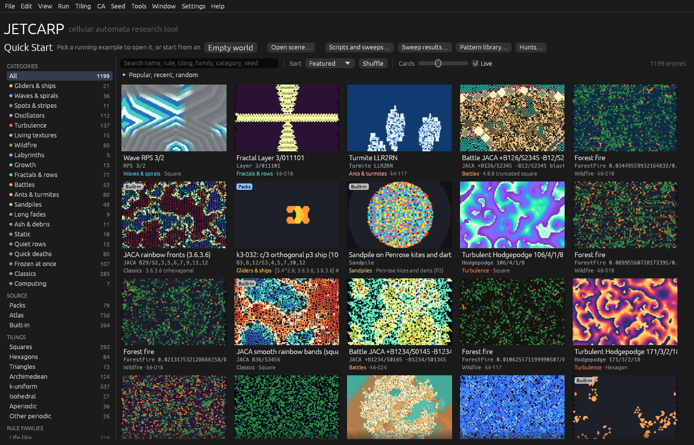

# JETCARP

**Jimmie's Euclidean Tilings and Cellular Automata Research Program**

> **Photosensitive seizure warning:** JETCARP's animations can flash and flicker rapidly, and can
> trigger seizures in people with photosensitive epilepsy. Please read the
> [warning](https://jprodgers.github.io/jetcarp/getting-started/photosensitivity.html) before you
> use it. Its [strobe guard](https://jprodgers.github.io/jetcarp/guides/strobe-guard.html) softens,
> slows or pauses scenes that flash, which lowers the risk but does not remove it.

[](https://doi.org/10.5281/zenodo.24191765)

<picture>
  <source srcset="https://raw.githubusercontent.com/jprodgers/jetcarp/main/docs/src/images/readme/six-worlds-still.webp" media="(prefers-reduced-motion: reduce)">
  
</picture>

*Six of JETCARP's built-in scenes, each run from its starting pattern: a layered rule on the
aperiodic spectre tiling, a cyclic automaton and Hodgepodge on squares, and JACA, JETCARP's
two-sign automaton, on the Cairo pentagons, a 2-uniform tiling and Penrose rhombs.*

JETCARP runs cellular automata on almost any tiling of the plane: squares and hexagons, all eleven
Archimedean tilings, the 1,248 k-uniform tilings up to k = 6, 81 isohedral tile types, tiles you
draw yourself, and the aperiodic Penrose, hat and spectre tilings. Several automata can run at
once, on shared or separate cell fields. It has a graphical app, a command line, a scripting
language, and a Model Context Protocol (MCP) server, plus tools that search for spaceships,
oscillators and other patterns and keep verified catalogues of what they find.



*The app opens on the Quick Start: over a thousand running examples, by category, tiling and rule
family. The [book](https://jprodgers.github.io/jetcarp/) has the guides, tutorials and
references.*

> **Status:** before 1.0, a release may still change the scene format, the command line, the
> scripting API and the MCP tools.

## Installing

On Linux and macOS:

```bash
curl -LsSf https://github.com/jprodgers/jetcarp/releases/latest/download/jetcarp-installer.sh | sh
```

On Windows, in PowerShell:

```powershell
Invoke-WebRequest https://github.com/jprodgers/jetcarp/releases/latest/download/jetcarp-installer.ps1 -OutFile jetcarp-installer.ps1
powershell -ExecutionPolicy Bypass -File .\jetcarp-installer.ps1
```

Or `pipx install jetcarp` (or `uv tool install jetcarp`); `brew tap jprodgers/jetcarp` then
`brew install jetcarp`; `scoop bucket add jetcarp https://github.com/jprodgers/scoop-jetcarp` then
`scoop install jetcarp`; or `cargo install jetcarp`. Every way, and what to know on each system, is
in [Installing JETCARP](https://jprodgers.github.io/jetcarp/getting-started/installing.html).
Then run `jetcarp` in a terminal to open the app.

**No telemetry.** JETCARP makes no network connections: it does not check for updates, report
crashes or collect statistics, and never sends anything anywhere. See
[SECURITY.md](https://github.com/jprodgers/jetcarp/blob/main/SECURITY.md) for what it does open
(local sockets only) and how to report a security problem.

## Building from source

JETCARP is written in Rust (1.95 or newer).

```bash
cargo build --release
cargo test --workspace --release
```

## Contributing

Bug reports, corrections to the history and credits, rules, tilings, code and documentation are all
welcome: see [CONTRIBUTING.md](https://github.com/jprodgers/jetcarp/blob/main/CONTRIBUTING.md) and the
[Code of Conduct](https://github.com/jprodgers/jetcarp/blob/main/CODE_OF_CONDUCT.md). What changed in
each release is in the [changelog](https://jprodgers.github.io/jetcarp/about/changelog.html).

## Licence

JETCARP is dual-licensed under the [Unlicense](https://github.com/jprodgers/jetcarp/blob/main/UNLICENSE) and the [MIT licence](https://github.com/jprodgers/jetcarp/blob/main/LICENSE-MIT); use
either. A few files derived from other people's work keep their own licences, listed in
[THIRD_PARTY_NOTICES.md](https://github.com/jprodgers/jetcarp/blob/main/THIRD_PARTY_NOTICES.md).

## Citing JETCARP

If JETCARP helps your research, please cite it. GitHub's *Cite this repository* button reads
[CITATION.cff](https://github.com/jprodgers/jetcarp/blob/main/CITATION.cff). Every release is archived on Zenodo under
[10.5281/zenodo.24191765](https://doi.org/10.5281/zenodo.24191765), which resolves to the newest.

## How JETCARP was made

Jimmie Rodgers designed JETCARP, chose its research directions, and tested it on Linux, Windows
and macOS. All of its code was written by [Claude Code](https://claude.com/claude-code), Anthropic's AI
coding tool; the [documentation](https://jprodgers.github.io/jetcarp/about/how-made.html) describes who did what. Every simulation result JETCARP reports is checked by its own test suite or by exact
verification (for example, exact recurrence for spaceships), but please treat it as you would any
research software: check the results that matter to you.

## Acknowledgements

Emily Teich rated hundreds of animated clips from JETCARP's exploratory search. Her ratings
trained the score that decides which runs the search shows people, which brought her eye for
what is beautiful into the search itself.

Craig S. Kaplan answered within hours, and generously, when asked whether JETCARP could use the
code from Kaplan's Spectre visualizer, which had never been formally released: Kaplan made it
available under the same BSD licence as Kaplan's hatviz. JETCARP's hat, spectre and isohedral
tilings all rest on Kaplan's work.
