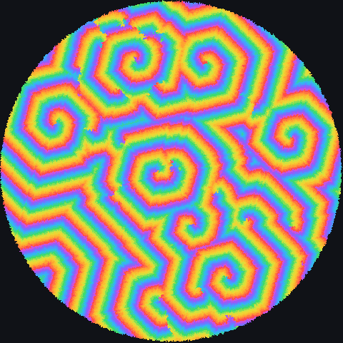
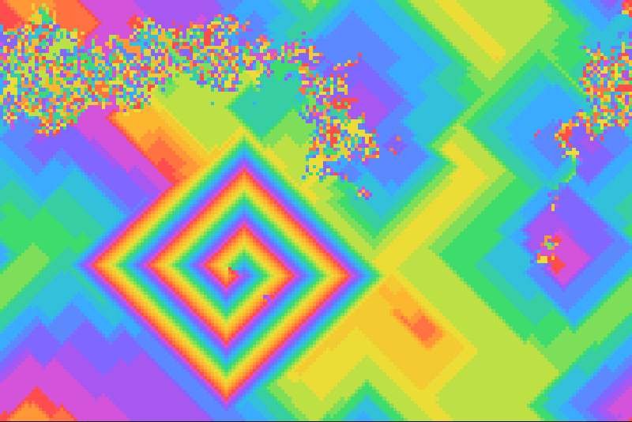
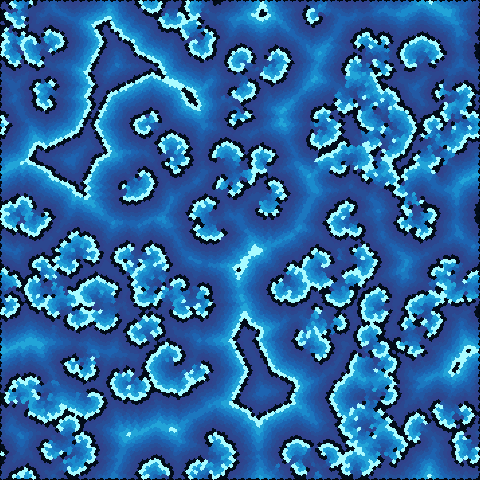

# Cyclic, Greenberg–Hastings and rock-paper-scissors

These three families share one idea: states arranged in a cycle, where each state can be
overtaken only by the next one around. From a random start they organise themselves into
travelling waves and rotating spirals, the same patterns seen in chemical oscillators, heart tissue
and competing species. JETCARP runs all three on any tiling.

<figure>

<figcaption>The cyclic cellular automaton <code>Cyclic 14/1</code> with edge neighbours on a patch of
about 35,000 hat tiles, 600 generations after a random start. Each spiral is a self-sustaining
core that sends out waves of colour. Scene <code>docs/scenes/automata/cyclic-hat.json</code>,
600 generations.</figcaption>
</figure>

## What it is

**Cyclic cellular automaton.** There are `n` colours arranged on a wheel, 0, 1, …, n − 1 and back
to 0. A cell of colour `k` changes to colour `k + 1` (mod `n`) when at least a threshold number of
its neighbours already have colour `k + 1`; otherwise it stays. Every colour is "eaten" by the next.
From random colours, the grid first breaks into patches, then small cycles of colours that chase
each other around a point appear, and these spiral cores, once formed, take over the whole grid.

**Greenberg–Hastings.** A model of an *excitable medium*. A cell is *resting* (0), *excited* (1),
or in one of several *refractory* stages (2 to n − 1). A resting cell becomes excited when at least
a threshold number of its neighbours are excited; every other state advances one step on its own,
the last refractory stage returning to rest. An excited region therefore fires once and cannot fire
again for a while, so excitation travels as waves that annihilate when they meet. In the cyclic
automaton every state needs a neighbour to advance; in Greenberg–Hastings only the resting state
does ([Fisch, Gravner and Griffeath 1991](../research/bibliography.md#fisch1991threshold)).

**Rock-paper-scissors.** Each cell is one of `n` species in a cycle of dominance (with three:
rock, paper, scissors). A cell is taken over by its predator, the next species around the cycle,
when *more than* a threshold number of its neighbours are that predator. This is a cyclic
automaton with a strict threshold: `RPS n/t` behaves like `Cyclic n/(t+1)`.

<figure class="pair">

<figcaption>Left: <code>Cyclic 16/1</code> on squares with edge neighbours, 400 generations; on the square
grid the spirals are square. Scene <code>docs/scenes/automata/cyclic-square.json</code>. Right:
Greenberg–Hastings <code>GH 10/1</code> on Cairo pentagons, 400 generations: bright excited fronts with
darker refractory wakes. Scene <code>docs/scenes/automata/cyclic-gh.json</code>.</figcaption>
</figure>

## Where it came from

**Greenberg–Hastings (1978).** J. M. Greenberg and S. P. Hastings introduced their discrete model of
excitable media in 1978 ([Greenberg and Hastings 1978](../research/bibliography.md#greenberg1978spatial)),
and the same year Greenberg, Hassard and Hastings surveyed pattern formation in reaction–diffusion
systems ([Greenberg, Hassard and Hastings 1978](../research/bibliography.md#greenberg1978pattern)).
The model belongs to the tradition of excitable media such as nerve and heart tissue and the
Belousov–Zhabotinsky reaction. Rigorous results followed from Durrett and Steif
([1991](../research/bibliography.md#durrett1991some)), Fisch, Gravner and Griffeath
([1993](../research/bibliography.md#fisch1993metastability)) and Durrett and Griffeath
([1993](../research/bibliography.md#durrett1993asymptotic)).

**The cyclic automaton (late 1980s).** The cyclic cellular automaton came from David Griffeath's
probability group at the University of Wisconsin–Madison; MCell's documentation says it was
discovered and explored by Griffeath ([MCell families](../research/bibliography.md#mcellnd_families)).
Griffeath described it in "Cyclic random competition" in the *Notices of the AMS* in December 1988
([Griffeath 1988](../research/bibliography.md#griffeath1988cyclic)); its random ancestor is the cyclic
particle system of Bramson and Griffeath ([1989](../research/bibliography.md#bramson1989flux)). His
student Robert Fisch analysed the one-dimensional version
([Fisch 1990](../research/bibliography.md#fisch1990onedimensional);
[Fisch 1990b](../research/bibliography.md#fisch1990cyclic)). A. K. Dewdney presented the
two-dimensional rule as "cyclic space" in *Scientific American* in August 1989; the "demons" of his
title are the spiral cores ([Dewdney 1989](../research/bibliography.md#dewdney1989cellular)). The
standard reference, which treats the cyclic and Greenberg–Hastings rules together with a range and a
threshold, is Fisch, Gravner and Griffeath's "Threshold-range scaling of excitable cellular automata"
([1991](../research/bibliography.md#fisch1991threshold)).

**Rock-paper-scissors.** Three species in a cycle of dominance on a lattice have been studied in
physics and ecology since Kei-ichi Tainaka's lattice Lotka–Volterra models
([Tainaka 1988](../research/bibliography.md#tainaka1988lattice);
[Tainaka 1989](../research/bibliography.md#tainaka1989stationary)), including Frean and Abraham's
"survival of the weakest" ([2001](../research/bibliography.md#frean2001rock)), Kerr, Riley, Feldman and
Bohannan's experiment with strains of *E. coli* ([2002](../research/bibliography.md#kerr2002local)),
and Reichenbach, Mobilia and Frey's work on mobility and spiral waves
([2007](../research/bibliography.md#reichenbach2007mobility)). Those models are stochastic. The
deterministic threshold rule JETCARP implements is the one described by Softology, maker of Visions
of Chaos, in a 2018 blog post ([Softology 2018](../research/bibliography.md#softology2018rock)).

## How JETCARP runs it

### Notation

| Notation | Rule |
| --- | --- |
| `Cyclic 16/1` | 16 colours; advance when at least 1 neighbour has the next colour |
| `GH 3/1` | Greenberg–Hastings with 3 states (one refractory stage); fire with at least 1 excited neighbour |
| `GH 10/1` | 10 states: rest, excited and 8 refractory stages |
| `RPS 3/3` | 3 species; taken over when more than 3 neighbours are the predator |

The cyclic automaton uses edge neighbours by default, the four orthogonal neighbours on squares;
Greenberg–Hastings and rock-paper-scissors use touch neighbours. Either can be changed per
automaton. With edge neighbours and threshold 1, as in the cyclic figures, spirals form readily.
Starting patterns are usually random states (`random_states`).

### On any tiling

All three families only count neighbours in particular states, so they run on any neighbour graph
(see [How JETCARP generalises automata](generalising.md)). The spirals change shape with the tiling:
square on squares, rounder on hexagons, irregular on Penrose and hat tilings, but they still form.
Greenberg–Hastings worlds on lattice tilings can be jumped far ahead with HashLife.

## What is new here

Cyclic automata have been run on general networks before. Our prior-art search found no earlier
version of these three families on aperiodic tilings such as Penrose, hat or spectre, but that is a
direct application of known rules to known graphs, so we do not count it as a discovery.

## Try it

- Quick Start: *Cyclic CA*, *Greenberg-Hastings* and *Rock-paper-scissors*.
- `jetcarp run docs/scenes/automata/cyclic-hat.json --gens 600 --png spirals.png`
- Raise the threshold of `Cyclic 16/1` to 2 or 3 with touch neighbours: Fisch, Gravner and Griffeath
  mapped how range and threshold decide between spirals, turbulence and fixation.

## References

- [Greenberg and Hastings 1978](../research/bibliography.md#greenberg1978spatial);
  [Greenberg, Hassard and Hastings 1978](../research/bibliography.md#greenberg1978pattern);
  [Durrett and Steif 1991](../research/bibliography.md#durrett1991some);
  [Fisch, Gravner and Griffeath 1993](../research/bibliography.md#fisch1993metastability);
  [Durrett and Griffeath 1993](../research/bibliography.md#durrett1993asymptotic)
- [Griffeath 1988](../research/bibliography.md#griffeath1988cyclic);
  [Bramson and Griffeath 1989](../research/bibliography.md#bramson1989flux);
  [Fisch 1990](../research/bibliography.md#fisch1990onedimensional);
  [Fisch 1990b](../research/bibliography.md#fisch1990cyclic);
  [Dewdney 1989](../research/bibliography.md#dewdney1989cellular);
  [Fisch, Gravner and Griffeath 1991](../research/bibliography.md#fisch1991threshold);
  [MCell families](../research/bibliography.md#mcellnd_families)
- [Tainaka 1988](../research/bibliography.md#tainaka1988lattice);
  [Tainaka 1989](../research/bibliography.md#tainaka1989stationary);
  [Frean and Abraham 2001](../research/bibliography.md#frean2001rock);
  [Kerr et al. 2002](../research/bibliography.md#kerr2002local);
  [Reichenbach, Mobilia and Frey 2007](../research/bibliography.md#reichenbach2007mobility);
  [Softology 2018](../research/bibliography.md#softology2018rock)
