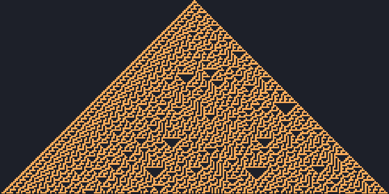
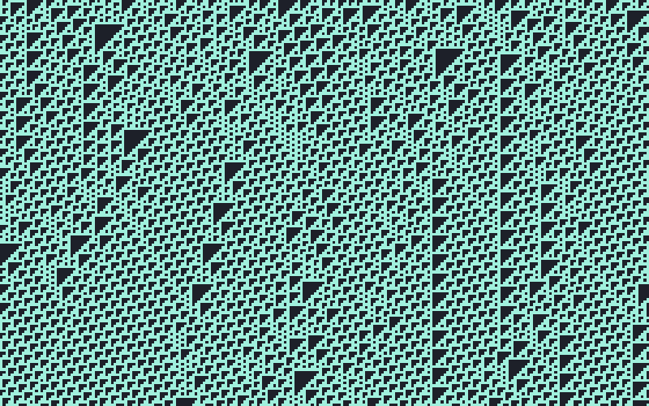
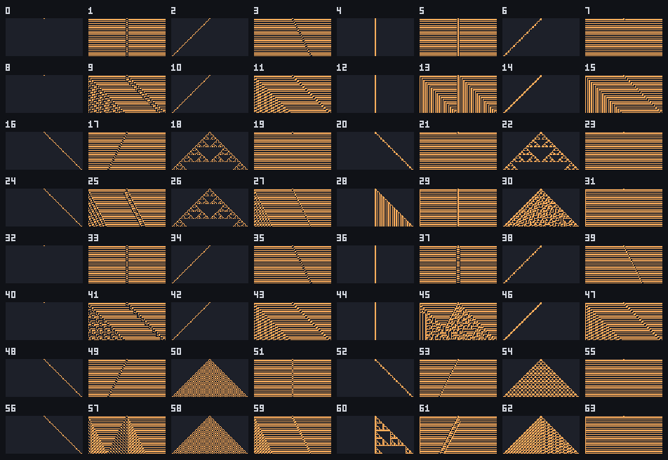

# Elementary (Wolfram) rules

The elementary cellular automata are the simplest interesting ones: a single row of cells, each
alive or dead, where each cell's next state depends on itself and its two neighbours. There are
only 256 such rules, yet among them are rules that make nested fractals, rules that look random,
and one that can compute anything. JETCARP draws them the classic way, one row per generation down
the square grid.

<figure>

<figcaption>Rule 30 (<code>W30</code>) from a single live cell. Each row is one generation, computed from
the row above. Scene <code>docs/scenes/automata/elementary-rule30.json</code>, run until the bottom
row is written.</figcaption>
</figure>

## What it is

A cell and its two neighbours form a pattern of three cells, and there are eight possible patterns
(from 111 down to 000). An elementary rule says which of the eight patterns produce a live cell in
the next generation. Reading those eight outputs as a binary number, from pattern 111 down to 000,
gives the rule's number between 0 and 255. Rule 30 is 00011110 in binary: patterns 100, 011, 010 and
001 produce a live cell, the rest a dead one.

Because the automaton is one-dimensional, its whole history fits in one picture: put each
generation below the last. Some famous members:

- **Rule 90**, where each cell is the exclusive or (XOR) of its two neighbours. From one cell it
  draws Pascal's triangle mod 2, the Sierpinski triangle.
- **Rule 30**, whose centre column looks random enough to be used as a source of pseudorandom bits.
- **Rule 110**, in which moving structures collide on a periodic background, and which can emulate
  any computer.
- **Rule 184**, where live cells move right when the cell ahead is empty: a simple model of traffic.

<figure>

<figcaption>Rule 110 (<code>W110</code>) from a random first row on a wrapped grid. Scene
<code>docs/scenes/automata/elementary-rule110.json</code>.</figcaption>
</figure>

## Where it came from

One-dimensional cellular automata were studied in symbolic dynamics as maps that commute with the
shift; Gustav Hedlund's 1969 paper is the standard reference for that line of work
([Hedlund 1969](../research/bibliography.md#hedlund1969endomorphisms)).

Stephen Wolfram studied the 256 three-neighbour rules systematically in "Statistical mechanics of
cellular automata" (1983), numbering each rule by its outputs read as a binary number, the scheme
now called the Wolfram code ([Wolfram 1983](../research/bibliography.md#wolfram1983statistical);
[Wikipedia: Wolfram code](../research/bibliography.md#wikipediand_wolframcode)). In 1984 he sorted
cellular automaton behaviour into four qualitative classes, from rules that die out to rules with
complex, long-lived structures ([Wolfram 1984](../research/bibliography.md#wolfram1984universality)),
and with Olivier Martin and Andrew Odlyzko worked out the algebra of the *additive* rules such as 90
and 150 ([Martin, Odlyzko and Wolfram 1984](../research/bibliography.md#martin1984algebraic)). He
proposed rule 30 as a random-number generator in 1986
([Wolfram 1986](../research/bibliography.md#wolfram1986random)).

Wolfram's 1985 list of open problems asked which cellular automata are computation-universal
([Wolfram 1985](../research/bibliography.md#wolfram1985twenty)). Matthew Cook proved that rule 110
is, by showing it can emulate cyclic tag systems. He presented the proof at the CA98 conference
at the Santa Fe Institute; Wolfram Research then took legal action over Cook's nondisclosure
agreement, and the proof was published in 2004
([Cook 2004](../research/bibliography.md#cook2004universality);
[Wikipedia: Rule 110](../research/bibliography.md#wikipediand_rule110);
[Giles 2002](../research/bibliography.md#giles2002kind)). Turlough Neary and Damien Woods later
showed that rule 110 simulates Turing machines efficiently, so predicting it is P-complete
([Neary and Woods 2006](../research/bibliography.md#neary2006pcompleteness)). Wolfram's *A New Kind
of Science* (2002) brought the elementary rules to a wide audience
([Wolfram 2002](../research/bibliography.md#wolfram2002new)).

## How JETCARP runs it

### Notation

| Notation | Rule |
| --- | --- |
| `W30` | Rule 30 (`Rule 30` also works) |
| `W90` | Rule 90 |
| `W110` | Rule 110 |
| `W0` to `W255` | Every elementary rule, odd numbers included |

Golly's `Wn` rules are limited to even numbers, because in an odd rule the empty pattern 000
produces a live cell, which raises the same problem as B0 rules
([Golly: QuickLife](../research/bibliography.md#gollynd_quicklife)). JETCARP runs odd rules too: their
background simply alternates from row to row, which shows as stripes.

### Rows on the square grid

An elementary rule in JETCARP fills the square grid from the top down: each generation computes the
next row from the one above it. The first row is set by the seed: one live cell in the middle
(`top_center`) or a random row (`top_random`). With dead edges, cells beyond the sides count as dead;
with wrapped edges the row is a ring, and the rule keeps going for one full pass of the grid. The
run is *done* when the bottom row has been written, which searches and scripts use to know when to
stop. Colour by row gives the gradients often seen in pictures of these rules.

An elementary rule can share a field with other automata: in the Quick Start entry *Rule 30 meets
Life and ants*, Life rewrites the rows rule 30 leaves behind while ants wander through them.

### Not on other tilings

"The cell to the left and the cell to the right in the row above" only makes sense on a grid with
rows, so the `W` rules stay on squares. JETCARP carries the idea elsewhere in two ways: the
[hexagonal row rules](hexagonal-rows.md), which read the two or three hexagons above a cell, and
[layered rules](layered.md), which replace rows with layers of graph distance and run on any tiling.

<figure>

<figcaption>Rules 0 to 63 from a single cell, labelled with their numbers: a contact sheet made by
<code>jetcarp sheet --kind w --from 0 --count 64</code>. Odd rules turn the empty background on and
off, which shows as stripes.</figcaption>
</figure>

## What is new here

Nothing. The elementary rules are among the most studied objects in the field, and JETCARP runs them
as everyone does. Its own additions are the [hexagonal](hexagonal-rows.md) and
[layered](layered.md) families described on their own pages.

## Try it

- Quick Start: *Rule 30*, *Rule 90*, *Rule 110*, and ten more named rules (18, 22, 45, 54, 60, 73,
  105, 126, 150, 184).
- `jetcarp sheet --kind w --from 64 --count 64 --png sheet.png` draws the next 64 rules.
- `jetcarp run docs/scenes/automata/elementary-rule110.json --gens 200 --png rule110.png`

## References

- [Hedlund 1969](../research/bibliography.md#hedlund1969endomorphisms)
- [Wolfram 1983](../research/bibliography.md#wolfram1983statistical);
  [Wolfram 1984](../research/bibliography.md#wolfram1984universality);
  [Martin, Odlyzko and Wolfram 1984](../research/bibliography.md#martin1984algebraic);
  [Wolfram 1985](../research/bibliography.md#wolfram1985twenty);
  [Wolfram 1986](../research/bibliography.md#wolfram1986random);
  [Wolfram 2002](../research/bibliography.md#wolfram2002new)
- [Cook 2004](../research/bibliography.md#cook2004universality);
  [Giles 2002](../research/bibliography.md#giles2002kind);
  [Neary and Woods 2006](../research/bibliography.md#neary2006pcompleteness)
- Wikipedia: [Wolfram code](../research/bibliography.md#wikipediand_wolframcode),
  [Rule 110](../research/bibliography.md#wikipediand_rule110),
  [Rule 184](../research/bibliography.md#wikipediand_rule184)
- [Golly: QuickLife](../research/bibliography.md#gollynd_quicklife)
