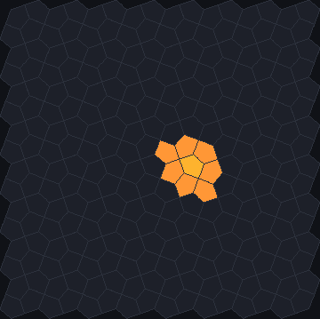
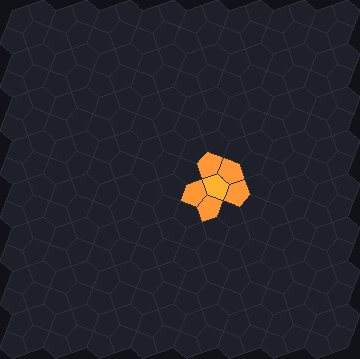
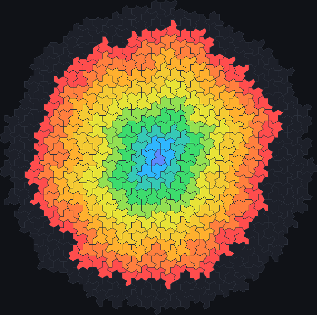

# How JETCARP generalises automata to any tiling

Almost every well-known cellular automaton was invented on the square grid, and most of their
rules are written in terms of that grid: "the eight surrounding cells", "the cell above",
"turn left". JETCARP runs these rules on hexagons, pentagons, mixtures of polygons, tiles you draw
yourself and aperiodic tilings such as the hat. It can do this because it reduces every tiling to
the same object, a *neighbour graph*, and rewrites each rule family in terms of that graph. This
page explains the graph, the choices it involves, and which families could not be carried over.

<figure class="pair">

<figcaption>The two neighbourhoods on the Cairo pentagon tiling. Left: a pentagon (pale) and its seven
<em>touch</em> neighbours, which share an edge or a corner with it. Right: its five <em>edge</em>
neighbours. Each picture is one generation of a rule that switches on every cell with exactly one
live neighbour. Scenes <code>docs/scenes/automata/generalising-touch.json</code> and
<code>generalising-edge.json</code>, 1 generation.</figcaption>
</figure>

## What it is

A cellular automaton is a grid of cells, each in one of a few *states*, updated all at once in
steps called *generations*. Each cell's next state depends only on its own state and the states of
its *neighbours*. Change what counts as a neighbour and you change the automaton.

On a tiling, the natural neighbours of a tile are the tiles next to it. JETCARP records them as a
graph: one node per tile, and a link between two tiles that are neighbours. Everything a rule needs
is then a question about the graph: how many neighbours are alive, which neighbour lies to the
left, how far away a tile is.

There are two ways for tiles to be "next to" each other, and JETCARP offers both:

- **Touch** neighbours share an edge or at least one corner. On the square grid this is the
  eight-cell *Moore neighbourhood* used by Conway's Life.
- **Edge** neighbours share a stretch of edge. On the square grid this is the four-cell *von
  Neumann neighbourhood*.

On squares the two give 8 and 4 neighbours. Elsewhere the numbers change, sometimes a lot. A
triangle has 12 touch neighbours but only 3 edge neighbours; a Cairo pentagon has 7 and 5; a
hexagon has 6 either way, because hexagons never meet at a corner alone. In a tiling with several
kinds of tile, the counts differ from tile to tile: in the 4.8.8 tiling a square has 4 neighbours
and an octagon 8. On aperiodic tilings they vary irregularly: a Penrose rhomb touches between 7 and
11 others. The [tiling catalogue](../tilings/catalogue.md) lists the counts for every tiling.

This matters because most rules *count* neighbours. Life's rule "born with exactly 3 live
neighbours" means something quite different when a cell has 12 neighbours, or when some cells have
4 and others 8. Much of what is interesting about running old rules on new tilings comes from this.

## Where it came from

The two square-grid neighbourhoods are named after Edward F. Moore, who described machine models of
self-reproduction at a 1961 symposium ([Moore 1962](../research/bibliography.md#moore1962machine)),
and John von Neumann, whose 29-state automaton used the four edge neighbours
([von Neumann 1966](../research/bibliography.md#vonneumann1966theory); see
[LifeWiki: Moore neighbourhood](../research/bibliography.md#lifewikind_moore) and
[Von Neumann neighbourhood](../research/bibliography.md#lifewikind_vonneumann)).

Running automata on other grids is almost as old. Marcel Golay used hexagonal cellular logic for image
processing ([Golay 1969](../research/bibliography.md#golay1969hexagonal)). Carter Bays explored
Life-like rules on the triangular tiling
([Bays 1994](../research/bibliography.md#bays1994cellular)) and on hexagons and pentagons
([Bays 2005](../research/bibliography.md#bays2005note)). Life on Penrose tilings was studied by Hill,
Stepney and Wan ([2005](../research/bibliography.md#hill2005penrose)) and by Owens and Stepney
([2010](../research/bibliography.md#owens2010game)), and Adam Goucher found a glider that travels
across a Penrose tiling ([Goucher 2012](../research/bibliography.md#goucher2012gliders)). Ants
and turmites have run on triangular and hexagonal grids in Tim Hutton's Golly rules
([Hutton 2015](../research/bibliography.md#hutton2015twodimensional)) and on Penrose tilings
([ptiles/ant](../research/bibliography.md#ptilesnd_ant)).

General tools came later. Ready, from the GollyGang project, runs user-defined rules on polygonal and
polyhedral meshes ([Ready](../research/bibliography.md#huttonnd_ready)). Andrew Trevorrow's HatLife
ran Life-like, Larger than Life-style and WireWorld rules on the hat tiling within weeks of its
discovery ([Trevorrow 2023](../research/bibliography.md#trevorrow2023hatlife)), and James Edmond's
work on the hat and spectre runs Generations and priority-table rules on a general graph
([Edmond 2026](../research/bibliography.md#edmond2026gliders)). JETCARP builds on all of this.

## How JETCARP runs it

### One graph, three ways of storing it

Every tiling becomes a neighbour graph in which each tile's neighbours are kept in **clockwise
order**. How the graph is stored depends on the tiling, but the rules never see the difference:

- *Dense* storage for lattices of one tile shape (squares, hexagons, bricks), where the neighbours
  follow a fixed stencil.
- *Periodic* storage for tilings that repeat a unit cell containing several tiles (the Archimedean,
  k-uniform and isohedral tilings, and tiles you draw), with one table of neighbour offsets per tile
  in the cell.
- *Explicit* storage for finite patches of aperiodic tilings (Penrose, hat and spectre), with every
  tile's neighbour list written out.

Periodic worlds can have dead edges (cells beyond the edge count as empty), wrapped edges (a torus),
or live edges (cells beyond the edge count as alive). Aperiodic patches have dead edges.

### Rules that count

Life-like rules, Generations, [JACA](jaca.md), WireWorld and the cyclic, Greenberg–Hastings,
rock-paper-scissors, Hodgepodge and forest-fire families all depend on how many neighbours are in
some state. They carry over directly: a cell counts its neighbours in the graph, whatever their
number. Each automaton in a scene chooses `touch` or `edge`; in B/S notation a trailing `V` means
edge neighbours, as on LifeWiki. Because some tiles have more than nine neighbours, counts of 10 or
more are written with commas: `B3,10/S2,3`.

The [Abelian sandpile](sandpile.md) is the clearest case of a rule that depends on degree: a tile
topples when it holds as many grains as it has neighbours, so on the spectre the threshold differs
from tile to tile.

### Rules that turn

[Langton's ant and the turmites](turmites.md) need direction: "turn right and step forward". JETCARP
measures turns in *slots* of a tile's clockwise list of edge neighbours. `R` and `L` turn one slot
either way, `U` turns half the tile's degree, and `R2` and `L2` turn two slots (120 degrees on a
hexagon). After a step the ant faces "straight on", the slot opposite the edge it came in by. On a
tile with an odd number of sides there is no exact opposite, so "straight on" is rounded and stays
relative to the entry edge. This one convention lets the same ant run on squares, pentagons, mixed
tilings and the hat.

### Rules that measure distance

Some families need "within r cells" or "the next row out". JETCARP uses distance in the graph,
counted in steps from neighbour to neighbour:

- [Larger than Life](larger-than-life.md) counts the cells within `r` steps, over touch neighbours
  for its Moore form and over edge neighbours for its von Neumann form. On the square grid these
  are the usual box and diamond.
- [Layered rules](layered.md) grow outward from a seed tile one layer at a time, where a layer is all
  the tiles at the same graph distance. This is how JETCARP carries Wolfram's row-by-row rules to
  any tiling.
- [JACA](jaca.md)'s blast radius destroys every cell within `N` steps of an annihilation.
- [Lenia](lenia.md) is the exception: its smooth kernel uses straight-line distance between tile
  centres, measured in units of the average tile size.

<figure>

<figcaption>Graph distance on the hat tiling. A Greenberg–Hastings wave (<code>GH 14/1</code>) starts
at one tile and advances one step of the touch neighbour graph per generation, leaving a trail of
refractory states, so each colour band is one distance from the centre. Scene
<code>docs/scenes/automata/generalising-layers.json</code>, 9 generations.</figcaption>
</figure>

### What stays on its own grid

A few families are tied to a grid's geometry in a way that has no natural meaning elsewhere, and
JETCARP does not pretend otherwise:

- [Elementary rules](elementary.md) (`W30`) read the three cells above in a square grid; the
  [hexagonal row rules](hexagonal-rows.md) (`HexW`, `HexT`) read the hexagons above. Their
  any-tiling counterpart is the layered family.
- [Margolus block rules](margolus.md) update 2 × 2 blocks of squares on alternating offsets.
- [Von Neumann's 29-state automaton](von-neumann.md) depends on the four compass directions; JETCARP
  refuses to place it on another tiling.

## What is new here

None of the ingredients on this page is new on its own, as the history above shows: Ready runs
arbitrary rules on meshes, HatLife and Edmond's work run several families on the hat and spectre,
and many single families have been run on hexagons, triangles or Penrose tilings. What JETCARP
adds, to our knowledge, is breadth: one engine that runs every family listed here on every class of
tiling it supports (lattices, the 1,248 k-uniform tilings, 81 isohedral types, drawn tiles, and the
Penrose, hat and spectre tilings), with the same neighbour model throughout. Not all of these are
different graphs: the 81 isohedral types have only the eleven graphs of the Laves tilings, and several
drawn families copy the square or hexagonal grid (see [Isohedral tilings](../tilings/isohedral.md)).
Tests check that results agree across thread counts and, where available, between CPU and GPU.

Our prior-art search found no earlier version of the cyclic, Greenberg–Hastings,
rock-paper-scissors, Hodgepodge or forest-fire rules on aperiodic tilings, or of turmites on the hat
and spectre. Each of these is a direct application of a known rule to a known graph, though, so we
do not count them as discoveries. The search behind these statements is summarised in
[What is new in JETCARP](../research/contributions.md).

## Try it

- In the app, any Quick Start entry can be moved to another tiling: change the tiling and the rule
  keeps running. The *Tiling showcase* entries pair each tiling with a rule chosen to stay lively
  there.
- Run the figures above from their scenes, for example
  `jetcarp run docs/scenes/automata/generalising-touch.json --gens 1 --png touch.png`.
- `jetcarp tilings` lists every tiling family with its edge and touch neighbour counts.

## References

- [Moore 1962](../research/bibliography.md#moore1962machine);
  [von Neumann 1966](../research/bibliography.md#vonneumann1966theory)
- [Golay 1969](../research/bibliography.md#golay1969hexagonal);
  [Bays 1994](../research/bibliography.md#bays1994cellular);
  [Bays 2005](../research/bibliography.md#bays2005note)
- [Hill, Stepney and Wan 2005](../research/bibliography.md#hill2005penrose);
  [Owens and Stepney 2010](../research/bibliography.md#owens2010game);
  [Goucher 2012](../research/bibliography.md#goucher2012gliders)
- [Hutton 2015](../research/bibliography.md#hutton2015twodimensional);
  [ptiles/ant](../research/bibliography.md#ptilesnd_ant)
- [Ready](../research/bibliography.md#huttonnd_ready);
  [Trevorrow 2023](../research/bibliography.md#trevorrow2023hatlife);
  [Edmond 2026](../research/bibliography.md#edmond2026gliders)
