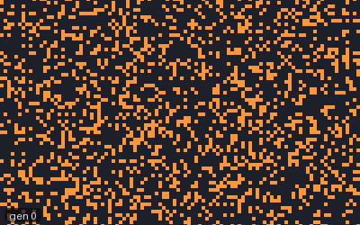
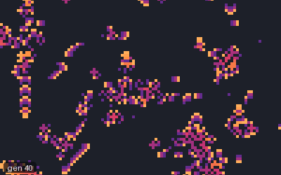
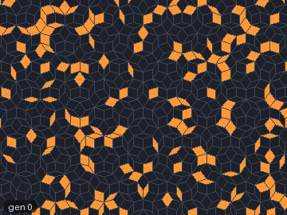

# Generations

A Generations rule is a Life-like rule in which dying cells do not vanish at once. They fade
through a fixed number of "ageing" states first, and while they fade nothing can be born in their
place. That one change turns static Life-like worlds into restless ones full of waves, trails and
fast-moving gliders.

<figure>
<picture>
  <source srcset="../images/automata/generations-brain-still.png" media="(prefers-reduced-motion: reduce)">
  
</picture>
<figcaption>Brian's Brain (<code>B2/S/C3</code>), the first 80 generations after a random start, one
generation per frame, in part of a wrapped 160 × 100 grid. Watch the soup sort itself within a few
dozen generations into gliders: each is a front of firing cells (orange) followed by refractory ones
(blue), and they travel in straight lines until they collide. Scene
<code>docs/scenes/automata/generations-brain.json</code>.</figcaption>
</figure>

## What it is

A Generations rule has three parts: birth counts, survival counts, and a number of states `C`.

- State 0 is empty and state 1 is alive. Only state-1 cells count as live neighbours.
- An empty cell is born (becomes 1) when its number of live neighbours is in the birth list.
- A live cell stays at 1 when its count is in the survival list. Otherwise it starts to age: it
  moves to state 2, then 3, and so on up to `C − 1`, one step per generation, and then becomes
  empty.
- An ageing cell ignores its neighbours, and no cell can be born on top of it.

With `C = 2` there are no ageing states and the rule is an ordinary Life-like rule. The ageing
states act as a wake: a pattern cannot fall back into the space it has just left, which is why so
many Generations rules are full of spaceships.

The best-known example is **Brian's Brain**, `B2/S/C3`, which reads naturally as a model of
neurons. Each cell is *ready* (0), *firing* (1) or *refractory* (2). A ready cell fires when
exactly two of its neighbours are firing; a firing cell always becomes refractory (the survival
list is empty); a refractory cell becomes ready again.

## Where it came from

The earliest dated member of the family we found is Brian's Brain. Tommaso Toffoli and Norman
Margolus describe it in *Cellular Automata Machines* (1987), in a section on the firing of neurons,
as a three-state rule they ran on their CAM-6 hardware as BRIAN'S-BRAIN; a footnote says the rule
was suggested by Brian Silverman, while the neuron interpretation is theirs
([Toffoli and Margolus 1987](../research/bibliography.md#toffoli1987cellular)). LifeWiki dates the
rule to the mid-1990s ([LifeWiki: Brian's Brain](../research/bibliography.md#lifewikind_briansbrain)),
but the 1987 book shows it was published by then. Rudy Rucker and John Walker's CelLab (Autodesk,
1989) included it as "Brain", along with many other multi-state rules
([Rucker and Walker 1989](../research/bibliography.md#rucker1989cellab);
[CelLab rules](../research/bibliography.md#walkernd_cellabrules)).

The family got its name and its notation from Mirek Wójtowicz's MCell ("Mirek's Cellebration"), a
Windows program he began in January 1999
([Wójtowicz 2024](../research/bibliography.md#wojtowicz2024mcell)). MCell made Generations a named
family with a survival/birth/states notation, and its documentation calls it perhaps the most
beautiful family in the program ([MCell families](../research/bibliography.md#wojtowicznd_families)).
We found no source that says who first used the name. Wójtowicz's own *Star Wars* (`B2/S345/C4`)
dates from March 1999 ([LifeWiki: List of Generations rules](../research/bibliography.md#lifewikind_generationslist)).

Around MCell grew a community of rule authors. The MCell rules lexicon and LifeWiki's list credit
rules to Wójtowicz, John Elliott, Michael Sweney, Charles A. Rockafellor, Scott Robert Ladd, Brian
Prentice, Jason Rampe, Anders Starmark, Rudy Rucker and John Walker, and others
([MCell rules lexicon](../research/bibliography.md#wojtowicznd_rules);
[LifeWiki list](../research/bibliography.md#lifewikind_generationslist)); the
[named rule catalogue](named-rules.md#generations) gives the credit for each rule. Golly added
Generations in version 2.0 in December 2008
([Golly changes](../research/bibliography.md#gollynd_changes);
[Golly: Generations](../research/bibliography.md#gollynd_generations)).

<figure>
<picture>
  <source srcset="../images/automata/generations-starwars-still.png" media="(prefers-reduced-motion: reduce)">
  
</picture>
<figcaption>Mirek Wójtowicz's Star Wars (<code>B2/S345/C4</code>) from generation 40 to 120 after a random
start, one generation per frame. Live cells survive with three to five neighbours and fade through two
dying states; watch small ships fly off while the debris decays behind them. Scene
<code>docs/scenes/automata/generations-starwars.json</code>.</figcaption>
</figure>

## How JETCARP runs it

### Notation

JETCARP writes Generations rules as LifeWiki does, `B…/S…/C<states>`, with 2 to 255 states:

| Notation | Rule |
| --- | --- |
| `B2/S/C3` | Brian's Brain |
| `B2/S345/C4` | Star Wars |
| `B2/S/C3V` | Brian's Brain on edge neighbours |
| `B3/S23/C2` | Two states: the same as Life, `B3/S23` |

`B2/S/3` (no `C`) is also accepted. MCell's survival/birth order is not; write the birth list
first. Forty-five named Generations rules can be typed by name (see the
[catalogue](named-rules.md#generations)).

### On any tiling

Like Life-like rules, Generations rules only count live neighbours, so they run on every tiling's
neighbour graph with touch neighbours by default, or edge neighbours with the `V` suffix (see
[How JETCARP generalises automata](generalising.md)). Brian's Brain on Penrose rhombs, below, keeps
its waves going across a tiling with no repeating pattern at all.

<figure>
<picture>
  <source srcset="../images/automata/generations-penrose-still.png" media="(prefers-reduced-motion: reduce)">
  
</picture>
<figcaption>Brian's Brain on the middle of a patch of about 4,000 Penrose rhombs, the first 80
generations after a random start. Each rhomb touches between 7 and 11 others, so the square grid's
gliders cannot exist here; watch the firing rhombs (orange) and their refractory wakes (blue) form
ragged chains that wander instead of flying straight. Scene
<code>docs/scenes/automata/generations-penrose.json</code>.</figcaption>
</figure>

### Colours, speed and long runs

Each state gets its own colour from the palette. On lattice tilings Generations rules can be
stepped on the GPU with identical results, and HashLife can jump wrap-edge lattice worlds far ahead,
including rules with birth on 0.

## What is new here

Nothing on this page is new. Generations-style rules have run on the hat in Andrew Trevorrow's
HatLife ([Trevorrow 2023](../research/bibliography.md#trevorrow2023hatlife)) and on the hat and
spectre in James Edmond's work ([Edmond 2026](../research/bibliography.md#edmond2026gliders)).
JETCARP's part is running the family on every tiling it supports with the same engine as everything
else.

## Try it

- Quick Start: *Brian's Brain*, *Brian's Brain on Penrose rhombs*, and one entry for each of the 45
  named Generations rules.
- `jetcarp run docs/scenes/automata/generations-brain.json --gens 200 --png brain.png`
- Try Brian's Brain with edge neighbours (`B2/S/C3V`) on the hat; with fewer neighbours, firing
  needs a different count to spread.

## References

- [Toffoli and Margolus 1987](../research/bibliography.md#toffoli1987cellular);
  [Rucker and Walker 1989](../research/bibliography.md#rucker1989cellab);
  [CelLab rules](../research/bibliography.md#walkernd_cellabrules)
- [Wójtowicz 2024](../research/bibliography.md#wojtowicz2024mcell);
  [MCell families](../research/bibliography.md#wojtowicznd_families);
  [MCell rules lexicon](../research/bibliography.md#wojtowicznd_rules)
- LifeWiki: [Generations](../research/bibliography.md#lifewikind_generations),
  [List of Generations rules](../research/bibliography.md#lifewikind_generationslist),
  [Brian's Brain](../research/bibliography.md#lifewikind_briansbrain)
- [Golly: Generations](../research/bibliography.md#gollynd_generations);
  [Golly changes](../research/bibliography.md#gollynd_changes)
- [Trevorrow 2023](../research/bibliography.md#trevorrow2023hatlife);
  [Edmond 2026](../research/bibliography.md#edmond2026gliders)
