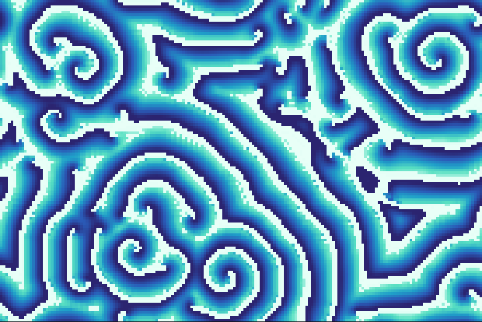
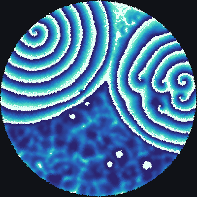
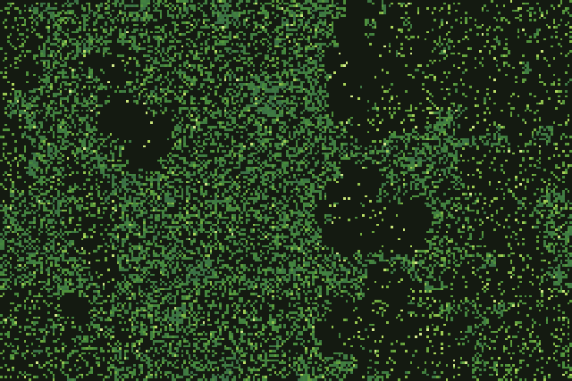

# Hodgepodge and forest fire

Two models from the late 1980s and early 1990s that brought cellular automata into chemistry and
statistical physics. The hodgepodge machine imitates a catalytic chemical reaction and produces
rotating spiral waves. The forest-fire model grows trees and burns them, and became a standard
example of *self-organised criticality*: a system that tunes itself, without outside adjustment, to
a state where events of every size happen.

<figure>

<figcaption>The hodgepodge machine <code>Hodgepodge 200/3/3/28</code>, 500 generations after a random
start: rotating spirals like those of the Belousov–Zhabotinsky reaction. Scene
<code>docs/scenes/automata/hodgepodge-square.json</code>, 500 generations.</figcaption>
</figure>

## What it is

**The hodgepodge machine.** Each cell holds a number from 0 to `n`. State 0 is *healthy*, `n` is
*ill*, and everything between is *infected*, more so for larger numbers. Ill cells recover; healthy
cells are infected by their neighbours; infected cells get worse, faster when their neighbours are
worse. The parameters `k1` and `k2` set how easily healthy cells catch the infection, and `g` how
fast infection grows. With suitable values the grid fills with spiral waves.

JETCARP's version of the rule, per generation, is:

- An ill cell (state `n`) becomes healthy (0).
- A healthy cell becomes ⌊`a` / `k1`⌋ + ⌊`b` / `k2`⌋, where `a` is the number of infected
  neighbours and `b` the number of ill neighbours.
- An infected cell becomes ⌊`S` / (`a` + `b` + 1)⌋ + `g`, where `S` is the sum of the states of
  the cell and its neighbours.
- Results above `n` are capped at `n`.

This follows the commonly published form of the rule; we have not yet checked it line by line
against Gerhardt and Schuster's paper.

**The forest fire.** Each cell is *empty*, a *tree* or *burning*. Each generation a burning tree
burns out and leaves empty ground; a tree catches fire if a neighbour is burning, or is struck by
lightning with a small probability `f`; and empty ground grows a tree with probability `p`. When
lightning is much rarer than growth, trees build up into large forests, and a single strike can
burn a forest of any size. The sizes of the fires then follow a power law, with no typical scale.

<figure class="pair">

<figcaption>Left: the same hodgepodge rule on a patch of Penrose kites and darts, 500 generations; spirals
form in part of the patch while the rest is still disordered. Scene
<code>docs/scenes/automata/hodgepodge-penrose.json</code>. Right: the forest fire
<code>ForestFire 0.002/0.00001</code> after 3,000 generations, coloured by age: dark patches are recently
burned, bright trees are new growth. Scene <code>docs/scenes/automata/forestfire-square.json</code>.</figcaption>
</figure>

## Where it came from

**Hodgepodge.** The hodgepodge machine was designed by Martin Gerhardt and Heike Schuster of the
University of Bielefeld, inspired by catalytic chemical reactions. A. K. Dewdney introduced it to the
public in his *Scientific American* column "The hodgepodge machine makes waves" in August 1988
([Dewdney 1988](../research/bibliography.md#dewdney1988hodgepodge)), and the CelLab manual credits it
as invented by Gerhardt and Schuster ([Rucker and Walker 1989](../research/bibliography.md#rucker1989cellab)).
Their own paper appeared in *Physica D* in 1989
([Gerhardt and Schuster 1989](../research/bibliography.md#gerhardt1989cellular)). With John J. Tyson
they went on to a more quantitative automaton model of excitable media, published in *Science* in
1990 ([Gerhardt, Schuster and Tyson 1990](../research/bibliography.md#gerhardt1990cellular)).

**Forest fire.** Per Bak, Kan Chen and Chao Tang introduced a forest-fire automaton in 1990: trees
grow, fire spreads from burning trees to their neighbours, and fires never start on their own
([Bak, Chen and Tang 1990](../research/bibliography.md#bak1990forestfire)); Chen, Bak and Jensen
published a deterministic variant the same year
([Chen, Bak and Jensen 1990](../research/bibliography.md#chen1990deterministic)). Barbara Drossel and
Franz Schwabl added lightning in 1992, and showed that with lightning much rarer than growth the
model organises itself into a critical state with fires of all sizes
([Drossel and Schwabl 1992](../research/bibliography.md#drossel1992selforganized)). Theirs became the
standard forest-fire model; the review by Clar, Drossel and Schwabl tells the story and notes that
C. L. Henley independently invented the limit in which clusters burn instantly
([Clar, Drossel and Schwabl 1996](../research/bibliography.md#clar1996forest);
[Henley 1993](../research/bibliography.md#henley1993statics)). The model descends from Bak, Tang and
Wiesenfeld's idea of self-organised criticality, introduced with the
[sandpile](sandpile.md) ([Bak, Tang and Wiesenfeld 1987](../research/bibliography.md#bak1987selforganized)).
Later work showed that its scaling is not simple at very large sizes
([Grassberger 2002](../research/bibliography.md#grassberger2002critical)).

## How JETCARP runs it

### Notation

| Notation | Rule |
| --- | --- |
| `Hodgepodge 200/3/3/28` | `n` = 200, `k1` = 3, `k2` = 3, `g` = 28 |
| `ForestFire 0.01/0.0001` | growth probability `p` = 0.01, lightning probability `f` = 0.0001 |

States are 0 to `n` for the hodgepodge machine (so `n` + 1 states) and 0 (empty), 1 (tree) and
2 (burning) for the forest fire.

### Randomness that replays

The forest fire is random, but JETCARP's random numbers are a fixed function of the scene's seed,
the generation and the cell, so a scene replays to exactly the same state every time, on any number
of threads. The hodgepodge machine is deterministic.

### On any tiling

Both rules count neighbours in particular states, so they run on any neighbour graph with touch or
edge neighbours (see [How JETCARP generalises automata](generalising.md)). The hodgepodge machine can
also be stepped on the GPU on lattice tilings. On tilings where tiles have different numbers of
neighbours, the hodgepodge machine's averages and the forest's spreading vary from tile to tile, but
the spirals and fires still appear.

## What is new here

Our prior-art search found no earlier version of either model on aperiodic tilings such as Penrose,
hat or spectre, and no hodgepodge machine off the square grid at all, though forest fires on
triangular and hexagonal lattices probably exist in the physics literature. Either way this is a
direct application of known rules to known graphs, so we do not count it as a discovery.

## Try it

- Quick Start: *Hodgepodge machine* and *Forest fire*.
- `jetcarp run docs/scenes/automata/hodgepodge-penrose.json --gens 1000 --png hodge.png`
- Lower the forest fire's lightning probability while keeping growth the same: fires become rarer
  and larger.

## References

- [Dewdney 1988](../research/bibliography.md#dewdney1988hodgepodge);
  [Gerhardt and Schuster 1989](../research/bibliography.md#gerhardt1989cellular);
  [Gerhardt, Schuster and Tyson 1990](../research/bibliography.md#gerhardt1990cellular);
  [Rucker and Walker 1989](../research/bibliography.md#rucker1989cellab)
- [Bak, Chen and Tang 1990](../research/bibliography.md#bak1990forestfire);
  [Chen, Bak and Jensen 1990](../research/bibliography.md#chen1990deterministic);
  [Drossel and Schwabl 1992](../research/bibliography.md#drossel1992selforganized);
  [Clar, Drossel and Schwabl 1996](../research/bibliography.md#clar1996forest);
  [Henley 1993](../research/bibliography.md#henley1993statics);
  [Grassberger 2002](../research/bibliography.md#grassberger2002critical)
- [Bak, Tang and Wiesenfeld 1987](../research/bibliography.md#bak1987selforganized)
