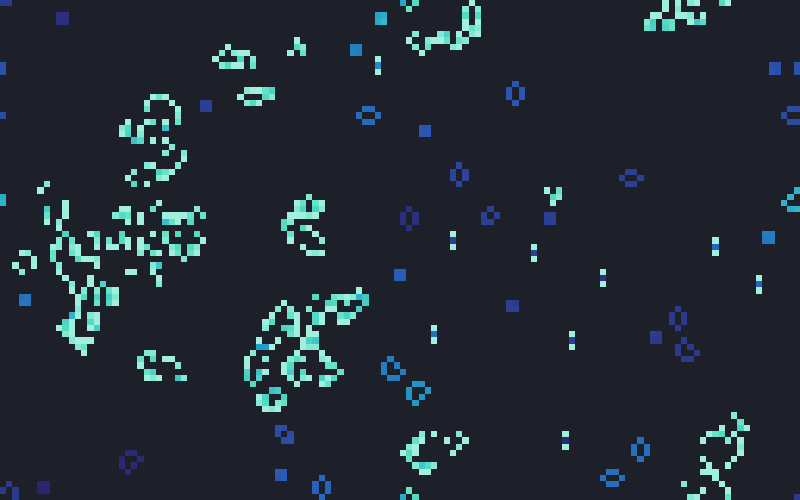
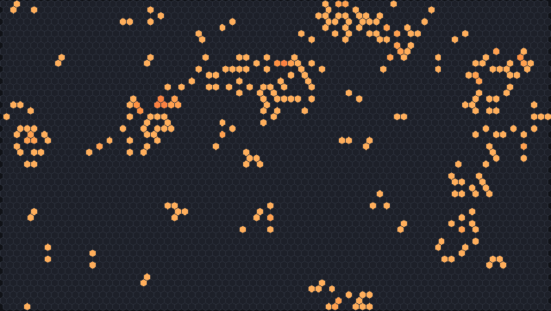
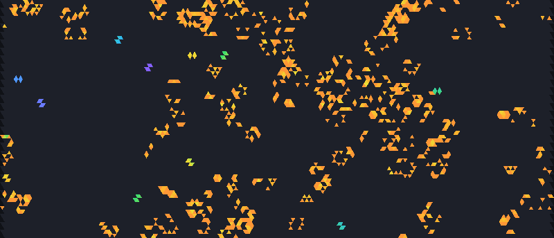

# Life-like rules

Conway's Game of Life is the best-known cellular automaton, and it belongs to a large family of
rules that work the same way: each cell is alive or dead, and whether it is alive next generation
depends only on whether it is alive now and how many of its neighbours are. JETCARP runs every rule
of this family on every tiling it supports, with either of two neighbourhoods.

<figure>

<figcaption>Conway's Life (<code>B3/S23</code>) 500 generations after a random start on a wrapped
128 × 80 grid. Colour shows how long a cell has been alive: pale cells are new, deep blue ones have
not changed for a long time (still lifes such as blocks and beehives). Scene
<code>docs/scenes/automata/life-square.json</code>, 500 generations.</figcaption>
</figure>

## What it is

A Life-like rule is fixed by two lists of neighbour counts:

- **Birth (B):** a dead cell becomes alive if its number of live neighbours is in this list.
- **Survival (S):** a live cell stays alive if its number of live neighbours is in this list.
  Otherwise it dies.

Life itself is `B3/S23`: a dead cell with exactly three live neighbours is born, and a live cell
with two or three survives. From these two lines come gliders that travel across the grid, guns that
fire them, and, as Conway sketched and later builders made explicit, machines that can compute
anything a computer can.

Rules of this kind are called *outer totalistic*: the new state depends on the cell itself and the
*total* of its neighbours, not on which neighbours are alive. On the square grid with the eight
surrounding cells as neighbours, counts run from 0 to 8, so there are 218 = 262,144
Life-like rules ([LifeWiki: Life-like cellular automaton](../research/bibliography.md#lifewikind_lifelikeca)).
Many have names and their own communities of explorers; JETCARP's
[named rule catalogue](named-rules.md) lists 96 of them.

## Where it came from

**Life.** John Horton Conway's Game of Life reached the public through Martin Gardner's
"Mathematical Games" column in *Scientific American* in October 1970
([Gardner 1970](../research/bibliography.md#gardner1970life)), followed by a second column in
February 1971 ([Gardner 1971](../research/bibliography.md#gardner1971life)). Conway was simplifying
ideas from von Neumann's self-reproducing automaton, and offered a $50 prize for a pattern that grows
without limit; an MIT group led by Bill Gosper won it in November 1970 with the glider gun
([LifeWiki: Conway's Game of Life](../research/bibliography.md#lifewikind_conwayslife)).
Berlekamp, Conway and Guy's *Winning Ways for your Mathematical Plays* (1982) gave Conway's sketch
that Life can hold a universal computer
([Berlekamp, Conway and Guy 1982](../research/bibliography.md#berlekamp1982winning)), and Paul
Rendell later built an explicit Turing machine in Life
([Rendell 2002](../research/bibliography.md#rendell2002turing)).

**Neighbourhoods.** The eight-cell neighbourhood is named after Edward F. Moore
([Moore 1962](../research/bibliography.md#moore1962machine)) and the four-cell one after John von
Neumann, who used it in his 29-state automaton
([LifeWiki: Von Neumann neighbourhood](../research/bibliography.md#lifewikind_vonneumann)).

**The rule space.** Norman Packard and Stephen Wolfram surveyed two-dimensional automata, numbering
outer-totalistic rules and studying their behaviour
([Packard and Wolfram 1985](../research/bibliography.md#packard1985twodimensional)). David Eppstein
later classified Life-like rules by whether patterns can grow out of a bounding box and whether they
can die out ([Eppstein 2010](../research/bibliography.md#eppstein2010growth)).

**Notation.** Two orders are in use. The older survival/birth form writes Life as `23/3`; it was
common for years, and Mirek Wójtowicz's MCell rule lexicon uses it
([Wójtowicz, rules lexicon](../research/bibliography.md#wojtowicznd_rules)). The birth/survival form
`B3/S23` is the one Golly and LifeWiki use today
([LifeWiki: Rulestring](../research/bibliography.md#lifewikind_rulestring)). We found no source that
says who first wrote rules as `B…/S…`.

**Variants.** People began trying other counts almost at once. LifeWiki traces 3-4 Life (`B34/S34`)
to Robert Wainwright's newsletter *Lifeline* in December 1971
([LifeWiki: 3-4 Life](../research/bibliography.md#lifewikind_34life)). A few of the many named rules
that followed, with credits as the sources give them:

- *HighLife* (`B36/S23`), first considered by Nathan Thompson in 1994 and named by Conway; it has a
  small replicator ([LifeWiki: HighLife](../research/bibliography.md#lifewikind_highlife)).
- *Day & Night* (`B3678/S34678`), explored by Nathan Thompson from 1997; swapping live and dead
  cells leaves it unchanged ([LifeWiki: Day & Night](../research/bibliography.md#lifewikind_daynight)).
- *Seeds* (`B2/S`), first studied by Brian Silverman and named by Wójtowicz
  ([LifeWiki: Seeds](../research/bibliography.md#lifewikind_seeds)).
- *Life without Death* (`B3/S012345678`), which Tommaso Toffoli and Norman Margolus described as
  INKSPOT ([Toffoli and Margolus 1987](../research/bibliography.md#toffoli1987cellular)).
- *Vote* and *Anneal*, Gérard Vichniac's majority and twisted-majority rules
  ([Vichniac 1986](../research/bibliography.md#vichniac1986cellular)).

**Software.** Golly, by Andrew Trevorrow and Tom Rokicki, first released in 2005, made these rules
easy to explore and fast to run ([Golly credits](../research/bibliography.md#gollynd_credits);
[Golly changes](../research/bibliography.md#gollynd_changes)). Before it came the CAM-6 hardware of
Toffoli and Margolus ([1987](../research/bibliography.md#toffoli1987cellular)), Rudy Rucker and John
Walker's CelLab ([1989](../research/bibliography.md#rucker1989cellab)) and Wójtowicz's MCell. Chris
Rowett's LifeViewer now shows patterns in the browser on LifeWiki and the forums
([Rowett 2019](../research/bibliography.md#rowett2019lifeviewer)).

## How JETCARP runs it

### Notation

JETCARP reads the birth/survival form, in upper or lower case:

| Notation | Meaning |
| --- | --- |
| `B3/S23` | Life: born on 3, survives on 2 or 3, touch neighbours |
| `B36/S23` | HighLife |
| `B2/S34H` | Hexagonal Life: the `H` records that the rule is meant for hexagons |
| `B1/S0V` | Gnarl on edge neighbours: born with one live neighbour, survives with none |
| `B3,10/S2,3` | Counts of 10 or more are separated by commas |
| `B014/S2` | Oils, a rule with birth on 0 (see below) |

Any of the [named rules](named-rules.md) can be typed by name instead.

### Any tiling, two neighbourhoods

A Life-like rule needs only a neighbour count, so it runs unchanged on any neighbour graph (see
[How JETCARP generalises automata](generalising.md)). By default a cell counts its *touch*
neighbours, which share an edge or a corner; on squares that is Moore's eight.

### Edge neighbours: the V suffix

A trailing `V` switches the rule to *edge* neighbours, which share a side; on squares that is von
Neumann's four. This follows LifeWiki's convention
([LifeWiki: Rulestring](../research/bibliography.md#lifewikind_rulestring)). The neighbourhood can
also be set per automaton in a scene (`"neighborhood": "edge"`).

Counts mean different things on different tilings. A triangle has 12 touch neighbours, a hexagon in
the 3.3.3.3.6 tiling has 18, and a square in 4.8.8 has only 4. A rule tuned for one tiling is
usually a different creature on another.

<figure class="pair">

<figcaption>Left: Hexagonal Life (<code>B2/S34H</code>), 60 generations from a random start; every
hexagon has six neighbours. Scene <code>docs/scenes/automata/life-hex.json</code>. Right: Life's own
rule <code>B3/S23</code> on triangles with touch neighbours, where each cell has twelve neighbours,
300 generations. Scene <code>docs/scenes/automata/life-triangle.json</code>.</figcaption>
</figure>

### B0 rules

If 0 is in the birth list, every dead cell with no live neighbours is born, so the empty background
switches on. Without survival on the maximum count it switches off again next generation, and the
whole picture flashes. Golly avoids this by running such a rule as two complementary rules that
alternate on even and odd generations, so that what you see is the rule's real behaviour without the
strobing ([Golly: QuickLife](../research/bibliography.md#gollynd_quicklife)); Golly credits David
Eppstein with the idea ([Golly credits](../research/bibliography.md#gollynd_credits)). JETCARP does
the same, and its tests check the result against running the rule by brute force. B0 rules also run
under HashLife.

### Speed

On lattice tilings JETCARP can step Life-like rules on the GPU as well as the CPU, with identical
results, and HashLife can jump wrap-edge lattice worlds far ahead.

## What is new here

Life-like rules on other tilings are not new: Carter Bays studied them on triangles, hexagons and
pentagons ([Bays 1994](../research/bibliography.md#bays1994cellular);
[Bays 2005](../research/bibliography.md#bays2005note)), Life has been run on Penrose tilings
([Hill, Stepney and Wan 2005](../research/bibliography.md#hill2005penrose);
[Owens and Stepney 2010](../research/bibliography.md#owens2010game)) and on the hat
([Trevorrow 2023](../research/bibliography.md#trevorrow2023hatlife)), and Hans Guttesen studied Life
on the Archimedean tilings ([Guttesen 2026](../research/bibliography.md#guttesen2026game)).

What JETCARP adds is a search for **spaceships** (patterns that move) across many tilings and rules
at once. Some of what it found was already known. Guttesen reported a period-4 glider and a glider
gun for Life on the kagome tiling (3.6.3.6) and a period-8 glider on the snub square tiling; JETCARP's
soup searches found what appear to be the same small kagome and snub-square ships independently, and
the credit for them is Guttesen's.

Beyond those, JETCARP's catalogue holds spaceships in Life-like rules on the 4.8.8, 3.12.12, 4.6.12,
3.4.6.4, 3.3.3.4.4 and 3.3.3.3.6 tilings and on several 2- and 3-uniform tilings. Guttesen found no
gliders for Life itself on 4.8.8, 4.6.12, 3.12.12 or 3.3.3.3.6; JETCARP's ships there are in other
rules. To our knowledge, Life-like spaceships on these tilings have not been reported before. Two
cautions apply. These ships are being re-verified on the release version of the engine. And a ship
on an unusual tiling is only new if the tiling's neighbour graph is really different: two isohedral
tilings turned out to have exactly the square grid's touch graph, so their "new" ships were
Conway's glider in disguise. For that reason no isohedral ships are claimed here, and each
remaining claim is being checked for this. The search behind these statements is described in
[What is new in JETCARP](../research/contributions.md).

## Try it

- Quick Start: *Life on the square grid*, *Life on the 12-neighbour triangle grid*, *B2/S34 on the
  hat*, and one entry for every named rule, each on its usual grid.
- From the command line:
  `jetcarp run docs/scenes/automata/life-square.json --gens 500 --png life.png`.
- Change the tiling of any Life-like entry in the app and watch the same rule on a new graph.

## References

- [Gardner 1970](../research/bibliography.md#gardner1970life);
  [Gardner 1971](../research/bibliography.md#gardner1971life);
  [Berlekamp, Conway and Guy 1982](../research/bibliography.md#berlekamp1982winning);
  [Rendell 2002](../research/bibliography.md#rendell2002turing)
- [Moore 1962](../research/bibliography.md#moore1962machine);
  [Packard and Wolfram 1985](../research/bibliography.md#packard1985twodimensional);
  [Eppstein 2010](../research/bibliography.md#eppstein2010growth)
- [Toffoli and Margolus 1987](../research/bibliography.md#toffoli1987cellular);
  [Vichniac 1986](../research/bibliography.md#vichniac1986cellular);
  [Rucker and Walker 1989](../research/bibliography.md#rucker1989cellab)
- [Golly: QuickLife](../research/bibliography.md#gollynd_quicklife);
  [Golly credits](../research/bibliography.md#gollynd_credits);
  [Golly changes](../research/bibliography.md#gollynd_changes);
  [Rowett 2019](../research/bibliography.md#rowett2019lifeviewer)
- [Bays 1994](../research/bibliography.md#bays1994cellular);
  [Bays 2005](../research/bibliography.md#bays2005note);
  [Hill, Stepney and Wan 2005](../research/bibliography.md#hill2005penrose);
  [Owens and Stepney 2010](../research/bibliography.md#owens2010game);
  [Trevorrow 2023](../research/bibliography.md#trevorrow2023hatlife);
  [Guttesen 2026](../research/bibliography.md#guttesen2026game)
- LifeWiki: [Life-like cellular automaton](../research/bibliography.md#lifewikind_lifelikeca),
  [Rulestring](../research/bibliography.md#lifewikind_rulestring),
  [Conway's Game of Life](../research/bibliography.md#lifewikind_conwayslife),
  [3-4 Life](../research/bibliography.md#lifewikind_34life),
  [HighLife](../research/bibliography.md#lifewikind_highlife),
  [Day & Night](../research/bibliography.md#lifewikind_daynight),
  [Seeds](../research/bibliography.md#lifewikind_seeds)
