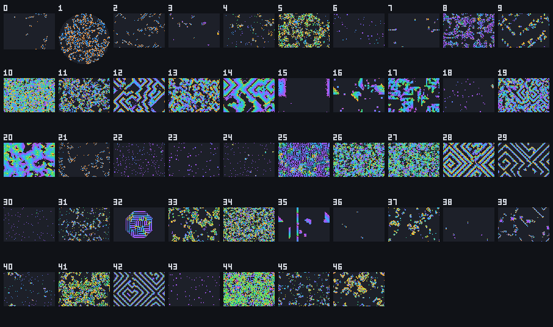

# Named rule catalogue

<!-- GENERATED FILE: do not edit by hand. Sources: crates/jetcarp-core/data/rules/named.json and
     docs/data/named-rule-credits.tsv; generator: docs/tools/gen-named-rules.py. -->

> **Generated page.** Built by `docs/tools/gen-named-rules.py` from the program's own rule list
> (`crates/jetcarp-core/data/rules/named.json`) and the credits file `docs/data/named-rule-credits.tsv`.
> Edit those files, not this page.

JETCARP knows 166 rules by name, collected from the rule lists that the Life community
has kept for decades. You can type a name anywhere a rule is expected (`jetcarp rules` lists them, with
a few more built-in names for families that have no standard list). Every one of them runs on any
tiling, though most were found on the square grid and behave differently elsewhere; see
[How JETCARP generalises automata](generalising.md).

**About the credits.** Most of these rules were named, and often found, by hobbyists: through
Mirek Wójtowicz's MCell program and its rules lexicon in the late 1990s, the ConwayLife.com forums,
and LifeWiki's lists. The *Credit* column names a person only when a source does, with the role the
source gives (found, named, studied). An empty cell means no source we checked names anyone, not
that nobody did. Where sources disagree, both are shown. 76 of the 166 rules have a named person. The credits were checked in November 2026
against LifeWiki (read through its mirror, since conwaylife.com refuses automated reading), the
MCell lexicon, Toffoli and Margolus's *Cellular Automata Machines* (1987) and Wikipedia.
If you know of an earlier or missing credit, please open an issue.

The *Source* column links the list each rule was taken from. The short descriptions JETCARP shows
for each rule are written in our own words.

| Family | Rules |
| --- | --- |
| [Life-like](life-like.md) | 88 |
| [Life-like (B0)](life-like.md#b0-rules) | 6 |
| [Life-like, hexagonal](life-like.md) | 1 |
| [Life-like, von Neumann](life-like.md#edge-neighbours-the-v-suffix) | 1 |
| [Generations](generations.md) | 45 |
| [Larger than Life](larger-than-life.md) | 9 |
| [Elementary](elementary.md) | 10 |
| [Agents](turmites.md) | 4 |
| [Layered](layered.md) | 2 |

<figure>

<figcaption>The Quick Start entries for the Generations family, each 200 generations from its usual start, drawn by <code>jetcarp quickstart --sheet --filter Generations</code>. Numbers: 0 Brian's Brain; 1 Brian's Brain on Penrose rhombs; 2 Brian's Brain; 3 Star Wars; 4 Frogs; 5 Caterpillars; 6 Banners; 7 Transers; 8 Sticks; 9 Worms; 10 Lava; 11 Cooties; 12 RainZha; 13 BelZhab; 14 Xtasy; 15 Fireworks; 16 Bombers; 17 Faders; 18 9:43 at Knight; 19 BelZhab Sediment; 20 Bloomerang; 21 Brain 6; 22 Burst; 23 Burst II; 24 Chenille; 25 Circuit Genesis; 26 Ebb and Flow; 27 Ebb and Flow II; 28 Flaming Starbows; 29 Frozen Spirals; 30 Glisserati; 31 Glissergy; 32 Lines; 33 Living On The Edge; 34 Meteor Guns; 35 Nova; 36 OrthoGo; 37 Prairie on fire; 38 Rake; 39 SediMental; 40 Snake; 41 Soft Freeze; 42 Spirals; 43 Swirl; 44 Thrill Grill; 45 Transers II; 46 Wanderers.</figcaption>
</figure>

## Life-like

Family page: [Life-like](life-like.md).

| Name | Notation | Credit | Sources |
| --- | --- | --- | --- |
| 2x2 | `B36/S125` |  | [rule list](https://conwaylife.com/wiki/List_of_Life-like_rules); [LifeWiki: List of Life-like rules](https://conwaylife.com/wiki/List_of_Life-like_rules); [LifeWiki: OCA:2×2](https://conwaylife.com/wiki/OCA:2×2); [MCell lexicon](https://mcell.ca/pages/rules.html) |
| 2x2 2 | `B3678/S1258` |  | [rule list](https://conwaylife.com/wiki/List_of_Life-like_rules); [LifeWiki: List of Life-like rules](https://conwaylife.com/wiki/List_of_Life-like_rules); [LifeWiki: OCA:2×2 2](https://conwaylife.com/wiki/OCA:2×2_2) |
| 3-4 Life | `B34/S34` |  | [rule list](https://conwaylife.com/wiki/List_of_Life-like_rules); [LifeWiki: List of Life-like rules](https://conwaylife.com/wiki/List_of_Life-like_rules); [LifeWiki: OCA:3-4 Life](https://conwaylife.com/wiki/OCA:3-4_Life); [MCell lexicon](https://mcell.ca/pages/rules.html) |
| Amoeba | `B357/S1358` |  | [rule list](https://conwaylife.com/wiki/List_of_Life-like_rules); [LifeWiki: List of Life-like rules](https://conwaylife.com/wiki/List_of_Life-like_rules); [LifeWiki: OCA:Amoeba](https://conwaylife.com/wiki/OCA:Amoeba); [MCell lexicon](https://mcell.ca/pages/rules.html) |
| Assimilation | `B345/S4567` |  | [rule list](https://conwaylife.com/wiki/List_of_Life-like_rules); [LifeWiki: List of Life-like rules](https://conwaylife.com/wiki/List_of_Life-like_rules); [LifeWiki: OCA:Assimilation](https://conwaylife.com/wiki/OCA:Assimilation); [MCell lexicon](https://mcell.ca/pages/rules.html) |
| Bacteria | `B34/S456` |  | [rule list](https://conwaylife.com/wiki/List_of_Life-like_rules); [LifeWiki: List of Life-like rules](https://conwaylife.com/wiki/List_of_Life-like_rules); [LifeWiki: OCA:Bacteria](https://conwaylife.com/wiki/OCA:Bacteria) |
| Blinkers | `B345/S2` |  | [rule list](https://conwaylife.com/wiki/List_of_Life-like_rules); [LifeWiki: List of Life-like rules](https://conwaylife.com/wiki/List_of_Life-like_rules); [LifeWiki: OCA:Blinkers](https://conwaylife.com/wiki/OCA:Blinkers) |
| Bugs | `B3567/S15678` |  | [rule list](https://conwaylife.com/wiki/List_of_Life-like_rules); [LifeWiki: List of Life-like rules](https://conwaylife.com/wiki/List_of_Life-like_rules); [LifeWiki: OCA:Bugs (Life-like cellular automaton)](https://conwaylife.com/wiki/OCA:Bugs_(Life-like_cellular_automaton)) |
| Castles | `B3678/S135678` | melwin22 (ConwayLife.com forums) | [rule list](https://conwaylife.com/wiki/List_of_Life-like_rules); [LifeWiki: List of Life-like rules](https://conwaylife.com/wiki/List_of_Life-like_rules); [LifeWiki: OCA:Castles](https://conwaylife.com/wiki/OCA:Castles) |
| Cheerios | `B35678/S34567` |  | [rule list](https://conwaylife.com/wiki/List_of_Life-like_rules); [LifeWiki: List of Life-like rules](https://conwaylife.com/wiki/List_of_Life-like_rules) |
| Coagulations | `B378/S235678` |  | [rule list](https://conwaylife.com/wiki/List_of_Life-like_rules); [LifeWiki: List of Life-like rules](https://conwaylife.com/wiki/List_of_Life-like_rules); [LifeWiki: OCA:Coagulations](https://conwaylife.com/wiki/OCA:Coagulations); [MCell lexicon](https://mcell.ca/pages/rules.html) |
| Conway's Life | `B3/S23` | John Horton Conway (published by Martin Gardner, Oct 1970) | [rule list](https://conwaylife.com/wiki/List_of_Life-like_rules); [LifeWiki: List of Life-like rules](https://conwaylife.com/wiki/List_of_Life-like_rules); [MCell lexicon](https://mcell.ca/pages/rules.html) |
| Coral | `B3/S45678` |  | [rule list](https://conwaylife.com/wiki/List_of_Life-like_rules); [LifeWiki: List of Life-like rules](https://conwaylife.com/wiki/List_of_Life-like_rules); [LifeWiki: OCA:Coral](https://conwaylife.com/wiki/OCA:Coral); [MCell lexicon](https://mcell.ca/pages/rules.html) |
| Corrosion of Conformity | `B3/S124` |  | [rule list](https://conwaylife.com/wiki/List_of_Life-like_rules); [LifeWiki: List of Life-like rules](https://conwaylife.com/wiki/List_of_Life-like_rules); [LifeWiki: OCA:Corrosion of Conformity](https://conwaylife.com/wiki/OCA:Corrosion_of_Conformity) |
| Dance | `B34/S35` |  | [rule list](https://conwaylife.com/wiki/List_of_Life-like_rules); [LifeWiki: List of Life-like rules](https://conwaylife.com/wiki/List_of_Life-like_rules); [LifeWiki: OCA:Dance](https://conwaylife.com/wiki/OCA:Dance) |
| Day & Night | `B3678/S34678` | Nathan Thompson (explored it from April 1997; David Bell discussed it in Nov 1997) | [rule list](https://conwaylife.com/wiki/List_of_Life-like_rules); [LifeWiki: List of Life-like rules](https://conwaylife.com/wiki/List_of_Life-like_rules); [LifeWiki: OCA:Day & Night](https://conwaylife.com/wiki/OCA:Day_&_Night); [MCell lexicon](https://mcell.ca/pages/rules.html) |
| Diamoeba | `B35678/S5678` | Dean Hickerson | [rule list](https://conwaylife.com/wiki/List_of_Life-like_rules); [LifeWiki: List of Life-like rules](https://conwaylife.com/wiki/List_of_Life-like_rules); [LifeWiki: OCA:Diamoeba](https://conwaylife.com/wiki/OCA:Diamoeba); [MCell lexicon](https://mcell.ca/pages/rules.html) |
| DotLife | `B3/S023` |  | [rule list](https://conwaylife.com/wiki/List_of_Life-like_rules); [LifeWiki: List of Life-like rules](https://conwaylife.com/wiki/List_of_Life-like_rules); [LifeWiki: OCA:DotLife](https://conwaylife.com/wiki/OCA:DotLife) |
| DrighLife | `B367/S23` |  | [rule list](https://conwaylife.com/wiki/List_of_Life-like_rules); [LifeWiki: List of Life-like rules](https://conwaylife.com/wiki/List_of_Life-like_rules) |
| DryFlock | `B37/S12` |  | [rule list](https://conwaylife.com/wiki/List_of_Life-like_rules); [LifeWiki: List of Life-like rules](https://conwaylife.com/wiki/List_of_Life-like_rules) |
| DryLife | `B37/S23` |  | [rule list](https://conwaylife.com/wiki/List_of_Life-like_rules); [LifeWiki: List of Life-like rules](https://conwaylife.com/wiki/List_of_Life-like_rules); [LifeWiki: OCA:DryLife](https://conwaylife.com/wiki/OCA:DryLife) |
| DryLife without Death | `B37/S012345678` |  | [rule list](https://conwaylife.com/wiki/List_of_Life-like_rules); [LifeWiki: List of Life-like rules](https://conwaylife.com/wiki/List_of_Life-like_rules); [LifeWiki: OCA:Life without death](https://conwaylife.com/wiki/OCA:Life_without_death) |
| EightFlock | `B3/S128` |  | [rule list](https://conwaylife.com/wiki/List_of_Life-like_rules); [LifeWiki: List of Life-like rules](https://conwaylife.com/wiki/List_of_Life-like_rules); [LifeWiki: OCA:EightFlock](https://conwaylife.com/wiki/OCA:EightFlock) |
| EightLife | `B3/S238` |  | [rule list](https://conwaylife.com/wiki/List_of_Life-like_rules); [LifeWiki: List of Life-like rules](https://conwaylife.com/wiki/List_of_Life-like_rules); [LifeWiki: OCA:EightLife](https://conwaylife.com/wiki/OCA:EightLife) |
| Electrified Maze | `B45/S12345` |  | [rule list](https://conwaylife.com/wiki/List_of_Life-like_rules); [LifeWiki: List of Life-like rules](https://conwaylife.com/wiki/List_of_Life-like_rules) |
| Eppstein | `B35/S236` | Dean Hickerson and David Eppstein (explored it) | [rule list](https://conwaylife.com/wiki/List_of_Life-like_rules); [LifeWiki: List of Life-like rules](https://conwaylife.com/wiki/List_of_Life-like_rules); [LifeWiki: OCA:B35/S236](https://conwaylife.com/wiki/OCA:B35/S236) |
| Feux | `B1358/S0247` |  | [rule list](https://conwaylife.com/wiki/List_of_Life-like_rules); [LifeWiki: List of Life-like rules](https://conwaylife.com/wiki/List_of_Life-like_rules); [MCell lexicon](https://mcell.ca/pages/rules.html) |
| Flock | `B3/S12` |  | [rule list](https://conwaylife.com/wiki/List_of_Life-like_rules); [LifeWiki: List of Life-like rules](https://conwaylife.com/wiki/List_of_Life-like_rules); [LifeWiki: OCA:Flock](https://conwaylife.com/wiki/OCA:Flock) |
| Forrest of Ls | `B168/S236` |  | [rule list](https://conwaylife.com/wiki/List_of_Life-like_rules); [LifeWiki: List of Life-like rules](https://conwaylife.com/wiki/List_of_Life-like_rules) |
| Fredkin | `B1357/S02468` | Edward Fredkin | [rule list](https://conwaylife.com/wiki/List_of_Life-like_rules); [MCell lexicon](https://mcell.ca/pages/rules.html); [LifeWiki: OCA:Replicator](https://conwaylife.com/wiki/OCA:Replicator) |
| Fuzz | `B1/S014567` |  | [rule list](https://conwaylife.com/wiki/List_of_Life-like_rules); [LifeWiki: List of Life-like rules](https://conwaylife.com/wiki/List_of_Life-like_rules) |
| Gems | `B3457/S4568` |  | [rule list](https://conwaylife.com/wiki/List_of_Life-like_rules); [LifeWiki: List of Life-like rules](https://conwaylife.com/wiki/List_of_Life-like_rules); [LifeWiki: OCA:Gems](https://conwaylife.com/wiki/OCA:Gems) |
| Gems Minor | `B34578/S456` |  | [rule list](https://conwaylife.com/wiki/List_of_Life-like_rules); [LifeWiki: List of Life-like rules](https://conwaylife.com/wiki/List_of_Life-like_rules); [LifeWiki: OCA:Gems](https://conwaylife.com/wiki/OCA:Gems) |
| Geology | `B3578/S24678` |  | [rule list](https://conwaylife.com/wiki/List_of_Life-like_rules); [LifeWiki: List of Life-like rules](https://conwaylife.com/wiki/List_of_Life-like_rules); [LifeWiki: OCA:Geology](https://conwaylife.com/wiki/OCA:Geology) |
| Gnarl | `B1/S1` | Kellie Evans | [rule list](https://conwaylife.com/wiki/List_of_Life-like_rules); [LifeWiki: List of Life-like rules](https://conwaylife.com/wiki/List_of_Life-like_rules); [MCell lexicon](https://mcell.ca/pages/rules.html) |
| Grounded Life | `B35/S23` |  | [rule list](https://conwaylife.com/wiki/List_of_Life-like_rules); [LifeWiki: List of Life-like rules](https://conwaylife.com/wiki/List_of_Life-like_rules); [LifeWiki: OCA:Grounded Life](https://conwaylife.com/wiki/OCA:Grounded_Life) |
| H-trees | `B1/S012345678` |  | [rule list](https://conwaylife.com/wiki/List_of_Life-like_rules); [LifeWiki: List of Life-like rules](https://conwaylife.com/wiki/List_of_Life-like_rules); [LifeWiki: OCA:H-trees](https://conwaylife.com/wiki/OCA:H-trees) |
| HighFlock | `B36/S12` |  | [rule list](https://conwaylife.com/wiki/List_of_Life-like_rules); [LifeWiki: List of Life-like rules](https://conwaylife.com/wiki/List_of_Life-like_rules); [LifeWiki: OCA:HighFlock](https://conwaylife.com/wiki/OCA:HighFlock) |
| HighLife | `B36/S23` | Nathan Thompson (first considered it, 1994); named by John Conway | [rule list](https://conwaylife.com/wiki/List_of_Life-like_rules); [LifeWiki: List of Life-like rules](https://conwaylife.com/wiki/List_of_Life-like_rules); [LifeWiki: OCA:HighLife](https://conwaylife.com/wiki/OCA:HighLife); [MCell lexicon](https://mcell.ca/pages/rules.html) |
| Holstein | `B35678/S4678` |  | [rule list](https://conwaylife.com/wiki/List_of_Life-like_rules); [LifeWiki: List of Life-like rules](https://conwaylife.com/wiki/List_of_Life-like_rules); [LifeWiki: OCA:Holstein](https://conwaylife.com/wiki/OCA:Holstein) |
| HoneyFlock | `B38/S128` |  | [rule list](https://conwaylife.com/wiki/List_of_Life-like_rules); [LifeWiki: List of Life-like rules](https://conwaylife.com/wiki/List_of_Life-like_rules) |
| HoneyLife | `B38/S238` |  | [rule list](https://conwaylife.com/wiki/List_of_Life-like_rules); [LifeWiki: List of Life-like rules](https://conwaylife.com/wiki/List_of_Life-like_rules); [LifeWiki: OCA:HoneyLife](https://conwaylife.com/wiki/OCA:HoneyLife) |
| Iceballs | `B25678/S5678` |  | [rule list](https://conwaylife.com/wiki/List_of_Life-like_rules); [LifeWiki: List of Life-like rules](https://conwaylife.com/wiki/List_of_Life-like_rules); [LifeWiki: OCA:Iceballs](https://conwaylife.com/wiki/OCA:Iceballs) |
| IronFlock | `B36/S128` |  | [rule list](https://conwaylife.com/wiki/List_of_Life-like_rules); [LifeWiki: List of Life-like rules](https://conwaylife.com/wiki/List_of_Life-like_rules) |
| IronLife | `B36/S238` |  | [rule list](https://conwaylife.com/wiki/List_of_Life-like_rules); [LifeWiki: List of Life-like rules](https://conwaylife.com/wiki/List_of_Life-like_rules) |
| Land Rush | `B35/S234578` |  | [rule list](https://conwaylife.com/wiki/List_of_Life-like_rules); [LifeWiki: List of Life-like rules](https://conwaylife.com/wiki/List_of_Life-like_rules); [LifeWiki: OCA:Land Rush](https://conwaylife.com/wiki/OCA:Land_Rush) |
| Land Rush 2 | `B36/S234578` |  | [rule list](https://conwaylife.com/wiki/List_of_Life-like_rules); [LifeWiki: List of Life-like rules](https://conwaylife.com/wiki/List_of_Life-like_rules); [LifeWiki: OCA:Land Rush](https://conwaylife.com/wiki/OCA:Land_Rush) |
| Life SkyHigh | `B368/S236` |  | [rule list](https://conwaylife.com/wiki/List_of_Life-like_rules); [LifeWiki: List of Life-like rules](https://conwaylife.com/wiki/List_of_Life-like_rules) |
| Life without death | `B3/S012345678` | Toffoli & Margolus describe it as INKSPOT (1987); MCell credits “Flakes” to Janko Gravner | [rule list](https://conwaylife.com/wiki/List_of_Life-like_rules); [LifeWiki: List of Life-like rules](https://conwaylife.com/wiki/List_of_Life-like_rules); [LifeWiki: OCA:Life without death](https://conwaylife.com/wiki/OCA:Life_without_death); [MCell lexicon](https://mcell.ca/pages/rules.html); [Toffoli & Margolus 1987](../research/bibliography.md#toffoli1987cellular) |
| Lifeguard 1 | `B48/S234` |  | [rule list](https://conwaylife.com/wiki/List_of_Life-like_rules); [LifeWiki: List of Life-like rules](https://conwaylife.com/wiki/List_of_Life-like_rules) |
| Lifeguard 2 | `B3/S4567` |  | [rule list](https://conwaylife.com/wiki/List_of_Life-like_rules); [LifeWiki: List of Life-like rules](https://conwaylife.com/wiki/List_of_Life-like_rules); [LifeWiki: OCA:Lifeguard 2](https://conwaylife.com/wiki/OCA:Lifeguard_2) |
| Live Free or Die | `B2/S0` |  | [rule list](https://conwaylife.com/wiki/List_of_Life-like_rules); [LifeWiki: List of Life-like rules](https://conwaylife.com/wiki/List_of_Life-like_rules); [LifeWiki: OCA:Live Free or Die](https://conwaylife.com/wiki/OCA:Live_Free_or_Die) |
| Long Life | `B345/S5` | Andrew Trevorrow | [rule list](https://conwaylife.com/wiki/List_of_Life-like_rules); [LifeWiki: List of Life-like rules](https://conwaylife.com/wiki/List_of_Life-like_rules); [LifeWiki: OCA:LongLife](https://conwaylife.com/wiki/OCA:LongLife); [MCell lexicon](https://mcell.ca/pages/rules.html) |
| LowDeath | `B368/S238` |  | [rule list](https://conwaylife.com/wiki/List_of_Life-like_rules); [LifeWiki: List of Life-like rules](https://conwaylife.com/wiki/List_of_Life-like_rules); [LifeWiki: OCA:LowDeath](https://conwaylife.com/wiki/OCA:LowDeath) |
| LowDeath without Death | `B368/S012345678` |  | [rule list](https://conwaylife.com/wiki/List_of_Life-like_rules); [LifeWiki: List of Life-like rules](https://conwaylife.com/wiki/List_of_Life-like_rules) |
| LowFlockDeath | `B368/S128` |  | [rule list](https://conwaylife.com/wiki/List_of_Life-like_rules); [LifeWiki: List of Life-like rules](https://conwaylife.com/wiki/List_of_Life-like_rules) |
| LowLife | `B3/S13` | Jean-Claude Heudin (subject of his 1996 Complex Systems paper) | [rule list](https://conwaylife.com/wiki/List_of_Life-like_rules); [LifeWiki: List of Life-like rules](https://conwaylife.com/wiki/List_of_Life-like_rules); [LifeWiki: OCA:LowLife](https://conwaylife.com/wiki/OCA:LowLife) |
| Magnezones | `B3/S123678` |  | [rule list](https://conwaylife.com/wiki/List_of_Life-like_rules); [LifeWiki: List of Life-like rules](https://conwaylife.com/wiki/List_of_Life-like_rules) |
| Majority | `B45678/S5678` |  | [rule list](https://conwaylife.com/wiki/List_of_Life-like_rules); [LifeWiki: List of Life-like rules](https://conwaylife.com/wiki/List_of_Life-like_rules) |
| Maze | `B3/S12345` |  | [rule list](https://conwaylife.com/wiki/List_of_Life-like_rules); [LifeWiki: List of Life-like rules](https://conwaylife.com/wiki/List_of_Life-like_rules); [LifeWiki: OCA:Maze](https://conwaylife.com/wiki/OCA:Maze); [MCell lexicon](https://mcell.ca/pages/rules.html) |
| Maze with Mice | `B37/S12345` |  | [rule list](https://conwaylife.com/wiki/List_of_Life-like_rules); [LifeWiki: List of Life-like rules](https://conwaylife.com/wiki/List_of_Life-like_rules); [LifeWiki: OCA:Maze](https://conwaylife.com/wiki/OCA:Maze) |
| Mazectric | `B3/S1234` | Charles A. Rockafellor | [rule list](https://conwaylife.com/wiki/List_of_Life-like_rules); [LifeWiki: List of Life-like rules](https://conwaylife.com/wiki/List_of_Life-like_rules); [LifeWiki: OCA:Maze](https://conwaylife.com/wiki/OCA:Maze); [MCell lexicon](https://mcell.ca/pages/rules.html) |
| Mazectric with Mice | `B37/S1234` |  | [rule list](https://conwaylife.com/wiki/List_of_Life-like_rules); [LifeWiki: List of Life-like rules](https://conwaylife.com/wiki/List_of_Life-like_rules); [LifeWiki: OCA:Maze](https://conwaylife.com/wiki/OCA:Maze) |
| Morley | `B368/S245` | Stephen Morley (namesake: Golly named it after him because he studied it extensively); discoverer not named | [rule list](https://conwaylife.com/wiki/List_of_Life-like_rules); [LifeWiki: List of Life-like rules](https://conwaylife.com/wiki/List_of_Life-like_rules); [LifeWiki: OCA:Move](https://conwaylife.com/wiki/OCA:Move); [MCell lexicon](https://mcell.ca/pages/rules.html) |
| Never happy | `B345/S0456` |  | [rule list](https://conwaylife.com/wiki/List_of_Life-like_rules); [LifeWiki: List of Life-like rules](https://conwaylife.com/wiki/List_of_Life-like_rules) |
| Oscillators Rule | `B45/S1235` |  | [rule list](https://conwaylife.com/wiki/List_of_Life-like_rules); [LifeWiki: List of Life-like rules](https://conwaylife.com/wiki/List_of_Life-like_rules) |
| Pedestrian Flock | `B38/S12` |  | [rule list](https://conwaylife.com/wiki/List_of_Life-like_rules); [LifeWiki: List of Life-like rules](https://conwaylife.com/wiki/List_of_Life-like_rules); [LifeWiki: OCA:Pedestrian Flock](https://conwaylife.com/wiki/OCA:Pedestrian_Flock) |
| Pedestrian Life | `B38/S23` |  | [rule list](https://conwaylife.com/wiki/List_of_Life-like_rules); [LifeWiki: List of Life-like rules](https://conwaylife.com/wiki/List_of_Life-like_rules); [LifeWiki: OCA:Pedestrian Life](https://conwaylife.com/wiki/OCA:Pedestrian_Life) |
| Pedestrian Life without Death | `B38/S012345678` |  | [rule list](https://conwaylife.com/wiki/List_of_Life-like_rules); [LifeWiki: List of Life-like rules](https://conwaylife.com/wiki/List_of_Life-like_rules) |
| Plow World | `B378/S012345678` |  | [rule list](https://conwaylife.com/wiki/List_of_Life-like_rules); [LifeWiki: List of Life-like rules](https://conwaylife.com/wiki/List_of_Life-like_rules); [LifeWiki: OCA:Life without death](https://conwaylife.com/wiki/OCA:Life_without_death); [Toffoli & Margolus 1987](../research/bibliography.md#toffoli1987cellular) |
| Pseudo Life | `B357/S238` |  | [rule list](https://conwaylife.com/wiki/List_of_Life-like_rules); [LifeWiki: List of Life-like rules](https://conwaylife.com/wiki/List_of_Life-like_rules); [LifeWiki: OCA:Pseudo Life](https://conwaylife.com/wiki/OCA:Pseudo_Life); [MCell lexicon](https://mcell.ca/pages/rules.html) |
| Replicator | `B1357/S1357` |  | [rule list](https://conwaylife.com/wiki/List_of_Life-like_rules); [LifeWiki: List of Life-like rules](https://conwaylife.com/wiki/List_of_Life-like_rules); [LifeWiki: OCA:Replicator](https://conwaylife.com/wiki/OCA:Replicator); [MCell lexicon](https://mcell.ca/pages/rules.html) |
| Rings 'n' Slugs | `B56/S14568` |  | [rule list](https://conwaylife.com/wiki/List_of_Life-like_rules); [LifeWiki: List of Life-like rules](https://conwaylife.com/wiki/List_of_Life-like_rules); [LifeWiki: OCA:Rings 'n' Slugs](https://conwaylife.com/wiki/OCA:Rings_%27n%27_Slugs) |
| Seeds | `B2/S` | Brian Silverman (first investigated it); named by Mirek Wójtowicz | [rule list](https://conwaylife.com/wiki/List_of_Life-like_rules); [LifeWiki: List of Life-like rules](https://conwaylife.com/wiki/List_of_Life-like_rules); [LifeWiki: OCA:Seeds](https://conwaylife.com/wiki/OCA:Seeds); [MCell lexicon](https://mcell.ca/pages/rules.html) |
| Serviettes | `B234/S` |  | [rule list](https://conwaylife.com/wiki/List_of_Life-like_rules); [LifeWiki: List of Life-like rules](https://conwaylife.com/wiki/List_of_Life-like_rules); [LifeWiki: OCA:Serviettes](https://conwaylife.com/wiki/OCA:Serviettes); [MCell lexicon](https://mcell.ca/pages/rules.html) |
| Shoots and Roots | `B3/S245678` |  | [rule list](https://conwaylife.com/wiki/List_of_Life-like_rules); [LifeWiki: List of Life-like rules](https://conwaylife.com/wiki/List_of_Life-like_rules); [LifeWiki: OCA:Shoots and Roots](https://conwaylife.com/wiki/OCA:Shoots_and_Roots) |
| Slow Blob | `B367/S125678` |  | [rule list](https://conwaylife.com/wiki/List_of_Life-like_rules); [LifeWiki: List of Life-like rules](https://conwaylife.com/wiki/List_of_Life-like_rules) |
| Snakeskin | `B1/S134567` |  | [rule list](https://conwaylife.com/wiki/List_of_Life-like_rules); [LifeWiki: List of Life-like rules](https://conwaylife.com/wiki/List_of_Life-like_rules) |
| SnowLife | `B3/S1237` | Joshua Herman (found by accident while working with Louis Kauffman) | [rule list](https://conwaylife.com/wiki/List_of_Life-like_rules); [LifeWiki: List of Life-like rules](https://conwaylife.com/wiki/List_of_Life-like_rules); [LifeWiki: OCA:SnowLife](https://conwaylife.com/wiki/OCA:SnowLife) |
| Solid islands grow amongst static | `B12678/S15678` |  | [rule list](https://conwaylife.com/wiki/List_of_Life-like_rules); [LifeWiki: List of Life-like rules](https://conwaylife.com/wiki/List_of_Life-like_rules) |
| Spiral and polygonal growth | `B34568/S15678` |  | [rule list](https://conwaylife.com/wiki/List_of_Life-like_rules); [LifeWiki: List of Life-like rules](https://conwaylife.com/wiki/List_of_Life-like_rules) |
| sqrt replicator rule | `B36/S245` |  | [rule list](https://conwaylife.com/wiki/List_of_Life-like_rules); [LifeWiki: List of Life-like rules](https://conwaylife.com/wiki/List_of_Life-like_rules); [LifeWiki: OCA:Sqrt replicator rule](https://conwaylife.com/wiki/OCA:Sqrt_replicator_rule) |
| Stains | `B3678/S235678` |  | [rule list](https://conwaylife.com/wiki/List_of_Life-like_rules); [LifeWiki: List of Life-like rules](https://conwaylife.com/wiki/List_of_Life-like_rules); [LifeWiki: OCA:Stains](https://conwaylife.com/wiki/OCA:Stains); [MCell lexicon](https://mcell.ca/pages/rules.html) |
| Star Trek | `B3/S0248` |  | [rule list](https://conwaylife.com/wiki/List_of_Life-like_rules); [LifeWiki: List of Life-like rules](https://conwaylife.com/wiki/List_of_Life-like_rules); [LifeWiki: OCA:Star Trek](https://conwaylife.com/wiki/OCA:Star_Trek) |
| Virus | `B36/S235` | phdanielli (name comes from the forum thread “Virus (B36/S235)”, 22 May 2013) | [rule list](https://conwaylife.com/wiki/List_of_Life-like_rules); [LifeWiki: List of Life-like rules](https://conwaylife.com/wiki/List_of_Life-like_rules); [LifeWiki: OCA:Virus](https://conwaylife.com/wiki/OCA:Virus) |
| Vote | `B5678/S45678` | Gérard Vichniac (standard voting rule) | [rule list](https://conwaylife.com/wiki/List_of_Life-like_rules); [LifeWiki: List of Life-like rules](https://conwaylife.com/wiki/List_of_Life-like_rules); [LifeWiki: OCA:Vote](https://conwaylife.com/wiki/OCA:Vote); [MCell lexicon](https://mcell.ca/pages/rules.html) |
| Vote 4/5 | `B4678/S35678` | Gérard Vichniac (his “Anneal” variant of the voting rule) | [rule list](https://conwaylife.com/wiki/List_of_Life-like_rules); [LifeWiki: List of Life-like rules](https://conwaylife.com/wiki/List_of_Life-like_rules); [LifeWiki: OCA:Vote](https://conwaylife.com/wiki/OCA:Vote); [MCell lexicon](https://mcell.ca/pages/rules.html); [Toffoli & Margolus 1987](../research/bibliography.md#toffoli1987cellular) |
| Walled cities | `B45678/S2345` | David Macfarlane | [rule list](https://conwaylife.com/wiki/List_of_Life-like_rules); [LifeWiki: List of Life-like rules](https://conwaylife.com/wiki/List_of_Life-like_rules); [LifeWiki: OCA:Walled Cities](https://conwaylife.com/wiki/OCA:Walled_Cities); [MCell lexicon](https://mcell.ca/pages/rules.html) |

## Life-like (B0)

Family page: [Life-like (B0)](life-like.md#b0-rules).

| Name | Notation | Credit | Sources |
| --- | --- | --- | --- |
| AntiLife | `B0123478/S01234678` |  | [rule list](https://conwaylife.com/wiki/List_of_Life-like_rules); [LifeWiki: List of Life-like rules](https://conwaylife.com/wiki/List_of_Life-like_rules) |
| InverseLife | `B0123478/S34678` | Jason Rampe (named it; MCell: “a rule by”) | [rule list](https://conwaylife.com/wiki/List_of_Life-like_rules); [LifeWiki: List of Life-like rules](https://conwaylife.com/wiki/List_of_Life-like_rules); [LifeWiki: OCA:B3678/S23](https://conwaylife.com/wiki/OCA:B3678/S23); [MCell lexicon](https://mcell.ca/pages/rules.html) |
| Invertamaze | `B028/S0124` |  | [rule list](https://conwaylife.com/wiki/List_of_Life-like_rules); [LifeWiki: List of Life-like rules](https://conwaylife.com/wiki/List_of_Life-like_rules); [LifeWiki: OCA:Invertamaze](https://conwaylife.com/wiki/OCA:Invertamaze) |
| Neon Blobs | `B08/S4` |  | [rule list](https://conwaylife.com/wiki/List_of_Life-like_rules); [LifeWiki: List of Life-like rules](https://conwaylife.com/wiki/List_of_Life-like_rules) |
| Oils | `B014/S2` |  | [rule list](https://conwaylife.com/wiki/List_of_Life-like_rules); [LifeWiki: List of Life-like rules](https://conwaylife.com/wiki/List_of_Life-like_rules) |
| Wickstretcher And The Parasites | `B01356/S012345` |  | [rule list](https://conwaylife.com/wiki/List_of_Life-like_rules); [LifeWiki: List of Life-like rules](https://conwaylife.com/wiki/List_of_Life-like_rules); [LifeWiki: OCA:Wickstretcher And The Parasites](https://conwaylife.com/wiki/OCA:Wickstretcher_And_The_Parasites) |

## Life-like, hexagonal

Family page: [Life-like, hexagonal](life-like.md).

| Name | Notation | Credit | Sources |
| --- | --- | --- | --- |
| Hexagonal Life | `B2/S34H` | Name taken from the title of a ConwayLife.com forum thread by drc, 18 January 2016 (not re-checked) | [rule list](https://conwaylife.com/wiki/Hexagonal_neighbourhood); [LifeWiki: Hexagonal neighbourhood](https://conwaylife.com/wiki/Hexagonal_neighbourhood); [ConwayLife forum](https://conwaylife.com/forums/viewtopic.php?p=26870) |

## Life-like, von Neumann

Family page: [Life-like, von Neumann](life-like.md#edge-neighbours-the-v-suffix).

| Name | Notation | Credit | Sources |
| --- | --- | --- | --- |
| Gnarl (von Neumann) | `B1/S0V` | Kellie Evans | [rule list](https://conwaylife.com/wiki/Gnarl); [LifeWiki: Gnarl](https://conwaylife.com/wiki/Gnarl); [MCell lexicon](https://mcell.ca/pages/rules.html) |

## Generations

Family page: [Generations](generations.md).

| Name | Notation | Credit | Sources |
| --- | --- | --- | --- |
| 9:43 at Knight | `B34578/S237/C4` | EricG | [rule list](https://conwaylife.com/wiki/List_of_Generations_rules); [LifeWiki: List of Generations rules](https://conwaylife.com/wiki/List_of_Generations_rules) |
| Banners | `B3457/S2367/C5` | Mirek Wójtowicz | [rule list](https://conwaylife.com/wiki/List_of_Generations_rules); [LifeWiki: List of Generations rules](https://conwaylife.com/wiki/List_of_Generations_rules); [MCell lexicon](https://mcell.ca/pages/rules.html) |
| BelZhab | `B23/S23/C8` |  | [rule list](https://conwaylife.com/wiki/List_of_Generations_rules); [LifeWiki: List of Generations rules](https://conwaylife.com/wiki/List_of_Generations_rules); [MCell lexicon](https://mcell.ca/pages/rules.html) |
| BelZhab Sediment | `B23/S145678/C8` | Jason Rampe | [rule list](https://conwaylife.com/wiki/List_of_Generations_rules); [LifeWiki: List of Generations rules](https://conwaylife.com/wiki/List_of_Generations_rules); [MCell lexicon](https://mcell.ca/pages/rules.html) |
| Bloomerang | `B34678/S234/C24` | John Elliott (July 2000) | [rule list](https://conwaylife.com/wiki/List_of_Generations_rules); [LifeWiki: List of Generations rules](https://conwaylife.com/wiki/List_of_Generations_rules); [MCell lexicon](https://mcell.ca/pages/rules.html) |
| Bombers | `B24/S345/C25` | LifeWiki: Mirek Wójtowicz; MCell: “Author unknown” | [rule list](https://conwaylife.com/wiki/List_of_Generations_rules); [LifeWiki: List of Generations rules](https://conwaylife.com/wiki/List_of_Generations_rules); [MCell lexicon](https://mcell.ca/pages/rules.html) |
| Brain 6 | `B246/S6/C3` | Michael Sweney | [rule list](https://conwaylife.com/wiki/List_of_Generations_rules); [LifeWiki: List of Generations rules](https://conwaylife.com/wiki/List_of_Generations_rules); [MCell lexicon](https://mcell.ca/pages/rules.html) |
| Brian's Brain | `B2/S/C3` | Brian Silverman (published by Toffoli and Margolus, 1987) | [rule list](https://conwaylife.com/wiki/List_of_Generations_rules); [LifeWiki: List of Generations rules](https://conwaylife.com/wiki/List_of_Generations_rules); [LifeWiki: Brian's Brain](https://conwaylife.com/wiki/Brian%27s_Brain); [MCell lexicon](https://mcell.ca/pages/rules.html); [Toffoli & Margolus 1987](../research/bibliography.md#toffoli1987cellular) |
| Burst | `B3468/S0235678/C9` | Michael Sweney | [rule list](https://conwaylife.com/wiki/List_of_Generations_rules); [LifeWiki: List of Generations rules](https://conwaylife.com/wiki/List_of_Generations_rules); [MCell lexicon](https://mcell.ca/pages/rules.html) |
| Burst II | `B3468/S235678/C9` | Michael Sweney | [rule list](https://conwaylife.com/wiki/List_of_Generations_rules); [LifeWiki: List of Generations rules](https://conwaylife.com/wiki/List_of_Generations_rules); [MCell lexicon](https://mcell.ca/pages/rules.html) |
| Caterpillars | `B378/S124567/C4` | Mirek Wójtowicz | [rule list](https://conwaylife.com/wiki/List_of_Generations_rules); [LifeWiki: List of Generations rules](https://conwaylife.com/wiki/List_of_Generations_rules); [MCell lexicon](https://mcell.ca/pages/rules.html) |
| Chenille | `B24567/S05678/C6` |  | [rule list](https://conwaylife.com/wiki/List_of_Generations_rules); [LifeWiki: List of Generations rules](https://conwaylife.com/wiki/List_of_Generations_rules); [MCell lexicon](https://mcell.ca/pages/rules.html) |
| Circuit Genesis | `B1234/S2345/C8` | Charles A. Rockafellor | [rule list](https://conwaylife.com/wiki/List_of_Generations_rules); [LifeWiki: List of Generations rules](https://conwaylife.com/wiki/List_of_Generations_rules); [MCell lexicon](https://mcell.ca/pages/rules.html) |
| Cooties | `B2/S23/C8` | Rudy Rucker | [rule list](https://conwaylife.com/wiki/List_of_Generations_rules); [LifeWiki: List of Generations rules](https://conwaylife.com/wiki/List_of_Generations_rules); [MCell lexicon](https://mcell.ca/pages/rules.html) |
| Ebb and Flow | `B36/S012478/C18` | Michael Sweney | [rule list](https://conwaylife.com/wiki/List_of_Generations_rules); [LifeWiki: List of Generations rules](https://conwaylife.com/wiki/List_of_Generations_rules); [MCell lexicon](https://mcell.ca/pages/rules.html) |
| Ebb and Flow II | `B37/S012468/C18` | Michael Sweney | [rule list](https://conwaylife.com/wiki/List_of_Generations_rules); [LifeWiki: List of Generations rules](https://conwaylife.com/wiki/List_of_Generations_rules); [MCell lexicon](https://mcell.ca/pages/rules.html) |
| Faders | `B2/S2/C25` | Rudy Rucker and John Walker | [rule list](https://conwaylife.com/wiki/List_of_Generations_rules); [LifeWiki: List of Generations rules](https://conwaylife.com/wiki/List_of_Generations_rules); [MCell lexicon](https://mcell.ca/pages/rules.html) |
| Fireworks | `B13/S2/C21` | John Elliott | [rule list](https://conwaylife.com/wiki/List_of_Generations_rules); [LifeWiki: List of Generations rules](https://conwaylife.com/wiki/List_of_Generations_rules); [MCell lexicon](https://mcell.ca/pages/rules.html) |
| Flaming Starbows | `B23/S347/C8` | Charles A. Rockafellor | [rule list](https://conwaylife.com/wiki/List_of_Generations_rules); [LifeWiki: List of Generations rules](https://conwaylife.com/wiki/List_of_Generations_rules); [MCell lexicon](https://mcell.ca/pages/rules.html) |
| Frogs | `B34/S12/C3` | Scott Robert Ladd | [rule list](https://conwaylife.com/wiki/List_of_Generations_rules); [LifeWiki: List of Generations rules](https://conwaylife.com/wiki/List_of_Generations_rules); [MCell lexicon](https://mcell.ca/pages/rules.html) |
| Frozen Spirals | `B23/S356/C6` | Mirek Wójtowicz | [rule list](https://conwaylife.com/wiki/List_of_Generations_rules); [LifeWiki: List of Generations rules](https://conwaylife.com/wiki/List_of_Generations_rules); [MCell lexicon](https://mcell.ca/pages/rules.html) |
| Glisserati | `B245678/S035678/C7` | John Elliott (May 2000) | [rule list](https://conwaylife.com/wiki/List_of_Generations_rules); [LifeWiki: List of Generations rules](https://conwaylife.com/wiki/List_of_Generations_rules); [MCell lexicon](https://mcell.ca/pages/rules.html) |
| Glissergy | `B245678/S035678/C5` | John Elliott (May 2000) | [rule list](https://conwaylife.com/wiki/List_of_Generations_rules); [LifeWiki: List of Generations rules](https://conwaylife.com/wiki/List_of_Generations_rules); [MCell lexicon](https://mcell.ca/pages/rules.html) |
| Lava | `B45678/S12345/C8` | Mirek Wójtowicz | [rule list](https://conwaylife.com/wiki/List_of_Generations_rules); [LifeWiki: List of Generations rules](https://conwaylife.com/wiki/List_of_Generations_rules); [MCell lexicon](https://mcell.ca/pages/rules.html) |
| Lines | `B458/S012345/C3` | Anders Starmark (September 2000) | [rule list](https://conwaylife.com/wiki/List_of_Generations_rules); [LifeWiki: List of Generations rules](https://conwaylife.com/wiki/List_of_Generations_rules); [MCell lexicon](https://mcell.ca/pages/rules.html) |
| Living On The Edge | `B3/S345/C6` | Mirek Wójtowicz (February 2000) | [rule list](https://conwaylife.com/wiki/List_of_Generations_rules); [LifeWiki: List of Generations rules](https://conwaylife.com/wiki/List_of_Generations_rules); [MCell lexicon](https://mcell.ca/pages/rules.html) |
| Meteor Guns | `B3/S01245678/C8` | Charles A. Rockafellor | [rule list](https://conwaylife.com/wiki/List_of_Generations_rules); [LifeWiki: List of Generations rules](https://conwaylife.com/wiki/List_of_Generations_rules); [MCell lexicon](https://mcell.ca/pages/rules.html) |
| Nova | `B2478/S45678/C25` | Mirek Wójtowicz | [rule list](https://conwaylife.com/wiki/List_of_Generations_rules); [LifeWiki: List of Generations rules](https://conwaylife.com/wiki/List_of_Generations_rules); [MCell lexicon](https://mcell.ca/pages/rules.html) |
| OrthoGo | `B2/S3/C4` | John Elliott (December 1999) | [rule list](https://conwaylife.com/wiki/List_of_Generations_rules); [LifeWiki: List of Generations rules](https://conwaylife.com/wiki/List_of_Generations_rules); [MCell lexicon](https://mcell.ca/pages/rules.html) |
| Prairie on fire | `B34/S345/C6` | Mirek Wójtowicz | [rule list](https://conwaylife.com/wiki/List_of_Generations_rules); [LifeWiki: List of Generations rules](https://conwaylife.com/wiki/List_of_Generations_rules); [MCell lexicon](https://mcell.ca/pages/rules.html) |
| RainZha | `B23/S2/C8` | Rudy Rucker and John Walker | [rule list](https://conwaylife.com/wiki/List_of_Generations_rules); [LifeWiki: List of Generations rules](https://conwaylife.com/wiki/List_of_Generations_rules); [MCell lexicon](https://mcell.ca/pages/rules.html) |
| Rake | `B2678/S3467/C6` | Brian Prentice | [rule list](https://conwaylife.com/wiki/List_of_Generations_rules); [LifeWiki: List of Generations rules](https://conwaylife.com/wiki/List_of_Generations_rules); [MCell lexicon](https://mcell.ca/pages/rules.html) |
| SediMental | `B25678/S45678/C4` | John Elliott | [rule list](https://conwaylife.com/wiki/List_of_Generations_rules); [LifeWiki: List of Generations rules](https://conwaylife.com/wiki/List_of_Generations_rules); [MCell lexicon](https://mcell.ca/pages/rules.html) |
| Snake | `B25/S03467/C6` | Brian Prentice | [rule list](https://conwaylife.com/wiki/List_of_Generations_rules); [LifeWiki: List of Generations rules](https://conwaylife.com/wiki/List_of_Generations_rules); [MCell lexicon](https://mcell.ca/pages/rules.html) |
| Soft Freeze | `B38/S13458/C6` | John Elliott | [rule list](https://conwaylife.com/wiki/List_of_Generations_rules); [LifeWiki: List of Generations rules](https://conwaylife.com/wiki/List_of_Generations_rules); [MCell lexicon](https://mcell.ca/pages/rules.html) |
| Spirals | `B234/S2/C5` |  | [rule list](https://conwaylife.com/wiki/List_of_Generations_rules); [LifeWiki: List of Generations rules](https://conwaylife.com/wiki/List_of_Generations_rules); [MCell lexicon](https://mcell.ca/pages/rules.html) |
| Star Wars | `B2/S345/C4` | Mirek Wójtowicz (March 1999) | [rule list](https://conwaylife.com/wiki/List_of_Generations_rules); [LifeWiki: List of Generations rules](https://conwaylife.com/wiki/List_of_Generations_rules); [MCell lexicon](https://mcell.ca/pages/rules.html) |
| Sticks | `B2/S3456/C6` | Rudy Rucker | [rule list](https://conwaylife.com/wiki/List_of_Generations_rules); [LifeWiki: List of Generations rules](https://conwaylife.com/wiki/List_of_Generations_rules); [MCell lexicon](https://mcell.ca/pages/rules.html) |
| Swirl | `B34/S23/C8` | Scott Robert Ladd | [rule list](https://conwaylife.com/wiki/List_of_Generations_rules); [LifeWiki: List of Generations rules](https://conwaylife.com/wiki/List_of_Generations_rules); [MCell lexicon](https://mcell.ca/pages/rules.html) |
| Thrill Grill | `B34/S1234/C48` | John Elliott (July 2000) | [rule list](https://conwaylife.com/wiki/List_of_Generations_rules); [LifeWiki: List of Generations rules](https://conwaylife.com/wiki/List_of_Generations_rules); [MCell lexicon](https://mcell.ca/pages/rules.html) |
| Transers | `B26/S345/C5` | John Elliott | [rule list](https://conwaylife.com/wiki/List_of_Generations_rules); [LifeWiki: List of Generations rules](https://conwaylife.com/wiki/List_of_Generations_rules); [MCell lexicon](https://mcell.ca/pages/rules.html) |
| Transers II | `B26/S0345/C6` | Michael Sweney | [rule list](https://conwaylife.com/wiki/List_of_Generations_rules); [LifeWiki: List of Generations rules](https://conwaylife.com/wiki/List_of_Generations_rules); [MCell lexicon](https://mcell.ca/pages/rules.html) |
| Wanderers | `B34678/S345/C5` | Mirek Wójtowicz | [rule list](https://conwaylife.com/wiki/List_of_Generations_rules); [LifeWiki: List of Generations rules](https://conwaylife.com/wiki/List_of_Generations_rules); [MCell lexicon](https://mcell.ca/pages/rules.html) |
| Worms | `B25/S3467/C6` | Mirek Wójtowicz (8 April 1999) | [rule list](https://conwaylife.com/wiki/List_of_Generations_rules); [LifeWiki: List of Generations rules](https://conwaylife.com/wiki/List_of_Generations_rules); [MCell lexicon](https://mcell.ca/pages/rules.html) |
| Xtasy | `B2356/S1456/C16` | John Elliott (July 2000) | [rule list](https://conwaylife.com/wiki/List_of_Generations_rules); [LifeWiki: List of Generations rules](https://conwaylife.com/wiki/List_of_Generations_rules); [MCell lexicon](https://mcell.ca/pages/rules.html) |

## Larger than Life

Family page: [Larger than Life](larger-than-life.md).

| Name | Notation | Credit | Sources |
| --- | --- | --- | --- |
| Bosco's Rule | `R5,C2,S33-57,B34-45` | Kellie Evans | [rule list](https://conwaylife.com/wiki/Larger_than_Life); [LifeWiki: Larger than Life](https://conwaylife.com/wiki/Larger_than_Life); [MCell lexicon](https://mcell.ca/pages/rules.html); Golly LtL help |
| Bugsmovie | `R10,C2,S122-211,B123-170` | David Griffeath | [rule list](https://conwaylife.com/wiki/Larger_than_Life); [LifeWiki: Larger than Life](https://conwaylife.com/wiki/Larger_than_Life); [MCell lexicon](https://mcell.ca/pages/rules.html) |
| Coexistence ¹ | <code class="wrap">R4,C2,S9,14,16-17,21,23-24,30-31,37-38,44-45,51-52,58-59,B3,10,17,21,24,31,38,45,52,59,NW100010001000000000000000000000777000100707001000777000000000000000000000100010001</code> | bubblegum | [rule list](https://conwaylife.com/wiki/Larger_than_Life); [LifeWiki: Larger than Life](https://conwaylife.com/wiki/Larger_than_Life) |
| Factorio | `R3,C2,S2,B3,N+` | H. H. P. M. P. Cole | [rule list](https://conwaylife.com/wiki/Larger_than_Life); [LifeWiki: Larger than Life](https://conwaylife.com/wiki/Larger_than_Life) |
| Globe | `R8,C2,S163-223,B74-252` | Mirek Wójtowicz | [rule list](https://conwaylife.com/wiki/Larger_than_Life); [LifeWiki: Larger than Life](https://conwaylife.com/wiki/Larger_than_Life); [MCell lexicon](https://mcell.ca/pages/rules.html) |
| Majority (LtL) | `R4,C2,S40-80,B41-81` | David Griffeath | [rule list](https://conwaylife.com/wiki/Larger_than_Life); [LifeWiki: Larger than Life](https://conwaylife.com/wiki/Larger_than_Life); [MCell lexicon](https://mcell.ca/pages/rules.html) |
| Majorly | `R7,C2,S112-224,B113-225` | David Griffeath | [rule list](https://conwaylife.com/wiki/Larger_than_Life); [LifeWiki: Larger than Life](https://conwaylife.com/wiki/Larger_than_Life); [MCell lexicon](https://mcell.ca/pages/rules.html) |
| ModernArt | `R10,C255,S1-2,B3` | Charles A. Rockafellor | [rule list](https://conwaylife.com/wiki/Larger_than_Life); [LifeWiki: Larger than Life](https://conwaylife.com/wiki/Larger_than_Life); [MCell lexicon](https://mcell.ca/pages/rules.html) |
| Waffle | `R7,C2,S99-199,B75-170` | Kellie Evans | [rule list](https://conwaylife.com/wiki/Larger_than_Life); [LifeWiki: Larger than Life](https://conwaylife.com/wiki/Larger_than_Life); [MCell lexicon](https://mcell.ca/pages/rules.html) |

## Elementary

Family page: [Elementary](elementary.md).

| Name | Notation | Credit | Sources |
| --- | --- | --- | --- |
| Rule 105 | `W105` |  | [rule list](https://en.wikipedia.org/wiki/Elementary_cellular_automaton); [Wikipedia: Elementary cellular automaton](https://en.wikipedia.org/wiki/Elementary_cellular_automaton) |
| Rule 126 | `W126` |  | [rule list](https://en.wikipedia.org/wiki/Elementary_cellular_automaton); [Wikipedia: Elementary cellular automaton](https://en.wikipedia.org/wiki/Elementary_cellular_automaton) |
| Rule 150 | `W150` |  | [rule list](https://en.wikipedia.org/wiki/Elementary_cellular_automaton); [Wikipedia: Elementary cellular automaton](https://en.wikipedia.org/wiki/Elementary_cellular_automaton) |
| Rule 18 | `W18` |  | [rule list](https://en.wikipedia.org/wiki/Elementary_cellular_automaton); [Wikipedia: Elementary cellular automaton](https://en.wikipedia.org/wiki/Elementary_cellular_automaton) |
| Rule 184 | `W184` | Earliest studies: Wentian Li (1987) and Krug & Spohn (1988); later used for traffic flow (e.g. Biham, Middleton & Levine 1992) | [rule list](https://en.wikipedia.org/wiki/Elementary_cellular_automaton); [Wikipedia: Elementary cellular automaton](https://en.wikipedia.org/wiki/Elementary_cellular_automaton); [Wikipedia: Rule 184](https://en.wikipedia.org/wiki/Rule_184) |
| Rule 22 | `W22` |  | [rule list](https://en.wikipedia.org/wiki/Elementary_cellular_automaton); [Wikipedia: Elementary cellular automaton](https://en.wikipedia.org/wiki/Elementary_cellular_automaton) |
| Rule 45 | `W45` |  | [rule list](https://en.wikipedia.org/wiki/Elementary_cellular_automaton); [Wikipedia: Elementary cellular automaton](https://en.wikipedia.org/wiki/Elementary_cellular_automaton) |
| Rule 54 | `W54` |  | [rule list](https://en.wikipedia.org/wiki/Elementary_cellular_automaton); [Wikipedia: Elementary cellular automaton](https://en.wikipedia.org/wiki/Elementary_cellular_automaton) |
| Rule 60 | `W60` |  | [rule list](https://en.wikipedia.org/wiki/Elementary_cellular_automaton); [Wikipedia: Elementary cellular automaton](https://en.wikipedia.org/wiki/Elementary_cellular_automaton) |
| Rule 73 | `W73` |  | [rule list](https://en.wikipedia.org/wiki/Elementary_cellular_automaton); [Wikipedia: Elementary cellular automaton](https://en.wikipedia.org/wiki/Elementary_cellular_automaton) |

## Agents

Family page: [Agents](turmites.md).

| Name | Notation | Credit | Sources |
| --- | --- | --- | --- |
| Turmite LLRRRLRLRLLR | `Turmite LLRRRLRLRLLR` |  | [rule list](https://en.wikipedia.org/wiki/Langton%27s_ant); [Wikipedia: Langton%27s ant](https://en.wikipedia.org/wiki/Langton%27s_ant) |
| Turmite LRRRRRLLR | `Turmite LRRRRRLLR` |  | [rule list](https://en.wikipedia.org/wiki/Langton%27s_ant); [Wikipedia: Langton%27s ant](https://en.wikipedia.org/wiki/Langton%27s_ant) |
| Turmite RLR | `Turmite RLR` |  | [rule list](https://en.wikipedia.org/wiki/Langton%27s_ant); [Wikipedia: Langton%27s ant](https://en.wikipedia.org/wiki/Langton%27s_ant) |
| Turmite RRLLLRLLLRRR | `Turmite RRLLLRLLLRRR` |  | [rule list](https://en.wikipedia.org/wiki/Langton%27s_ant); [Wikipedia: Langton%27s ant](https://en.wikipedia.org/wiki/Langton%27s_ant) |

## Layered

Family page: [Layered](layered.md).

| Name | Notation | Credit | Sources |
| --- | --- | --- | --- |
| Layered parity | `Layer 2/01` | Jimmie Rodgers (JETCARP, 2026) | [JETCARP](layered.md) |
| Layered sum mod 3 | `Layer 3/012` | Jimmie Rodgers (JETCARP, 2026) | [JETCARP](layered.md) |

¹ Listed in the data file but not yet accepted by this version of JETCARP: Coexistence. Coexistence uses a weighted Larger than Life neighbourhood, which JETCARP does not read yet.
