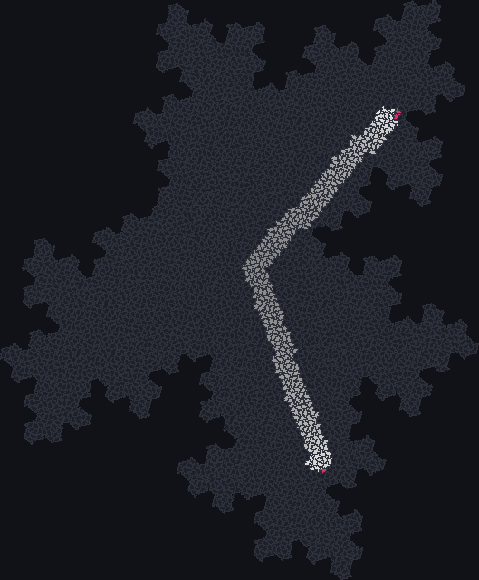
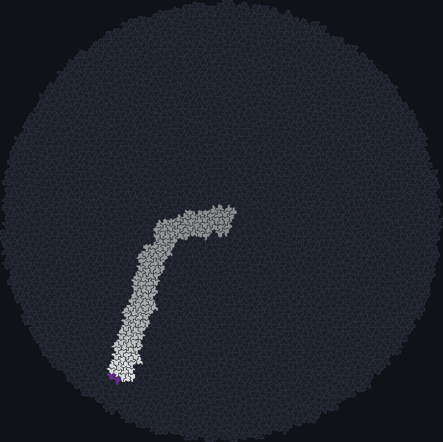

# Priority rules and the Spectre glider

For years it was an open question whether anything could glide across an aperiodic tiling: a
small pattern that moves forever through a tiling that never repeats. In 2026 James Edmond found
gliders on both of the new aperiodic monotiles, the hat and the spectre, by widening the space of
rules to *priority tables* and searching it with an evolutionary algorithm. JETCARP runs his rules,
and reimplements his search on every tiling.

<figure>

<figcaption>Edmond's Spectre glider. A two-tile seed at the centre of a patch of about 4,000 spectres
launches a pair of gliders on lanes 120° apart; the pale tiles are the trail of every tile they have
occupied in 70 generations (older parts darker), and the small red and yellow groups at the ends are
the gliders. Scene <code>docs/scenes/automata/priority-spectre-glider.json</code>, drawn with the trail
script <code>docs/scenes/automata/glider-trail.rhai</code>.</figcaption>
</figure>

## What it is

A **priority table** is a rule written as an ordered list of rows. Each row says: if the cell is in
this state (or any state), and its neighbours meet these conditions, then its next state is this.
The conditions are thresholds on how many neighbours are in each state, joined by "and". The first
row that matches decides the cell's next state; a cell that matches no row becomes empty.

This is more expressive than a birth/survival rule, which only counts live neighbours, and it
contains the Generations rules as a special case. Edmond found that searches over simpler rules on
the hat and spectre turned up only travellers that eventually die, and that priority tables over the
touch neighbourhood were rich enough to hold true gliders.

The **Spectre glider** rule is one such table with four states, of which it uses three. A *head*
(state 1) excites *wings* (state 3) around it; a wing next to a head becomes a head; crowded wings die.
The result is a relay that moves one ring of tiles every two generations. From the seed it emits two
gliders on lanes 120° apart, and Edmond reports that his gliders travel a million rings at constant
speed and heading ([Edmond 2026](../research/bibliography.md#edmond2026gliders)).

## Where it came from

Life on Penrose tilings was studied for its still lifes and oscillators; Hill, Stepney and Wan, and
Owens and Stepney, found no moving objects
([Hill, Stepney and Wan 2005](../research/bibliography.md#hill2005penrose);
[Owens and Stepney 2010](../research/bibliography.md#owens2010game)). Adam P. Goucher found the first
glider on an aperiodic tiling in 2012, with a four-state rule on a Penrose tiling
([Goucher 2012](../research/bibliography.md#goucher2012gliders)); Edmond's paper says this overturned
a conjecture, backed by a small cash prize, that no such object exists. After the hat was announced in
2023, Andrew Trevorrow's HatLife let people explore rules on it interactively, including a
hand-designed "Worms" rule whose worms cross the patch
([Trevorrow 2023](../research/bibliography.md#trevorrow2023hatlife)).

James Edmond's "Gliders on Aperiodic Monotilings: Cellular Automata on the Hat and Spectre" (2026)
introduced priority tables, presented as his own rule family, and found gliders on both monotiles
with a genetic algorithm over four-state tables on the touch neighbourhood. His gliders' headings fall
on a "six-spoke compass", and the Spectre glider is his record of the evolved Spectre rule (Table 7 of
the paper's second version), found with no known rule planted in the search
([Edmond 2026](../research/bibliography.md#edmond2026gliders)).

## How JETCARP runs it

### Notation

| Notation | Meaning |
| --- | --- |
| `SpectreGlider` | Edmond's Spectre glider rule |
| `Priority 4: 0\|n0>=3&n1>=1->3; 3\|n3>=3->0; 3\|n1>=1->1` | The same rule written as a table |
| `Priority 4: 3\|n2>=1->2; 0\|n3>=2->0; 0\|n2>=1->3; 0\|n1>=1->2` | A hat glider rule found by JETCARP's search (below) |

`Priority <states>:` is followed by rows separated by semicolons. Each row is
`<own state>|<conditions>-><next state>`, where the own state is a number or `*` for any state, and the
conditions are terms `nS>=m` ("at least m neighbours in state S") joined by `&`, or `always`. The
first matching row wins and the default is 0. `SpectreGlider` is exactly the three rows above: these
are the rows of Edmond's Table 7 that do not lead to state 0, since 0 is the default anyway.

### On any tiling

A priority table only counts neighbours by state, so it runs on any neighbour graph (see
[How JETCARP generalises automata](generalising.md)). Edmond's rules use touch neighbours, which is
also JETCARP's default for them. The seed `glider_pair` places the Spectre glider's two-tile seed at
the centre of a patch.

### Evolutionary search and verified movers

`jetcarp evolve` reimplements Edmond's evolutionary search and runs it on any tiling, periodic or
aperiodic. It is written from his paper and a reading of his repository; two small functions, the
mutation step and the table notation, are adapted from his monotile-ca code under its MIT licence,
as listed in JETCARP's third-party notices. Movers it finds on aperiodic tilings are followed by
`jetcarp movers` across ever larger exact patches, or on a sliding window that generates tiles around
the mover as it goes, and recorded as *verified to a distance*: the number of rings of tiles the mover
was followed without changing.

<figure>

<figcaption>A glider on the hat found by JETCARP's reimplementation of Edmond's search, with its trail
over 60 generations: after a short start it settles onto a straight course. After relabelling its
states, the rule differs from Edmond's hat glider B on about 561 of some 12,000 combinations of
state and neighbour counts, and it is very probably the same mechanism. Scene
<code>docs/scenes/automata/priority-hat-glider.json</code>, trail script
<code>docs/scenes/automata/glider-trail.rhai</code>.</figcaption>
</figure>

## What is new here

Priority tables, the evolutionary method, the Spectre glider and the hat gliders are Edmond's. The
hat glider JETCARP found is not a new kind of object: compared rule by rule with all of Edmond's
published tables, it is closest to his hat glider B after relabelling the states, and probably the
same mechanism in a different table. JETCARP's own part is running the search on every tiling and
verifying movers to a distance; we make no novelty claim for this family. The comparison is
described in [What is new in JETCARP](../research/contributions.md).

## Try it

- Quick Start: *Spectre glider* and *Spectre glider (Edmond 2026)*.
- `jetcarp script docs/scenes/automata/glider-trail.rhai --out pictures --set scene=$PWD/docs/scenes/automata/priority-spectre-glider.json --set gens=70 --set png=trail.png`
  draws the trail picture above.
- `jetcarp evolve --help` describes the search.

## References

- [Edmond 2026](../research/bibliography.md#edmond2026gliders)
- [Goucher 2012](../research/bibliography.md#goucher2012gliders);
  [Hill, Stepney and Wan 2005](../research/bibliography.md#hill2005penrose);
  [Owens and Stepney 2010](../research/bibliography.md#owens2010game)
- [Trevorrow 2023](../research/bibliography.md#trevorrow2023hatlife)
