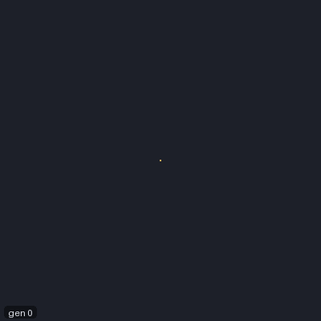
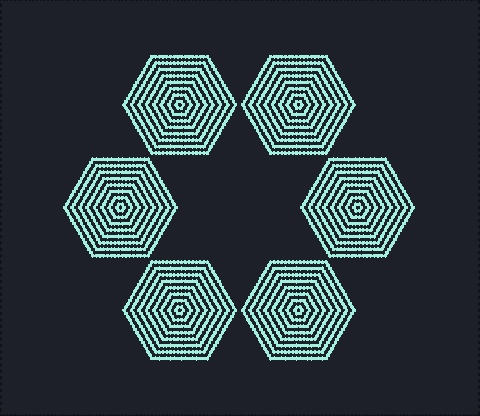

# Rule tables

Every family on the other pages has its rule built into JETCARP. A rule table is the way to write
your own: a list of transitions, each saying "a cell in this state, with these neighbours in these
positions, becomes this". Rule tables can express almost any rule with a handful of states,
including rules that depend on direction, which is how classic constructions such as Codd's
automaton and Langton's loops are usually written down.

<figure class="pair">
<div><picture>
  <source srcset="../images/automata/ruletable-parity-still.png" media="(prefers-reduced-motion: reduce)">
  
</picture></div>
<div></div>
<figcaption>Left: the built-in table <code>parity</code>, in which each cell becomes the exclusive or of its
four edge neighbours, from one live cell for 63 generations. Watch the pattern copy itself: the rule is
linear, so at generation 2<sup>k</sup> the pattern is four copies of the starting cell, 2<sup>k</sup>
cells away, and each copy then replays the history so far; at generation 63, just before the next
doubling, the copies fill a diamond. Scene
<code>docs/scenes/automata/ruletable-parity.json</code>. Right: the same idea on hexagons, as a table
of 128 transitions written into the scene itself, 47 generations. Scene
<code>docs/scenes/automata/ruletable-hex.json</code>.</figcaption>
</figure>

## What it is

A rule table lists transitions of the form `c,n1,…,nk:new`: if the cell is in state `c` and its
neighbours, read in a fixed order, are in states `n1` to `nk`, its next state is `new`. Each position
can also be `*` (any state) or a set of alternatives such as `1|2|3`. A *symmetry* setting saves
writing out every rotation of a case: `rotate` applies each transition to all rotations of the
neighbours, `rotate_reflect` also to their mirror images, and `permute` treats the neighbours as an
unordered collection. The first transition that matches wins; a cell that matches none keeps its
state.

Because a table can tell neighbours apart by position, it can express rules that depend on
direction: a signal travelling along a wire, a gate that only lets it pass one way. That is what made
tables the standard way to write constructions like Codd's.

## Where it came from

Edgar F. Codd's PhD thesis at the University of Michigan (1965), advised by John H. Holland, and his
book *Cellular Automata* (1968) reduced von Neumann's 29 states to 8 while keeping computation and
construction universal, with signals running along wires wrapped in a sheath
([Codd 1965](../research/bibliography.md#codd1965propagation);
[Codd 1968](../research/bibliography.md#codd1968cellular);
[Wikipedia: Codd's cellular automaton](../research/bibliography.md#wikipediand_codd)). Christopher
Langton's self-reproducing loop of 1984 was derived from Codd's periodic emitter; it replicates with a
few dozen cells but does not compute universally
([Langton 1984](../research/bibliography.md#langton1984selfreproduction)). Rules like these are
naturally written as transition tables. Tim Hutton found four flaws in Codd's published specification,
corrected them and built Codd's complete self-replicating computer, whose tape alone is 208 million
cells long ([Hutton 2010](../research/bibliography.md#hutton2010codd)).

Golly's RuleTable format, written by Hutton, made tables a common exchange format
([Golly: file formats](../research/bibliography.md#gollynd_formats);
[Golly credits](../research/bibliography.md#gollynd_credits)), and Hutton's Rule Table Repository
collected Codd's rule, John Devore's 1973 variant, Langton's loops and their successors by Byl, Chou
and Reggia, and Sayama ([Rule Table Repository](../research/bibliography.md#huttonnd_ruletablerepository)).

## How JETCARP runs it

### JETCARP's own format

JETCARP's tables are its own JSON format; it does not read Golly's files and uses none of Golly's
code. A table looks like this:

```json
{
  "name": "parity-example",
  "states": 2,
  "neighborhood": "edge",
  "symmetry": "rotate",
  "arity": 4,
  "transitions": ["0,1,0,0,0:1", "1,1,1,0,0:0"]
}
```

`arity` is the number of neighbours each transition lists. A scene can carry its own tables in a
`tables` list, and the app can load one from a file; an automaton then uses it with the rule
`Table <name>`. One table is built in: `Table parity`, Fredkin's replicator rule on edge neighbours
(each cell becomes the XOR of its four neighbours), generated in JETCARP from the rule's definition.

### Neighbour order on any tiling

The neighbours are read in the cell's clockwise slot order, the same order turmites use for turning
(see [How JETCARP generalises automata](generalising.md)). On squares with edge neighbours that is
north, east, south, west. Edge neighbours are the default; touch neighbours can be chosen. Cells past a
dead edge read as 0 (or 1 with live edges). On a tiling where tiles have different numbers of
neighbours, a positional table only applies to tiles with exactly `arity` neighbours, and the others
keep their state; a `permute` table counts neighbours without regard to position.

### Codd's automaton

JETCARP v0.4.0 does not ship Codd's rule; adding it, written from Codd's book, is on the roadmap.

## What is new here

Nothing. Rule tables are a standard tool; JETCARP's contribution is only its own file format and
running tables on any tiling's neighbour order.

## Try it

- Quick Start: *Parity (von Neumann table)*.
- `jetcarp run docs/scenes/automata/ruletable-hex.json --gens 47 --png hex-parity.png`, then edit
  the scene's table and run it again.

## References

- [Codd 1965](../research/bibliography.md#codd1965propagation);
  [Codd 1968](../research/bibliography.md#codd1968cellular);
  [Wikipedia: Codd's cellular automaton](../research/bibliography.md#wikipediand_codd)
- [Langton 1984](../research/bibliography.md#langton1984selfreproduction);
  [Hutton 2010](../research/bibliography.md#hutton2010codd)
- [Golly: file formats](../research/bibliography.md#gollynd_formats);
  [Golly credits](../research/bibliography.md#gollynd_credits);
  [Rule Table Repository](../research/bibliography.md#huttonnd_ruletablerepository)
