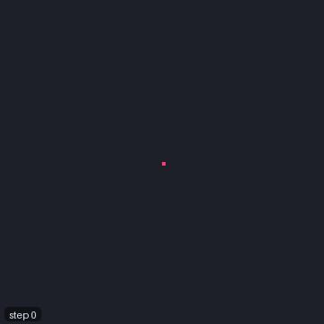
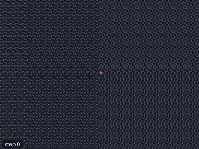
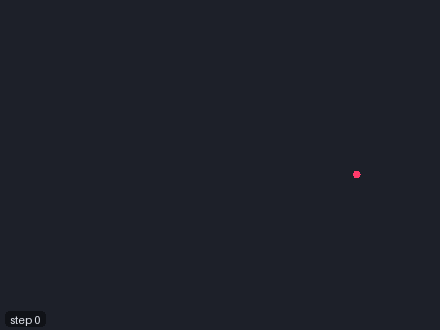

# Langton's ant and turmites

Langton's ant is a single moving agent with a two-line rule: on a white cell turn right, on a black
cell turn left; flip the colour of the cell and step forward. From an empty grid it wanders for
about ten thousand steps in what looks like chaos, then suddenly starts building a straight
"highway" and never stops. Turmites generalise the ant to more colours and to internal states.
JETCARP runs them on any tiling.

<figure>
<picture>
  <source srcset="../images/automata/turmite-langton-still.png" media="(prefers-reduced-motion: reduce)">
  
</picture>
<figcaption>Langton's ant (<code>Ant RL</code>) on an empty grid, about 12,000 steps at 150 steps a frame. For
about ten thousand steps it builds an irregular, roughly symmetric blob; then, quite suddenly, it
starts the diagonal highway that repeats every 104 steps and leaves the blob for good. The red cell is
the ant. Scene <code>docs/scenes/automata/turmite-langton.json</code>.</figcaption>
</figure>

## What it is

An **ant** sits on a cell, facing one of the cell's sides. Each step it reads the colour of its cell,
turns according to that colour, changes the cell to the next colour, and moves to the neighbour it
now faces. A *turn string* gives the turn for each colour: Langton's ant is `RL` (two colours: right
on colour 0, left on colour 1), and `LLRR` has four colours, each cell cycling through 0, 1, 2, 3.

A **turmite** adds internal states: what it writes, how it turns and which state it moves to all
depend on both its state and the cell's colour, like a Turing machine whose tape is the plane. An
ant is a turmite with one state.

These agents are interesting for how much they do with so little. The RL ant's highway repeats every
104 steps, moving two cells diagonally each period. Some turn strings, such as `LLRR`, grow patterns
that keep returning to perfect mirror symmetry; others fill squares or triangles, or wander forever.
A single ant can compute: its path can be made to evaluate any logical circuit.

<figure class="pair">

<picture>
  <source srcset="../images/automata/turmite-llrr-still.png" media="(prefers-reduced-motion: reduce)">
  
</picture>

<picture>
  <source srcset="../images/automata/turmite-cairo-still.png" media="(prefers-reduced-motion: reduce)">
  
</picture>

<figcaption>Left: the four-colour turmite <code>LLRR</code> over 120,000 steps; watch its blob grow and
keep returning to mirror symmetry. Scene <code>docs/scenes/automata/turmite-llrr.json</code>. Right:
Langton's ant on Cairo pentagons over 30,000 steps, here without a highway; the pentagons' outlines
show the tiling under the cloud. Scene <code>docs/scenes/automata/turmite-cairo.json</code>.</figcaption>
</figure>

<figure>
<picture>
  <source srcset="../images/automata/turmite-trihex-highway-still.png" media="(prefers-reduced-motion: reduce)">
  
</picture>
<figcaption>The three-colour turmite <code>RNL</code> (turn right, go on, or turn left, by the colour of the
tile) on the trihexagonal tiling 3.6.3.6, about 3,000 steps. After roughly 2,600 steps of disorder it
builds a highway that repeats every 36 steps and runs straight out of the picture. One of 39,744
highways on non-square tilings in JETCARP's catalogue, all re-verified on the release engine. Scene
<code>docs/scenes/automata/turmite-trihex-highway.json</code>.</figcaption>
</figure>

## Where it came from

Christopher G. Langton described single-state two-dimensional Turing machines, which he called
*vants* (virtual ants), in "Studying artificial life with cellular automata" (1986); the RL ant is
among them ([Langton 1986](../research/bibliography.md#langton1986studying)). Greg Turk's 2025 review
credits Langton with the term and, as far as Turk knows, with being the first to study such
machines. Turk also points to a related earlier idea, the "worms" of Paterson and Conway that Martin
Gardner wrote about in 1973 ([Turk 2025](../research/bibliography.md#turk2025vants);
[Gardner 1973](../research/bibliography.md#gardner1973worms)).

Turk rediscovered the RL ant independently and sent several two-dimensional Turing machines to
A. K. Dewdney, who presented them in his *Scientific American* column of September 1989 and coined
the name *tur-mite* ([Dewdney 1989](../research/bibliography.md#dewdney1989computer);
[Turk 2025](../research/bibliography.md#turk2025vants)). David Gale's columns in *The Mathematical
Intelligencer* took up the ant ([Gale 1993](../research/bibliography.md#gale1993industrious)) and
reported James Propp's work on ants whose turns are a string of Ls and Rs
([Propp 1994](../research/bibliography.md#propp1994further)). Gale, Propp, Scott Sutherland and Serge
Troubetzkoy identified a class of ants whose patterns are, at times, bilaterally symmetric, and proved
it ([Gale et al. 1995](../research/bibliography.md#gale1995further)); the columns were collected in
Gale's *Tracking the Automatic Ant* ([Gale 1998](../research/bibliography.md#gale1998tracking)). Ian
Stewart's 1994 *Scientific American* article brought the ant to a wide audience
([Stewart 1994](../research/bibliography.md#stewart1994ultimate)).

Physicists met the same dynamics independently, as a particle bouncing off rotators that flip when
hit, a *Lorentz lattice gas*. Bunimovich and Troubetzkoy's recurrence results are the source usually
cited for the theorem that the ant's path is always unbounded
([Bunimovich and Troubetzkoy 1992](../research/bibliography.md#bunimovich1992recurrence)); Kong and
Cohen studied related lattice gases on the triangular lattice
([Kong and Cohen 1991](../research/bibliography.md#kong1991diffusion)). Gajardo, Moreira and Goles
showed that the ant's path can compute any boolean circuit, so predicting it is P-hard
([Gajardo, Moreira and Goles 2002](../research/bibliography.md#gajardo2002complexity)), and Tsukiji and
Hagiwara extended hardness results to generalised ants on square and hexagonal grids
([Tsukiji and Hagiwara 2011](../research/bibliography.md#tsukiji2011recognizing)).

The highway's onset is usually given as step 9,977, with period 104
([Hutton 2015](../research/bibliography.md#hutton2015twodimensional)); we have not traced that
number to a primary publication, but JETCARP's own run reproduces it exactly. Tim Hutton's Golly
scripts generate turmite rules, including on triangular and hexagonal grids, and his page credits
Allen H. Brady with first studying the triangular case
([Hutton 2015](../research/bibliography.md#hutton2015twodimensional)). Other programs that run ants
include CelLab ([Rucker and Walker 1989](../research/bibliography.md#rucker1989cellab)), Uri
Wilensky's NetLogo model ([Wilensky 2005](../research/bibliography.md#wilensky2005vants)) and, on
Penrose tilings, ptiles/ant ([ptiles/ant](../research/bibliography.md#ptilesnd_ant)). Turk's 2025
paper publishes much of his own work from around 1989, including multistate, universal and
self-reproducing turmites ([Turk 2025](../research/bibliography.md#turk2025vants)).

## How JETCARP runs it

### Notation

| Notation | Meaning |
| --- | --- |
| `Ant RL` | Langton's ant |
| `Turmite LLRR` | Four colours, one state |
| `Turmite RL2NU` | Turns for hexagons: R, L2 (two slots), N (none), U (U-turn) |
| `Turmite 1R1,1L0/1R1,0N0` | A table: two states (separated by `/`) and two colours (separated by `,`) |

In a table each entry is `<colour to write><turn><next state>`, one group per state and one entry per
colour. Up to 16 colours and 16 states are allowed, with 10 to 15 written `a` to `f`.

### Turns on any tiling

A turn is counted in *slots* of the current tile's edge neighbours, listed clockwise. `R` and `L`
turn one slot, `R2` and `L2` two slots (120 degrees on a hexagon), `U` half the tile's number of
sides, and `N` not at all. After a step, the ant faces "straight on": the side opposite the one it
came in by. A tile with an odd number of sides has no opposite side, so straight on is rounded, and
on such tiles `N` and `U` are relative to the entry edge. With this one convention the same turn
string runs on squares, hexagons, pentagons, mixed tilings and the aperiodic tilings, even though
`R` means 90 degrees on a square, 60 on a hexagon and something irregular on a hat (see
[How JETCARP generalises automata](generalising.md)).

### Running and searching

In a scene, an ant automaton takes `steps_per_gen` (how many ant steps make one generation) and an
`ants` seed with a count; several ants can share a field, and on a field shared with other automata
they interact with Life or an elementary rule. At a dead edge an ant either bounces or falls off.

For research, `jetcarp ants` runs turn strings and turmite tables on an unbounded periodic tiling and
classifies every run. When it reports a *highway*, it has proved one: it checks that the ant and
every cell ahead of it recur, shifted, after a fixed number of steps, which by induction repeats
forever. It reproduces the RL ant's published highway (period 104, onset 9,977) and finds, for
example, a highway for `LNL` on hexagons with period 35 from step 161,093. This engine is tested to
agree cell for cell with the ordinary world's turmites on seven tilings.

## What is new here

Ants have run on hexagons, triangles and Penrose tilings before (see above). Our prior-art search
found no earlier turmites on the hat or spectre tilings, but that is a direct application of a known
rule to a known graph, so we do not count it as a discovery. We make no novelty claim for this
family.

## Try it

- Quick Start: *Langton's ant*, *Four-colour turmite LLRR*, and the named turmites *RLR*,
  *LRRRRRLLR*, *LLRRRLRLRLLR* and *RRLLLRLLLRRR*.
- `jetcarp run docs/scenes/automata/turmite-langton.json --gens 120 --png ant.png`
- Move Langton's ant to the hat or to 4.8.8, where tiles of different degree make `R` mean different
  angles from step to step.

## References

- [Langton 1986](../research/bibliography.md#langton1986studying);
  [Turk 2025](../research/bibliography.md#turk2025vants);
  [Gardner 1973](../research/bibliography.md#gardner1973worms);
  [Dewdney 1989](../research/bibliography.md#dewdney1989computer)
- [Gale 1993](../research/bibliography.md#gale1993industrious);
  [Propp 1994](../research/bibliography.md#propp1994further);
  [Gale et al. 1995](../research/bibliography.md#gale1995further);
  [Gale 1998](../research/bibliography.md#gale1998tracking);
  [Stewart 1994](../research/bibliography.md#stewart1994ultimate)
- [Bunimovich and Troubetzkoy 1992](../research/bibliography.md#bunimovich1992recurrence);
  [Kong and Cohen 1991](../research/bibliography.md#kong1991diffusion);
  [Gajardo, Moreira and Goles 2002](../research/bibliography.md#gajardo2002complexity);
  [Tsukiji and Hagiwara 2011](../research/bibliography.md#tsukiji2011recognizing)
- [Hutton 2015](../research/bibliography.md#hutton2015twodimensional);
  [Rucker and Walker 1989](../research/bibliography.md#rucker1989cellab);
  [Wilensky 2005](../research/bibliography.md#wilensky2005vants);
  [ptiles/ant](../research/bibliography.md#ptilesnd_ant)
