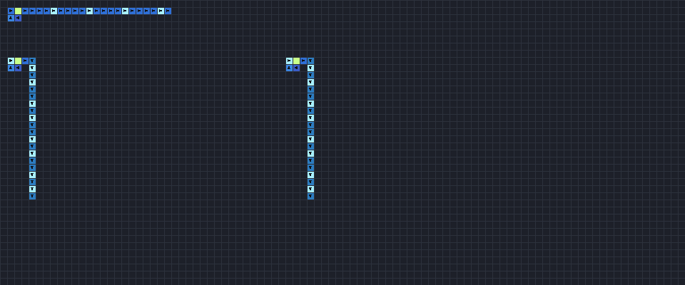
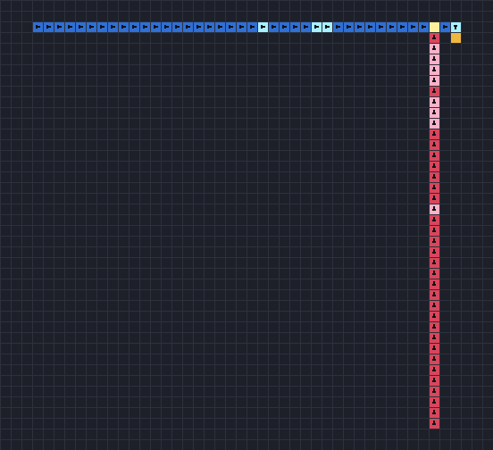

# Von Neumann's 29-state automaton

John von Neumann designed this automaton in the early 1950s to answer a question about life itself:
can a machine build a copy of itself, including the instructions for building the next copy? His
answer was a universal constructor made of cells, each with 29 states, connected to its four
neighbours. Conway's Life began as a simplification of its ideas. JETCARP runs it on the square
grid, from the rule as published.

<figure>

<figcaption>Storage loops growing channels, after Burks's Fig. 12. Each four-cell loop with one
confluent cell (green) stores five bits and feeds them into the ground forever; the pattern 10000
builds an ordinary transmission cell pointing east on each pass, so the top channel grows to the
right, and 10100 builds cells pointing south, so the lower two grow downward. Blue cells are ordinary
transmission states, pale ones carry a signal, and the arrows show each cell's direction. Scene
<code>docs/scenes/automata/vonneumann-channels.json</code>, 120 generations.</figcaption>
</figure>

## What it is

Every cell is in one of 29 states, and talks only to its four edge neighbours:

- **Ground** (unexcitable), the empty background.
- **Transmission** states: ordinary and special, each pointing in one of four directions, each
  quiescent or carrying a signal (16 states). A transmission cell passes a signal in the direction it
  points, one cell per step. A signal of the other kind (ordinary versus special) pointed at a
  transmission or confluent cell destroys it, turning it back to ground.
- **Confluent** states (4), which combine signals: a confluent cell fires only when all the ordinary
  cells pointing into it fire, and it delays its output, which lets it act as an AND gate and a
  memory element.
- **Sensitised** states (8), the intermediate steps by which a signal arriving at ground builds a new
  cell. A sequence of signals sent into ground decides, bit by bit, which of the other states the new
  cell becomes.

With these parts, a *constructing arm* can extend into empty space, build any pattern of cells by
sending the right signal sequences, and withdraw again. Von Neumann's design couples such an arm to a
long tape of instructions; the machine reads the tape, builds a copy of itself, and copies the tape
into it: self-reproduction from a description, a constructor and a copier.

<figure>

<figcaption>Construct and withdraw, after Burks's Fig. 14, 20 ticks in: an ordinary tape from the left
(blue) and a special tape from below (red) feed one cell. Over 37 ticks they build a path of three
cells, write a confluent cell at its end and then destroy the path again, leaving only the confluent
cell. Scene <code>docs/scenes/automata/vonneumann-construct.json</code>, 20 generations.</figcaption>
</figure>

## Where it came from

Von Neumann's work on automata began with "The General and Logical Theory of Automata" (1948) and a
series of lectures at the University of Illinois in 1949, which described a *kinematic*
self-reproducing machine built from mechanical parts. Arthur W. Burks writes that
Stanisław Ulam suggested a cellular framework would be easier to treat mathematically. Von Neumann
then designed an infinite array of square cells, each holding the same 29-state automaton. He began
the manuscript in September 1952 and worked on it until 1953, and left it unfinished
([von Neumann 1966](../research/bibliography.md#vonneumann1966theory)).

Burks edited and completed the work as *Theory of Self-Reproducing Automata* (1966), which states the
transition rule and shows how to finish the self-reproducing design
([von Neumann 1966](../research/bibliography.md#vonneumann1966theory)). A footnote there notes that
Edward F. Moore's 1962 paper proposed the name "tessellation model"
([Moore 1962](../research/bibliography.md#moore1962machine)). E. F. Codd later reduced the number of
states to 8 ([Codd 1968](../research/bibliography.md#codd1968cellular); see [Rule tables](rule-tables.md)).

The first working implementation of a self-reproducing universal constructor was built by Renato
Nobili and Umberto Pesavento in 1994; to simplify the design they extended the rule so that confluent
cells can cross signals ([Pesavento 1995](../research/bibliography.md#pesavento1995implementation);
[Nobili and Pesavento 1996](../research/bibliography.md#nobili1996generalised)). Golly runs the
original 29-state rule and the extended Nobili32 and Hutton32 variants
([Golly: JvN](../research/bibliography.md#gollynd_jvn)), and Yinusa and Nehaniv used it to show that
the completed machine passes heritable mutations to its offspring
([Yinusa and Nehaniv 2011](../research/bibliography.md#yinusa2011study)). Greg Turk's 2025 review
traces the line from von Neumann through Codd and Langton to the present
([Turk 2025](../research/bibliography.md#turk2025vants)).

## How JETCARP runs it

### From the book

JETCARP's `JvN29` was written from Burks's 1966 edition: the states and transition rule (section
2.8.1), its verbal summary (2.8.2) and the worked illustrations (2.8.3). The book's formal statement
of the rule is garbled in the scanned text that was available, so the implementation follows the
clear verbal summary, which the legible parts of the formal rule agree with. Where the text left
details open, the choices were checked against the book's own examples:

- A cell is destroyed by a signal of the other kind pointing at it from any side, including head on,
  so an ordinary and a special signal pointing at each other destroy each other.
- Destruction wins over receiving a signal but not over sending one: a cell excited at one step still
  delivers its signal at the next, even though it has become ground.
- In the storage loop of Fig. 12 the text says four cells store five bits, which four one-step cells
  cannot do, so one of them must be a confluent cell (a two-step delay). Starting it that way
  reproduces the book's trace exactly.
- The construct-and-withdraw sequence of Fig. 14 builds its path, writes the confluent cell and
  withdraws in exactly the 37 ticks the book states.

The book is in copyright; only the rule, which is an algorithm, is reimplemented. No code, rule files
or patterns from other programs were used. JETCARP numbers the states its own way (ground 0,
sensitised 1 to 8, transmission 9 to 24, confluent 25 to 28), so its patterns are not interchangeable
with other programs' files.

### Notation and display

The rule is written `JvN29` (also `JvN` or `VonNeumann29`). The Draw tool lists the states by name.
Ordinary transmission cells are blue and special ones red, excited forms pale and bright; confluent
cells are green and sensitised ones amber. Pictures draw an arrow on each transmission cell when tiles
are at least 10 pixels across.

### Square grid only

The rule depends on the four compass directions, so it has no meaning on other tilings, and JETCARP
refuses to place it on one or to switch a world containing it to another tiling. Cells beyond a dead
edge count as ground; wrapped edges work.

## What is new here

Nothing. This is von Neumann's automaton as Burks published it. JETCARP's contribution is a fresh,
documented reading of the book, with the ambiguities and how they were resolved written down.

## Try it

- Quick Start: *von Neumann: storage loops growing channels* and *von Neumann: construct and withdraw*.
- `jetcarp run docs/scenes/automata/vonneumann-construct.json --gens 37 --png construct.png` runs the
  whole Fig. 14 sequence.

## References

- [von Neumann 1966](../research/bibliography.md#vonneumann1966theory);
  [Moore 1962](../research/bibliography.md#moore1962machine);
  [Codd 1968](../research/bibliography.md#codd1968cellular)
- [Pesavento 1995](../research/bibliography.md#pesavento1995implementation);
  [Nobili and Pesavento 1996](../research/bibliography.md#nobili1996generalised);
  [Golly: JvN](../research/bibliography.md#gollynd_jvn);
  [Yinusa and Nehaniv 2011](../research/bibliography.md#yinusa2011study);
  [Turk 2025](../research/bibliography.md#turk2025vants)
