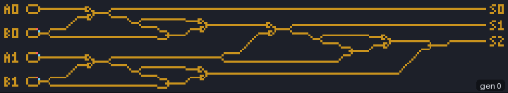

# WireWorld

WireWorld is a cellular automaton for building circuits. You draw wires, and "electrons" run along
them, split at junctions, and are stopped or passed by small arrangements of wire that act as
diodes and logic gates. With enough wire it can compute anything; David Moore and Mark Owen, with
help from others, built a complete programmable computer in it
([Moore and Owen: The Wireworld computer](../research/bibliography.md#quinapalusnd_wireworld)).

<figure>
<picture>
  <source srcset="../images/automata/wireworld-adder-still.png" media="(prefers-reduced-motion: reduce)">
  
</picture>
<figcaption>JETCARP's two-bit adder computing 2 + 3, 240 generations at three a frame. The loops on the
left hold the input bits (A0, B0, A1, B1, low bit first); watch the electrons (blue heads, red tails)
leave them and travel right along the copper wire through XOR and OR junctions. After about 220
generations the output wires S0 and S2 carry electrons and S1 stays dark: 101 in binary, which is 5.
Scene <code>docs/scenes/automata/wireworld-adder.json</code>.</figcaption>
</figure>

## What it is

Each cell is in one of four states: **empty**, **conductor** (copper), **electron head** or
**electron tail**. The rule:

- An empty cell stays empty.
- An electron head becomes an electron tail.
- An electron tail becomes conductor.
- A conductor cell becomes an electron head if exactly one or two of its neighbours are electron
  heads; otherwise it stays conductor.

A head followed by its tail is an electron with a direction: the tail behind it stops it moving
backwards. The "one or two" condition is what makes the circuits work. Where wires meet, a junction
shaped so that an electron coming one way sees one head and one coming the other way sees three can
pass electrons in only one direction (a diode), and similar small shapes give OR, AND, XOR and NOT
gates, clocks and memory ([LifeWiki: WireWorld](../research/bibliography.md#lifewikind_wireworld)).

## Where it came from

WireWorld was devised by Brian Silverman, who also created Brian's Brain and Seeds. LifeWiki says
he proposed it in 1987 as part of his program *Phantom Fish Tank*
([LifeWiki: WireWorld](../research/bibliography.md#lifewikind_wireworld)), and the CelLab manual's
references list *The Phantom Fishtank* (Logo Computer Systems, Montreal, 1987)
([Silverman 1987](../research/bibliography.md#silverman1987phantom)). A 2025 blog post gives 1984
instead ([daneelsan 2025](../research/bibliography.md#daneelsan2025wireworld)), so the rule itself
may be older than the program; we have not been able to settle this.

A. K. Dewdney described WireWorld in his *Scientific American* column in January 1990, which made it
widely known ([Dewdney 1990](../research/bibliography.md#dewdney1990cellular);
[LifeWiki: WireWorld](../research/bibliography.md#lifewikind_wireworld)). David Moore and Mark Owen,
"with the help of many others", designed a complete programmable computer in WireWorld between 1990
and 1992 and wrote it up in September 2004
([Moore and Owen: The Wireworld computer](../research/bibliography.md#quinapalusnd_wireworld)); a copy
that computes prime numbers ships with Golly
([LifeWiki: WireWorld](../research/bibliography.md#lifewikind_wireworld)). WireWorld has
long been built into MCell and Golly, and Andrew Trevorrow's HatLife ran it on the hat tiling in
2023 ([Trevorrow 2023](../research/bibliography.md#trevorrow2023hatlife)).

## How JETCARP runs it

### Notation and states

The rule is written `WireWorld`. States are 0 (empty), 1 (electron head), 2 (electron tail) and 3
(conductor), drawn by default as dark background, blue, red and amber; use the Draw tool to paint
wire and electrons.

### On any tiling

WireWorld only asks how many neighbours are electron heads, so it runs on any neighbour graph (see
[How JETCARP generalises automata](generalising.md)). The circuits designed for the square grid
depend on its geometry, though: a junction that is a diode on squares is just a blob of wire on
hexagons. On another tiling you have to find new gates, which is part of the fun. Touch neighbours
are the default, as in the classic rule; edge neighbours make thin wires behave differently at
corners. WireWorld can be stepped on the GPU on lattice tilings, and HashLife can jump wrap-edge
lattice worlds far ahead.

### The adder

The adder in the figure was built for JETCARP, cell by cell, by code that can regenerate and check
it. Every component keeps one timing rule: electrons that leave their sources together reach each
column together, so the inputs of every gate arrive at the same moment and no delay lines are
needed. Its parts are fan-outs, a three-cell OR junction and a 17-cell XOR junction in which two
simultaneous electrons annihilate. The OR and XOR junctions were found by JETCARP's own search, an
exhaustive scan of small junction shapes and simulated annealing, not copied from earlier designs.
Half adders are built without any wire crossings, and the tests run all 16 input combinations.
`jetcarp demo wireworld-adder --a A --b B` builds it for any inputs from 0 to 3.

## What is new here

WireWorld, its gates and its computers are not ours. The adder's particular junctions were found by
JETCARP's search, but we make no claim that they are new shapes; small WireWorld gates have been
designed by many people. Running WireWorld on other tilings has been done before, on the hat.

## Try it

- Quick Start: *WireWorld clocks*, *WireWorld adder: 2 + 3* (family *Computing*).
- `jetcarp demo wireworld-adder --a 3 --b 3 --png adder.png` builds and runs the adder for 3 + 3.
- Paint a loop of wire with one head and one tail behind it and watch it act as a clock.

## References

- [LifeWiki: WireWorld](../research/bibliography.md#lifewikind_wireworld)
- [Silverman 1987](../research/bibliography.md#silverman1987phantom);
  [daneelsan 2025](../research/bibliography.md#daneelsan2025wireworld)
- [Dewdney 1990](../research/bibliography.md#dewdney1990cellular)
- [Moore and Owen: The Wireworld computer](../research/bibliography.md#quinapalusnd_wireworld)
- [Trevorrow 2023](../research/bibliography.md#trevorrow2023hatlife)
