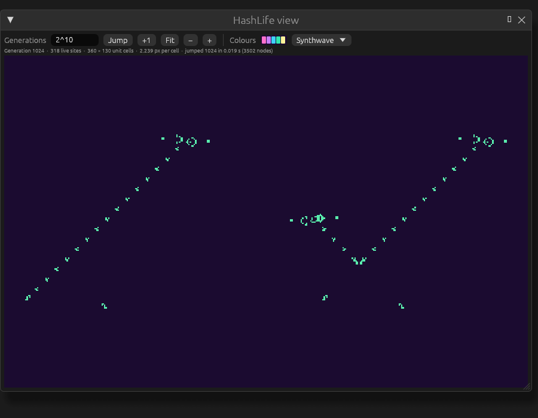

# HashLife and very long runs

HashLife, Bill Gosper's algorithm of 1984, jumps a pattern millions or trillions of generations
ahead in a moment. It cuts the plane into blocks, remembers how each block evolves, and treats equal
blocks anywhere in space and time as one, so a pattern that is regular, such as a glider gun and its
stream, costs almost nothing to run far ahead. JETCARP's HashLife was written for it from the
published algorithm, and it works on every periodic tiling, not just the square grid. This guide
covers what HashLife can run, the two ways of jumping, the *HashLife view* window, the
`jetcarp hashlife` command, scripts, and what to do for long runs HashLife cannot help with.

<figure>

<figcaption>The <em>HashLife view</em> window on the built-in <em>Life NOT gate</em> scene
(<code>crates/jetcarp-core/data/scenes/life-not.json</code>) after 2<sup>10</sup> generations, in the
Synthwave palette. Drawn by the app's offscreen test (see <code>docs/tools/render-figures.sh</code>).</figcaption>
</figure>

## What HashLife can run

- **Tilings:** any periodic tiling. Each unit cell of the tiling is one site of HashLife's lattice,
  holding the states of all its tiles, so the square grid (with either neighbourhood), hexagons, the
  Archimedean and k-uniform tilings, the isohedral types and the editable families all work. The
  aperiodic Penrose, hat and spectre tilings have no lattice, so they do not.
- **Rules:** those whose next state depends only on a cell's own state and how many neighbours are in
  state 1: Life-like rules and Generations rules (rules with B0 included), WireWorld and
  Greenberg–Hastings. A world may have several such automata, on shared or separate fields. Any other
  rule is refused by name.
- **Ages are not kept.** After a jump every live cell has age 1, so age colouring starts over, and the
  world's state hash differs from that of a world stepped the same distance even though every cell
  matches. Compare the hash of the cell states alone: `w.states_hash()` in a script, `cells_hash` in
  the world status, or `--compare` on the command line.
- **Limits:** jumps of up to 2<sup>62</sup> generations, and up to 65,536 different states per site
  (the number of states raised to the number of tile types in the unit cell). Memory is kept in check
  by a cap on the number of stored blocks (48 million by default, about 2 GB), beyond which unused
  blocks are cleared out; that never changes the result.

## Two ways to jump

**On the unbounded plane.** The world's live cells are taken out of their grid and run on an infinite
plane, ignoring the grid's edges, and the result is brought back as a new world: by default the same
frame as the original, or any region of the plane. This works for any qualifying world on a periodic
tiling.

**In place, on a torus.** A world with wrapped edges whose width and height, in unit cells, are both
powers of two (such as 256 × 128) is a torus that HashLife can advance exactly as stepping would. The
jump is logged as a `jump` command, so the scene replays it. A world with dead or live edges, or with a
sequence installed, cannot be jumped in place.

## In the app

*Run → Jump* opens a small menu with a *Generations* box, which takes a number or a form such as
`2^40` or `1e6`, and three choices:

- **Jump ahead (HashLife)** jumps the world in place. When the world does not qualify, the button is
  greyed out and hovering over it says why (for example, *HashLife needs a torus whose sides are powers
  of two (this one is 200 × 140 unit cells)*).
- **On the unbounded plane** shows the same frame after that many generations on the plane, as a new
  world named after the old one (*… +1000000 (HashLife plane)*).
- **HashLife view…** opens the pattern on the plane in a window of its own, also under *Tools →
  HashLife view…*. Opening it pauses the world.

In the **HashLife view**, type a number of generations and press *Jump*, or *+1* for one more. Drag
to pan and scroll to zoom about the pointer; *Fit* frames the whole pattern, and *−* and *+* halve and
double the zoom. *Colours* uses the world's palette or any other. The line under the toolbar gives the
generation, the number of live sites, the pattern's extent in unit cells and the zoom. The view draws
straight from HashLife's blocks at the level where one block is about one screen pixel, so zoomed out
it is as fast after 2<sup>40</sup> generations as after 100; zoomed in, every tile is drawn in its real
shape. Jumps run in the background while the window shows the last frame.

## On the command line

`jetcarp hashlife` takes a scene, a record exported from the pattern library, or a pattern in RLE or
plaintext. A Gosper glider gun, 2<sup>40</sup> generations on:

```text
$ jetcarp hashlife gosper.rle --gens 2^40 --png gun.png
input:      gosper.rle
mode:       plane (square B3/S23)
generation: 1099511627776 (+1099511627776 in 0.008s)
population: 183251938004 (was 36)
bounds:     i 0..274877906961, j 0..274877906948 (274877906962 × 274877906949 unit cells)
nodes:      9277 live, 9277 peak, 0 collections
region:     i0 -8, j0 -8, 274877906978 × 274877906965
png:        gun.png (1025x1025, density map)
```

On the plane, the options choose what to export: `--region i0,j0,w,h` (in unit cells), or `world`
for the source scene's own frame (the default is the pattern's bounding box plus `--margin`, 8), and
`--boundary` for the exported world's edges. `--save FILE` writes the region as a new scene, which
starts at generation 0 with every cell at age 1 (it has no recorded hash, so run it with `jetcarp run`
rather than `jetcarp verify`). `--png FILE` draws it with JETCARP's renderer up to `--max-cells` cells
(16 million) and as a density map above that, in `--palette`, at most `--max-side` pixels. `--rule`
overrides the rule (RLE files default to their header's rule, else `B3/S23`).

`--torus` jumps a scene in place instead, and `--compare cpu` (or `gpu`) also runs the ordinary
engine and checks that every cell agrees:

```text
$ jetcarp hashlife torus.json --torus --gens 5000 --compare cpu
input:      torus.json
mode:       torus (Square (parallelogram) (square): 65536 cells, 256x256 unit cells, 1 tile type(s), storage dense, edges wrap)
generation: 5000 (+5000 in 0.200s)
population: 1969
states:     730e938cfe04df96
hash:       4cd23522a2a2780b
nodes:      71640 live, 71640 peak, 0 collections
compare:    cpu (32 threads) 3.539s, states equal
```

Saved with `--save`, a torus jump keeps the `jump` command in the scene's log, so `jetcarp verify`
replays it. `--node-cap` changes the number of stored blocks before a clear-out, and `--leaf-level`
(at most 6) how large a block is stepped directly by a fast bit-parallel stepper for Life-like and
Generations rules without B0; neither changes the result.

## In a script

```rhai
let w = world(#{ tiling: "square", size: [256, 256], boundary: "wrap", rng_seed: 1 });
w.add_ca("B3/S23", #{ seed: "random:0.3" });
print(w.can_jump());           // true, or the reason it cannot
w.jump("2^20");                // in place, logged as a jump command
print(w.states_hash());
let later = hashlife(w, 1000); // on the plane: a new world, same frame and edges
```

`hashlife(w, n, #{ region: [i0, j0, w, h], boundary: "dead", node_cap: 48000000 })` chooses the region
and edges of the result; `region: "fit"` with `margin` takes the pattern's bounding box. See
[Scripting (Rhai) API](../reference/scripting.md#running).

## Long runs HashLife cannot help with

HashLife needs regularity and a lattice. For everything else:

- **Run headless.** `jetcarp run scene.json --gens N` runs as fast as the machine allows, with no
  drawing, on all cores; `--gpu` steps on the graphics adapter where the rules allow it, with an
  identical result. In the app, *Run → Max speed* and *Run → GPU simulation* do the same.
- **Save and carry on.** `jetcarp run … --save` records where a run got to, and running the saved
  scene again continues from there.
- **Large sandpiles** have their own method, which builds a pile of any size by doubling (see
  [Large sandpiles](large-sandpiles.md)).
- **Movers on aperiodic tilings** can be followed for millions of tiles on a sliding window that is
  built around them as they go (see [Aperiodic patches and following movers](aperiodic-patches.md)).
- **Searches** run as resumable jobs, so they can run for days and survive restarts (see
  [Searching for patterns](searching.md)).

HashLife was described by R. Wm. Gosper in "Exploiting regularities in large cellular spaces",
*Physica D* 10 (1984), 75–80. JETCARP claims nothing new about the algorithm itself.
