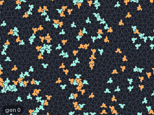
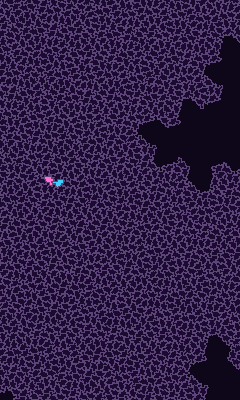
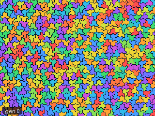
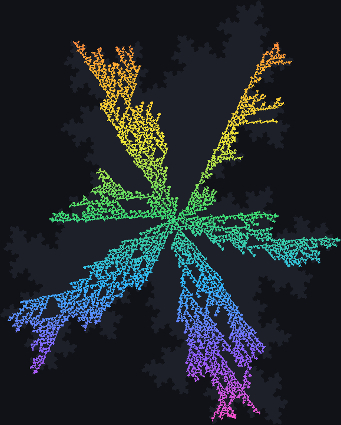

# Introduction

**JETCARP**, Jimmie's Euclidean Tilings and Cellular Automata Research Program, runs cellular
automata on almost any tiling of the plane: squares and hexagons, all eleven Archimedean tilings, the
1,248 k-uniform tilings up to k = 6, 81 isohedral tile types, tiles you draw yourself, and the
aperiodic Penrose, hat and spectre tilings. It runs Life and the Life-like rules, Generations, Larger
than Life, Langton's ant and the turmites, WireWorld, the cyclic and excitable rules, sandpiles,
Lenia and more, several at once if you like, on shared or separate fields. It is one program, with a
graphical app, a command line, a scripting language and a Model Context Protocol (MCP) server for AI
assistants, and it comes with tools that search for spaceships, oscillators and other patterns and
keep verified catalogues of what they find.

This is version 0.4.0, the first public release. JETCARP grew out of an earlier private project of
Jimmie's called CART; the [changelog](about/changelog.md) says what changed.

## Who it is for

- **Desktop art.** JETCARP can run a scene as a live wallpaper behind your windows, as a screensaver,
  or as still wallpapers cut to your monitors, in thirty built-in palettes or your own. Start with
  [Your first live wallpaper](tutorials/first-wallpaper.md).
- **Hobby exploration.** Pick an entry from Quick Start, move it to another tiling, change the rule,
  draw your own tile, and see what happens. Searching for your own spaceships takes one command.
  Start with [Life on a new tiling](tutorials/life-on-a-new-tiling.md).
- **Research.** Every run is a [scene](reference/scene-format.md) that replays bit for bit and records
  its state hash; every catalogued pattern has been verified exactly; the searches are resumable jobs
  whose results do not depend on the thread count and are designed not to depend on the machine; and
  everything can be scripted.
  Start with [Core ideas](getting-started/core-ideas.md) and [Reproducibility](research/reproducibility.md).

## A gallery

<figure class="pair">

<picture>
  <source srcset="images/automata/jaca-hat-war-still.png" media="(prefers-reduced-motion: reduce)">
  
</picture>

<picture>
  <source srcset="images/automata/priority-spectre-glider-still.png" media="(prefers-reduced-motion: reduce)">
  
</picture>

<figcaption>Left: a territory war on the hat tiling in <a href="automata/jaca.md">JACA</a>, Jimmie
Rodgers's annihilating two-sided Life (<code>JACA B27/S013</code>); where the two signs meet, both are
destroyed. Scene <code>docs/scenes/automata/jaca-hat-war.json</code>. Right: James Edmond's
<a href="automata/priority-rules.md">Spectre glider</a>, two gliders crossing a tiling that never
repeats. Scene <code>docs/scenes/automata/priority-spectre-glider.json</code>.</figcaption>
</figure>

<figure class="pair">

<picture>
  <source srcset="images/tilings/ship-57a0326c-still.png" media="(prefers-reduced-motion: reduce)">
  
</picture>

<picture>
  <source srcset="images/automata/cyclic-hat-still.png" media="(prefers-reduced-motion: reduce)">
  
</picture>

<figcaption>Left: a period-42 spaceship on the rhombitrihexagonal tiling 3.4.6.4, found by JETCARP's
soup searches and one of the strongest of its candidates: to our knowledge it has not been reported
before (see <a href="research/contributions.md#4-spaceships-on-non-square-tilings">What is new</a>). Scene
<code>docs/scenes/tilings/ship-57a0326c.json</code>. Right: the
<a href="automata/cyclic.md">cyclic automaton</a> organising noise into spirals on the hat. Scene
<code>docs/scenes/automata/cyclic-hat.json</code>.</figcaption>
</figure>

<figure class="pair">

<picture>
  <source srcset="images/automata/turmite-trihex-highway-still.png" media="(prefers-reduced-motion: reduce)">
  
</picture>

<figcaption>Left: the <a href="automata/turmites.md">turmite</a> <code>RNL</code> on the trihexagonal
tiling, which builds a highway after about 2,600 steps of disorder. Scene
<code>docs/scenes/automata/turmite-trihex-highway.json</code>. Right: the
<a href="automata/layered.md">layered rule</a> <code>Layer 2/01</code> grown from one tile of the
spectre tiling. Scene <code>docs/scenes/automata/layered-spectre.json</code>.</figcaption>
</figure>

Every picture in this book is made by JETCARP from the scene named under it, so you can run any of
them yourself: `jetcarp run <scene> --gens N --png out.png`.

## Two ways through this book

- **Desktop and hobby.** [Getting started](getting-started/installing.md), then tutorials
  [1](tutorials/first-wallpaper.md) and [2](tutorials/life-on-a-new-tiling.md), then the guides
  (for example [Wallpapers](guides/wallpapers.md) and [Searching for patterns](guides/searching.md))
  as you need them.
- **Research.** [Getting started](getting-started/installing.md) and
  [Core ideas](getting-started/core-ideas.md), then the encyclopedia of
  [cellular automata](automata/generalising.md) and [tilings](tilings/neighbour-graphs.md), then
  [Research](research/reproducibility.md) (reproducibility, search methods, what is new, findings
  and the bibliography) and the [Reference](reference/cli.md) pages.

## Standing on earlier work

Almost nothing in JETCARP's rules and tilings is new: they are the work of many people over
seventy years, credited on the page for each family and tiling, in the
[bibliography](research/bibliography.md), and in [Credits](about/credits.md). The few things that, as
far as we can tell, are new are listed with their evidence in
[What is new in JETCARP](research/contributions.md), together with what we decided not to claim.
JETCARP was built with heavy use of an AI coding assistant; [How JETCARP was made](about/how-made.md)
says how, and how its results were checked.

## Where to go next

- [Install JETCARP](getting-started/installing.md) and [set it up](getting-started/first-run.md).
- Read the [core ideas](getting-started/core-ideas.md): tilings, cell fields, rules and scenes.
- See [what is new](research/contributions.md) and [what the searches found](research/findings.md).
- [Cite JETCARP](about/citing.md) if it helps your work, and [contribute](about/contributing.md) if
  you would like to.
