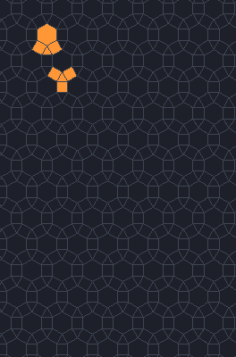
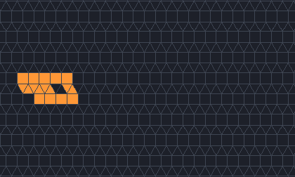
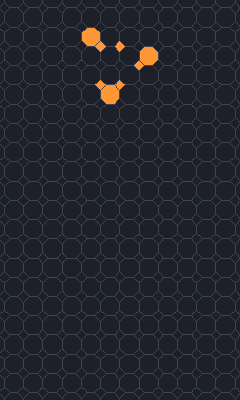
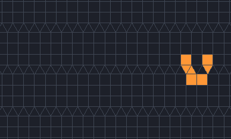
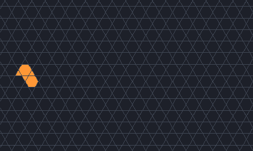
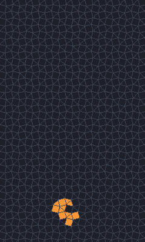

# What is new in JETCARP

> **Draft.** This page is a first draft of JETCARP's contributions, written for the v0.4.0 release
> and the paper that will follow. Each claim below is limited to what our prior-art search supports.
> The spaceship claims have been through the checks described in [How we checked](#how-we-checked),
> but not yet past the ConwayLife community, whom we will ask; see *Checks still to do* at the end.
> If you know of earlier work that we have missed, please open an issue. We will correct the page and
> credit it.

JETCARP stands on a great deal of earlier work, credited on every page of this encyclopedia and
collected in the [bibliography](bibliography.md). This page lists the few things that, as far as we can
tell, are new, says how we looked, and lists the things we have decided *not* to claim.

## How we searched

In November 2026 we audited each candidate contribution against the literature and the hobbyist
record: web and arXiv searches, Crossref records for every paper cited, the authors' own pages and
repositories, and LifeWiki. Every search query and fetched page is logged with its date in our research
notes, and each source was checked against its primary record before being listed in the bibliography.
The verdicts used three levels: *prior art found*, *related work only*, and *nothing found after
search*. Only the last two can support a claim, and we word such claims "to our knowledge".

The search has known weaknesses:

- **Forums.** The ConwayLife.com site refuses automated reading, so LifeWiki and the forums were read
  through a mirror, and forum coverage is the weakest part of the search. A second pass over the forum
  boards, Code Golf Stack Exchange and code hosts in November 2026 found EricG's 2013 exploration of
  Life-like rules on the Archimedean tilings, which changed the spaceship claims below; its pattern
  files are no longer online. Hobbyists may well have found other things below without publishing
  them in papers.
- **Unread full texts.** For a few papers only abstracts or search excerpts could be read; where a
  statement rests on an excerpt, the page that makes it says so.
- **A fast-moving field.** Several closely related works appeared between August and October 2026
  (Guttesen's Life on Archimedean lattices, Edmond's monotile gliders). We will re-run the key searches
  just before publication.

## Contributions

### 1. JACA, an annihilating two-sided family of Life-like rules

**Claim (to our knowledge).** The particular combination in [JACA](../automata/jaca.md) is new: an
independent birth/survival rule for each sign, counting only same-sign neighbours; destruction of every
live cell that touches the other sign; a blast radius measured in neighbourhood steps; cancelled double
births; an exact reduction to the plain rule when only one sign is present; and use on any periodic or
aperiodic tiling. JACA is Jimmie Rodgers's idea (November 2026).

**Evidence.** Each ingredient has a precedent, and all are credited: two-player Life with a coin flip
for tied births ([Levene and Roussos 2003](bibliography.md#levene2003twoplayer)); the +1/−1/0 encoding,
own-sign counting and cancelled births of the "Game of Life or Death"
([Unsupervision Blog 2025](bibliography.md#unsupervision2025playable)); matter–antimatter Life whose
touching cells turn into energy ([KittyTac and wildmyron 2018](bibliography.md#kittytac2018rulerequest);
[LifeWiki: Rule:Energetic](bibliography.md#lifewikind_energetic)); and A + B → 0 annihilation in physics
([Toussaint and Wilczek 1983](bibliography.md#toussaint1983particle);
[Chopard and Droz 1998](bibliography.md#chopard1998cellular)). No source combined them. Not searched:
MCell's weighted rules with negative weights, Golly's rule-table collection, and most of the ConwayLife
rule-request thread.

**Not claimed.** "The first signed or ternary Life", "the first matter–antimatter Life", and anything
about JACA's colouring.

### 2. Layered rules on any tiling

**Claim (to our knowledge).** [Layered rules](../automata/layered.md), Wolfram-style totalistic rules
whose rows are the graph-distance layers around a seed so that they run unchanged on any tiling,
including aperiodic ones, are a construction we have not seen published. They are Jimmie Rodgers's
(2026).

**Evidence.** The closest work embeds one-dimensional rules in hyperbolic tilings along a chosen line
([Margenstern 2010](bibliography.md#margenstern2010embedding)) or draws elementary rules on the fixed rows
of hexagon and pentagon lattices ([Kerekrety 2020](bibliography.md#kerekrety2020elementary)). Dalai's
"Layered Cellular Automata" is unrelated despite the name ([Dalai 2023](bibliography.md#dalai2023layered)).
The idea is simple, so it may exist in unpublished code or in work on rules over graphs that our search
did not reach; Wolfram's work on network systems was not checked in detail.

### 3. Presenting and cataloguing the three-parent hexagon rules

**Claim (to our knowledge).** JETCARP is the first to present the [three-parent hexagon rules](../automata/hexagonal-rows.md)
(`HexT`, `HexT3`) as a family of hexagon pictures with a Wolfram-style numbering of all 256 binary and
327 three-state rules, totalistic and symmetric subsets, and an automatic classification of
all binary and totalistic rules. The claim is to the presentation and catalogue only: the underlying
rules are standard second-order one-dimensional automata.

**Evidence.** Second-order rules and staggered neighbourhoods are in
[Wolfram 2002](bibliography.md#wolfram2002new) and the
[Wolfram Language](bibliography.md#wolframnd_cellularautomaton); no source numbered or catalogued this
family as hexagon rules.

**Not claimed.** The two-parent rules `HexW` and `HexW3`, which are Wolfram's two-cell rules
([Wolfram 2002](bibliography.md#wolfram2002new), p. 885) and are also drawn by
[Kerekrety 2020](bibliography.md#kerekrety2020elementary).

### 4. Spaceships on non-square tilings

**Claim (to our knowledge).** JETCARP's soup searches have found particular spaceships in Life-like
rules on Archimedean and k-uniform tilings that we have not found reported before. Spaceships on these
tilings are not new in themselves: EricG found ships in Life-like rules on every Archimedean tiling in
2013 ([EricG 2013](bibliography.md#ericg2013tiling2)), and Martin Büttner found one on a tiling of
hexagons, squares and triangles in 2014 ([Code Golf 2014](bibliography.md#codegolf2014life)). Of 72
candidates, 60 distinct objects survived the checks in the box below. We claim, to our knowledge, only
the 25 of them that are single ships, carry no flag, and run in none of the rules in which EricG
reported ships: six on Archimedean tilings (3.4.6.4, 3.3.3.4.4 and 3.3.3.3.6), thirteen on 2-uniform
tilings and six on 3-uniform tilings. Every one is listed, with its rule range, in
[Findings](findings.md#the-60-objects). Each runs the same way in a whole range of rules; none of
these 25 runs in Life itself. Life's own spaceships on these tilings are a separate claim, below.

The other 35 are described, not claimed:

- **Flagged, 28.** Eleven are flagged as most likely already known: eight small ships that turn up
  often in soups and run in many rules on an Archimedean tiling (on 4.8.8, 3.12.12, 4.6.12, 3.6.3.6 and
  3.3.3.4.4), and three built on Guttesen's gliders. Seventeen are flagged to check before claiming:
  they run in a well-known rule (HighLife, Pedestrian Life, or `B2/S34` on 4.8.8), contain a phase of
  one of Guttesen's gliders, were very common in their search, or run on 4.8.8 or 3.12.12 in the
  `B2` and `B26` rules where EricG reported many ships in 2013 without listing them. We found no
  earlier report of any of them, but others may well have seen them.
- **Derivative, 13, six of them also flagged.** A smaller ship that pulls a passenger along
  unchanged, or a bound pair of gliders. They are kept as distinct objects with the core named, as
  Life catalogues keep tag-alongs, but they are not counted as discoveries.

The strongest candidates, single ships with no flag that the checks confirmed on every count (the
fourth, on 4.8.8, is now flagged):

<figure class="pair">

<picture>
  <source srcset="../images/tilings/ship-aa7e7357-still.png" media="(prefers-reduced-motion: reduce)">
  
</picture>

<picture>
  <source srcset="../images/tilings/ship-a13d3fbf-still.png" media="(prefers-reduced-motion: reduce)">
  
</picture>

<figcaption>Left: <code>aa7e7357</code> on the rhombitrihexagonal tiling 3.4.6.4, period 42, 7 to 15
cells; watch it change shape through its long period while it moves 3 lattice steps (c/14). It runs
in the 1,024 rules from <code>B3/S235</code> up and only on its own tiling. Right: <code>a13d3fbf</code>
on the elongated triangular tiling 3.3.3.4.4, period 8, 13 to 17 cells, moving 2 lattice steps along
the rows every period (c/4), in the 1,024 rules from <code>B46/S3458</code> up; it also runs unchanged
in corridors of the 3-uniform tilings k3-051 and k3-052, and its live tiles evolve the same way on six
more 2- and 3-uniform tilings. Scenes
<code>docs/scenes/tilings/ship-aa7e7357.json</code> and <code>ship-a13d3fbf.json</code>.</figcaption>
</figure>

<figure class="pair">

<picture>
  <source srcset="../images/tilings/ship-acd0fa8b-still.png" media="(prefers-reduced-motion: reduce)">
  
</picture>

<picture>
  <source srcset="../images/tilings/ship-9cee5c6a-still.png" media="(prefers-reduced-motion: reduce)">
  
</picture>

<figcaption>Left: <code>acd0fa8b</code> on the snub hexagonal tiling 3.3.3.3.6, period 27, 4 to 18
cells, one lattice step along a row per period (c/27), in about a million rules from
<code>B37/S2,5,6,10</code> up. Right: <code>9cee5c6a</code> on 4.8.8, period 6, 7 to 13 cells, 2 lattice
steps per period (c/3), in the 128 rules from <code>B2/S2</code> up: the only surviving 4.8.8 candidate
that does not move at c/2, and it contains no smaller ship. It was among the four strongest until we
read EricG's 2013 report that many <code>B2</code> rules on 4.8.8 have spaceships; his patterns are not
online, so it is flagged until they can be compared. Scenes
<code>docs/scenes/tilings/ship-acd0fa8b.json</code> and <code>ship-9cee5c6a.json</code>.</figcaption>
</figure>

One ship that was among the strongest before the congruence test shows how far that test reaches:

<figure>
<picture>
  <source srcset="../images/tilings/ship-7860a67a-still.png" media="(prefers-reduced-motion: reduce)">
  
</picture>
<figcaption><code>7860a67a</code>, a 7-cell period-4 ship that moves one lattice step every 4
generations (c/4), here on the 2-uniform tiling k2-003 in the 256 rules from <code>B45/S34</code> up.
It runs unchanged on k2-004 and in strips of the 3-uniform tilings k3-010 and k3-016, where the search
first found it, and its live tiles evolve the same way on k3-013 and k3-019 (where it was catalogued a
second time, as <code>25e004f4</code>), on k3-051 and k3-052, and on the Archimedean elongated triangular
tiling 3.3.3.4.4, where the tiles around it have more neighbours. Small, common and running in many
rules on an Archimedean tiling, it is now flagged as most likely already known. Scene
<code>docs/scenes/tilings/ship-7860a67a.json</code>.</figcaption>
</figure>

**Evidence.** Gliders on triangles, hexagons and Cairo pentagons go back to Carter Bays
([Bays 1994](bibliography.md#bays1994cellular); [Bays 2005](bibliography.md#bays2005note);
[Kerekrety 2020](bibliography.md#kerekrety2020game)), and hexagonal Life (`B2/S34H`) has known
spaceships ([drc, Hickerson and wildmyron 2016](bibliography.md#drc2016b2s34h)).

The closest earlier work is EricG's, posted on the ConwayLife forums on 12 June 2013
([EricG 2013](bibliography.md#ericg2013tiling2); pentagonal tilings in
[EricG 2013](bibliography.md#ericg2013tiling1)). He emulated the eight composite Archimedean tilings and
their eight duals in Golly, with the same neighbours as JETCARP's (cells sharing an edge or a vertex:
octagons 8 and squares 4 on 4.8.8, squares 12 and triangles 9 on 3.3.3.4.4), and found spaceships in
Life-like rules on 14 of the 16, among them every Archimedean tiling. He named the rules but not the
ships: on 4.8.8, "many of the B2 rules" and `B2/S346`; on 3.12.12, `B2/S2` ("generates lots of
spaceships") and `B26/S3569` and its variants; on 4.6.12, `B2/S2`; on 3.4.6.4, `B3468/S239` and
`B346/S239`; on 3.3.3.4.4, `B3/S23` and other `B3` rules, `B36/S23` and `B3/S2489`; on 3.3.3.3.6, rules
such as `B37/S247,10`; and on 3.6.3.6 and 3.3.4.3.4, Life itself. His pattern files were shared from a
Google Drive folder that no longer opens. JETCARP's six claimed Archimedean ships run in none of his
named rules: the 3.4.6.4 ship needs `S5` and cannot have `B4` or `B6`, the 3.3.3.4.4 ships need births
on 4 and his are all `B3` rules, and the 3.3.3.3.6 ship needs `S5` and `S6` and cannot have `S4`. The
4.8.8 and 3.12.12 ships do run in the `B2` and `B26` rules he describes, so they are flagged.

In 2014 a Code Golf challenge asked for Life (`B3/S23`) on any grid but a regular one, with
vertex-sharing neighbours ([Code Golf 2014](bibliography.md#codegolf2014life)). Peter Taylor found only
oscillators on 3.4.6.4. Kevin L ran a tiling of hexagons, squares and triangles whose repeating unit, by
its code, is one hexagon, two squares and two triangles, as in the 2-uniform tiling
[3.42.6; 3.6.3.6], and posted a period-20 spaceship found by Martin Büttner. The page does
not name the tiling, and its rule is stated only in a comment copied from an earlier answer, but the
challenge asked for Life. A JETCARP hunt of 500,000 Life soups on each of the two tilings of that type
found no ship on k2-006 and, on k2-007, a period-20 spaceship of 8 cells moving one lattice step per
period (c/20) in about one soup in nine, so Büttner's tiling was very likely k2-007 and his ship very
likely this one. It is the earliest spaceship on a k-uniform tiling (k of 2 or more) that we know of.
JETCARP's claimed ships on k2-006 and k2-007 are of other periods and run in other rules.

H. S. Guttesen studied Life (`B3/S23`) on six Archimedean lattices and found no gliders on 4.8.8,
4.6.12, 3.12.12 or 3.3.3.3.6 ([Guttesen 2026](bibliography.md#guttesen2026game)); JETCARP's ships there
are in other rules. We found no other report of Life-like spaceships on k-uniform tilings.

**Claim (to our knowledge): Life on the 2- and 3-uniform tilings.** In November 2026 JETCARP ran a
census of Life itself (`B3/S23`, touching neighbours) on all 92 Archimedean, 2-uniform and 3-uniform
tilings, 50,000 random soups on each
([Findings](findings.md#life-on-the-archimedean-and-k-uniform-tilings)). By the search above, Life has
not been reported on any 3-uniform tiling before, nor on any 2-uniform tiling but k2-007, where Büttner
very likely found his ship. The census finds Life spaceships on 19 of the 61 3-uniform tilings and 5 of
the 20 2-uniform ones. After the same checks as the candidates above, 26 of its objects are single
ships with no flag, on 2 of the 2-uniform and 8 of the 3-uniform tilings, and to our knowledge they
have not been reported before; 13 of them are large ships of k3-055 that may share a common engine.
Twelve more passed the same checks but are flagged: ten are so common on their tiling that anyone who
ran Life there would see them at once, although we know of no one who has, and two lie on tilings
where others have run Life (3.3.4.3.4 and k2-007). Everything else the census found is a known ship,
two or more smaller ships flying together, or a smaller ship with a passenger.

**Not claimed.**

- **Guttesen's gliders.** EricG reported spaceships in Life on the kagome (3.6.3.6) and snub square
  tilings in 2013 ([EricG 2013](bibliography.md#ericg2013tiling2)) without describing them. Guttesen
  described the small gliders themselves and built a kagome glider gun
  ([Guttesen 2026](bibliography.md#guttesen2026game)), and we call them Guttesen's gliders after his
  description.
  JETCARP's searches found both independently: its kagome ship is exactly his glider g, and its
  snub-square ship matches his figure. Ten catalogue entries turned out to be pairs of ships flying side
  by side without touching: eight pairs of his glider g, one pair of his snub-square glider and one
  pair of a 3.6.3.6 ship. All Life candidates on 3.6.3.6 were such pairs. In Life on 3.3.4.3.4,
  JETCARP also found two larger ships built around his glider, of periods 16 and 24; we found no
  earlier report of them, but they are his glider's relatives and flagged as such.
- **Ships on isohedral tilings.** The 81 isohedral types have only 11 neighbour graphs, those of the
  Laves tilings (see [Findings](findings.md#isohedral-tilings-are-eleven-neighbour-graphs)): 57 types
  are the square, hexagonal or triangular grid in another drawing, and IH27–IH29 are the Cairo tiling.
  Among the drawn families, the brick, herringbone and lizard tilings likewise behave as hexagons, the
  quadrilateral, glide and four-fold tilings as squares, and the Pythagorean tiling as 4.8.8. Every
  ship JETCARP found on an isohedral type is a known ship of the square or triangular grid, such as
  Conway's glider, and results on an isohedral type are presented as results on its Laves tiling.
- **Ships of simpler tilings.** Eight ships found on 3-uniform tilings run unchanged on a 2-uniform
  tiling or on 3.6.3.6, and eight more, among them five found in strips of squares and triangles,
  run with the same live tiles on 3.3.3.4.4 or on a 2-uniform tiling; each is claimed only on the
  simplest tiling it runs on.
- **The same ship catalogued twice.** `25e004f4` is `7860a67a`, and `f62ba07d` is `c15dd310`: the
  same live tiles at every generation, at positions with other neighbour counts around them.
- **The known Life ships of the census.** Conway's glider and spaceships; Guttesen's two gliders, also
  in the kagome corridors of three 3-uniform tilings; the period-2 ship on 3.3.3.4.4, the only Life ship
  the census found there, which is probably the "common spaceship (although it only travels
  horizontally)" EricG reported in 2013; and the period-20 ship on k2-007, very likely Büttner's.
  Neither of the last two could be compared cell for cell, since EricG's patterns are offline and
  Büttner's animation could not be read. The lightweight spaceship also runs in the strips of squares
  of k3-010, and the census found it there too.

<figure class="pair">

<picture>
  <source srcset="../images/tilings/glider-guttesen-kagome-still.png" media="(prefers-reduced-motion: reduce)">
  
</picture>

<picture>
  <source srcset="../images/tilings/glider-guttesen-snubsq-still.png" media="(prefers-reduced-motion: reduce)">
  
</picture>

<figcaption>Guttesen's gliders in Life (<code>B3/S23</code>), as JETCARP's searches found them
independently. Left: his glider g on the kagome tiling 3.6.3.6, period 4. Right: his period-8 glider on
the snub square tiling 3.3.4.3.4. Both are credited to
<a href="bibliography.md#guttesen2026game">Guttesen 2026</a>. Scenes
<code>docs/scenes/tilings/glider-guttesen-kagome.json</code> and
<code>glider-guttesen-snubsq.json</code>.</figcaption>
</figure>

**How we checked**

- **Re-verification on the current engine.** All 103 spaceship records, the 739 longest-period
  oscillators and 39,744 turmite highways on non-square tilings were run again on JETCARP 0.4.0, and
  every one gave the same period, displacement and speed. Each ship was also pasted alone on a fresh
  patch and named again by JETCARP's object finder.
- **Lattice equivalence.** Each candidate's one-period trajectory and its rim were mapped into 196
  distinct neighbour graphs: the 362 combinations of 19 tiling families, the 81 isohedral types and the
  81 catalogued 2- and 3-uniform tilings with touching and with edge neighbours. The map must keep every
  live-neighbour count, so a hit means the ship runs on that tiling too; JETCARP then ran each hit to
  confirm it. No candidate is a ship of the square, hexagonal or triangular grid, of Cairo, or of any
  Laves tiling; 8 belong to a simpler tiling.
- **Congruence.** Two ships are also the same object if one rotation, reflection and translation
  carries the live tiles of one onto those of the other at every generation, whatever the neighbour
  counts of the empty tiles around them. JETCARP dumped every generation's live tiles with their
  polygons for all 72 candidates, their images on other tilings, the compounds' parts, Guttesen's
  gliders and the lattice objects of the catalogue, and compared every pair: two pairs of candidates
  are one ship each and were merged. Each candidate's live tiles were then placed isometrically on
  all 181 tilings above and run by JETCARP in a rule the counts there allow: 8 more ships run on a
  simpler tiling (5 on 3.3.3.4.4), and 19 objects run on several tilings.
- **Compound and same-object checks.** Every phase of every ship was split into groups and each
  group run alone: 10 candidates were two ships flying together, and 13 carry a smaller ship inside
  unchanged. Every candidate was compared with all 137 ship records: no two have the same neighbour
  counts everywhere (but see the congruence check above).
- **Robustness.** Each ship ran 40 periods on a wrapped patch of about 30,000 cells, on a smaller
  patch and with dead edges, with identical results.
- **The Life census.** Every spaceship record of the census of Life on the 92 Archimedean, 2-uniform
  and 3-uniform tilings went through the same checks: the confirmation runs, the compound and
  derivative tests (with a second, larger search for a smaller ship inside each single one),
  congruence with every other record and with the candidates above, and placement on all 181
  tilings in Life.
- **Not yet searched.** The ConwayLife.com forums, where hobbyists report most new patterns, refuse
  automated reading, so our prior-art search could not cover them. We will ask the community when the
  results are posted there.

The full list is in [Findings](findings.md). See also
[Life-like rules](../automata/life-like.md#what-is-new-here) and
[Regular and Archimedean tilings](../tilings/regular-archimedean.md#what-is-new-here).

### 5. Sandpiles on the monotiles and across the tiling catalogues

**Claim (to our knowledge).** JETCARP is the first to show sandpile identities and large single-source
sandpiles on the hat and spectre monotiles, on the k-uniform tilings with k of 2 or more, and on the
eight Laves tilings that are not regular grids. The last are what JETCARP's 81 isohedral types amount
to: a sandpile sees only the neighbour graph, and the isohedral types have only the 11 graphs of the
Laves tilings (see [Findings](findings.md#isohedral-tilings-are-eleven-neighbour-graphs)), so a result
on, say, IH21 is a result on the floret pentagonal tiling.

**Evidence.** Identities have been computed on triangular, hexagonal and Penrose grids
([Fersula, Noûs and Perrot 2020](bibliography.md#fersula2020sandpile)); single-source piles have a long
literature on the square grid ([Ostojic 2003](bibliography.md#ostojic2003patterns);
[Pegden and Smart 2013](bibliography.md#pegden2013convergence)). No sandpile work on the hat or spectre
was found at all. Identities on the hexagonal and 4.8.8 grids also appear in Eli T. Johnson's 2019
master's thesis at the University of Washington ([Johnson 2019](bibliography.md#johnson2019sandpile)),
so 4.8.8 is excluded.

**Not claimed.** The doubling method JETCARP uses for very large piles, which follows directly from the
abelian property and is presumably known. See [The Abelian sandpile](../automata/sandpile.md).

### 6. Tilings as a dimension of an exploratory search

**Claim (to our knowledge).** JETCARP's exploratory search is the first to treat the tiling itself as a
search dimension: it explores tiling, rule family, rule and starting pattern together, over about 1,200
periodic and aperiodic tilings and 22 rule families in one archive. (Fewer of the tilings are distinct
as neighbour graphs: the 81 isohedral types among them have only 11.) Its first full run covered about
15 million runs.

**Evidence.** The method's parts are established. The archive keeps the best few runs per niche, in
the manner of MAP-Elites quality-diversity search
([Mouret and Clune 2015](bibliography.md#mouret2015illuminating)), which Faldor and Cully applied to
Lenia ([Faldor and Cully 2024](bibliography.md#faldor2024toward)). Its score is a small model fitted to
human keep/maybe/drop ratings of animated clips, the general technique of learning from human
preferences ([Christiano et al. 2017](bibliography.md#christiano2017deep)); in Picbreeder people chose
directly, with no model in between
([Secretan et al. 2008](bibliography.md#secretan2008picbreeder);
[2011](bibliography.md#secretan2011picbreeder)). Most of the clips were rated by Emily Teich, whose eye
for what is beautiful is built into the score. Other automated discovery in artificial life uses
learned goal spaces ([Reinke, Etcheverry and Oudeyer 2020](bibliography.md#reinke2020intrinsically))
or foundation models in place of human judgement
([Kumar et al. 2025](bibliography.md#kumar2025automating)). Earlier cellular automaton searches of
this kind work on one substrate, such as Lenia ([Chan 2019](bibliography.md#chan2019lenia)); searches
over several tilings had fixed goals, such as gliders on three aperiodic tilings
([Edmond 2026](bibliography.md#edmond2026gliders)) or Life on six Archimedean lattices
([Guttesen 2026](bibliography.md#guttesen2026game)).

The search will be described in full in [Search methods](search-methods.md).

### 7. One engine for every family on every tiling

**Claim (to our knowledge).** No earlier program runs as many cellular automaton families (Life-like,
Generations, Larger than Life, JACA, layered, turmites, WireWorld, cyclic, Greenberg–Hastings,
rock-paper-scissors, Hodgepodge, forest fire, Lenia, sandpiles, priority tables and rule tables) on as
many classes of tiling (lattices, 1,248 k-uniform tilings, 81 isohedral types with their 11 Laves
neighbour graphs, drawn tiles, and the Penrose, hat and spectre tilings) with one neighbour model, tested for agreement across thread counts
and between CPU and GPU.

**Evidence.** Breadth is the contribution, not any one family on any one tiling: Ready runs arbitrary
rules on meshes ([Ready](bibliography.md#huttonnd_ready)); HatLife ran Life-like, Larger than Life-style
and WireWorld rules on the hat ([Trevorrow 2023](bibliography.md#trevorrow2023hatlife)); Edmond ran
Generations and priority-table rules on the hat and spectre ([Edmond 2026](bibliography.md#edmond2026gliders));
Life has long been studied on Penrose tilings ([Owens and Stepney 2010](bibliography.md#owens2010game)).
Our search found no aperiodic-tiling version of the cyclic, Greenberg–Hastings, rock-paper-scissors,
Hodgepodge or forest-fire rules, and no turmites on the hat or spectre, but these are direct applications
of known rules to known graphs, and we do not count them as discoveries. See
[How JETCARP generalises automata](../automata/generalising.md).

## What we do not claim

- **Age colouring**, including colouring cells by how long they have been alive and fading destroyed
  cells: Chris Rowett's LifeViewer and other programs did this first
  ([LifeWiki: LifeViewer](bibliography.md#lifewikind_lifeviewer);
  [Rowett: LifeViewer](bibliography.md#rowettnd_lifeviewer)).
- **The two-parent hexagon rules** (`HexW`, `HexW3`): Wolfram's ([Wolfram 2002](bibliography.md#wolfram2002new)).
- **Life gliders on the kagome and snub square tilings**, and the pairs of them that JETCARP's
  catalogue first listed as ships: reported by EricG in 2013 and described by Guttesen in 2026
  ([EricG 2013](bibliography.md#ericg2013tiling2); [Guttesen 2026](bibliography.md#guttesen2026game)).
- **Spaceships on Archimedean tilings as such**: EricG found them on every Archimedean tiling in 2013.
  Only particular ships are claimed.
- **Spaceships on isohedral tilings**: all are known ships of the square or triangular grid.
- **The hat glider**: it is James Edmond's hat glider B in another table. With B's states renamed, the
  two tables give the same evolution cell for cell; JETCARP's search found it again, and JETCARP's
  only addition is a check that it travels a million rings of tiles on a sliding window, where
  Edmond's certificates already prove it immortal
  ([Edmond 2026](bibliography.md#edmond2026gliders); see [Priority rules](../automata/priority-rules.md)
  and [Findings](findings.md#the-hat-glider-is-edmonds-glider-b)).
- **"The first cellular automata on aperiodic tilings"**: Life on Penrose tilings was studied from 2005,
  and Goucher found the first aperiodic glider in 2012 ([Goucher 2012](bibliography.md#goucher2012gliders)).
- **"The first matter–antimatter Life"**: see JACA above.

## Checks still to do

Done in November 2026: the re-verification on the release engine, the lattice-equivalence,
compound and cross-tiling checks, the comparison of JETCARP's kagome and snub-square ships with
Guttesen's figures, and the side-by-side run of the hat glider and Edmond's glider B (see
[Findings](findings.md)). Before the claims above are final, and before the paper:

- Ask on the ConwayLife forums, when the results are posted there, whether any of the spaceship
  candidates have been seen before, and ask EricG whether his 2013 Tiling Project patterns can be
  shared again, so the flagged 4.8.8 and 3.12.12 ships, and the claimed Archimedean ones, can be
  compared with his.
- Find Martin Büttner's 2014 period-20 ship, confirm its tiling and rule, and compare it cell for
  cell with the census's period-20 ship on k2-007, which is very likely his.
- Compare the census's 3.3.3.4.4 ship with EricG's, and look more closely at the large Life ships of
  k3-055, which may share a common engine.
- Compare the kagome and snub-square ships with Guttesen's configurations cell for cell, once he
  publishes them.
- Extend the equivalence survey to the k-uniform tilings with k from 4 to 6.
- Re-run the key searches just before publication.

## Credits

These findings were made with JETCARP by Jimmie Rodgers. The evolutionary glider search is James
Edmond's method, reimplemented. Emily Teich rated most of the clips that taught the exploratory search
what to show.
