# Findings

This page collects what JETCARP's searches have found and what the checks of November 2026 made of
it. It is the data behind the claims on [What is new in JETCARP](contributions.md): every result was
run again on the release engine (JETCARP 0.4.0), every spaceship was compared with the ships of
simpler tilings, and the list was cut down wherever a check failed. A census of Life itself on the
Archimedean, 2-uniform and 3-uniform tilings went through the same checks; its results are in
[their own section](#life-on-the-archimedean-and-k-uniform-tilings). The ConwayLife.com forums have not
been searched yet, so a candidate here is a candidate, not a discovery; we will ask the community when
the results are posted there. Corrections are welcome as issues.

## Re-verification on the release engine

The finds were made with JETCARP's predecessor, CART. Before anything was claimed, the records were run
again on JETCARP 0.4.0:

| Records | Checked | Passed |
| --- | --- | --- |
| Spaceships | 103 | 103 |
| Long-period oscillators (the 40 longest per tiling family) | 739 | 739 |
| Turmite highways on non-square tilings | 39,744 | 39,744 |

Spaceships and oscillators were checked twice: by `jetcarp library verify --all`, and by pasting each
record alone on a fresh wrapped patch and letting JETCARP's object finder name it again after 200
generations. No period, displacement or speed changed. Every highway gave the same onset, period, cells
and speed with its stored limits.

## Isohedral tilings are eleven neighbour graphs

A rule that only counts neighbours sees the neighbour graph, not the shapes (see
[Tilings as neighbour graphs](../tilings/neighbour-graphs.md)). Every isohedral tiling is
combinatorially one of the eleven **Laves tilings**, the duals of the uniform tilings, whatever the
shape of its tile, so JETCARP's 81 isohedral types give rules only eleven different worlds in each
neighbourhood. A survey of all 362 tiling and neighbourhood pairs (19 families, the 81 isohedral types
and the 81 catalogued 2- and 3-uniform tilings, with touching and with edge neighbours) found:

| Laves tiling | Isohedral types in JETCARP | Neighbour graph is that of |
| --- | --- | --- |
| [36], hexagon-like | IH01–IH18, IH20 (19 types) | the hexagonal grid |
| [44], square-like | 30 types from IH41 to IH76 | the square grid |
| [63], triangle-like | IH83–IH86, IH88, IH90, IH91, IH93 (8) | the triangular grid |
| [32.4.3.4], Cairo pentagonal | IH27–IH29 (3) | the Cairo tiling |
| [33.42], prismatic pentagonal | IH22–IH26 (5) | itself |
| [34.6], floret pentagonal | IH21 | itself |
| [3.6.3.6], rhombille | IH33, IH34, IH36, IH37 (4) | itself |
| [3.4.6.4], deltoidal trihexagonal | IH30–IH32 (3) | itself |
| [3.122], triakis triangular | IH38–IH40 (3) | itself |
| [4.82], tetrakis square | IH78, IH79, IH81, IH82 (4) | itself |
| [4.6.12], kisrhombille | IH77 | itself |

Several drawn families are also lattices in disguise: the brick, herringbone and three-fold (lizard)
tilings behave exactly as hexagons, the quadrilateral, glide and four-fold tilings as squares, and the
Pythagorean tiling as 4.8.8. No 2- or 3-uniform tiling has the graph of a lattice, of Cairo or of an
Archimedean tiling. The [isohedral tilings](../tilings/isohedral.md) page therefore presents results on
an isohedral type as results on its Laves tiling.

The survey also explains an early false alarm. JETCARP's catalogue held "spaceships" on IH46, IH54,
IH62, IH72 and IH84; mapped back onto their lattices they are Conway's glider, the lightweight and
middleweight spaceships, and an unnamed ship of the triangular grid. Every ship found on an isohedral
type is a known lattice object, and none is claimed.

## Spaceships

### How the list was cut

Of the 103 spaceship records, 35 were known objects of the square and triangular grids (every ship
on an isohedral type among them) and 5 were H. S. Guttesen's kagome glider, alone, in
pairs or in corridors of kagome tiles. Fresh soup searches in November 2026 re-found Guttesen's
snub-square glider and added 16 objects. That left 72 candidates, which a second, deliberately
skeptical pass and then a looser congruence test examined:

| Step | Result |
| --- | --- |
| Candidates examined | 72 |
| Compounds: two smaller ships flying side by side without influencing each other | 10, removed |
| The same object as another record, with every neighbour count the same | none |
| The same live tiles at every generation as another candidate (congruence test) | 2 pairs, merged |
| Re-attributed to a simpler tiling by the strict map (7 from 3-uniform to 2-uniform tilings, 1 from k3-032 to 3.6.3.6) | 8 |
| Re-attributed to a simpler tiling by the congruence test (5 to 3.3.3.4.4, 3 from 3-uniform to 2-uniform tilings) | 8 |
| Objects that run on more than one tiling | 19 |
| **Distinct surviving objects** | **60** |
| of which single ships (6 of them contain a perturbed phase of a smaller ship) | 47 |
| of which derivative: a smaller ship with a passenger that it pulls along unchanged, or a bound pair of gliders | 13 |
| Flag A: most likely already known or noticed by others | 11 |
| Flag B: check before claiming | 17 |
| Unflagged | 32, of which 25 are single ships |

The checks are described in the box on [What is new in JETCARP](contributions.md#how-we-checked).
No ship depended on dead edges or on the size of the patch, no period or displacement was misreported,
and no candidate is a ship of a lattice, of Cairo or of any Laves tiling.

The skeptical pass called two ships the same object only if a map between them kept every neighbour
count, of the live tiles and of the empty tiles around them. The congruence test is looser: two ships
are one object if, after a shift of phase, one rotation, reflection and translation carries the live
tiles of one onto the live tiles of the other at every generation of a period, whatever the neighbour
counts of the empty tiles around them. It merged two pairs:

- `7860a67a` and `25e004f4` are one 7-cell ship. On k2-003 and k3-016 the squares at the edge of its
  strip of squares and triangles border another row of squares and touch 10 tiles; on k3-013 and k3-019
  they border a row of triangles and touch 12. The live tiles never notice: every birth and survival
  condition is the same, and the range only looks 16 times larger on k3-013 because counts of 11 and 12,
  which the ship never meets, exist only there.
- `c15dd310` and `f62ba07d` are one 4-to-5-cell ship, recorded twice on the same tiling k3-019, at two
  positions that no symmetry of the tiling exchanges: one translation, with a shift of two generations,
  carries one onto the other, but the rows beyond its strip are squares on one side and triangles on the
  other, and swapped at the second position. Their ranges are equal.

The same test, run against every Archimedean, 2-uniform, 3-uniform and isohedral tiling (an isometric
copy of each ship's live tiles is placed on the tiling, and JETCARP runs it in a rule that the counts
there allow), found that eight ships run, with the same live tiles, on a simpler tiling than the one
they were claimed on: `7860a67a`, `f1b6f83a`, `b36f22f2`, `ffc6a106` and `c15dd310`, found in strips of
squares and triangles inside 2- and 3-uniform tilings, run on the Archimedean elongated triangular tiling
3.3.3.4.4; `0d9a694c` (from k3-003) runs on k2-012; and `29fa9994` and `dc81d36e` (from k3-015 and
k3-021) run on k2-015. They are listed on the simpler tiling, and so, by the same rules as the others,
`7860a67a` and `c15dd310` are now flagged: small, common in their searches and wide-range on an
Archimedean tiling.

**Flag A** marks ships that are small, turn up often in soups and run in many rules on an Archimedean
tiling (`69c9912a`, `938f9833`, `c78ceb01`, `b2c790bb`, `1723afa2`, `8aa7e24c`, `7860a67a`, `c15dd310`),
and the ships built on Guttesen's gliders (`2ba58828`, `98a3c53b` in Life on 3.3.4.3.4, and
`ea5d187b`). Others may well have
seen these; we found no report, and do not write "to our knowledge" for them. **Flag B** marks ships
that run in a well-known rule on an Archimedean tiling (HighLife, Pedestrian Life, or the
`B2/S34` rule of the 4.8.8 hunts, which is Hexagonal Life without its `H`), that contain a phase of one
of Guttesen's gliders, or that were very common in their search. Four more joined Flag B after a second
search of the ConwayLife forums found EricG's 2013 exploration of the Archimedean tilings
([EricG 2013](bibliography.md#ericg2013tiling2)): `c4c00098` and `9cee5c6a` run in `B2/S2` on 4.8.8,
where EricG found "many of the B2 rules" to have spaceships, and `852ea9ff` and `a0229739` run in
`B26` rules on 3.12.12, next to the `B2/S2` and `B26/S3569` rules in which EricG reported many ships.
EricG did not list the ships, and the pattern files are no longer online, so these four wait for a
comparison with them. The claimed ships on 3.4.6.4, 3.3.3.4.4 and 3.3.3.3.6 run in none of the rules
EricG named (see [What is new in JETCARP](contributions.md#4-spaceships-on-non-square-tilings)).

Life itself (`B3/S23`), the rule Guttesen searched, deserves a separate word. All eleven of these
candidates that run in Life turned out to be made of Guttesen's gliders: on 3.6.3.6 every one is a
pair of glider g, so no new single Life ship on the kagome tiling survives; on 3.3.4.3.4 one is a
pair of the snub-square glider, one is a bound pair of it (`2ba58828`, period 16) and one contains a
perturbed copy of it (`98a3c53b`, period 24). But the searches behind these candidates ran Life on only
a few tilings, so they say little about Life elsewhere. A later census of Life on all 92 Archimedean,
2-uniform and 3-uniform tilings found Life spaceships on 28 of them, 24 of those 2- or 3-uniform; see
[Life on the Archimedean and k-uniform tilings](#life-on-the-archimedean-and-k-uniform-tilings).

### The 60 objects

Sorted by the simplest tiling each one runs on: Archimedean, then 2-uniform, then 3-uniform. *Runs
on* lists every tiling where the ship was catalogued or where JETCARP confirmed it as one ship whose
live tiles evolve exactly as the catalogued ship's: either a map that keeps all neighbour counts
carries it there, or an isometric copy of it runs in some rule while the empty tiles around it have
other neighbour counts. Merged objects give the second id in brackets. *d per period* is the displacement in lattice steps,
in the lattice basis of the patch it was catalogued on; on the tilings with a hexagonal lattice the
two basis vectors are 60° apart, so (1, −1) is as short a step as (1, 0), and direction words such as
"diagonal" would mislead. *Smallest rule* is the rule with the fewest birth and survival conditions in
which the ship runs; it runs identically in every rule between that one and the largest, and the
count says how many that is; where two counts are given, the count depends on the tiling (each card
lists them), because a tiling with more neighbours per tile leaves more counts that the ship never
meets free. *Seen* is how often the search met it, which depends on how long that
search ran. Each id links to the object's card in the [gallery](#gallery-of-the-60-objects) below,
with a clip of it moving.

| | id | runs on (simplest first) | p | d per period | cells | smallest rule (rules in range) | seen | kind | flag |
| --- | --- | --- | --- | --- | --- | --- | --- | --- | --- |
| 1 | [`0ed091c9`](#ship-0ed091c9) | 4.8.8 | 2 | (0, 1) | 5–9 | `B2/S3` (512) | 270 | single | B |
| 2 | [`3c6d5ab0`](#ship-3c6d5ab0) | 4.8.8 | 2 | (0, −1) | 14–16 | `B2/S2` (256) | 8 | derivative: `69c9912a` with a tag-along |  |
| 3 | [`69c9912a`](#ship-69c9912a) | 4.8.8 | 2 | (0, −1) | 5 | `B2/S2` (512) | 8,034 | single | A |
| 4 | [`070a054d`](#ship-070a054d) | 4.8.8 | 4 | (−2, 0) | 9–10 | `B2/S2` (256) | 32 | derivative: `938f9833` with a tag-along |  |
| 5 | [`3e6ae2f3`](#ship-3e6ae2f3) | 4.8.8 | 4 | (0, −2) | 9–14 | `B2/S2` (64) | 5 | derivative: `69c9912a` with a tag-along |  |
| 6 | [`5aec548b`](#ship-5aec548b) | 4.8.8 | 4 | (0, −2) | 7–10 | `B2/S2` (256) | 92 | derivative: `69c9912a` with a tag-along |  |
| 7 | [`616314c5`](#ship-616314c5) | 4.8.8 | 4 | (0, −2) | 14–17 | `B2/S2` (256) | 2 | derivative: `69c9912a` with a tag-along |  |
| 8 | [`7c5b3e65`](#ship-7c5b3e65) | 4.8.8 | 4 | (0, −2) | 10–15 | `B2/S3` (64) | 54 | derivative: `0ed091c9` with a tag-along | B |
| 9 | [`938f9833`](#ship-938f9833) | 4.8.8 | 4 | (0, −2) | 5–6 | `B2/S2` (256) | 406 | single | A |
| 10 | [`c2f4f14a`](#ship-c2f4f14a) | 4.8.8 | 4 | (0, −2) | 8–9 | `B2/S2` (256) | 3 | derivative: `c4c00098` with a tag-along |  |
| 11 | [`c4c00098`](#ship-c4c00098) | 4.8.8 | 4 | (0, −2) | 7 | `B2/S2` (512) | 9 | single, contains a phase of `69c9912a`, `938f9833` | B |
| 12 | [`9cee5c6a`](#ship-9cee5c6a) | 4.8.8 | 6 | (0, 2) | 7–13 | `B2/S2` (128) | 11 | single | B |
| 13 | [`25969982`](#ship-25969982) | 4.8.8 | 12 | (6, 0) | 12–18 | `B2/S34` (64) | 2 | derivative: `0ed091c9` with a tag-along | B |
| 14 | [`07ab1946`](#ship-07ab1946) | 4.8.8 | 16 | (0, 8) | 19–26 | `B2/S34` (16) | 1 | derivative: `0ed091c9` with a tag-along | B |
| 15 | [`bdc1c8c7`](#ship-bdc1c8c7) | 4.8.8 | 16 | (0, 8) | 14–20 | `B2/S34` (32) | 95 | derivative: `0ed091c9` with a tag-along | B |
| 16 | [`fff1b887`](#ship-fff1b887) | 4.8.8 | 16 | (0, 8) | 14–28 | `B2/S34` (32) | 271 | single | B |
| 17 | [`7e51c0d1`](#ship-7e51c0d1) | 4.8.8 | 24 | (12, 0) | 14–21 | `B2/S3` (128) | 1 | single | B |
| 18 | [`852ea9ff`](#ship-852ea9ff) | 3.12.12 | 2 | (0, −1) | 6–9 | `B26/S2` (32,768) | 39 | single, contains a phase of `c78ceb01` | B |
| 19 | [`a0229739`](#ship-a0229739) | 3.12.12 | 2 | (0, −1) | 7–9 | `B26/S2` (16,384) | 6 | single, contains a phase of `852ea9ff`, `c78ceb01` | B |
| 20 | [`c78ceb01`](#ship-c78ceb01) | 3.12.12 | 2 | (0, 1) | 4–5 | `B2/S2` (65,536) | 1,742 | single | A |
| 21 | [`b2c790bb`](#ship-b2c790bb) | 3.12.12 | 6 | (−2, 4) | 5–8 | `B2/S2` (32,768) | 1,585 | single | A |
| 22 | [`5e1adb91`](#ship-5e1adb91) | 3.12.12 | 8 | (4, 0) | 12–23 | `B26/S26` (1,024) | 1 | derivative: `852ea9ff` with a tag-along |  |
| 23 | [`1723afa2`](#ship-1723afa2) | 4.6.12 | 4 | (0, 1) | 5–6 | `B2/S2` (65,536) | 373 | single | A |
| 24 | [`aa7e7357`](#ship-aa7e7357) | 3.4.6.4 | 42 | (0, 3) | 7–15 | `B3/S235` (1,024) | 61 | single |  |
| 25 | [`7860a67a`](#ship-7860a67a) (= `25e004f4`) | 3.3.3.4.4, k2-003, k2-004, k3-010, k3-013, k3-016, k3-019, k3-051, k3-052 | 4 | (−1, 0) | 7 | `B45/S34` (256 to 4,096) | 447 | single | A |
| 26 | [`f1b6f83a`](#ship-f1b6f83a) | 3.3.3.4.4, k2-003, k2-004, k3-010, k3-013, k3-016, k3-019, k3-051, k3-052 | 4 | (−1, 0) | 12–16 | `B456/S347` (256 to 4,096) | 7 | single |  |
| 27 | [`c15dd310`](#ship-c15dd310) (= `f62ba07d`) | 3.3.3.4.4, k2-003, k2-004, k3-010, k3-013, k3-016, k3-019, k3-051, k3-052 | 5 | (−1, 0) | 4–5 | `B3/S2` (8,192 to 131,072) | 406 | single | A |
| 28 | [`a13d3fbf`](#ship-a13d3fbf) | 3.3.3.4.4, k2-003, k2-004, k3-010, k3-013, k3-016, k3-019, k3-051, k3-052 | 8 | (2, 0) | 13–17 | `B46/S3458` (64 to 1,024) | 2 | single |  |
| 29 | [`b36f22f2`](#ship-b36f22f2) | 3.3.3.4.4, k2-003, k2-004, k3-010, k3-013, k3-016, k3-019, k3-051, k3-052 | 18 | (−1, 0) | 10–14 | `B4567/S3478` (32 to 512) | 45 | single |  |
| 30 | [`ffc6a106`](#ship-ffc6a106) | 3.3.3.4.4, k2-003, k2-004, k3-010, k3-013, k3-016, k3-019, k3-051, k3-052 | 26 | (1, 0) | 17–26 | `B45679/S3478` (16 to 256) | 1 | single |  |
| 31 | [`acd0fa8b`](#ship-acd0fa8b) | 3.3.3.3.6 | 27 | (−1, 1) | 4–18 | `B37/S2,5,6,10` (1,048,576) | 30 | single |  |
| 32 | [`2ba58828`](#ship-2ba58828) | 3.3.4.3.4 | 16 | (0, −4) | 15–33 | `B3/S23` (256) | 1 | derivative: a bound pair of Guttesen's snub-square glider | A |
| 33 | [`98a3c53b`](#ship-98a3c53b) | 3.3.4.3.4 | 24 | (0, 6) | 17–50 | `B3/S23` (128) | 1 | single, contains a phase of Guttesen's snub-square glider | A |
| 34 | [`0ccbe694`](#ship-0ccbe694) | 3.6.3.6, k3-030, k3-032, k3-039 | 4 | (−1, 0) | 8–9 | `B36/S23` (8,192) | 423 | single, contains a phase of Guttesen's g | B |
| 35 | [`8aa7e24c`](#ship-8aa7e24c) | 3.6.3.6, k3-030, k3-032, k3-039 | 4 | (−1, 0) | 7–8 | `B3/S345` (16,384) | 1,347 | single | A |
| 36 | [`ea5d187b`](#ship-ea5d187b) | 3.6.3.6 | 4 | (−1, 0) | 10–13 | `B36/S23` (4,096) | 2 | derivative: Guttesen's g with a tag-along | A |
| 37 | [`095a6bf7`](#ship-095a6bf7) | 3.6.3.6 | 12 | (0, 3) | 5–12 | `B38/S23` (2,048) | 595 | single, contains a phase of Guttesen's g | B |
| 38 | [`61627500`](#ship-61627500) | k2-004, k2-003, k3-010, k3-013, k3-016, k3-019 | 3 | (−1, 0) | 4–6 | `B3/S35` (2,048 to 32,768) | 19 | single |  |
| 39 | [`29af9b20`](#ship-29af9b20) | k2-004, k2-003, k3-010, k3-016 | 5 | (−1, 0) | 5–9 | `B3/S356` (512) | 4 | single |  |
| 40 | [`58ce78e3`](#ship-58ce78e3) | k2-006, k3-028, k3-029, k3-030 | 10 | (1, 0) | 4–9 | `B36/S23` (4,096) | 43 | single | B |
| 41 | [`dcd6b05f`](#ship-dcd6b05f) | k2-006, k3-028 | 16 | (1, 0) | 8–11 | `B3/S1346` (2,048) | 13 | single |  |
| 42 | [`da6eca43`](#ship-da6eca43) | k2-006 | 46 | (−1, 2) | 5–17 | `B38/S345` (512) | 26 | single |  |
| 43 | [`f9773263`](#ship-f9773263) | k2-007, k3-028, k3-031, k3-032 | 4 | (−1, 0) | 6–13 | `B3/S13468` (4,096) | 17 | single |  |
| 44 | [`56ddb3e7`](#ship-56ddb3e7) | k2-012, k3-003 | 6 | (−1, 0) | 7 | `B45/S34` (1,024 to 262,144) | 110 | single |  |
| 45 | [`0d9a694c`](#ship-0d9a694c) | k2-012, k3-003 | 10 | (1, 0) | 4–10 | `B3/S2456` (512 to 131,072) | 254 | single |  |
| 46 | [`01d41fa4`](#ship-01d41fa4) | k2-012, k3-003 | 14 | (−1, 0) | 11–17 | `B456/S3468` (128 to 32,768) | 11 | single |  |
| 47 | [`47978a43`](#ship-47978a43) | k2-013 | 6 | (−1, 0) | 9–20 | `B2,10/S1` (4,294,967,296) | 44 | single |  |
| 48 | [`4b87931e`](#ship-4b87931e) | k2-013 | 17 | (1, −1) | 2–20 | `B2,8,13/S1` (2,147,483,648) | 275 | single |  |
| 49 | [`931ac6a1`](#ship-931ac6a1) | k2-014, k3-014, k3-020, k3-051 | 4 | (−2, 0) | 5–6 | `B3/S2` (4,096 to 16,384) | 179 | single |  |
| 50 | [`29fa9994`](#ship-29fa9994) | k2-015, k3-015, k3-021, k3-052 | 32 | (1, 0) | 11–16 | `B4,5,6,7,8,11/S56` (16) | 30 | single |  |
| 51 | [`dc81d36e`](#ship-dc81d36e) | k2-015, k3-015, k3-021, k3-052 | 44 | (−1, 0) | 11–16 | `B4,5,6,7,8,10/S56` (16) | 35 | single |  |
| 52 | [`47587892`](#ship-47587892) | k2-017 | 17 | (0, −1) | 3–13 | `B3/S25` (8,192) | 949 | single | B |
| 53 | [`5b9c9e68`](#ship-5b9c9e68) | k3-009 | 16 | (−1, 0) | 4–10 | `B3478/S23` (134,217,728) | 466 | single |  |
| 54 | [`d37488d1`](#ship-d37488d1) | k3-022 | 12 | (−1, −1) | 9–11 | `B3/S3457` (1,024) | 1,158 | single | B |
| 55 | [`573a43ed`](#ship-573a43ed) | k3-032 | 3 | (1, 0) | 10–13 | `B3/S3457` (1,024) | 2 | single |  |
| 56 | [`e3df3631`](#ship-e3df3631) | k3-038 | 53 | (−1, 0) | 4–24 | `B3/S136` (2,048) | 4 | single |  |
| 57 | [`df78e126`](#ship-df78e126) | k3-045 | 37 | (1, 0) | 6–23 | `B4,5,9,11/S2,3,5,8,9,14` (4,096) | 8 | single |  |
| 58 | [`9d5c568b`](#ship-9d5c568b) | k3-053 | 26 | (0, 1) | 3–7 | `B36/S25` (16,384) | 642 | single |  |
| 59 | [`91205ceb`](#ship-91205ceb) | k3-058 | 12 | (0, 1) | 6–10 | `B37/S25` (16,777,216) | 1,096 | single | B |
| 60 | [`f3d2fa6a`](#ship-f3d2fa6a) | k3-058 | 22 | (−1, 1) | 4–12 | `B37/S25` (4,194,304) | 359 | single |  |

Two notes on the table. The two k2-013 ships run identically in about 232 and 231
rules because they use very few neighbour counts, although that tiling's dodecagons touch up to 24
tiles: the ships are real, but their mechanism is simple. And a *derivative* ship is kept as a distinct
object, as Life catalogues keep tag-alongs, but it is not counted as a separate discovery.

### Not claimed

- **Compounds.** Ten catalogue entries are two ships that fly side by side and never influence each
  other; JETCARP's object finder stored each pair as one ship. Eight are two of Guttesen's kagome
  glider g (`7e188e44`, `0c8ab3fe`, `be288c7d`, `7c25665e`, `c10cc071`, `c7d48e0c`, `b9c14072`,
  `dbeb2dbf`), one is two of Guttesen's snub-square glider (`80d241d2`) and one is two copies of `095a6bf7`
  (`f338d60a`).
- **Guttesen's gliders.** Glider g on 3.6.3.6 and the period-8 glider on 3.3.4.3.4, both in Life,
  were found by JETCARP's searches independently; they are Guttesen's, first posted as Code Golf answers in
  November 2024 ([Guttesen 2024](bibliography.md#guttesen2024answers);
  [Guttesen 2026](bibliography.md#guttesen2026game)). EricG had already reported spaceships in Life
  on both tilings in 2013, without describing them ([EricG 2013](bibliography.md#ericg2013tiling2)). JETCARP's 4-to-5-cell kagome ship is exactly
  Guttesen's Fig. 4 glider (the same cells in one phase), and its snub-square ship matches Fig. 5 by eye;
  a cell-for-cell check awaits Guttesen's published configurations. Guttesen's large kagome glider G (period 40) was
  not found. Glider g also runs in corridors of kagome tiles inside the 3-uniform tilings k3-030,
  k3-032 and k3-039; the snub-square glider runs only on 3.3.4.3.4.
- **Lattice objects.** Every ship on an isohedral type, and the unnamed ships of the square and
  triangular grids found along the way, belong to those grids.

### Gallery of the 60 objects

Every one of the 60 objects, in the order of the table, grouped by the verdicts of the skeptical
pass and the congruence test. Each clip is a fixed window that the ship crosses, on the first tiling
of its *runs on* list, in the rule the search found it in, with the tile outlines drawn. The
*Tiling* line lists every tiling on which the ship's live tiles evolve the same way; where the empty
tiles around them have other neighbour counts, the range of rules differs, and the *Rules* line
gives each. Watch each ship come back to the same shape one period later, moved along by its
displacement; the clip then starts again. Speeds are in lattice steps per period, as in the table;
where a ship moves along both lattice vectors, the card gives its displacement. Slow ships are
filmed every few generations, and each card says which generations its clip shows. With reduced
motion, the clip is replaced by a still of a few of its positions, older ones fainter. The scenes
are in `docs/scenes/findings/`, one per object, and `docs/tools/render-animations.sh findings/`
makes the clips again.

#### Single ships with no flag (25)

The 25 single ships that carry no flag. These are the only candidates that [What is new in
JETCARP](contributions.md#4-spaceships-on-non-square-tilings) claims, to our knowledge.

<picture>
  <source srcset="../images/findings/57a0326c-still.png" media="(prefers-reduced-motion: reduce)">
  
</picture>

<code>aa7e7357</code> <a class="ship-n" href="#the-60-objects">table row 24</a>

<dl>
<dt>Tiling</dt><dd>3.4.6.4</dd>
<dt>Period</dt><dd>42, moving 3 lattice steps per period (c/14)</dd>
<dt>Cells</dt><dd>7–15</dd>
<dt>Rules</dt><dd><code>B3/S235</code> to <code>B3,9,10,11,12/S2,3,5,7,8,9,10,11,12</code> (1,024 rules)</dd>
<dt>Seen</dt><dd>61 times</dd>
<dt>Verdict</dt><dd><b>Single ship</b>, no flag.</dd>
</dl>

Clip: generations 6 to 90, every 2nd.

<picture>
  <source srcset="../images/findings/b86608f6-still.png" media="(prefers-reduced-motion: reduce)">
  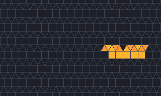
</picture>

<code>f1b6f83a</code> <a class="ship-n" href="#the-60-objects">table row 26</a>

<dl>
<dt>Tiling</dt><dd>3.3.3.4.4 (shown); also k2-003, k2-004, k3-010, k3-013, k3-016, k3-019, k3-051 and k3-052; found on k3-010</dd>
<dt>Period</dt><dd>4, moving one lattice step per period (c/4)</dd>
<dt>Cells</dt><dd>12–16</dd>
<dt>Rules</dt><dd><code>B456/S347</code> to <code>B4,5,6,7,8,9,10,11,12/S0,3,4,7,8,9,10,11,12</code> (4,096 rules) on 3.3.3.4.4, k3-013, k3-019, k3-051 and k3-052; <code>B456/S347</code> to <code>B4,5,6,7,8,9,10/S0,3,4,7,8,9,10</code> (256 rules) on k2-003, k2-004, k3-010 and k3-016</dd>
<dt>Seen</dt><dd>7 times</dd>
<dt>Verdict</dt><dd><b>Single ship</b>, no flag.</dd>
</dl>

Clip: generations 1 to 49.

<picture>
  <source srcset="../images/findings/3e30b9ff-still.png" media="(prefers-reduced-motion: reduce)">
  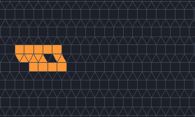
</picture>

<code>a13d3fbf</code> <a class="ship-n" href="#the-60-objects">table row 28</a>

<dl>
<dt>Tiling</dt><dd>3.3.3.4.4 (shown); also k2-003, k2-004, k3-010, k3-013, k3-016, k3-019, k3-051 and k3-052</dd>
<dt>Period</dt><dd>8, moving 2 lattice steps per period (c/4)</dd>
<dt>Cells</dt><dd>13–17</dd>
<dt>Rules</dt><dd><code>B46/S3458</code> to <code>B4,6,9,10,11,12/S0,1,3,4,5,8,9,10,11,12</code> (1,024 rules) on 3.3.3.4.4, k3-013, k3-019, k3-051 and k3-052; <code>B46/S3458</code> to <code>B4,6,9,10/S0,1,3,4,5,8,9,10</code> (64 rules) on k2-003, k2-004, k3-010 and k3-016</dd>
<dt>Seen</dt><dd>2 times</dd>
<dt>Verdict</dt><dd><b>Single ship</b>, no flag.</dd>
</dl>

Clip: generations 0 to 48.

<picture>
  <source srcset="../images/findings/d36fd2c3-still.png" media="(prefers-reduced-motion: reduce)">
  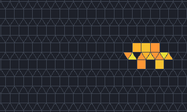
</picture>

<code>b36f22f2</code> <a class="ship-n" href="#the-60-objects">table row 29</a>

<dl>
<dt>Tiling</dt><dd>3.3.3.4.4 (shown); also k2-003, k2-004, k3-010, k3-013, k3-016, k3-019, k3-051 and k3-052; found on k3-010</dd>
<dt>Period</dt><dd>18, moving one lattice step per period (c/18)</dd>
<dt>Cells</dt><dd>10–14</dd>
<dt>Rules</dt><dd><code>B4567/S3478</code> to <code>B4,5,6,7,9,10,11,12/S0,3,4,7,8,9,10,11,12</code> (512 rules) on 3.3.3.4.4, k3-013, k3-019, k3-051 and k3-052; <code>B4567/S3478</code> to <code>B4,5,6,7,9,10/S0,3,4,7,8,9,10</code> (32 rules) on k2-003, k2-004, k3-010 and k3-016</dd>
<dt>Seen</dt><dd>45 times</dd>
<dt>Verdict</dt><dd><b>Single ship</b>, no flag.</dd>
</dl>

Clip: generations 8 to 224, every 4th.

<picture>
  <source srcset="../images/findings/9f3f8ff8-still.png" media="(prefers-reduced-motion: reduce)">
  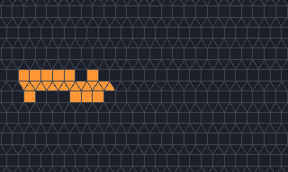
</picture>

<code>ffc6a106</code> <a class="ship-n" href="#the-60-objects">table row 30</a>

<dl>
<dt>Tiling</dt><dd>3.3.3.4.4 (shown); also k2-003, k2-004, k3-010, k3-013, k3-016, k3-019, k3-051 and k3-052; found on k3-010</dd>
<dt>Period</dt><dd>26, moving one lattice step per period (c/26)</dd>
<dt>Cells</dt><dd>17–26</dd>
<dt>Rules</dt><dd><code>B45679/S3478</code> to <code>B4,5,6,7,9,10,11,12/S0,1,3,4,7,8,10,11,12</code> (256 rules) on 3.3.3.4.4, k3-013, k3-019, k3-051 and k3-052; <code>B45679/S3478</code> to <code>B4,5,6,7,9,10/S0,1,3,4,7,8,10</code> (16 rules) on k2-003, k2-004, k3-010 and k3-016</dd>
<dt>Seen</dt><dd>1 time</dd>
<dt>Verdict</dt><dd><b>Single ship</b>, no flag.</dd>
</dl>

Clip: generations 0 to 364, every 6th.

<picture>
  <source srcset="../images/findings/d3cd3951-still.png" media="(prefers-reduced-motion: reduce)">
  
</picture>

<code>acd0fa8b</code> <a class="ship-n" href="#the-60-objects">table row 31</a>

<dl>
<dt>Tiling</dt><dd>3.3.3.3.6</dd>
<dt>Period</dt><dd>27, moving one lattice step per period (c/27)</dd>
<dt>Cells</dt><dd>4–18</dd>
<dt>Rules</dt><dd><code>B37/S2,5,6,10</code> to <code>B3,7,8,9,11,12,13,14,15,16,17,18/S2,5,6,8,9,10,11,12,13,14,15,16,17,18</code> (1,048,576 rules)</dd>
<dt>Seen</dt><dd>30 times</dd>
<dt>Verdict</dt><dd><b>Single ship</b>, no flag.</dd>
</dl>

Clip: generations 9 to 144, every 3rd.

<picture>
  <source srcset="../images/findings/2e4467c0-still.png" media="(prefers-reduced-motion: reduce)">
  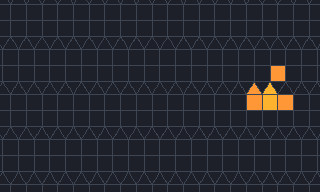
</picture>

<code>61627500</code> <a class="ship-n" href="#the-60-objects">table row 38</a>

<dl>
<dt>Tiling</dt><dd>k2-004 (shown); also k2-003, k3-010, k3-013, k3-016 and k3-019</dd>
<dt>Period</dt><dd>3, moving one lattice step per period (c/3)</dd>
<dt>Cells</dt><dd>4–6</dd>
<dt>Rules</dt><dd><code>B3/S35</code> to <code>B3,6,7,8,9,10/S0,3,5,6,7,8,9,10</code> (2,048 rules) on k2-004, k2-003, k3-010 and k3-016; <code>B3/S35</code> to <code>B3,6,7,8,9,10,11,12/S0,3,5,6,7,8,9,10,11,12</code> (32,768 rules) on k3-013 and k3-019</dd>
<dt>Seen</dt><dd>19 times</dd>
<dt>Verdict</dt><dd><b>Single ship</b>, no flag.</dd>
</dl>

Clip: generations 1 to 43.

<picture>
  <source srcset="../images/findings/6469dbc4-still.png" media="(prefers-reduced-motion: reduce)">
  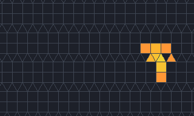
</picture>

<code>29af9b20</code> <a class="ship-n" href="#the-60-objects">table row 39</a>

<dl>
<dt>Tiling</dt><dd>k2-004 (shown); also k2-003, k3-010 and k3-016</dd>
<dt>Period</dt><dd>5, moving one lattice step per period (c/5)</dd>
<dt>Cells</dt><dd>5–9</dd>
<dt>Rules</dt><dd><code>B3/S356</code> to <code>B3,7,8,9,10/S0,3,5,6,7,8,9,10</code> (512 rules)</dd>
<dt>Seen</dt><dd>4 times</dd>
<dt>Verdict</dt><dd><b>Single ship</b>, no flag.</dd>
</dl>

Clip: generations 3 to 63.

<picture>
  <source srcset="../images/findings/9bebe7ea-still.png" media="(prefers-reduced-motion: reduce)">
  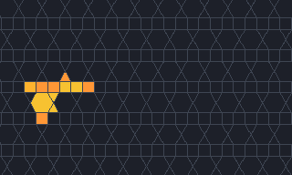
</picture>

<code>dcd6b05f</code> <a class="ship-n" href="#the-60-objects">table row 41</a>

<dl>
<dt>Tiling</dt><dd>k2-006 (shown); also k3-028; found on k3-028</dd>
<dt>Period</dt><dd>16, moving one lattice step per period (c/16)</dd>
<dt>Cells</dt><dd>8–11</dd>
<dt>Rules</dt><dd><code>B3/S1346</code> to <code>B3,8,9,10,11,12/S1,3,4,6,7,8,9,10,11,12</code> (2,048 rules)</dd>
<dt>Seen</dt><dd>13 times</dd>
<dt>Verdict</dt><dd><b>Single ship</b>, no flag.</dd>
</dl>

Clip: generations 2 to 130, every 3rd.

<picture>
  <source srcset="../images/findings/3fcb35b1-still.png" media="(prefers-reduced-motion: reduce)">
  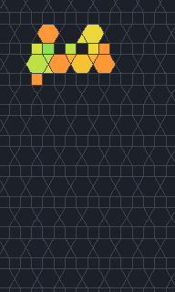
</picture>

<code>da6eca43</code> <a class="ship-n" href="#the-60-objects">table row 42</a>

<dl>
<dt>Tiling</dt><dd>k2-006</dd>
<dt>Period</dt><dd>46, moving (−1, 2) per period</dd>
<dt>Cells</dt><dd>5–17</dd>
<dt>Rules</dt><dd><code>B38/S345</code> to <code>B3,8,9,10,11,12/S3,4,5,8,9,10,11,12</code> (512 rules)</dd>
<dt>Seen</dt><dd>26 times</dd>
<dt>Verdict</dt><dd><b>Single ship</b>, no flag.</dd>
</dl>

Clip: generations 11 to 149, every 3rd.

<picture>
  <source srcset="../images/findings/af899881-still.png" media="(prefers-reduced-motion: reduce)">
  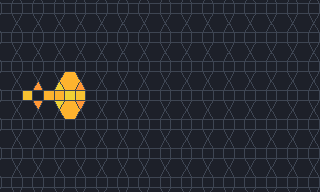
</picture>

<code>f9773263</code> <a class="ship-n" href="#the-60-objects">table row 43</a>

<dl>
<dt>Tiling</dt><dd>k2-007 (shown); also k3-028, k3-031 and k3-032; found on k3-028</dd>
<dt>Period</dt><dd>4, moving one lattice step per period (c/4)</dd>
<dt>Cells</dt><dd>6–13</dd>
<dt>Rules</dt><dd><code>B3/S13468</code> to <code>B3,7,8,9,10,11,12/S0,1,3,4,6,7,8,9,10,11,12</code> (4,096 rules)</dd>
<dt>Seen</dt><dd>17 times</dd>
<dt>Verdict</dt><dd><b>Single ship</b>, no flag.</dd>
</dl>

Clip: generations 3 to 43.

<picture>
  <source srcset="../images/findings/3021704c-still.png" media="(prefers-reduced-motion: reduce)">
  
</picture>

<code>56ddb3e7</code> <a class="ship-n" href="#the-60-objects">table row 44</a>

<dl>
<dt>Tiling</dt><dd>k2-012 (shown); also k3-003</dd>
<dt>Period</dt><dd>6, moving one lattice step per period (c/6)</dd>
<dt>Cells</dt><dd>7</dd>
<dt>Rules</dt><dd><code>B45/S34</code> to <code>B4,5,8,9,10,11,12,13,14/S0,1,3,4,6,7,8,9,10,11,12,13,14</code> (262,144 rules) on k2-012; <code>B45/S34</code> to <code>B4,5,8,9,10/S0,1,3,4,6,7,8,9,10</code> (1,024 rules) on k3-003</dd>
<dt>Seen</dt><dd>110 times</dd>
<dt>Verdict</dt><dd><b>Single ship</b>, no flag.</dd>
</dl>

Clip: generations 0 to 48.

<picture>
  <source srcset="../images/findings/9c87573c-still.png" media="(prefers-reduced-motion: reduce)">
  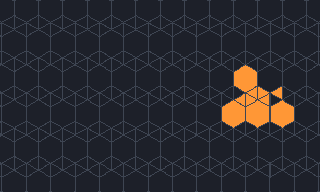
</picture>

<code>0d9a694c</code> <a class="ship-n" href="#the-60-objects">table row 45</a>

<dl>
<dt>Tiling</dt><dd>k2-012 (shown); also k3-003; found on k3-003</dd>
<dt>Period</dt><dd>10, moving one lattice step per period (c/10)</dd>
<dt>Cells</dt><dd>4–10</dd>
<dt>Rules</dt><dd><code>B3/S2456</code> to <code>B3,6,7,8,9,10,11,12,13,14/S0,2,4,5,6,8,9,10,11,12,13,14</code> (131,072 rules) on k2-012; <code>B3/S2456</code> to <code>B3,6,7,8,9,10/S0,2,4,5,6,8,9,10</code> (512 rules) on k3-003</dd>
<dt>Seen</dt><dd>254 times</dd>
<dt>Verdict</dt><dd><b>Single ship</b>, no flag.</dd>
</dl>

Clip: generations 0 to 80, every 2nd.

<picture>
  <source srcset="../images/findings/a5564155-still.png" media="(prefers-reduced-motion: reduce)">
  
</picture>

<code>01d41fa4</code> <a class="ship-n" href="#the-60-objects">table row 46</a>

<dl>
<dt>Tiling</dt><dd>k2-012 (shown); also k3-003</dd>
<dt>Period</dt><dd>14, moving one lattice step per period (c/14)</dd>
<dt>Cells</dt><dd>11–17</dd>
<dt>Rules</dt><dd><code>B456/S3468</code> to <code>B4,5,6,8,9,10,11,12,13,14/S0,1,3,4,6,8,9,10,11,12,13,14</code> (32,768 rules) on k2-012; <code>B456/S3468</code> to <code>B4,5,6,8,9,10/S0,1,3,4,6,8,9,10</code> (128 rules) on k3-003</dd>
<dt>Seen</dt><dd>11 times</dd>
<dt>Verdict</dt><dd><b>Single ship</b>, no flag.</dd>
</dl>

Clip: generations 0 to 112, every 2nd.

<picture>
  <source srcset="../images/findings/9d1ccd9c-still.png" media="(prefers-reduced-motion: reduce)">
  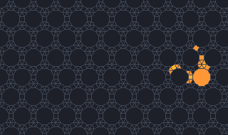
</picture>

<code>47978a43</code> <a class="ship-n" href="#the-60-objects">table row 47</a>

<dl>
<dt>Tiling</dt><dd>k2-013</dd>
<dt>Period</dt><dd>6, moving one lattice step per period (c/6)</dd>
<dt>Cells</dt><dd>9–20</dd>
<dt>Rules</dt><dd><code>B2,10/S1</code> to <code>B2,8,9,10,11,12,13,14,15,16,17,18,19,20,21,22,23,24/S1,9,10,11,12,13,14,15,16,17,18,19,20,21,22,23,24</code> (4,294,967,296 rules)</dd>
<dt>Seen</dt><dd>44 times</dd>
<dt>Verdict</dt><dd><b>Single ship</b>, no flag.</dd>
</dl>

Clip: generations 4 to 46.

<picture>
  <source srcset="../images/findings/e1067c81-still.png" media="(prefers-reduced-motion: reduce)">
  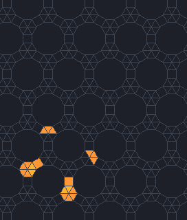
</picture>

<code>4b87931e</code> <a class="ship-n" href="#the-60-objects">table row 48</a>

<dl>
<dt>Tiling</dt><dd>k2-013</dd>
<dt>Period</dt><dd>17, moving (1, −1) per period</dd>
<dt>Cells</dt><dd>2–20</dd>
<dt>Rules</dt><dd><code>B2,8,13/S1</code> to <code>B2,8,9,10,11,12,13,14,15,16,17,18,19,20,21,22,23,24/S1,9,10,11,12,13,14,15,16,17,18,19,20,21,22,23,24</code> (2,147,483,648 rules)</dd>
<dt>Seen</dt><dd>275 times</dd>
<dt>Verdict</dt><dd><b>Single ship</b>, no flag.</dd>
</dl>

Clip: generations 7 to 58.

<picture>
  <source srcset="../images/findings/49a92bbe-still.png" media="(prefers-reduced-motion: reduce)">
  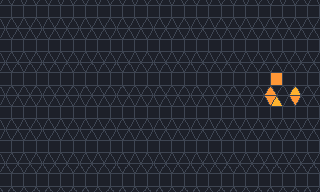
</picture>

<code>931ac6a1</code> <a class="ship-n" href="#the-60-objects">table row 49</a>

<dl>
<dt>Tiling</dt><dd>k2-014 (shown); also k3-014, k3-020 and k3-051</dd>
<dt>Period</dt><dd>4, moving 2 lattice steps per period (c/2)</dd>
<dt>Cells</dt><dd>5–6</dd>
<dt>Rules</dt><dd><code>B3/S2</code> to <code>B3,7,8,9,10,11,12/S2,5,6,7,8,9,10,11,12</code> (16,384 rules) on k2-014 and k3-051; <code>B3/S2</code> to <code>B3,7,8,9,10,11/S2,5,6,7,8,9,10,11</code> (4,096 rules) on k3-014 and k3-020</dd>
<dt>Seen</dt><dd>179 times</dd>
<dt>Verdict</dt><dd><b>Single ship</b>, no flag.</dd>
</dl>

Clip: generations 1 to 41.

<picture>
  <source srcset="../images/findings/b79fe209-still.png" media="(prefers-reduced-motion: reduce)">
  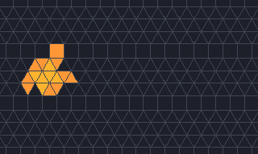
</picture>

<code>29fa9994</code> <a class="ship-n" href="#the-60-objects">table row 50</a>

<dl>
<dt>Tiling</dt><dd>k2-015 (shown); also k3-015, k3-021 and k3-052; found on k3-021</dd>
<dt>Period</dt><dd>32, moving one lattice step per period (c/32)</dd>
<dt>Cells</dt><dd>11–16</dd>
<dt>Rules</dt><dd><code>B4,5,6,7,8,11/S56</code> to <code>B4,5,6,7,8,10,11,12/S0,5,6,12</code> (16 rules)</dd>
<dt>Seen</dt><dd>30 times</dd>
<dt>Verdict</dt><dd><b>Single ship</b>, no flag.</dd>
</dl>

Clip: generations 11 to 363, every 6th.

<picture>
  <source srcset="../images/findings/b3726ba1-still.png" media="(prefers-reduced-motion: reduce)">
  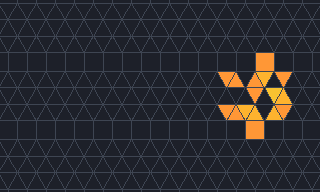
</picture>

<code>dc81d36e</code> <a class="ship-n" href="#the-60-objects">table row 51</a>

<dl>
<dt>Tiling</dt><dd>k2-015 (shown); also k3-015, k3-021 and k3-052; found on k3-021</dd>
<dt>Period</dt><dd>44, moving one lattice step per period (c/44)</dd>
<dt>Cells</dt><dd>11–16</dd>
<dt>Rules</dt><dd><code>B4,5,6,7,8,10/S56</code> to <code>B4,5,6,7,8,10,11,12/S0,5,6,12</code> (16 rules)</dd>
<dt>Seen</dt><dd>35 times</dd>
<dt>Verdict</dt><dd><b>Single ship</b>, no flag.</dd>
</dl>

Clip: generations 8 to 448, every 7th.

<picture>
  <source srcset="../images/findings/7ff20168-still.png" media="(prefers-reduced-motion: reduce)">
  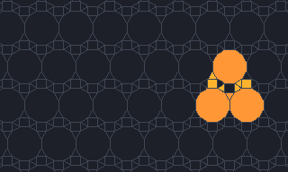
</picture>

<code>5b9c9e68</code> <a class="ship-n" href="#the-60-objects">table row 53</a>

<dl>
<dt>Tiling</dt><dd>k3-009</dd>
<dt>Period</dt><dd>16, moving one lattice step per period (c/16)</dd>
<dt>Cells</dt><dd>4–10</dd>
<dt>Rules</dt><dd><code>B3478/S23</code> to <code>B3,4,6,7,8,9,10,11,12,13,14,15,16,17,18,19,20/S2,3,7,8,9,10,11,12,13,14,15,16,17,18,19,20</code> (134,217,728 rules)</dd>
<dt>Seen</dt><dd>466 times</dd>
<dt>Verdict</dt><dd><b>Single ship</b>, no flag.</dd>
</dl>

Clip: generations 1 to 81, every 2nd.

<picture>
  <source srcset="../images/findings/ed99f9a8-still.png" media="(prefers-reduced-motion: reduce)">
  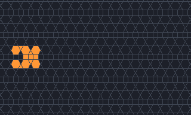
</picture>

<code>573a43ed</code> <a class="ship-n" href="#the-60-objects">table row 55</a>

<dl>
<dt>Tiling</dt><dd>k3-032</dd>
<dt>Period</dt><dd>3, moving one lattice step per period (c/3)</dd>
<dt>Cells</dt><dd>10–13</dd>
<dt>Rules</dt><dd><code>B3/S3457</code> to <code>B3,7,8,9,10,11,12/S3,4,5,7,9,10,11,12</code> (1,024 rules)</dd>
<dt>Seen</dt><dd>2 times</dd>
<dt>Verdict</dt><dd><b>Single ship</b>, no flag.</dd>
</dl>

Clip: generations 0 to 42.

<picture>
  <source srcset="../images/findings/6c774748-still.png" media="(prefers-reduced-motion: reduce)">
  
</picture>

<code>e3df3631</code> <a class="ship-n" href="#the-60-objects">table row 56</a>

<dl>
<dt>Tiling</dt><dd>k3-038</dd>
<dt>Period</dt><dd>53, moving one lattice step per period (c/53)</dd>
<dt>Cells</dt><dd>4–24</dd>
<dt>Rules</dt><dd><code>B3/S136</code> to <code>B3,10,11,12,13,14/S1,3,6,9,10,11,12,13,14</code> (2,048 rules)</dd>
<dt>Seen</dt><dd>4 times</dd>
<dt>Verdict</dt><dd><b>Single ship</b>, no flag.</dd>
</dl>

Clip: generations 41 to 359, every 6th.

<picture>
  <source srcset="../images/findings/17453dab-still.png" media="(prefers-reduced-motion: reduce)">
  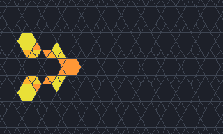
</picture>

<code>df78e126</code> <a class="ship-n" href="#the-60-objects">table row 57</a>

<dl>
<dt>Tiling</dt><dd>k3-045</dd>
<dt>Period</dt><dd>37, moving one lattice step per period (c/37)</dd>
<dt>Cells</dt><dd>6–23</dd>
<dt>Rules</dt><dd><code>B4,5,9,11/S2,3,5,8,9,14</code> to <code>B4,5,9,10,11,13,14,15,16/S0,2,3,5,8,9,10,11,12,13,14,15,16</code> (4,096 rules)</dd>
<dt>Seen</dt><dd>8 times</dd>
<dt>Verdict</dt><dd><b>Single ship</b>, no flag.</dd>
</dl>

Clip: generations 5 to 264, every 5th.

<picture>
  <source srcset="../images/findings/9242617e-still.png" media="(prefers-reduced-motion: reduce)">
  
</picture>

<code>9d5c568b</code> <a class="ship-n" href="#the-60-objects">table row 58</a>

<dl>
<dt>Tiling</dt><dd>k3-053</dd>
<dt>Period</dt><dd>26, moving one lattice step per period (c/26)</dd>
<dt>Cells</dt><dd>3–7</dd>
<dt>Rules</dt><dd><code>B36/S25</code> to <code>B3,6,7,8,9,10,11,12/S0,2,5,6,7,8,9,10,11,12</code> (16,384 rules)</dd>
<dt>Seen</dt><dd>642 times</dd>
<dt>Verdict</dt><dd><b>Single ship</b>, no flag.</dd>
</dl>

Clip: generations 11 to 63.

<picture>
  <source srcset="../images/findings/2c3cee67-still.png" media="(prefers-reduced-motion: reduce)">
  
</picture>

<code>f3d2fa6a</code> <a class="ship-n" href="#the-60-objects">table row 60</a>

<dl>
<dt>Tiling</dt><dd>k3-058</dd>
<dt>Period</dt><dd>22, moving (−1, 1) per period</dd>
<dt>Cells</dt><dd>4–12</dd>
<dt>Rules</dt><dd><code>B37/S25</code> to <code>B3,7,9,10,11,12,13,14,15,16,17,18/S2,5,6,8,9,10,11,12,13,14,15,16,17,18</code> (4,194,304 rules)</dd>
<dt>Seen</dt><dd>359 times</dd>
<dt>Verdict</dt><dd><b>Single ship</b>, no flag.</dd>
</dl>

Clip: generations 10 to 73.

#### Derivatives with no flag (7)

A smaller ship that pulls a passenger along unchanged. Each is kept as a distinct object, with its
core linked, but is not counted as a discovery. Six more derivatives are flagged and shown below.

<picture>
  <source srcset="../images/findings/ca2f31b0-still.png" media="(prefers-reduced-motion: reduce)">
  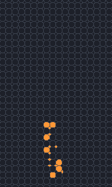
</picture>

<code>3c6d5ab0</code> <a class="ship-n" href="#the-60-objects">table row 2</a>

<dl>
<dt>Tiling</dt><dd>4.8.8</dd>
<dt>Period</dt><dd>2, moving one lattice step per period (c/2)</dd>
<dt>Cells</dt><dd>14–16</dd>
<dt>Rules</dt><dd><code>B2/S2</code> to <code>B2678/S245678</code> (256 rules)</dd>
<dt>Seen</dt><dd>8 times</dd>
<dt>Verdict</dt><dd><b>Derivative</b>: <a href="#ship-69c9912a"><code>69c9912a</code></a> with a tag-along; not counted as a discovery.</dd>
</dl>

Clip: generations 0 to 36.

<picture>
  <source srcset="../images/findings/2f5d3182-still.png" media="(prefers-reduced-motion: reduce)">
  
</picture>

<code>070a054d</code> <a class="ship-n" href="#the-60-objects">table row 4</a>

<dl>
<dt>Tiling</dt><dd>4.8.8</dd>
<dt>Period</dt><dd>4, moving 2 lattice steps per period (c/2)</dd>
<dt>Cells</dt><dd>9–10</dd>
<dt>Rules</dt><dd><code>B2/S2</code> to <code>B25678/S25678</code> (256 rules)</dd>
<dt>Seen</dt><dd>32 times</dd>
<dt>Verdict</dt><dd><b>Derivative</b>: <a href="#ship-938f9833"><code>938f9833</code></a> with a tag-along; not counted as a discovery.</dd>
</dl>

Clip: generations 1 to 41.

<picture>
  <source srcset="../images/findings/298db0cf-still.png" media="(prefers-reduced-motion: reduce)">
  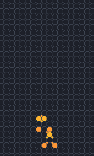
</picture>

<code>3e6ae2f3</code> <a class="ship-n" href="#the-60-objects">table row 5</a>

<dl>
<dt>Tiling</dt><dd>4.8.8</dd>
<dt>Period</dt><dd>4, moving 2 lattice steps per period (c/2)</dd>
<dt>Cells</dt><dd>9–14</dd>
<dt>Rules</dt><dd><code>B2/S2</code> to <code>B278/S25678</code> (64 rules)</dd>
<dt>Seen</dt><dd>5 times</dd>
<dt>Verdict</dt><dd><b>Derivative</b>: <a href="#ship-69c9912a"><code>69c9912a</code></a> with a tag-along; not counted as a discovery.</dd>
</dl>

Clip: generations 1 to 41.

<picture>
  <source srcset="../images/findings/984c5dd5-still.png" media="(prefers-reduced-motion: reduce)">
  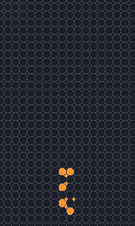
</picture>

<code>5aec548b</code> <a class="ship-n" href="#the-60-objects">table row 6</a>

<dl>
<dt>Tiling</dt><dd>4.8.8</dd>
<dt>Period</dt><dd>4, moving 2 lattice steps per period (c/2)</dd>
<dt>Cells</dt><dd>7–10</dd>
<dt>Rules</dt><dd><code>B2/S2</code> to <code>B2678/S245678</code> (256 rules)</dd>
<dt>Seen</dt><dd>92 times</dd>
<dt>Verdict</dt><dd><b>Derivative</b>: <a href="#ship-69c9912a"><code>69c9912a</code></a> with a tag-along; not counted as a discovery.</dd>
</dl>

Clip: generations 0 to 40.

<picture>
  <source srcset="../images/findings/87759c78-still.png" media="(prefers-reduced-motion: reduce)">
  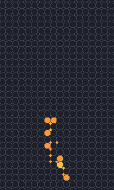
</picture>

<code>616314c5</code> <a class="ship-n" href="#the-60-objects">table row 7</a>

<dl>
<dt>Tiling</dt><dd>4.8.8</dd>
<dt>Period</dt><dd>4, moving 2 lattice steps per period (c/2)</dd>
<dt>Cells</dt><dd>14–17</dd>
<dt>Rules</dt><dd><code>B2/S2</code> to <code>B2678/S245678</code> (256 rules)</dd>
<dt>Seen</dt><dd>2 times</dd>
<dt>Verdict</dt><dd><b>Derivative</b>: <a href="#ship-69c9912a"><code>69c9912a</code></a> with a tag-along; not counted as a discovery.</dd>
</dl>

Clip: generations 2 to 36.

<picture>
  <source srcset="../images/findings/c45a97a1-still.png" media="(prefers-reduced-motion: reduce)">
  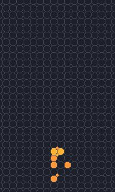
</picture>

<code>c2f4f14a</code> <a class="ship-n" href="#the-60-objects">table row 10</a>

<dl>
<dt>Tiling</dt><dd>4.8.8</dd>
<dt>Period</dt><dd>4, moving 2 lattice steps per period (c/2)</dd>
<dt>Cells</dt><dd>8–9</dd>
<dt>Rules</dt><dd><code>B2/S2</code> to <code>B25678/S25678</code> (256 rules)</dd>
<dt>Seen</dt><dd>3 times</dd>
<dt>Verdict</dt><dd><b>Derivative</b>: <a href="#ship-c4c00098"><code>c4c00098</code></a> with a tag-along; not counted as a discovery.</dd>
</dl>

Clip: generations 1 to 41.

<picture>
  <source srcset="../images/findings/25ba593a-still.png" media="(prefers-reduced-motion: reduce)">
  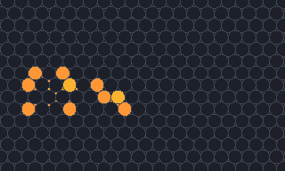
</picture>

<code>5e1adb91</code> <a class="ship-n" href="#the-60-objects">table row 22</a>

<dl>
<dt>Tiling</dt><dd>3.12.12</dd>
<dt>Period</dt><dd>8, moving 4 lattice steps per period (c/2)</dd>
<dt>Cells</dt><dd>12–23</dd>
<dt>Rules</dt><dd><code>B26/S26</code> to <code>B2,6,8,9,10,11,12/S2,6,7,9,10,11,12</code> (1,024 rules)</dd>
<dt>Seen</dt><dd>1 time</dd>
<dt>Verdict</dt><dd><b>Derivative</b>: <a href="#ship-852ea9ff"><code>852ea9ff</code></a> with a tag-along; not counted as a discovery.</dd>
</dl>

Clip: generations 4 to 24.

#### Flag A: most likely already known (11)

Small ships that turn up often in soups and run in many rules on an Archimedean tiling, and the
ships built on Guttesen's gliders. We found no earlier report of them, but others may well have seen
them, so they are not claimed.

<picture>
  <source srcset="../images/findings/78d55497-still.png" media="(prefers-reduced-motion: reduce)">
  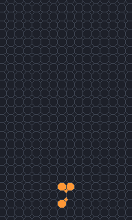
</picture>

<code>69c9912a</code> <a class="ship-n" href="#the-60-objects">table row 3</a>

<dl>
<dt>Tiling</dt><dd>4.8.8</dd>
<dt>Period</dt><dd>2, moving one lattice step per period (c/2)</dd>
<dt>Cells</dt><dd>5</dd>
<dt>Rules</dt><dd><code>B2/S2</code> to <code>B25678/S245678</code> (512 rules)</dd>
<dt>Seen</dt><dd>8,034 times</dd>
<dt>Verdict</dt><dd><b>Flag A</b>, most likely already known: small (5 cells), common (seen 8,034 times) and wide-range (512 rules) on an Archimedean tiling. Single ship.</dd>
</dl>

Clip: generations 0 to 40.

<picture>
  <source srcset="../images/findings/bde55795-still.png" media="(prefers-reduced-motion: reduce)">
  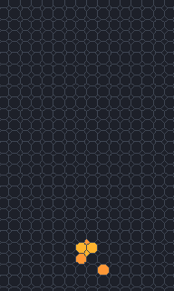
</picture>

<code>938f9833</code> <a class="ship-n" href="#the-60-objects">table row 9</a>

<dl>
<dt>Tiling</dt><dd>4.8.8</dd>
<dt>Period</dt><dd>4, moving 2 lattice steps per period (c/2)</dd>
<dt>Cells</dt><dd>5–6</dd>
<dt>Rules</dt><dd><code>B2/S2</code> to <code>B25678/S25678</code> (256 rules)</dd>
<dt>Seen</dt><dd>406 times</dd>
<dt>Verdict</dt><dd><b>Flag A</b>, most likely already known: small (5–6 cells), common (seen 406 times) and wide-range (256 rules) on an Archimedean tiling. Single ship.</dd>
</dl>

Clip: generations 1 to 41.

<picture>
  <source srcset="../images/findings/30594bf3-still.png" media="(prefers-reduced-motion: reduce)">
  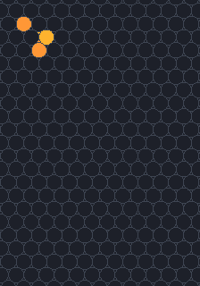
</picture>

<code>c78ceb01</code> <a class="ship-n" href="#the-60-objects">table row 20</a>

<dl>
<dt>Tiling</dt><dd>3.12.12</dd>
<dt>Period</dt><dd>2, moving one lattice step per period (c/2)</dd>
<dt>Cells</dt><dd>4–5</dd>
<dt>Rules</dt><dd><code>B2/S2</code> to <code>B2,6,7,8,9,10,11,12/S2,4,5,6,7,8,9,10,11,12</code> (65,536 rules)</dd>
<dt>Seen</dt><dd>1,742 times</dd>
<dt>Verdict</dt><dd><b>Flag A</b>, most likely already known: small (4–5 cells), common (seen 1,742 times) and wide-range (65,536 rules) on an Archimedean tiling. Single ship.</dd>
</dl>

Clip: generations 1 to 34.

<picture>
  <source srcset="../images/findings/3aaf02c0-still.png" media="(prefers-reduced-motion: reduce)">
  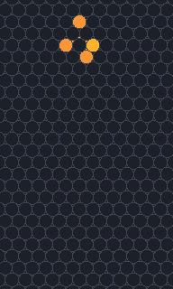
</picture>

<code>b2c790bb</code> <a class="ship-n" href="#the-60-objects">table row 21</a>

<dl>
<dt>Tiling</dt><dd>3.12.12</dd>
<dt>Period</dt><dd>6, moving (−2, 4) per period</dd>
<dt>Cells</dt><dd>5–8</dd>
<dt>Rules</dt><dd><code>B2/S2</code> to <code>B2,5,6,8,9,10,11,12/S2,5,6,7,8,9,10,11,12</code> (32,768 rules)</dd>
<dt>Seen</dt><dd>1,585 times</dd>
<dt>Verdict</dt><dd><b>Flag A</b>, most likely already known: small (5–8 cells), common (seen 1,585 times) and wide-range (32,768 rules) on an Archimedean tiling. Single ship.</dd>
</dl>

Clip: generations 2 to 29.

<picture>
  <source srcset="../images/findings/781cc2ef-still.png" media="(prefers-reduced-motion: reduce)">
  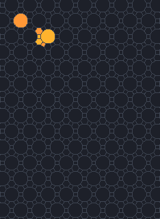
</picture>

<code>1723afa2</code> <a class="ship-n" href="#the-60-objects">table row 23</a>

<dl>
<dt>Tiling</dt><dd>4.6.12</dd>
<dt>Period</dt><dd>4, moving one lattice step per period (c/4)</dd>
<dt>Cells</dt><dd>5–6</dd>
<dt>Rules</dt><dd><code>B2/S2</code> to <code>B2,5,6,7,8,9,10,11,12/S2,5,6,7,8,9,10,11,12</code> (65,536 rules)</dd>
<dt>Seen</dt><dd>373 times</dd>
<dt>Verdict</dt><dd><b>Flag A</b>, most likely already known: small (5–6 cells), common (seen 373 times) and wide-range (65,536 rules) on an Archimedean tiling. Single ship.</dd>
</dl>

Clip: generations 1 to 41.

<picture>
  <source srcset="../images/findings/d8692b4b-still.png" media="(prefers-reduced-motion: reduce)">
  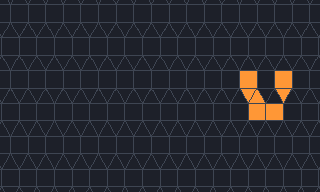
</picture>

<code>7860a67a</code> <a class="ship-n" href="#the-60-objects">table row 25</a>

<dl>
<dt>Tiling</dt><dd>3.3.3.4.4 (shown); also k2-003, k2-004, k3-010, k3-013, k3-016, k3-019, k3-051 and k3-052; found on k3-016 and, as <code>25e004f4</code>, on k3-013</dd>
<dt>Period</dt><dd>4, moving one lattice step per period (c/4)</dd>
<dt>Cells</dt><dd>7</dd>
<dt>Rules</dt><dd><code>B45/S34</code> to <code>B4,5,8,9,10,11,12/S0,3,4,7,8,9,10,11,12</code> (4,096 rules) on 3.3.3.4.4, k3-013, k3-019, k3-051 and k3-052; <code>B45/S34</code> to <code>B4,5,8,9,10/S0,3,4,7,8,9,10</code> (256 rules) on k2-003, k2-004, k3-010 and k3-016</dd>
<dt>Seen</dt><dd>447 times (249 as <code>7860a67a</code>, 198 as <code>25e004f4</code>)</dd>
<dt>Verdict</dt><dd><b>Flag A</b>, most likely already known: small (7 cells), common (seen 447 times) and wide-range (4,096 rules) on an Archimedean tiling. Single ship.</dd>
</dl>

Clip: generations 0 to 48.

<picture>
  <source srcset="../images/findings/1a403313-still.png" media="(prefers-reduced-motion: reduce)">
  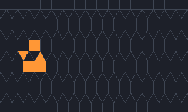
</picture>

<code>c15dd310</code> <a class="ship-n" href="#the-60-objects">table row 27</a>

<dl>
<dt>Tiling</dt><dd>3.3.3.4.4 (shown); also k2-003, k2-004, k3-010, k3-013, k3-016, k3-019, k3-051 and k3-052; found on k3-019 and, as <code>f62ba07d</code>, on k3-019</dd>
<dt>Period</dt><dd>5, moving one lattice step per period (c/5)</dd>
<dt>Cells</dt><dd>4–5</dd>
<dt>Rules</dt><dd><code>B3/S2</code> to <code>B3,6,7,8,9,10,11,12/S0,2,4,5,6,7,8,9,10,11,12</code> (131,072 rules) on 3.3.3.4.4, k3-013, k3-019, k3-051 and k3-052; <code>B3/S2</code> to <code>B3,6,7,8,9,10/S0,2,4,5,6,7,8,9,10</code> (8,192 rules) on k2-003, k2-004, k3-010 and k3-016</dd>
<dt>Seen</dt><dd>406 times (229 as <code>c15dd310</code>, 177 as <code>f62ba07d</code>)</dd>
<dt>Verdict</dt><dd><b>Flag A</b>, most likely already known: small (4–5 cells), common (seen 406 times) and wide-range (131,072 rules) on an Archimedean tiling. Single ship.</dd>
</dl>

Clip: generations 0 to 55.

<picture>
  <source srcset="../images/findings/c696c65e-still.png" media="(prefers-reduced-motion: reduce)">
  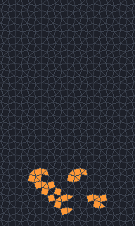
</picture>

<code>2ba58828</code> <a class="ship-n" href="#the-60-objects">table row 32</a>

<dl>
<dt>Tiling</dt><dd>3.3.4.3.4</dd>
<dt>Period</dt><dd>16, moving 4 lattice steps per period (c/4)</dd>
<dt>Cells</dt><dd>15–33</dd>
<dt>Rules</dt><dd><code>B3/S23</code> to <code>B3,8,10,11,12/S2,3,9,10,11,12</code> (256 rules)</dd>
<dt>Seen</dt><dd>1 time</dd>
<dt>Verdict</dt><dd><b>Flag A</b>, most likely already known: runs in Life (<code>B3/S23</code>) on an Archimedean tiling that Guttesen searched; built on Guttesen's snub-square glider. Derivative: a bound pair of Guttesen's snub-square glider.</dd>
</dl>

Clip: generations 0 to 48.

<picture>
  <source srcset="../images/findings/a5e9ba80-still.png" media="(prefers-reduced-motion: reduce)">
  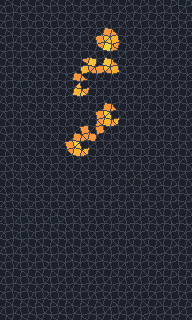
</picture>

<code>98a3c53b</code> <a class="ship-n" href="#the-60-objects">table row 33</a>

<dl>
<dt>Tiling</dt><dd>3.3.4.3.4</dd>
<dt>Period</dt><dd>24, moving 6 lattice steps per period (c/4)</dd>
<dt>Cells</dt><dd>17–50</dd>
<dt>Rules</dt><dd><code>B3/S23</code> to <code>B3,8,10,11,12/S2,3,10,11,12</code> (128 rules)</dd>
<dt>Seen</dt><dd>1 time</dd>
<dt>Verdict</dt><dd><b>Flag A</b>, most likely already known: runs in Life (<code>B3/S23</code>) on an Archimedean tiling that Guttesen searched; contains a perturbed phase of Guttesen's snub-square glider. Single ship.</dd>
</dl>

Clip: generations 15 to 55.

<picture>
  <source srcset="../images/findings/1df4b31f-still.png" media="(prefers-reduced-motion: reduce)">
  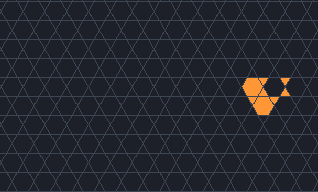
</picture>

<code>8aa7e24c</code> <a class="ship-n" href="#the-60-objects">table row 35</a>

<dl>
<dt>Tiling</dt><dd>3.6.3.6 (shown); also k3-030, k3-032 and k3-039; found on k3-032</dd>
<dt>Period</dt><dd>4, moving one lattice step per period (c/4)</dd>
<dt>Cells</dt><dd>7–8</dd>
<dt>Rules</dt><dd><code>B3/S345</code> to <code>B3,4,6,8,9,10,11,12/S0,3,4,5,7,8,9,10,11,12</code> (16,384 rules)</dd>
<dt>Seen</dt><dd>1,347 times</dd>
<dt>Verdict</dt><dd><b>Flag A</b>, most likely already known: small (7–8 cells), common (seen 1,347 times) and wide-range (16,384 rules) on an Archimedean tiling. Single ship.</dd>
</dl>

Clip: generations 0 to 40.

<picture>
  <source srcset="../images/findings/e08df0a8-still.png" media="(prefers-reduced-motion: reduce)">
  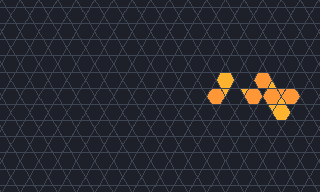
</picture>

<code>ea5d187b</code> <a class="ship-n" href="#the-60-objects">table row 36</a>

<dl>
<dt>Tiling</dt><dd>3.6.3.6</dd>
<dt>Period</dt><dd>4, moving one lattice step per period (c/4)</dd>
<dt>Cells</dt><dd>10–13</dd>
<dt>Rules</dt><dd><code>B36/S23</code> to <code>B3,6,7,8,9,10,11,12/S2,3,6,7,9,10,11,12</code> (4,096 rules)</dd>
<dt>Seen</dt><dd>2 times</dd>
<dt>Verdict</dt><dd><b>Flag A</b>, most likely already known: built on Guttesen's kagome glider g; runs in HighLife (<code>B36/S23</code>) on an Archimedean tiling. Derivative: Guttesen's kagome glider g with a tag-along.</dd>
</dl>

Clip: generations 1 to 41.

#### Flag B: check before claiming (17)

Ships that run in a well-known rule on an Archimedean tiling, contain a phase of one of Guttesen's
gliders, were very common in their search, or run on 4.8.8 or 3.12.12 in the rules where EricG
reported many spaceships in 2013 without listing them. We found no earlier report of them, but
others may well have seen them, so they are not claimed.

<picture>
  <source srcset="../images/findings/9d091ca3-still.png" media="(prefers-reduced-motion: reduce)">
  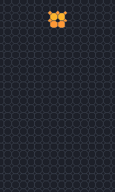
</picture>

<code>0ed091c9</code> <a class="ship-n" href="#the-60-objects">table row 1</a>

<dl>
<dt>Tiling</dt><dd>4.8.8</dd>
<dt>Period</dt><dd>2, moving one lattice step per period (c/2)</dd>
<dt>Cells</dt><dd>5–9</dd>
<dt>Rules</dt><dd><code>B2/S3</code> to <code>B25678/S034678</code> (512 rules)</dd>
<dt>Seen</dt><dd>270 times</dd>
<dt>Verdict</dt><dd><b>Flag B</b>, check before claiming: runs in <code>B2/S34</code>, the rule of the 4.8.8 hunts (Hexagonal Life without its <code>H</code>). Single ship.</dd>
</dl>

Clip: generations 1 to 41.

<picture>
  <source srcset="../images/findings/feae0172-still.png" media="(prefers-reduced-motion: reduce)">
  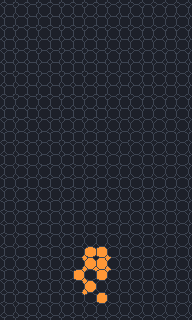
</picture>

<code>7c5b3e65</code> <a class="ship-n" href="#the-60-objects">table row 8</a>

<dl>
<dt>Tiling</dt><dd>4.8.8</dd>
<dt>Period</dt><dd>4, moving 2 lattice steps per period (c/2)</dd>
<dt>Cells</dt><dd>10–15</dd>
<dt>Rules</dt><dd><code>B2/S3</code> to <code>B2568/S3478</code> (64 rules)</dd>
<dt>Seen</dt><dd>54 times</dd>
<dt>Verdict</dt><dd><b>Flag B</b>, check before claiming: runs in <code>B2/S34</code>, the rule of the 4.8.8 hunts (Hexagonal Life without its <code>H</code>). Derivative: <a href="#ship-0ed091c9"><code>0ed091c9</code></a> with a tag-along.</dd>
</dl>

Clip: generations 0 to 40.

<picture>
  <source srcset="../images/findings/7f22824b-still.png" media="(prefers-reduced-motion: reduce)">
  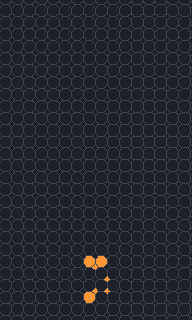
</picture>

<code>c4c00098</code> <a class="ship-n" href="#the-60-objects">table row 11</a>

<dl>
<dt>Tiling</dt><dd>4.8.8</dd>
<dt>Period</dt><dd>4, moving 2 lattice steps per period (c/2)</dd>
<dt>Cells</dt><dd>7</dd>
<dt>Rules</dt><dd><code>B2/S2</code> to <code>B245678/S25678</code> (512 rules)</dd>
<dt>Seen</dt><dd>9 times</dd>
<dt>Verdict</dt><dd><b>Flag B</b>, check before claiming: runs in <code>B2/S2</code> on 4.8.8, among the B2 rules where EricG (2013) reported many spaceships without listing them. Single ship; contains a perturbed phase of <a href="#ship-69c9912a"><code>69c9912a</code></a> and <a href="#ship-938f9833"><code>938f9833</code></a>.</dd>
</dl>

Clip: generations 0 to 40.

<picture>
  <source srcset="../images/findings/504fdf46-still.png" media="(prefers-reduced-motion: reduce)">
  
</picture>

<code>9cee5c6a</code> <a class="ship-n" href="#the-60-objects">table row 12</a>

<dl>
<dt>Tiling</dt><dd>4.8.8</dd>
<dt>Period</dt><dd>6, moving 2 lattice steps per period (c/3)</dd>
<dt>Cells</dt><dd>7–13</dd>
<dt>Rules</dt><dd><code>B2/S2</code> to <code>B2578/S25678</code> (128 rules)</dd>
<dt>Seen</dt><dd>11 times</dd>
<dt>Verdict</dt><dd><b>Flag B</b>, check before claiming: runs in <code>B2/S2</code> on 4.8.8, among the B2 rules where EricG (2013) reported many spaceships without listing them. Single ship.</dd>
</dl>

Clip: generations 2 to 44.

<picture>
  <source srcset="../images/findings/908dc7a0-still.png" media="(prefers-reduced-motion: reduce)">
  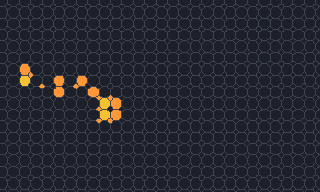
</picture>

<code>25969982</code> <a class="ship-n" href="#the-60-objects">table row 13</a>

<dl>
<dt>Tiling</dt><dd>4.8.8</dd>
<dt>Period</dt><dd>12, moving 6 lattice steps per period (c/2)</dd>
<dt>Cells</dt><dd>12–18</dd>
<dt>Rules</dt><dd><code>B2/S34</code> to <code>B2678/S34678</code> (64 rules)</dd>
<dt>Seen</dt><dd>2 times</dd>
<dt>Verdict</dt><dd><b>Flag B</b>, check before claiming: runs in <code>B2/S34</code>, the rule of the 4.8.8 hunts (Hexagonal Life without its <code>H</code>). Derivative: <a href="#ship-0ed091c9"><code>0ed091c9</code></a> with a tag-along.</dd>
</dl>

Clip: generations 2 to 34.

<picture>
  <source srcset="../images/findings/87dfbfaf-still.png" media="(prefers-reduced-motion: reduce)">
  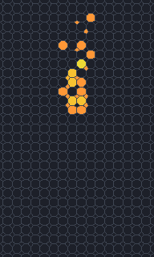
</picture>

<code>07ab1946</code> <a class="ship-n" href="#the-60-objects">table row 14</a>

<dl>
<dt>Tiling</dt><dd>4.8.8</dd>
<dt>Period</dt><dd>16, moving 8 lattice steps per period (c/2)</dd>
<dt>Cells</dt><dd>19–26</dd>
<dt>Rules</dt><dd><code>B2/S34</code> to <code>B268/S3478</code> (16 rules)</dd>
<dt>Seen</dt><dd>1 time</dd>
<dt>Verdict</dt><dd><b>Flag B</b>, check before claiming: runs in <code>B2/S34</code>, the rule of the 4.8.8 hunts (Hexagonal Life without its <code>H</code>). Derivative: <a href="#ship-0ed091c9"><code>0ed091c9</code></a> with a tag-along.</dd>
</dl>

Clip: generations 6 to 34.

<picture>
  <source srcset="../images/findings/71f3b4b3-still.png" media="(prefers-reduced-motion: reduce)">
  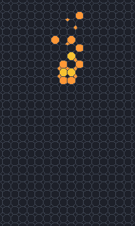
</picture>

<code>bdc1c8c7</code> <a class="ship-n" href="#the-60-objects">table row 15</a>

<dl>
<dt>Tiling</dt><dd>4.8.8</dd>
<dt>Period</dt><dd>16, moving 8 lattice steps per period (c/2)</dd>
<dt>Cells</dt><dd>14–20</dd>
<dt>Rules</dt><dd><code>B2/S34</code> to <code>B2568/S3478</code> (32 rules)</dd>
<dt>Seen</dt><dd>95 times</dd>
<dt>Verdict</dt><dd><b>Flag B</b>, check before claiming: runs in <code>B2/S34</code>, the rule of the 4.8.8 hunts (Hexagonal Life without its <code>H</code>). Derivative: <a href="#ship-0ed091c9"><code>0ed091c9</code></a> with a tag-along.</dd>
</dl>

Clip: generations 6 to 38.

<picture>
  <source srcset="../images/findings/76897484-still.png" media="(prefers-reduced-motion: reduce)">
  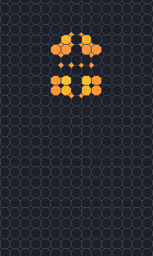
</picture>

<code>fff1b887</code> <a class="ship-n" href="#the-60-objects">table row 16</a>

<dl>
<dt>Tiling</dt><dd>4.8.8</dd>
<dt>Period</dt><dd>16, moving 8 lattice steps per period (c/2)</dd>
<dt>Cells</dt><dd>14–28</dd>
<dt>Rules</dt><dd><code>B2/S34</code> to <code>B278/S34678</code> (32 rules)</dd>
<dt>Seen</dt><dd>271 times</dd>
<dt>Verdict</dt><dd><b>Flag B</b>, check before claiming: runs in <code>B2/S34</code>, the rule of the 4.8.8 hunts (Hexagonal Life without its <code>H</code>). Single ship.</dd>
</dl>

Clip: generations 2 to 30.

<picture>
  <source srcset="../images/findings/a333894b-still.png" media="(prefers-reduced-motion: reduce)">
  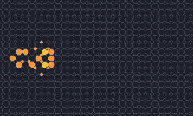
</picture>

<code>7e51c0d1</code> <a class="ship-n" href="#the-60-objects">table row 17</a>

<dl>
<dt>Tiling</dt><dd>4.8.8</dd>
<dt>Period</dt><dd>24, moving 12 lattice steps per period (c/2)</dd>
<dt>Cells</dt><dd>14–21</dd>
<dt>Rules</dt><dd><code>B2/S3</code> to <code>B278/S345678</code> (128 rules)</dd>
<dt>Seen</dt><dd>1 time</dd>
<dt>Verdict</dt><dd><b>Flag B</b>, check before claiming: runs in <code>B2/S34</code>, the rule of the 4.8.8 hunts (Hexagonal Life without its <code>H</code>). Single ship.</dd>
</dl>

Clip: generations 6 to 46.

<picture>
  <source srcset="../images/findings/95528302-still.png" media="(prefers-reduced-motion: reduce)">
  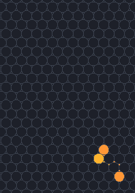
</picture>

<code>852ea9ff</code> <a class="ship-n" href="#the-60-objects">table row 18</a>

<dl>
<dt>Tiling</dt><dd>3.12.12</dd>
<dt>Period</dt><dd>2, moving one lattice step per period (c/2)</dd>
<dt>Cells</dt><dd>6–9</dd>
<dt>Rules</dt><dd><code>B26/S2</code> to <code>B2,4,6,7,8,9,10,11,12/S2,5,6,7,8,9,10,11,12</code> (32,768 rules)</dd>
<dt>Seen</dt><dd>39 times</dd>
<dt>Verdict</dt><dd><b>Flag B</b>, check before claiming: runs in B26 rules on 3.12.12, beside the <code>B2/S2</code> and <code>B26/S3569</code> rules where EricG (2013) reported many spaceships without listing them. Single ship; contains a perturbed phase of <a href="#ship-c78ceb01"><code>c78ceb01</code></a>.</dd>
</dl>

Clip: generations 1 to 32.

<picture>
  <source srcset="../images/findings/18746b1c-still.png" media="(prefers-reduced-motion: reduce)">
  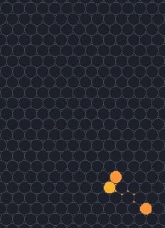
</picture>

<code>a0229739</code> <a class="ship-n" href="#the-60-objects">table row 19</a>

<dl>
<dt>Tiling</dt><dd>3.12.12</dd>
<dt>Period</dt><dd>2, moving one lattice step per period (c/2)</dd>
<dt>Cells</dt><dd>7–9</dd>
<dt>Rules</dt><dd><code>B26/S2</code> to <code>B2,6,7,8,9,10,11,12/S2,5,6,7,8,9,10,11,12</code> (16,384 rules)</dd>
<dt>Seen</dt><dd>6 times</dd>
<dt>Verdict</dt><dd><b>Flag B</b>, check before claiming: runs in B26 rules on 3.12.12, beside the <code>B2/S2</code> and <code>B26/S3569</code> rules where EricG (2013) reported many spaceships without listing them. Single ship; contains a perturbed phase of <a href="#ship-852ea9ff"><code>852ea9ff</code></a> and <a href="#ship-c78ceb01"><code>c78ceb01</code></a>.</dd>
</dl>

Clip: generations 1 to 31.

<picture>
  <source srcset="../images/findings/8f790b16-still.png" media="(prefers-reduced-motion: reduce)">
  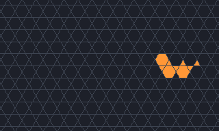
</picture>

<code>0ccbe694</code> <a class="ship-n" href="#the-60-objects">table row 34</a>

<dl>
<dt>Tiling</dt><dd>3.6.3.6 (shown); also k3-030, k3-032 and k3-039</dd>
<dt>Period</dt><dd>4, moving one lattice step per period (c/4)</dd>
<dt>Cells</dt><dd>8–9</dd>
<dt>Rules</dt><dd><code>B36/S23</code> to <code>B3,6,7,8,9,10,11,12/S2,3,6,7,8,9,10,11,12</code> (8,192 rules)</dd>
<dt>Seen</dt><dd>423 times</dd>
<dt>Verdict</dt><dd><b>Flag B</b>, check before claiming: runs in HighLife (<code>B36/S23</code>) on an Archimedean tiling; contains a perturbed phase of Guttesen's kagome glider g. Single ship.</dd>
</dl>

Clip: generations 0 to 40.

<picture>
  <source srcset="../images/findings/48e9e267-still.png" media="(prefers-reduced-motion: reduce)">
  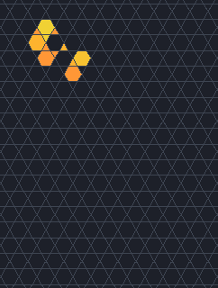
</picture>

<code>095a6bf7</code> <a class="ship-n" href="#the-60-objects">table row 37</a>

<dl>
<dt>Tiling</dt><dd>3.6.3.6</dd>
<dt>Period</dt><dd>12, moving 3 lattice steps per period (c/4)</dd>
<dt>Cells</dt><dd>5–12</dd>
<dt>Rules</dt><dd><code>B38/S23</code> to <code>B3,8,9,10,11,12/S2,3,6,7,8,9,10,11,12</code> (2,048 rules)</dd>
<dt>Seen</dt><dd>595 times</dd>
<dt>Verdict</dt><dd><b>Flag B</b>, check before claiming: runs in Pedestrian Life (<code>B38/S23</code>) on an Archimedean tiling; contains a perturbed phase of Guttesen's kagome glider g. Single ship.</dd>
</dl>

Clip: generations 3 to 51.

<picture>
  <source srcset="../images/findings/e71e1136-still.png" media="(prefers-reduced-motion: reduce)">
  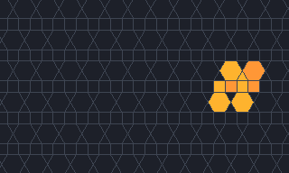
</picture>

<code>58ce78e3</code> <a class="ship-n" href="#the-60-objects">table row 40</a>

<dl>
<dt>Tiling</dt><dd>k2-006 (shown); also k3-028, k3-029 and k3-030; found on k3-029</dd>
<dt>Period</dt><dd>10, moving one lattice step per period (c/10)</dd>
<dt>Cells</dt><dd>4–9</dd>
<dt>Rules</dt><dd><code>B36/S23</code> to <code>B3,6,7,8,9,10,11,12/S2,3,7,8,9,10,11,12</code> (4,096 rules)</dd>
<dt>Seen</dt><dd>43 times</dd>
<dt>Verdict</dt><dd><b>Flag B</b>, check before claiming: runs in HighLife (<code>B36/S23</code>). Single ship.</dd>
</dl>

Clip: generations 1 to 81, every 2nd.

<picture>
  <source srcset="../images/findings/2afbf92b-still.png" media="(prefers-reduced-motion: reduce)">
  
</picture>

<code>47587892</code> <a class="ship-n" href="#the-60-objects">table row 52</a>

<dl>
<dt>Tiling</dt><dd>k2-017</dd>
<dt>Period</dt><dd>17, moving one lattice step per period (c/17)</dd>
<dt>Cells</dt><dd>3–13</dd>
<dt>Rules</dt><dd><code>B3/S25</code> to <code>B3,7,8,9,10,11,12/S2,5,6,7,8,9,10,11,12</code> (8,192 rules)</dd>
<dt>Seen</dt><dd>949 times</dd>
<dt>Verdict</dt><dd><b>Flag B</b>, check before claiming: common in its search (seen 949 times). Single ship.</dd>
</dl>

Clip: generations 6 to 57.

<picture>
  <source srcset="../images/findings/d5600a12-still.png" media="(prefers-reduced-motion: reduce)">
  
</picture>

<code>d37488d1</code> <a class="ship-n" href="#the-60-objects">table row 54</a>

<dl>
<dt>Tiling</dt><dd>k3-022</dd>
<dt>Period</dt><dd>12, moving (−1, −1) per period</dd>
<dt>Cells</dt><dd>9–11</dd>
<dt>Rules</dt><dd><code>B3/S3457</code> to <code>B3,8,9,10,11,12/S3,4,5,7,8,9,10,11,12</code> (1,024 rules)</dd>
<dt>Seen</dt><dd>1,158 times</dd>
<dt>Verdict</dt><dd><b>Flag B</b>, check before claiming: common in its search (seen 1,158 times). Single ship.</dd>
</dl>

Clip: generations 0 to 48.

<picture>
  <source srcset="../images/findings/ba6acb83-still.png" media="(prefers-reduced-motion: reduce)">
  
</picture>

<code>91205ceb</code> <a class="ship-n" href="#the-60-objects">table row 59</a>

<dl>
<dt>Tiling</dt><dd>k3-058</dd>
<dt>Period</dt><dd>12, moving one lattice step per period (c/12)</dd>
<dt>Cells</dt><dd>6–10</dd>
<dt>Rules</dt><dd><code>B37/S25</code> to <code>B3,7,8,9,10,11,12,13,14,15,16,17,18/S2,5,6,7,8,9,10,11,12,13,14,15,16,17,18</code> (16,777,216 rules)</dd>
<dt>Seen</dt><dd>1,096 times</dd>
<dt>Verdict</dt><dd><b>Flag B</b>, check before claiming: common in its search (seen 1,096 times). Single ship.</dd>
</dl>

Clip: generations 3 to 51.

## Life on the Archimedean and k-uniform tilings

The candidates above came from searches that ran Conway's Life itself on only a few tilings, so what
they say about Life is incomplete. In November 2026 JETCARP therefore ran a census of Life (`B3/S23`,
with cells that share an edge or a vertex as neighbours) on 92 tilings: the 11 Archimedean tilings,
which include the square, hexagonal and triangular grids, the 20 2-uniform tilings and the 61
3-uniform tilings of the [k-uniform catalogue](../tilings/k-uniform.md). On each it ran 50,000 random
soups of 16 by 16 unit cells, each cell live with probability one half, on the unbounded plane until
the soup settled, and catalogued every object that was left and every spaceship that flew away
(`jetcarp search hunt`, the job labelled `life-k123`).

Life has spaceships on 28 of the 92 tilings:
four Archimedean tilings (the square grid, 3.6.3.6, 3.3.3.4.4 and 3.3.4.3.4),
five of the 2-uniform tilings and 19 of the 3-uniform ones. On the other 64, no soup
produced one. That is not a proof that they have none: a ship that turns up in fewer than about one
soup in 50,000 could easily have been missed, and so would any ship of period above 64, which the
census did not look for.

| Tiling | Soups | Ships seen | Distinct objects | Of which listed here |
| --- | --- | --- | --- | --- |
| square | 50,000 | 95,227 | 6 | 4 known, 2 compound |
| hexagonal | 50,000 | none |  |  |
| triangular | 50,000 | none |  |  |
| 4.8.8 | 50,000 | none |  |  |
| 3.6.3.6 | 50,000 | 149,878 | 13 | 1 known, 12 compound |
| 3.3.3.4.4 | 50,000 | 4,605 | 2 | 1 known, 1 compound |
| 3.3.4.3.4 | 50,000 | 118,322 | 21 | 1 known, 1 flagged, 5 derivative, 14 compound |
| 3.3.3.3.6 | 50,000 | none |  |  |
| 3.4.6.4 | 50,000 | none |  |  |
| 3.12.12 | 50,000 | none |  |  |
| 4.6.12 | 50,000 | none |  |  |
| k2-001 | 50,000 | none |  |  |
| k2-002 | 50,000 | none |  |  |
| k2-003 | 50,000 | 577 | 2 | 1 single, 1 flagged |
| k2-004 | 50,000 | none |  |  |
| k2-005 | 50,000 | none |  |  |
| k2-006 | 50,000 | none |  |  |
| k2-007 | 50,000 | 5,773 | 3 | 1 known, 1 flagged, 1 compound |
| k2-008 | 50,000 | none |  |  |
| k2-009 | 50,000 | none |  |  |
| k2-010 | 50,000 | none |  |  |
| k2-011 | 50,000 | 332 | 1 | 1 flagged |
| k2-012 | 50,000 | 1 | 1 | 1 single |
| k2-013 | 50,000 | none |  |  |
| k2-014 | 50,000 | none |  |  |
| k2-015 | 50,000 | none |  |  |
| k2-016 | 50,000 | none |  |  |
| k2-017 | 50,000 | 67,753 | 3 | 1 flagged, 1 derivative, 1 compound |
| k2-018 | 50,000 | none |  |  |
| k2-019 | 50,000 | none |  |  |
| k2-020 | 50,000 | none |  |  |
| k3-001 | 50,000 | none |  |  |
| k3-002 | 50,000 | 560 | 2 | 1 single; 1 listed on k2-011 |
| k3-003 | 50,000 | none |  |  |
| k3-004 | 50,000 | none |  |  |
| k3-005 | 50,000 | none |  |  |
| k3-006 | 50,000 | none |  |  |
| k3-007 | 50,000 | none |  |  |
| k3-008 | 50,000 | none |  |  |
| k3-009 | 50,000 | none |  |  |
| k3-010 | 50,000 | 384 | 4 | 2 single; 1 listed on square; 1 listed on k2-003 |
| k3-011 | 50,000 | 26 | 4 | 4 single |
| k3-012 | 50,000 | none |  |  |
| k3-013 | 50,000 | 4,248 | 2 | 1 compound; 1 listed on 3.3.3.4.4 |
| k3-014 | 50,000 | none |  |  |
| k3-015 | 50,000 | none |  |  |
| k3-016 | 50,000 | 379 | 1 | 1 listed on k2-003 |
| k3-017 | 50,000 | none |  |  |
| k3-018 | 50,000 | none |  |  |
| k3-019 | 50,000 | 4,744 | 1 | 1 listed on 3.3.3.4.4 |
| k3-020 | 50,000 | none |  |  |
| k3-021 | 50,000 | none |  |  |
| k3-022 | 50,000 | none |  |  |
| k3-023 | 50,000 | none |  |  |
| k3-024 | 50,000 | none |  |  |
| k3-025 | 50,000 | none |  |  |
| k3-026 | 50,000 | none |  |  |
| k3-027 | 50,000 | none |  |  |
| k3-028 | 50,000 | none |  |  |
| k3-029 | 50,000 | none |  |  |
| k3-030 | 50,000 | 35,750 | 9 | 7 compound; 2 listed on 3.6.3.6 |
| k3-031 | 50,000 | none |  |  |
| k3-032 | 50,000 | 35,643 | 11 | 9 compound; 2 listed on 3.6.3.6 |
| k3-033 | 50,000 | none |  |  |
| k3-034 | 50,000 | none |  |  |
| k3-035 | 50,000 | none |  |  |
| k3-036 | 50,000 | none |  |  |
| k3-037 | 50,000 | none |  |  |
| k3-038 | 50,000 | none |  |  |
| k3-039 | 50,000 | 47,294 | 13 | 1 flagged, 2 derivative, 8 compound; 2 listed on 3.6.3.6 |
| k3-040 | 50,000 | 3,675 | 3 | 1 single, 1 flagged, 1 compound |
| k3-041 | 50,000 | 150 | 1 | 1 single |
| k3-042 | 50,000 | none |  |  |
| k3-043 | 50,000 | none |  |  |
| k3-044 | 50,000 | 88,580 | 45 | 1 single, 1 flagged, 3 derivative, 40 compound |
| k3-045 | 50,000 | 7,644 | 3 | 1 flagged, 2 compound |
| k3-046 | 50,000 | 3,794 | 2 | 1 derivative; 1 listed on k3-045 |
| k3-047 | 50,000 | none |  |  |
| k3-048 | 50,000 | none |  |  |
| k3-049 | 50,000 | none |  |  |
| k3-050 | 50,000 | none |  |  |
| k3-051 | 50,000 | none |  |  |
| k3-052 | 50,000 | none |  |  |
| k3-053 | 50,000 | 70,914 | 1 | 1 listed on k2-017 |
| k3-054 | 50,000 | none |  |  |
| k3-055 | 50,000 | 266 | 14 | 13 single, 1 derivative |
| k3-056 | 50,000 | none |  |  |
| k3-057 | 50,000 | 6,610 | 2 | 1 single, 1 flagged |
| k3-058 | 50,000 | none |  |  |
| k3-059 | 50,000 | 81,623 | 12 | 1 flagged, 1 derivative, 10 compound |
| k3-060 | 50,000 | none |  |  |
| k3-061 | 50,000 | 34,070 | 17 | 1 flagged, 1 derivative, 15 compound |

*Ships seen* counts every ship the census met, so a soup that sent out three gliders counts three.
*Distinct objects* counts the objects among them after the checks below; *of which listed here*
counts those listed on this tiling, since an object that also runs on a simpler tiling is listed
there.

### How the census ships were checked

The census catalogued 198 distinct spaceship records. Each went through the same checks as the
candidates above:

1. JETCARP ran it alone on a large wrapped patch, on a smaller one and with dead edges, and its
   object finder saw one spaceship each time, with the recorded period and displacement; a scratch
   catalog recomputed the same range of rules. The object finder cannot do this for a ship whose
   parts lie too far apart to be grouped (it sees the parts of a bound pair as two ships, and the
   pieces of one large k3-055 ship, `0af25862`, as debris); for those, JETCARP's engine was checked
   to repeat the ship, translated, for 12 periods.
2. Every phase was split into groups and each group run alone, to find **compounds**: two or more
   smaller ships flying together without influencing each other.
3. Every smaller ship of the same tiling was searched for inside it, to find **derivatives**: a
   smaller ship that runs inside it unchanged and pulls a passenger along, or two ships that are
   bound together.
4. Every pair of records, and every record against the candidates above and Guttesen's gliders, was
   tested for **congruence**: the same live tiles at every generation, after one rotation, reflection
   and translation and a shift of phase, whatever the neighbour counts of the empty tiles around
   them. A congruent pair is one object.
5. Each object's live tiles were placed on all 181 tilings of the earlier checks (Archimedean,
   2-uniform, 3-uniform and isohedral), and JETCARP ran every placement that Life allows. An object is
   listed on the simplest tiling where it runs in Life: Archimedean before 2-uniform before
   3-uniform.
6. Each object was compared with the known Life ships: Conway's glider and spaceships, Guttesen's two
   gliders, the 3.3.3.4.4 ship that EricG reported, and Büttner's period-20 ship. The last two could
   only be compared with their published descriptions, since their patterns are not available.

| Verdict | Objects |
| --- | --- |
| Spaceship records in the census | 198 |
| Records added from the 500,000-soup hunt on k2-007 | 1 |
| Distinct objects (records congruent to one another merged) | 185 |
| Compounds: two or more smaller ships flying together | 124 |
| Derivatives: a smaller ship with a passenger, or a bound pair | 15 |
| Known objects, credited below | 8 |
| Ships of a simpler tiling | 0 |
| Single ships, flagged | 12 |
| **Single ships with no flag** | **26** |

Two kinds of verdict need a word. A ship found in a corridor of a simpler tiling inside a 3-uniform
tiling is the same object as the simpler tiling's ship, and every such ship in this census was also
found on the simpler tiling itself: Guttesen's glider g in the kagome corridors of k3-030, k3-032 and
k3-039, the lightweight spaceship in the strips of squares of k3-010, the probable EricG ship in the
strips of squares and triangles of k3-013 and k3-019, and three ships that run on a 2-uniform tiling
and in strips of 3-uniform ones. So no object had to be moved to a simpler tiling. And a **flagged**
ship passed every check, but is so common (in at least one soup in a hundred on a tiling where the
census met it) that anyone who ran Life there would see it at once, or lies on a tiling where others
have run Life before (3.3.4.3.4 and k2-007). For these the question is not whether the ship is new, but whether anyone has
run Life on that tiling. We know of no one who has run Life on a 3-uniform tiling, or on a 2-uniform
tiling other than k2-007; other rules have been run on k2-001, where the census found no Life ship (see
[What is new in JETCARP](contributions.md#4-spaceships-on-non-square-tilings)).

Most census records are not new objects. JETCARP's object finder stores ships that fly side by side
as one, so the census lists 124 **compounds**, nearly all pairs (and a few triples) of the commonest
ship of their tiling: 40 of the period-31 ship of k3-044, 29 of Guttesen's glider g on 3.6.3.6 and in
kagome corridors, 15 of the period-22 ship of k3-061, 14 of the snub-square glider, 10 of the period-30
ship of k3-059, 7 of the period-20 ship of k3-039 (three of them with a glider g), and a few more,
among them two pairs of Conway's glider and two of the probable EricG ship. The 15 **derivatives** are 14
bound pairs (five of them made of the snub-square glider) and one large k3-055 ship that carries a
smaller k3-055 ship unchanged and drags debris behind it. Six single ships contain a perturbed phase of
a smaller ship without being built from it, as Life's own heavyweight spaceship contains a phase of the
lightweight one: the period-24 ship on 3.3.4.3.4 (Guttesen's glider), the period-20 ship of k3-039
(glider g), the k3-010 ship `b62c62bf` (the lightweight spaceship, which runs unchanged in the strips
of squares of k3-010), and three ships of k3-002 and k3-011 that each contain a phase of a smaller ship
of their own tiling.

The large ships of k3-055 deserve a caution. The census found 14 of them, all moving at c/4, with
periods of 20, 32 and 64 and up to 169 cells, each seen in only 1 to 185 soups. No test splits them
into independent parts, and only one of them carries a smaller one unchanged, so 13 are listed as
single ships; but they look alike, and a closer look may well find that they share a common engine.

### The Life objects

The known objects and every single ship that passed the checks, flagged or not, in the order of the
gallery below. *Seen* counts sightings on every tiling where the census met the object, with the
number of soups in brackets; *rules in range* gives
the smallest rule (always `B3/S23`) and how many rules the ship runs in unchanged. Each id links to
its card.

| | id | tiling (also runs on) | p | d per period | cells | rules in range | seen (soups) | verdict |
| --- | --- | --- | --- | --- | --- | --- | --- | --- |
| 1 | [`7e006ed1`](#life-7e006ed1) | square (25 isohedral and drawn tilings with the square grid's neighbour graph) | 4 | (−2, 0) | 11–15 | `B3/S23` (512) | 45 (45) | known: the middleweight spaceship (MWSS); contains a phase of the LWSS |
| 2 | [`83051933`](#life-83051933) | square (25 isohedral and drawn tilings with the square grid's neighbour graph) | 4 | (−1, −1) | 5 | `B3/S23` (512) | 95,041 (29,732) | known: Conway's glider |
| 3 | [`eaf14870`](#life-eaf14870) | square (k3-010, 25 isohedral and drawn tilings with the square grid's neighbour graph) | 4 | (−2, 0) | 9–12 | `B3/S23` (512) | 135 (133) | known: the lightweight spaceship (LWSS) |
| 4 | [`fbf3fc62`](#life-fbf3fc62) | square (25 isohedral and drawn tilings with the square grid's neighbour graph) | 4 | (−2, 0) | 13–18 | `B3/S23` (512) | 11 (11) | known: the heavyweight spaceship (HWSS); contains a phase of the MWSS and the LWSS |
| 5 | [`c1cda1c4`](#life-c1cda1c4) | 3.6.3.6 (k3-030, k3-032, k3-039) | 4 | (1, 0) | 4–5 | `B3/S23` (8,192) | 245,860 (114,606) | known: Guttesen's kagome glider g |
| 6 | [`6ca1d74c`](#life-6ca1d74c) | 3.3.3.4.4 (k3-013, k3-019) | 2 | (−1, 0) | 8–12 | `B3/S23` (8,192) | 13,595 (13,052) | known: EricG's 3.3.3.4.4 ship |
| 7 | [`ad39623e`](#life-ad39623e) | 3.3.4.3.4 | 8 | (0, −2) | 8–15 | `B3/S23` (8,192) | 118,271 (43,179) | known: Guttesen's snub-square glider |
| 8 | [`6574801c`](#life-6574801c) | k2-007 | 20 | (1, 0) | 6–20 | `B3/S23` (8,192) | 5,772 (5,537) | known: Büttner's period-20 ship |
| 9 | [`487cf3f7`](#life-487cf3f7) | k2-003 | 13 | (−2, 0) | 12–44 | `B3/S23` (2,048) | 13 (13) | single |
| 10 | [`4392fd90`](#life-4392fd90) | k2-012 | 3 | (−1, 0) | 10–14 | `B3/S23` (32,768) | 1 (1) | single |
| 11 | [`3b16f6b5`](#life-3b16f6b5) | k3-002 | 3 | (−1, 0) | 14–16 | `B3/S23` (1,024) | 10 (10) | single; contains a phase of `d45da341` |
| 12 | [`b62c62bf`](#life-b62c62bf) | k3-010 | 4 | (−2, 0) | 11–15 | `B3/S23` (2,048) | 2 (2) | single; contains a phase of the LWSS |
| 13 | [`c1a8b0bf`](#life-c1a8b0bf) | k3-010 | 38 | (4, 0) | 8–24 | `B3/S23` (2,048) | 23 (23) | single |
| 14 | [`28714e5c`](#life-28714e5c) | k3-011 | 4 | (1, 0) | 11–15 | `B3/S23` (8,192) | 8 (8) | single; contains a phase of [`6573d1df`](#life-6573d1df) |
| 15 | [`6573d1df`](#life-6573d1df) | k3-011 | 4 | (−1, 0) | 8–12 | `B3/S23` (8,192) | 9 (9) | single |
| 16 | [`a07330dc`](#life-a07330dc) | k3-011 | 4 | (−1, 0) | 11–18 | `B3/S23` (8,192) | 1 (1) | single; contains a phase of [`28714e5c`](#life-28714e5c) and [`6573d1df`](#life-6573d1df) |
| 17 | [`6a4efaf6`](#life-6a4efaf6) | k3-011 | 9 | (−1, 0) | 9–16 | `B3/S23` (8,192) | 8 (8) | single |
| 18 | [`b22eedfa`](#life-b22eedfa) | k3-040 | 8 | (2, 0) | 8–12 | `B3/S23` (32,768) | 13 (13) | single |
| 19 | [`63cd2160`](#life-63cd2160) | k3-041 | 4 | (1, 0) | 12–19 | `B3/S23` (32,768) | 150 (150) | single |
| 20 | [`4241bdcf`](#life-4241bdcf) | k3-044 | 8 | (1, 0) | 8–18 | `B3/S23` (131,072) | 5 (5) | single |
| 21 | [`06aa3aec`](#life-06aa3aec) | k3-055 | 20 | (5, 0) | 35–57 | `B3/S23` (8,192) | 185 (185) | single |
| 22 | [`0100430f`](#life-0100430f) | k3-055 | 32 | (8, 0) | 17–65 | `B3/S23` (8,192) | 21 (21) | single |
| 23 | [`0af25862`](#life-0af25862) | k3-055 | 32 | (−8, 0) | 28–66 | `B3/S23` (8,192) | 1 (1) | single |
| 24 | [`28d7a526`](#life-28d7a526) | k3-055 | 32 | (−8, 0) | 73–121 | `B3/S23` (8,192) | 1 (1) | single |
| 25 | [`3491af4a`](#life-3491af4a) | k3-055 | 32 | (8, 0) | 53–105 | `B3/S23` (8,192) | 7 (7) | single |
| 26 | [`63121d47`](#life-63121d47) | k3-055 | 32 | (8, 0) | 54–94 | `B3/S23` (8,192) | 1 (1) | single |
| 27 | [`b270dddd`](#life-b270dddd) | k3-055 | 32 | (−8, 0) | 52–96 | `B3/S23` (8,192) | 8 (8) | single |
| 28 | [`d0b8f09d`](#life-d0b8f09d) | k3-055 | 32 | (8, 0) | 39–73 | `B3/S23` (8,192) | 3 (3) | single |
| 29 | [`f34bd1e7`](#life-f34bd1e7) | k3-055 | 32 | (8, 0) | 38–104 | `B3/S23` (8,192) | 4 (4) | single |
| 30 | [`140cd3cc`](#life-140cd3cc) | k3-055 | 64 | (16, 0) | 63–148 | `B3/S23` (8,192) | 6 (6) | single |
| 31 | [`6c80b30d`](#life-6c80b30d) | k3-055 | 64 | (16, 0) | 75–149 | `B3/S23` (8,192) | 5 (5) | single |
| 32 | [`9f474023`](#life-9f474023) | k3-055 | 64 | (16, 0) | 28–84 | `B3/S23` (8,192) | 15 (15) | single |
| 33 | [`d26a876d`](#life-d26a876d) | k3-055 | 64 | (16, 0) | 103–169 | `B3/S23` (8,192) | 4 (4) | single |
| 34 | [`83da34d9`](#life-83da34d9) | k3-057 | 12 | (0, −1) | 13–24 | `B3/S23` (8,192) | 57 (57) | single |
| 35 | [`98a3c53b`](#life-98a3c53b) | 3.3.4.3.4 | 24 | (0, 6) | 17–50 | `B3/S23` (8,192) | 3 (3) | flagged; contains a phase of Guttesen's snub-square glider |
| 36 | [`2076694c`](#life-2076694c) | k2-003 (k3-010, k3-016) | 16 | (5, 0) | 8–16 | `B3/S23` (2,048) | 1,295 (1,292) | flagged |
| 37 | [`ac3667f4`](#life-ac3667f4) | k2-007 | 5 | (0, −1) | 16–22 | `B3/S23` (8,192) | 1 (1) | flagged |
| 38 | [`119e5cea`](#life-119e5cea) | k2-011 (k3-002) | 3 | (1, 0) | 9–11 | `B3/S23` (8,192) | 882 (878) | flagged |
| 39 | [`ac1d0f14`](#life-ac1d0f14) | k2-017 (k3-053) | 4 | (−1, 0) | 6–9 | `B3/S23` (8,192) | 138,656 (77,024) | flagged |
| 40 | [`5deb47c2`](#life-5deb47c2) | k3-039 | 20 | (−5, 0) | 7–21 | `B3/S23` (8,192) | 22,100 (17,978) | flagged; contains a phase of glider g |
| 41 | [`98d64885`](#life-98d64885) | k3-040 | 24 | (4, 0) | 7–23 | `B3/S23` (32,768) | 3,661 (3,567) | flagged |
| 42 | [`bf101de9`](#life-bf101de9) | k3-044 | 31 | (−2, 0) | 3–18 | `B3/S23` (131,072) | 88,492 (42,183) | flagged |
| 43 | [`49237dd5`](#life-49237dd5) | k3-045 (k3-046) | 11 | (−2, 0) | 8–16 | `B3/S23` (131,072) | 11,435 (10,811) | flagged |
| 44 | [`adfd2f61`](#life-adfd2f61) | k3-057 | 8 | (1, 0) | 9–14 | `B3/S23` (8,192) | 6,553 (6,141) | flagged |
| 45 | [`37db33e3`](#life-37db33e3) | k3-059 | 30 | (1, 1) | 7–23 | `B3/S23` (524,288) | 81,611 (41,207) | flagged |
| 46 | [`b414ad8f`](#life-b414ad8f) | k3-061 | 22 | (1, 1) | 5–10 | `B3/S23` (524,288) | 34,039 (25,346) | flagged |

### Gallery of the Life objects

Each clip is a window that the ship crosses, in Life, on the tiling it is listed on, with the tile
outlines drawn; with reduced motion it is replaced by a still of a few of its positions. The scenes
are in `docs/scenes/life-census/`, one per object, and `docs/tools/render-animations.sh life-census/`
makes the clips again.

#### Known objects (8)

Conway's glider and spaceships, which run on the square grid and on every isohedral tiling with its
neighbour graph; Guttesen's two gliders; the ship that is probably EricG's on 3.3.3.4.4; and the
ship that is very likely Büttner's on k2-007.

<picture>
  <source srcset="../images/life-census/77364004-still.png" media="(prefers-reduced-motion: reduce)">
  
</picture>

<code>7e006ed1</code> <a class="ship-n" href="#the-life-objects">table row 1</a>

<dl>
<dt>Tiling</dt><dd>square (shown); also, unchanged, 25 isohedral and drawn tilings with the square grid's neighbour graph</dd>
<dt>Period</dt><dd>4, moving 2 lattice steps per period (c/2)</dd>
<dt>Cells</dt><dd>11–15</dd>
<dt>Rules</dt><dd><code>B3/S23</code> to <code>B3468/S238</code> (512 rules)</dd>
<dt>Seen</dt><dd>45 times, in 45 soups</dd>
<dt>Verdict</dt><dd><b>Known</b>: the middleweight spaceship (MWSS) (found by John Conway in 1970). Contains a perturbed phase of the LWSS.</dd>
</dl>

Clip: generations 1 to 41.

<picture>
  <source srcset="../images/life-census/5a080db3-still.png" media="(prefers-reduced-motion: reduce)">
  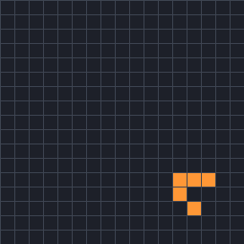
</picture>

<code>83051933</code> <a class="ship-n" href="#the-life-objects">table row 2</a>

<dl>
<dt>Tiling</dt><dd>square (shown); also, unchanged, 25 isohedral and drawn tilings with the square grid's neighbour graph</dd>
<dt>Period</dt><dd>4, moving (−1, −1) per period</dd>
<dt>Cells</dt><dd>5</dd>
<dt>Rules</dt><dd><code>B3/S23</code> to <code>B3678/S0235678</code> (512 rules)</dd>
<dt>Seen</dt><dd>95,041 times, in 29,732 soups</dd>
<dt>Verdict</dt><dd><b>Known</b>: Conway's glider (found by Richard Guy in 1970).</dd>
</dl>

Clip: generations 0 to 40.

<picture>
  <source srcset="../images/life-census/6dd55e69-still.png" media="(prefers-reduced-motion: reduce)">
  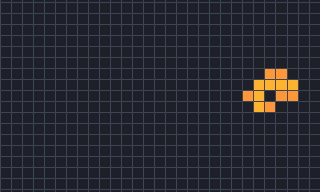
</picture>

<code>eaf14870</code> <a class="ship-n" href="#the-life-objects">table row 3</a>

<dl>
<dt>Tiling</dt><dd>square (shown); also, unchanged, k3-010 and 25 isohedral and drawn tilings with the square grid's neighbour graph</dd>
<dt>Period</dt><dd>4, moving 2 lattice steps per period (c/2)</dd>
<dt>Cells</dt><dd>9–12</dd>
<dt>Rules</dt><dd><code>B3/S23</code> to <code>B3468/S2378</code> (512 rules)</dd>
<dt>Seen</dt><dd>128 times, in 126 soups on square; 7 times, in 7 soups on k3-010</dd>
<dt>Verdict</dt><dd><b>Known</b>: the lightweight spaceship (LWSS) (found by John Conway in 1970).</dd>
</dl>

Clip: generations 1 to 41.

<picture>
  <source srcset="../images/life-census/1376072e-still.png" media="(prefers-reduced-motion: reduce)">
  
</picture>

<code>fbf3fc62</code> <a class="ship-n" href="#the-life-objects">table row 4</a>

<dl>
<dt>Tiling</dt><dd>square (shown); also, unchanged, 25 isohedral and drawn tilings with the square grid's neighbour graph</dd>
<dt>Period</dt><dd>4, moving 2 lattice steps per period (c/2)</dd>
<dt>Cells</dt><dd>13–18</dd>
<dt>Rules</dt><dd><code>B3/S23</code> to <code>B3468/S23</code> (512 rules)</dd>
<dt>Seen</dt><dd>11 times, in 11 soups</dd>
<dt>Verdict</dt><dd><b>Known</b>: the heavyweight spaceship (HWSS) (found by John Conway in 1970). Contains a perturbed phase of the MWSS and the LWSS.</dd>
</dl>

Clip: generations 1 to 41.

<picture>
  <source srcset="../images/tilings/glider-guttesen-kagome-still.png" media="(prefers-reduced-motion: reduce)">
  
</picture>

<code>c1cda1c4</code> <a class="ship-n" href="#the-life-objects">table row 5</a>

<dl>
<dt>Tiling</dt><dd>3.6.3.6 (shown); also, unchanged, k3-030, k3-032 and k3-039</dd>
<dt>Period</dt><dd>4, moving one lattice step per period (c/4)</dd>
<dt>Cells</dt><dd>4–5</dd>
<dt>Rules</dt><dd><code>B3/S23</code> to <code>B3,5,6,7,8,9,10,11,12/S1,2,3,5,6,7,8,9,10,11,12</code> (8,192 rules)</dd>
<dt>Seen</dt><dd>149,642 times, in 43,743 soups on 3.6.3.6; 35,634 times, in 25,780 soups on k3-030; 35,417 times, in 25,058 soups on k3-032; 25,167 times, in 20,025 soups on k3-039</dd>
<dt>Verdict</dt><dd><b>Known</b>: Guttesen's kagome glider g (Guttesen 2026).</dd>
</dl>

Clip: generations 0 to 60.

<picture>
  <source srcset="../images/life-census/232055ff-still.png" media="(prefers-reduced-motion: reduce)">
  
</picture>

<code>6ca1d74c</code> <a class="ship-n" href="#the-life-objects">table row 6</a>

<dl>
<dt>Tiling</dt><dd>3.3.3.4.4 (shown); also, unchanged, k3-013 and k3-019</dd>
<dt>Period</dt><dd>2, moving one lattice step per period (c/2)</dd>
<dt>Cells</dt><dd>8–12</dd>
<dt>Rules</dt><dd><code>B3/S23</code> to <code>B3,5,7,9,10,11,12/S1,2,3,6,7,8,9,10,11,12</code> (8,192 rules)</dd>
<dt>Seen</dt><dd>4,604 times, in 4,416 soups on 3.3.3.4.4; 4,247 times, in 4,066 soups on k3-013; 4,744 times, in 4,570 soups on k3-019</dd>
<dt>Verdict</dt><dd><b>Known</b>: probably EricG's 3.3.3.4.4 ship (EricG 2013).</dd>
</dl>

Clip: generations 0 to 40.

<picture>
  <source srcset="../images/tilings/glider-guttesen-snubsq-still.png" media="(prefers-reduced-motion: reduce)">
  
</picture>

<code>ad39623e</code> <a class="ship-n" href="#the-life-objects">table row 7</a>

<dl>
<dt>Tiling</dt><dd>3.3.4.3.4</dd>
<dt>Period</dt><dd>8, moving 2 lattice steps per period (c/4)</dd>
<dt>Cells</dt><dd>8–15</dd>
<dt>Rules</dt><dd><code>B3/S23</code> to <code>B3,6,8,10,11,12/S2,3,9,10,11,12</code> (8,192 rules)</dd>
<dt>Seen</dt><dd>118,271 times, in 43,179 soups</dd>
<dt>Verdict</dt><dd><b>Known</b>: Guttesen's snub-square glider (Guttesen 2026).</dd>
</dl>

Clip: generations 0 to 56.

<picture>
  <source srcset="../images/life-census/fabe952b-still.png" media="(prefers-reduced-motion: reduce)">
  
</picture>

<code>6574801c</code> <a class="ship-n" href="#the-life-objects">table row 8</a>

<dl>
<dt>Tiling</dt><dd>k2-007</dd>
<dt>Period</dt><dd>20, moving one lattice step per period (c/20)</dd>
<dt>Cells</dt><dd>6–20</dd>
<dt>Rules</dt><dd><code>B3/S23</code> to <code>B3,8,10,11,12/S2,3,8,9,10,11,12</code> (8,192 rules)</dd>
<dt>Seen</dt><dd>5,772 times, in 5,537 soups</dd>
<dt>Verdict</dt><dd><b>Known</b>: very likely Büttner's period-20 ship (Martin Büttner, Code Golf 2014).</dd>
</dl>

Clip: generations 9 to 169, every 3rd.

#### Single ships with no flag (26)

Single ships that carry no flag. To our knowledge, none of them has been reported before.

<picture>
  <source srcset="../images/life-census/0e3664c5-still.png" media="(prefers-reduced-motion: reduce)">
  
</picture>

<code>487cf3f7</code> <a class="ship-n" href="#the-life-objects">table row 9</a>

<dl>
<dt>Tiling</dt><dd>k2-003</dd>
<dt>Period</dt><dd>13, moving 2 lattice steps per period (2c/13)</dd>
<dt>Cells</dt><dd>12–44</dd>
<dt>Rules</dt><dd><code>B3/S23</code> to <code>B3,8,9,10/S2,3,9,10</code> (2,048 rules)</dd>
<dt>Seen</dt><dd>13 times, in 13 soups</dd>
<dt>Verdict</dt><dd><b>Single ship</b>, no flag.</dd>
</dl>

Clip: generations 6 to 149, every 3rd.

<picture>
  <source srcset="../images/life-census/d02b5ce8-still.png" media="(prefers-reduced-motion: reduce)">
  
</picture>

<code>4392fd90</code> <a class="ship-n" href="#the-life-objects">table row 10</a>

<dl>
<dt>Tiling</dt><dd>k2-012</dd>
<dt>Period</dt><dd>3, moving one lattice step per period (c/3)</dd>
<dt>Cells</dt><dd>10–14</dd>
<dt>Rules</dt><dd><code>B3/S23</code> to <code>B3,7,9,10,11,12,13,14/S0,2,3,6,7,8,9,10,11,12,13,14</code> (32,768 rules)</dd>
<dt>Seen</dt><dd>1 time, in 1 soup</dd>
<dt>Verdict</dt><dd><b>Single ship</b>, no flag.</dd>
</dl>

Clip: generations 2 to 44.

<picture>
  <source srcset="../images/life-census/ca75ccd6-still.png" media="(prefers-reduced-motion: reduce)">
  
</picture>

<code>3b16f6b5</code> <a class="ship-n" href="#the-life-objects">table row 11</a>

<dl>
<dt>Tiling</dt><dd>k3-002</dd>
<dt>Period</dt><dd>3, moving one lattice step per period (c/3)</dd>
<dt>Cells</dt><dd>14–16</dd>
<dt>Rules</dt><dd><code>B3/S23</code> to <code>B3789/S23789</code> (1,024 rules)</dd>
<dt>Seen</dt><dd>10 times, in 10 soups</dd>
<dt>Verdict</dt><dd><b>Single ship</b>, no flag. Contains a perturbed phase of <code>d45da341</code>.</dd>
</dl>

Clip: generations 1 to 43.

<picture>
  <source srcset="../images/life-census/25c5dc4a-still.png" media="(prefers-reduced-motion: reduce)">
  
</picture>

<code>b62c62bf</code> <a class="ship-n" href="#the-life-objects">table row 12</a>

<dl>
<dt>Tiling</dt><dd>k3-010</dd>
<dt>Period</dt><dd>4, moving 2 lattice steps per period (c/2)</dd>
<dt>Cells</dt><dd>11–15</dd>
<dt>Rules</dt><dd><code>B3/S23</code> to <code>B3,4,6,8,9,10/S2,3,8,9,10</code> (2,048 rules)</dd>
<dt>Seen</dt><dd>2 times, in 2 soups</dd>
<dt>Verdict</dt><dd><b>Single ship</b>, no flag. Contains a perturbed phase of the LWSS.</dd>
</dl>

Clip: generations 1 to 41.

<picture>
  <source srcset="../images/life-census/41eb5c62-still.png" media="(prefers-reduced-motion: reduce)">
  
</picture>

<code>c1a8b0bf</code> <a class="ship-n" href="#the-life-objects">table row 13</a>

<dl>
<dt>Tiling</dt><dd>k3-010</dd>
<dt>Period</dt><dd>38, moving 4 lattice steps per period (2c/19)</dd>
<dt>Cells</dt><dd>8–24</dd>
<dt>Rules</dt><dd><code>B3/S23</code> to <code>B3,8,9,10/S2,3,8,9,10</code> (2,048 rules)</dd>
<dt>Seen</dt><dd>23 times, in 23 soups</dd>
<dt>Verdict</dt><dd><b>Single ship</b>, no flag.</dd>
</dl>

Clip: generations 6 to 158, every 3rd.

<picture>
  <source srcset="../images/life-census/8488e7e9-still.png" media="(prefers-reduced-motion: reduce)">
  
</picture>

<code>28714e5c</code> <a class="ship-n" href="#the-life-objects">table row 14</a>

<dl>
<dt>Tiling</dt><dd>k3-011</dd>
<dt>Period</dt><dd>4, moving one lattice step per period (c/4)</dd>
<dt>Cells</dt><dd>11–15</dd>
<dt>Rules</dt><dd><code>B3/S23</code> to <code>B3,4,6,8,9,10,11,12/S2,3,8,9,10,11,12</code> (8,192 rules)</dd>
<dt>Seen</dt><dd>8 times, in 8 soups</dd>
<dt>Verdict</dt><dd><b>Single ship</b>, no flag. Contains a perturbed phase of <a href="#life-6573d1df"><code>6573d1df</code></a>.</dd>
</dl>

Clip: generations 1 to 41.

<picture>
  <source srcset="../images/life-census/d997330c-still.png" media="(prefers-reduced-motion: reduce)">
  
</picture>

<code>6573d1df</code> <a class="ship-n" href="#the-life-objects">table row 15</a>

<dl>
<dt>Tiling</dt><dd>k3-011</dd>
<dt>Period</dt><dd>4, moving one lattice step per period (c/4)</dd>
<dt>Cells</dt><dd>8–12</dd>
<dt>Rules</dt><dd><code>B3/S23</code> to <code>B3,6,8,9,10,11,12/S0,2,3,7,8,9,10,11,12</code> (8,192 rules)</dd>
<dt>Seen</dt><dd>9 times, in 9 soups</dd>
<dt>Verdict</dt><dd><b>Single ship</b>, no flag.</dd>
</dl>

Clip: generations 0 to 40.

<picture>
  <source srcset="../images/life-census/4f66f17e-still.png" media="(prefers-reduced-motion: reduce)">
  
</picture>

<code>a07330dc</code> <a class="ship-n" href="#the-life-objects">table row 16</a>

<dl>
<dt>Tiling</dt><dd>k3-011</dd>
<dt>Period</dt><dd>4, moving one lattice step per period (c/4)</dd>
<dt>Cells</dt><dd>11–18</dd>
<dt>Rules</dt><dd><code>B3/S23</code> to <code>B3,6,8,9,10,11,12/S2,3,9,10,11,12</code> (8,192 rules)</dd>
<dt>Seen</dt><dd>1 time, in 1 soup</dd>
<dt>Verdict</dt><dd><b>Single ship</b>, no flag. Contains a perturbed phase of <a href="#life-28714e5c"><code>28714e5c</code></a> and <a href="#life-6573d1df"><code>6573d1df</code></a>.</dd>
</dl>

Clip: generations 0 to 40.

<picture>
  <source srcset="../images/life-census/f87a9ed1-still.png" media="(prefers-reduced-motion: reduce)">
  
</picture>

<code>6a4efaf6</code> <a class="ship-n" href="#the-life-objects">table row 17</a>

<dl>
<dt>Tiling</dt><dd>k3-011</dd>
<dt>Period</dt><dd>9, moving one lattice step per period (c/9)</dd>
<dt>Cells</dt><dd>9–16</dd>
<dt>Rules</dt><dd><code>B3/S23</code> to <code>B3,9,10,11,12/S2,3,8,9,10,11,12</code> (8,192 rules)</dd>
<dt>Seen</dt><dd>8 times, in 8 soups</dd>
<dt>Verdict</dt><dd><b>Single ship</b>, no flag.</dd>
</dl>

Clip: generations 2 to 65.

<picture>
  <source srcset="../images/life-census/b6a6a47a-still.png" media="(prefers-reduced-motion: reduce)">
  
</picture>

<code>b22eedfa</code> <a class="ship-n" href="#the-life-objects">table row 18</a>

<dl>
<dt>Tiling</dt><dd>k3-040</dd>
<dt>Period</dt><dd>8, moving 2 lattice steps per period (c/4)</dd>
<dt>Cells</dt><dd>8–12</dd>
<dt>Rules</dt><dd><code>B3/S23</code> to <code>B3,8,9,10,11,12,13,14/S2,3,6,7,8,9,10,11,12,13,14</code> (32,768 rules)</dd>
<dt>Seen</dt><dd>13 times, in 13 soups</dd>
<dt>Verdict</dt><dd><b>Single ship</b>, no flag.</dd>
</dl>

Clip: generations 1 to 41.

<picture>
  <source srcset="../images/life-census/148310e3-still.png" media="(prefers-reduced-motion: reduce)">
  
</picture>

<code>63cd2160</code> <a class="ship-n" href="#the-life-objects">table row 19</a>

<dl>
<dt>Tiling</dt><dd>k3-041</dd>
<dt>Period</dt><dd>4, moving one lattice step per period (c/4)</dd>
<dt>Cells</dt><dd>12–19</dd>
<dt>Rules</dt><dd><code>B3/S23</code> to <code>B3,8,9,10,11,12,13,14/S2,3,8,9,10,11,12,13,14</code> (32,768 rules)</dd>
<dt>Seen</dt><dd>150 times, in 150 soups</dd>
<dt>Verdict</dt><dd><b>Single ship</b>, no flag.</dd>
</dl>

Clip: generations 2 to 42.

<picture>
  <source srcset="../images/life-census/f6567467-still.png" media="(prefers-reduced-motion: reduce)">
  
</picture>

<code>4241bdcf</code> <a class="ship-n" href="#the-life-objects">table row 20</a>

<dl>
<dt>Tiling</dt><dd>k3-044</dd>
<dt>Period</dt><dd>8, moving one lattice step per period (c/8)</dd>
<dt>Cells</dt><dd>8–18</dd>
<dt>Rules</dt><dd><code>B3/S23</code> to <code>B3,9,10,11,12,13,14,15,16/S2,3,6,7,8,9,10,11,12,13,14,15,16</code> (131,072 rules)</dd>
<dt>Seen</dt><dd>5 times, in 5 soups</dd>
<dt>Verdict</dt><dd><b>Single ship</b>, no flag.</dd>
</dl>

Clip: generations 2 to 58.

<picture>
  <source srcset="../images/life-census/139723e0-still.png" media="(prefers-reduced-motion: reduce)">
  
</picture>

<code>06aa3aec</code> <a class="ship-n" href="#the-life-objects">table row 21</a>

<dl>
<dt>Tiling</dt><dd>k3-055</dd>
<dt>Period</dt><dd>20, moving 5 lattice steps per period (c/4)</dd>
<dt>Cells</dt><dd>35–57</dd>
<dt>Rules</dt><dd><code>B3/S23</code> to <code>B3,10,11,12/S2,3,10,11,12</code> (8,192 rules)</dd>
<dt>Seen</dt><dd>185 times, in 185 soups</dd>
<dt>Verdict</dt><dd><b>Single ship</b>, no flag. One of the large k3-055 ships that may share a common engine (see above).</dd>
</dl>

Clip: generations 17 to 57.

<picture>
  <source srcset="../images/life-census/65acb120-still.png" media="(prefers-reduced-motion: reduce)">
  
</picture>

<code>0100430f</code> <a class="ship-n" href="#the-life-objects">table row 22</a>

<dl>
<dt>Tiling</dt><dd>k3-055</dd>
<dt>Period</dt><dd>32, moving 8 lattice steps per period (c/4)</dd>
<dt>Cells</dt><dd>17–65</dd>
<dt>Rules</dt><dd><code>B3/S23</code> to <code>B3,11,12/S2,3,10,11,12</code> (8,192 rules)</dd>
<dt>Seen</dt><dd>21 times, in 21 soups</dd>
<dt>Verdict</dt><dd><b>Single ship</b>, no flag. One of the large k3-055 ships that may share a common engine (see above).</dd>
</dl>

Clip: generations 19 to 51.

<picture>
  <source srcset="../images/life-census/5f371c4c-still.png" media="(prefers-reduced-motion: reduce)">
  
</picture>

<code>0af25862</code> <a class="ship-n" href="#the-life-objects">table row 23</a>

<dl>
<dt>Tiling</dt><dd>k3-055</dd>
<dt>Period</dt><dd>32, moving 8 lattice steps per period (c/4)</dd>
<dt>Cells</dt><dd>28–66</dd>
<dt>Rules</dt><dd><code>B3/S23</code> to <code>B3,11,12/S2,3,10,11,12</code> (8,192 rules)</dd>
<dt>Seen</dt><dd>1 time, in 1 soup</dd>
<dt>Verdict</dt><dd><b>Single ship</b>, no flag. One of the large k3-055 ships that may share a common engine (see above).</dd>
</dl>

Clip: generations 19 to 51.

<picture>
  <source srcset="../images/life-census/5912456d-still.png" media="(prefers-reduced-motion: reduce)">
  
</picture>

<code>28d7a526</code> <a class="ship-n" href="#the-life-objects">table row 24</a>

<dl>
<dt>Tiling</dt><dd>k3-055</dd>
<dt>Period</dt><dd>32, moving 8 lattice steps per period (c/4)</dd>
<dt>Cells</dt><dd>73–121</dd>
<dt>Rules</dt><dd><code>B3/S23</code> to <code>B3,11,12/S2,3,10,11,12</code> (8,192 rules)</dd>
<dt>Seen</dt><dd>1 time, in 1 soup</dd>
<dt>Verdict</dt><dd><b>Single ship</b>, no flag. One of the large k3-055 ships that may share a common engine (see above).</dd>
</dl>

Clip: generations 16 to 48.

<picture>
  <source srcset="../images/life-census/fbad7fbf-still.png" media="(prefers-reduced-motion: reduce)">
  
</picture>

<code>3491af4a</code> <a class="ship-n" href="#the-life-objects">table row 25</a>

<dl>
<dt>Tiling</dt><dd>k3-055</dd>
<dt>Period</dt><dd>32, moving 8 lattice steps per period (c/4)</dd>
<dt>Cells</dt><dd>53–105</dd>
<dt>Rules</dt><dd><code>B3/S23</code> to <code>B3,11,12/S2,3,10,11,12</code> (8,192 rules)</dd>
<dt>Seen</dt><dd>7 times, in 7 soups</dd>
<dt>Verdict</dt><dd><b>Single ship</b>, no flag. One of the large k3-055 ships that may share a common engine (see above).</dd>
</dl>

Clip: generations 23 to 55.

<picture>
  <source srcset="../images/life-census/ad91d936-still.png" media="(prefers-reduced-motion: reduce)">
  
</picture>

<code>63121d47</code> <a class="ship-n" href="#the-life-objects">table row 26</a>

<dl>
<dt>Tiling</dt><dd>k3-055</dd>
<dt>Period</dt><dd>32, moving 8 lattice steps per period (c/4)</dd>
<dt>Cells</dt><dd>54–94</dd>
<dt>Rules</dt><dd><code>B3/S23</code> to <code>B3,11,12/S2,3,10,11,12</code> (8,192 rules)</dd>
<dt>Seen</dt><dd>1 time, in 1 soup</dd>
<dt>Verdict</dt><dd><b>Single ship</b>, no flag. One of the large k3-055 ships that may share a common engine (see above).</dd>
</dl>

Clip: generations 19 to 51.

<picture>
  <source srcset="../images/life-census/8130b388-still.png" media="(prefers-reduced-motion: reduce)">
  
</picture>

<code>b270dddd</code> <a class="ship-n" href="#the-life-objects">table row 27</a>

<dl>
<dt>Tiling</dt><dd>k3-055</dd>
<dt>Period</dt><dd>32, moving 8 lattice steps per period (c/4)</dd>
<dt>Cells</dt><dd>52–96</dd>
<dt>Rules</dt><dd><code>B3/S23</code> to <code>B3,11,12/S2,3,9,10,11,12</code> (8,192 rules)</dd>
<dt>Seen</dt><dd>8 times, in 8 soups</dd>
<dt>Verdict</dt><dd><b>Single ship</b>, no flag. One of the large k3-055 ships that may share a common engine (see above).</dd>
</dl>

Clip: generations 1 to 33.

<picture>
  <source srcset="../images/life-census/b86bd684-still.png" media="(prefers-reduced-motion: reduce)">
  
</picture>

<code>d0b8f09d</code> <a class="ship-n" href="#the-life-objects">table row 28</a>

<dl>
<dt>Tiling</dt><dd>k3-055</dd>
<dt>Period</dt><dd>32, moving 8 lattice steps per period (c/4)</dd>
<dt>Cells</dt><dd>39–73</dd>
<dt>Rules</dt><dd><code>B3/S23</code> to <code>B3,12/S2,3,10,11,12</code> (8,192 rules)</dd>
<dt>Seen</dt><dd>3 times, in 3 soups</dd>
<dt>Verdict</dt><dd><b>Single ship</b>, no flag. One of the large k3-055 ships that may share a common engine (see above).</dd>
</dl>

Clip: generations 19 to 51.

<picture>
  <source srcset="../images/life-census/50ecb3d5-still.png" media="(prefers-reduced-motion: reduce)">
  
</picture>

<code>f34bd1e7</code> <a class="ship-n" href="#the-life-objects">table row 29</a>

<dl>
<dt>Tiling</dt><dd>k3-055</dd>
<dt>Period</dt><dd>32, moving 8 lattice steps per period (c/4)</dd>
<dt>Cells</dt><dd>38–104</dd>
<dt>Rules</dt><dd><code>B3/S23</code> to <code>B3,11,12/S2,3,9,10,11,12</code> (8,192 rules)</dd>
<dt>Seen</dt><dd>4 times, in 4 soups</dd>
<dt>Verdict</dt><dd><b>Single ship</b>, no flag. One of the large k3-055 ships that may share a common engine (see above).</dd>
</dl>

Clip: generations 22 to 54.

<picture>
  <source srcset="../images/life-census/d878334e-still.png" media="(prefers-reduced-motion: reduce)">
  
</picture>

<code>140cd3cc</code> <a class="ship-n" href="#the-life-objects">table row 30</a>

<dl>
<dt>Tiling</dt><dd>k3-055</dd>
<dt>Period</dt><dd>64, moving 16 lattice steps per period (c/4)</dd>
<dt>Cells</dt><dd>63–148</dd>
<dt>Rules</dt><dd><code>B3/S23</code> to <code>B3,11,12/S2,3,11,12</code> (8,192 rules)</dd>
<dt>Seen</dt><dd>6 times, in 6 soups</dd>
<dt>Verdict</dt><dd><b>Single ship</b>, no flag. One of the large k3-055 ships that may share a common engine (see above).</dd>
</dl>

Clip: generations 55 to 119, every 2nd.

<picture>
  <source srcset="../images/life-census/92b7544a-still.png" media="(prefers-reduced-motion: reduce)">
  
</picture>

<code>6c80b30d</code> <a class="ship-n" href="#the-life-objects">table row 31</a>

<dl>
<dt>Tiling</dt><dd>k3-055</dd>
<dt>Period</dt><dd>64, moving 16 lattice steps per period (c/4)</dd>
<dt>Cells</dt><dd>75–149</dd>
<dt>Rules</dt><dd><code>B3/S23</code> to <code>B3,11,12/S2,3,10,11,12</code> (8,192 rules)</dd>
<dt>Seen</dt><dd>5 times, in 5 soups</dd>
<dt>Verdict</dt><dd><b>Single ship</b>, no flag. One of the large k3-055 ships that may share a common engine (see above).</dd>
</dl>

Clip: generations 29 to 93, every 2nd.

<picture>
  <source srcset="../images/life-census/126db117-still.png" media="(prefers-reduced-motion: reduce)">
  
</picture>

<code>9f474023</code> <a class="ship-n" href="#the-life-objects">table row 32</a>

<dl>
<dt>Tiling</dt><dd>k3-055</dd>
<dt>Period</dt><dd>64, moving 16 lattice steps per period (c/4)</dd>
<dt>Cells</dt><dd>28–84</dd>
<dt>Rules</dt><dd><code>B3/S23</code> to <code>B3,11,12/S2,3,11,12</code> (8,192 rules)</dd>
<dt>Seen</dt><dd>15 times, in 15 soups</dd>
<dt>Verdict</dt><dd><b>Single ship</b>, no flag. One of the large k3-055 ships that may share a common engine (see above).</dd>
</dl>

Clip: generations 23 to 87, every 2nd.

<picture>
  <source srcset="../images/life-census/1ccdebc8-still.png" media="(prefers-reduced-motion: reduce)">
  
</picture>

<code>d26a876d</code> <a class="ship-n" href="#the-life-objects">table row 33</a>

<dl>
<dt>Tiling</dt><dd>k3-055</dd>
<dt>Period</dt><dd>64, moving 16 lattice steps per period (c/4)</dd>
<dt>Cells</dt><dd>103–169</dd>
<dt>Rules</dt><dd><code>B3/S23</code> to <code>B3,11,12/S2,3,10,11,12</code> (8,192 rules)</dd>
<dt>Seen</dt><dd>4 times, in 4 soups</dd>
<dt>Verdict</dt><dd><b>Single ship</b>, no flag. One of the large k3-055 ships that may share a common engine (see above).</dd>
</dl>

Clip: generations 12 to 76, every 2nd.

<picture>
  <source srcset="../images/life-census/f2841d4c-still.png" media="(prefers-reduced-motion: reduce)">
  
</picture>

<code>83da34d9</code> <a class="ship-n" href="#the-life-objects">table row 34</a>

<dl>
<dt>Tiling</dt><dd>k3-057</dd>
<dt>Period</dt><dd>12, moving one lattice step per period (c/12)</dd>
<dt>Cells</dt><dd>13–24</dd>
<dt>Rules</dt><dd><code>B3/S23</code> to <code>B3,9,10,11,12/S2,3,9,10,11,12</code> (8,192 rules)</dd>
<dt>Seen</dt><dd>57 times, in 57 soups</dd>
<dt>Verdict</dt><dd><b>Single ship</b>, no flag.</dd>
</dl>

Clip: generations 6 to 54.

#### Flagged single ships (12)

Single ships that passed every check but are common on their tiling, or lie on a tiling where others
have run Life. We found no earlier report of any of them.

<picture>
  <source srcset="../images/life-census/a5e9ba80-still.png" media="(prefers-reduced-motion: reduce)">
  
</picture>

<code>98a3c53b</code> <a class="ship-n" href="#the-life-objects">table row 35</a>

<dl>
<dt>Tiling</dt><dd>3.3.4.3.4</dd>
<dt>Period</dt><dd>24, moving 6 lattice steps per period (c/4)</dd>
<dt>Cells</dt><dd>17–50</dd>
<dt>Rules</dt><dd><code>B3/S23</code> to <code>B3,8,10,11,12/S2,3,10,11,12</code> (8,192 rules)</dd>
<dt>Seen</dt><dd>3 times, in 3 soups</dd>
<dt>Verdict</dt><dd><b>Flagged</b>: EricG 2013 and Guttesen 2026 ran Life on 3.3.4.3.4. Contains a perturbed phase of Guttesen's snub-square glider.</dd>
</dl>

Clip: generations 15 to 55.

<picture>
  <source srcset="../images/life-census/f89d8f11-still.png" media="(prefers-reduced-motion: reduce)">
  
</picture>

<code>2076694c</code> <a class="ship-n" href="#the-life-objects">table row 36</a>

<dl>
<dt>Tiling</dt><dd>k2-003 (shown); also, unchanged, k3-010 and k3-016</dd>
<dt>Period</dt><dd>16, moving 5 lattice steps per period (5c/16)</dd>
<dt>Cells</dt><dd>8–16</dd>
<dt>Rules</dt><dd><code>B3/S23</code> to <code>B3,7,8,9,10/S2,3,7,8,9,10</code> (2,048 rules)</dd>
<dt>Seen</dt><dd>564 times, in 563 soups on k2-003; 352 times, in 352 soups on k3-010; 379 times, in 377 soups on k3-016</dd>
<dt>Verdict</dt><dd><b>Flagged</b>: common: in 1.1% of the census soups on k2-003.</dd>
</dl>

Clip: generations 0 to 48.

<picture>
  <source srcset="../images/life-census/55db03c8-still.png" media="(prefers-reduced-motion: reduce)">
  
</picture>

<code>ac3667f4</code> <a class="ship-n" href="#the-life-objects">table row 37</a>

<dl>
<dt>Tiling</dt><dd>k2-007</dd>
<dt>Period</dt><dd>5, moving one lattice step per period (c/5)</dd>
<dt>Cells</dt><dd>16–22</dd>
<dt>Rules</dt><dd><code>B3/S23</code> to <code>B3,8,9,10,11,12/S2,3,6,7,8,9,10,11,12</code> (8,192 rules)</dd>
<dt>Seen</dt><dd>1 time, in 1 soup</dd>
<dt>Verdict</dt><dd><b>Flagged</b>: Büttner and Kevin L (Code Golf 2014) very likely ran Life on k2-007.</dd>
</dl>

Clip: generations 3 to 43.

<picture>
  <source srcset="../images/life-census/c1d7a48e-still.png" media="(prefers-reduced-motion: reduce)">
  
</picture>

<code>119e5cea</code> <a class="ship-n" href="#the-life-objects">table row 38</a>

<dl>
<dt>Tiling</dt><dd>k2-011 (shown); also, unchanged, k3-002</dd>
<dt>Period</dt><dd>3, moving one lattice step per period (c/3)</dd>
<dt>Cells</dt><dd>9–11</dd>
<dt>Rules</dt><dd><code>B3/S23</code> to <code>B3,6,7,8,9,10,11,12/S2,3,5,6,7,8,9,10,11,12</code> (8,192 rules)</dd>
<dt>Seen</dt><dd>332 times, in 329 soups on k2-011; 550 times, in 549 soups on k3-002</dd>
<dt>Verdict</dt><dd><b>Flagged</b>: common: in 1.1% of the census soups on k3-002 (where it runs in a corridor; 0.66% on k2-011).</dd>
</dl>

Clip: generations 0 to 42.

<picture>
  <source srcset="../images/life-census/16bc37c9-still.png" media="(prefers-reduced-motion: reduce)">
  
</picture>

<code>ac1d0f14</code> <a class="ship-n" href="#the-life-objects">table row 39</a>

<dl>
<dt>Tiling</dt><dd>k2-017 (shown); also, unchanged, k3-053</dd>
<dt>Period</dt><dd>4, moving one lattice step per period (c/4)</dd>
<dt>Cells</dt><dd>6–9</dd>
<dt>Rules</dt><dd><code>B3/S23</code> to <code>B3,5,6,8,9,10,11,12/S1,2,3,7,9,10,11,12</code> (8,192 rules)</dd>
<dt>Seen</dt><dd>67,742 times, in 38,158 soups on k2-017; 70,914 times, in 38,866 soups on k3-053</dd>
<dt>Verdict</dt><dd><b>Flagged</b>: common: in 76.3% of the census soups on k2-017.</dd>
</dl>

Clip: generations 1 to 41.

<picture>
  <source srcset="../images/life-census/020ec7b7-still.png" media="(prefers-reduced-motion: reduce)">
  
</picture>

<code>5deb47c2</code> <a class="ship-n" href="#the-life-objects">table row 40</a>

<dl>
<dt>Tiling</dt><dd>k3-039</dd>
<dt>Period</dt><dd>20, moving 5 lattice steps per period (c/4)</dd>
<dt>Cells</dt><dd>7–21</dd>
<dt>Rules</dt><dd><code>B3/S23</code> to <code>B3,7,9,10,11,12/S2,3,6,7,8,9,10,11,12</code> (8,192 rules)</dd>
<dt>Seen</dt><dd>22,100 times, in 17,978 soups</dd>
<dt>Verdict</dt><dd><b>Flagged</b>: common: in 36.0% of the census soups on k3-039. Contains a perturbed phase of glider g.</dd>
</dl>

Clip: generations 18 to 58.

<picture>
  <source srcset="../images/life-census/dab6fb01-still.png" media="(prefers-reduced-motion: reduce)">
  
</picture>

<code>98d64885</code> <a class="ship-n" href="#the-life-objects">table row 41</a>

<dl>
<dt>Tiling</dt><dd>k3-040</dd>
<dt>Period</dt><dd>24, moving 4 lattice steps per period (c/6)</dd>
<dt>Cells</dt><dd>7–23</dd>
<dt>Rules</dt><dd><code>B3/S23</code> to <code>B3,8,9,10,11,12,13,14/S2,3,8,9,10,11,12,13,14</code> (32,768 rules)</dd>
<dt>Seen</dt><dd>3,661 times, in 3,567 soups</dd>
<dt>Verdict</dt><dd><b>Flagged</b>: common: in 7.1% of the census soups on k3-040.</dd>
</dl>

Clip: generations 0 to 48.

<picture>
  <source srcset="../images/life-census/e1fcfa73-still.png" media="(prefers-reduced-motion: reduce)">
  
</picture>

<code>bf101de9</code> <a class="ship-n" href="#the-life-objects">table row 42</a>

<dl>
<dt>Tiling</dt><dd>k3-044</dd>
<dt>Period</dt><dd>31, moving 2 lattice steps per period (2c/31)</dd>
<dt>Cells</dt><dd>3–18</dd>
<dt>Rules</dt><dd><code>B3/S23</code> to <code>B3,9,10,11,12,13,14,15,16/S2,3,9,10,11,12,13,14,15,16</code> (131,072 rules)</dd>
<dt>Seen</dt><dd>88,492 times, in 42,183 soups</dd>
<dt>Verdict</dt><dd><b>Flagged</b>: common: in 84.4% of the census soups on k3-044.</dd>
</dl>

Clip: generations 29 to 122, every 2nd.

<picture>
  <source srcset="../images/life-census/3792824d-still.png" media="(prefers-reduced-motion: reduce)">
  
</picture>

<code>49237dd5</code> <a class="ship-n" href="#the-life-objects">table row 43</a>

<dl>
<dt>Tiling</dt><dd>k3-045 (shown); also, unchanged, k3-046</dd>
<dt>Period</dt><dd>11, moving 2 lattice steps per period (2c/11)</dd>
<dt>Cells</dt><dd>8–16</dd>
<dt>Rules</dt><dd><code>B3/S23</code> to <code>B3,9,10,11,12,13,14,15,16/S2,3,9,10,11,12,13,14,15,16</code> (131,072 rules)</dd>
<dt>Seen</dt><dd>7,642 times, in 7,138 soups on k3-045; 3,793 times, in 3,673 soups on k3-046</dd>
<dt>Verdict</dt><dd><b>Flagged</b>: common: in 14.3% of the census soups on k3-045.</dd>
</dl>

Clip: generations 1 to 45.

<picture>
  <source srcset="../images/life-census/1e6832e3-still.png" media="(prefers-reduced-motion: reduce)">
  
</picture>

<code>adfd2f61</code> <a class="ship-n" href="#the-life-objects">table row 44</a>

<dl>
<dt>Tiling</dt><dd>k3-057</dd>
<dt>Period</dt><dd>8, moving one lattice step per period (c/8)</dd>
<dt>Cells</dt><dd>9–14</dd>
<dt>Rules</dt><dd><code>B3/S23</code> to <code>B3,7,10,11,12/S2,3,7,8,9,10,11,12</code> (8,192 rules)</dd>
<dt>Seen</dt><dd>6,553 times, in 6,141 soups</dd>
<dt>Verdict</dt><dd><b>Flagged</b>: common: in 12.3% of the census soups on k3-057.</dd>
</dl>

Clip: generations 2 to 42.

<picture>
  <source srcset="../images/life-census/93a72ebd-still.png" media="(prefers-reduced-motion: reduce)">
  
</picture>

<code>37db33e3</code> <a class="ship-n" href="#the-life-objects">table row 45</a>

<dl>
<dt>Tiling</dt><dd>k3-059</dd>
<dt>Period</dt><dd>30, moving (1, 1) per period</dd>
<dt>Cells</dt><dd>7–23</dd>
<dt>Rules</dt><dd><code>B3/S23</code> to <code>B3,8,9,10,11,12,13,14,15,16,17,18/S2,3,9,10,11,12,13,14,15,16,17,18</code> (524,288 rules)</dd>
<dt>Seen</dt><dd>81,611 times, in 41,207 soups</dd>
<dt>Verdict</dt><dd><b>Flagged</b>: common: in 82.4% of the census soups on k3-059.</dd>
</dl>

Clip: generations 12 to 72.

<picture>
  <source srcset="../images/life-census/58e6d5fc-still.png" media="(prefers-reduced-motion: reduce)">
  
</picture>

<code>b414ad8f</code> <a class="ship-n" href="#the-life-objects">table row 46</a>

<dl>
<dt>Tiling</dt><dd>k3-061</dd>
<dt>Period</dt><dd>22, moving (1, 1) per period</dd>
<dt>Cells</dt><dd>5–10</dd>
<dt>Rules</dt><dd><code>B3/S23</code> to <code>B3,7,8,9,10,11,12,13,14,15,16,17,18/S2,3,7,8,9,10,11,12,13,14,15,16,17,18</code> (524,288 rules)</dd>
<dt>Seen</dt><dd>34,039 times, in 25,346 soups</dd>
<dt>Verdict</dt><dd><b>Flagged</b>: common: in 50.7% of the census soups on k3-061.</dd>
</dl>

Clip: generations 5 to 68.

### Credits for Life on these tilings

Conway's glider and the light-, middle- and heavyweight spaceships are the classic ships of Life
([Gardner 1970](bibliography.md#gardner1970life); [Berlekamp, Conway and Guy 1982](bibliography.md#berlekamp1982winning)).
EricG ran Life-like rules on the eight mixed Archimedean tilings in 2013 and reported Life spaceships
on 3.6.3.6, 3.3.4.3.4 and 3.3.3.4.4 ([EricG 2013](bibliography.md#ericg2013tiling2)). Martin Büttner
found a period-20 Life ship on a tiling of hexagons, squares and triangles in 2014
([Code Golf 2014](bibliography.md#codegolf2014life)). H. S. Guttesen described the kagome glider g
and the snub-square glider, first in Code Golf answers in 2024
([Guttesen 2024](bibliography.md#guttesen2024answers); [Guttesen 2026](bibliography.md#guttesen2026game)),
and a YouTube channel showed Life gliders on the snub square tiling in May 2024
([Tessellation Automata 2024](bibliography.md#tessellationautomata2024)). The 2- and 3-uniform
tilings are Galebach's catalogue ([Galebach: uniform tilings](bibliography.md#galebachnd_uniform)).

## The hat glider is Edmond's glider B

The hat glider that JETCARP's reimplementation of James Edmond's evolutionary search found is
Edmond's hat glider B ([Edmond 2026](bibliography.md#edmond2026gliders)) written in another table.
Rename B's states (1 as 3, 2 as 1, 3 as 2) and the two tables agree on every configuration the glider
meets after its first generation; run side by side, they give the same states every generation, for
180 generations on a level-5 patch and 1,467 generations on a level-7 patch. The glider has one head
and four to six wing tiles, its eight shapes are all among B's ten, and it moves one ring of tiles
every two generations. JETCARP's table has one extra row and its seed launches the glider on a
different lane, which is why it first looked different. The glider is Edmond's. What JETCARP adds is a
long run: on a sliding window that follows the glider, it travelled 1,000,000 rings of tiles at a
steady 2.14 units per generation (Edmond's certified minimum speed is 2.1397), and Edmond's own certificates prove it
immortal. See [Priority rules](../automata/priority-rules.md).

## Still to do

- Ask on the ConwayLife.com forums whether any of the candidates, above all the flagged ones, have
  been seen before. Our prior-art search could not read the forums directly.
- Compare the census's 3.3.3.4.4 ship with EricG's 2013 patterns, and its period-20 k2-007 ship with
  Büttner's 2014 ship, cell for cell, if those patterns can be found.
- Look more closely at the large Life ships of k3-055, which may share a common engine.
- Run the Life census on more soups, on the k-uniform tilings with k from 4 to 6, and with ships of
  periods above 64, which the census did not look for.
- Compare the kagome and snub-square ships with Guttesen's configurations cell for cell, once they
  are published.
- Extend the equivalence survey to the k-uniform tilings with k from 4 to 6, and the ship comparison
  to aperiodic tilings. Neither can turn a claimed ship into a lattice ship, but either could add
  "also runs on" entries.
- Re-run the key searches just before publication, since several closely related works appeared in
  August to October 2026.
