# Editable tile families

Some tilings in JETCARP are not fixed shapes but families: a tile whose corners you can drag and whose
edges you can bend, while the tiling stays a tiling. Any triangle tiles the plane, and so does any
quadrilateral; a hexagon whose edges pair up by 120-degree turns can become one of Escher's lizards.
These families, along with a few classic fixed patterns from paving and brickwork, are on this page.

<figure>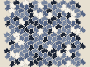<figcaption>Three-fold hexagon <code>lizard</code></figcaption></figure>
<figure>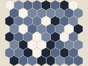<figcaption>Hexagon <code>hex</code></figcaption></figure>
<figure>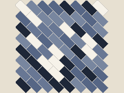<figcaption>Brick <code>brick</code></figcaption></figure>
<figure>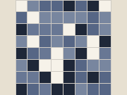<figcaption>Square (parallelogram) <code>square</code></figcaption></figure>
<figure>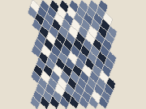<figcaption>Any quadrilateral <code>quad</code></figcaption></figure>
<figure>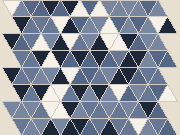<figcaption>Any triangle <code>triangle</code></figcaption></figure>
<figure>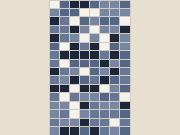<figcaption>Glide rectangle <code>glide</code></figcaption></figure>
<figure>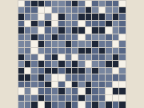<figcaption>Four-fold square <code>fourfold</code></figcaption></figure>
<figure>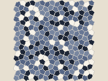<figcaption>Cairo pentagon <code>cairo</code></figcaption></figure>
<figure>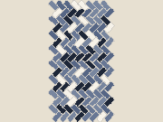<figcaption>Herringbone <code>herring</code></figcaption></figure>
<figure>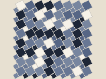<figcaption>Pythagorean squares <code>pyth</code></figcaption></figure>

The tile families of this page with their default shapes and JETCARP ids.
Herringbone and the Pythagorean tiling are fixed; the others can be reshaped. Thumbnails from the
<a href="catalogue.md#tiling-families">tiling catalogue</a>.

## What it is

Each editable family is one *prototile*, a tile shape, together with rules for how its edges fit
against its neighbours'. An edge can be paired with another edge by a slide (translation), by a turn
about a shared corner, or by a half turn about its own midpoint, and an edge can be any curve as long
as its partner follows it. The families JETCARP offers:

| Id | Family | How the edges pair | Neighbours (edge / touch) |
| --- | --- | --- | --- |
| `lizard` | Three-fold hexagon | each edge turns 120° about a shared corner onto its partner | 6 / 6 |
| `hex` | Hexagon | three pairs of opposite edges, each related by a slide | 6 / 6 |
| `brick` | Brick | a hexagon with straight angles at two corners | 6 / 6 |
| `square` | Square (parallelogram) | two pairs of opposite edges, each related by a slide | 4 / 8 |
| `quad` | Any quadrilateral | each edge turns 180° about its own midpoint | 4 / 8 |
| `triangle` | Any triangle | as for the quadrilateral; six triangles meet at each corner | 3 / 12 |
| `glide` | Glide rectangle | top and bottom edges pair by a flip and a slide, so neighbouring rows are mirror images | 4 / 8 |
| `fourfold` | Four-fold square | edges turn 90° about two opposite corners, so tiles spin in fours | 4 / 8 |
| `cairo` | Cairo pentagon | one half-turn edge and two pairs that turn 90° | 5 / 7 |

Two fixed patterns sit beside them. **Herringbone** (`herring`) lays rectangles in two orientations and
**Pythagorean squares** (`pyth`) mixes two sizes of square; neither is edge to edge, so JETCARP measures
which tiles touch from the geometry. Herringbone has the hexagon grid's neighbour graph; in the
Pythagorean tiling, large squares touch eight tiles and small squares four.

The neighbour graph depends on the family, not on the exact shape, so reshaping a tile changes how the
world looks but not how a rule behaves. That makes these families a way to draw: run a rule, then bend
the tiles into fish or lizards.

<figure>
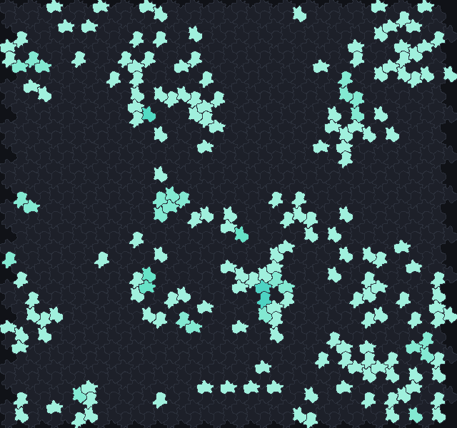
<figcaption>B2/S34 on the three-fold hexagon family in the shape of Escher's lizards, 30 generations
after a random start. Each lizard has six neighbours, so the rule behaves as on hexagons. Scene
<code>docs/scenes/tilings/editable-lizard.json</code>.</figcaption>
</figure>

## Where it came from

**Cairo pentagons.** The tiling is named after its use as street paving in Cairo; R. H. Macmillan's
note of 1979 is the classic written source, and Frank Morgan went looking for surviving Cairo pavements
in 2019 ([Macmillan 1979](../research/bibliography.md#macmillan1979pyramids);
[Morgan 2019](../research/bibliography.md#morgan2019undercover)). Earlier appearances include Harry
Nisbet's *Grammar of Textile Design* (1906), a 1909 US patent for pentagonal floor tiles by Herbert C.
Moore, P. A. MacMahon's *New Mathematical Pastimes* (1921), and notes by A. P. Rollett (1955) and J. A.
Dunn (1971) ([Nisbet 1906](../research/bibliography.md#nisbet1906grammar);
[Moore 1909](../research/bibliography.md#moore1909tile);
[MacMahon 1921](../research/bibliography.md#macmahon1921new);
[Rollett 1955](../research/bibliography.md#rollett1955pentagonal);
[Dunn 1971](../research/bibliography.md#dunn1971tessellations)). Mathematically it is the dual of the
snub square tiling, and its pentagon belongs to one of the families of convex pentagons that tile the
plane surveyed by Doris Schattschneider ([Schattschneider 1978](../research/bibliography.md#schattschneider1978tiling)).
Carter Bays found a Life-like glider on it ([Bays 2005](../research/bibliography.md#bays2005note)),
which Matej Kerekrety showed again as the "shrimp"
([Kerekrety 2020](../research/bibliography.md#kerekrety2020game)).

**Pythagorean tiling.** Two sizes of square, named for the dissection proofs of Pythagoras's theorem
it carries: lay a square grid with the hypotenuse as its side over it, and the two squares are cut into
pieces that make the larger one ([Frederickson 1997](../research/bibliography.md#frederickson1997dissections);
[Nelsen 2003](../research/bibliography.md#nelsen2003paintings);
[Aguiló, Fiol and Fiol 2000](../research/bibliography.md#aguilo2000periodic)).

**Herringbone.** Rectangles in two orientations; Grünbaum and Shephard list it among the isohedral
tilings by quadrangles ([Grünbaum and Shephard 1987](../research/bibliography.md#grunbaum1987tilings)).

**Brick.** Running bond, each course offset by half a brick. Its neighbour graph is the hexagonal one,
which is why Wolfram describes two-cell rules on cells "arranged like hexagons or staggered bricks"
([Wolfram 2002](../research/bibliography.md#wolfram2002new)).

**The three-fold hexagon.** Tom McLean's catalogue describes isohedral type IH7 in the same way as this
family: a hexagon whose adjacent sides pair up, meeting at 120°
([McLean](../research/bibliography.md#mcleannd_isohedral)). M. C. Escher drew lizards on a regular
division of the plane in his drawing no. 25 (1939), and used the same angular lizard in the lithograph
*Reptiles* (1943) ([Kersten 2018](../research/bibliography.md#kersten2018repeating);
[Schattschneider 1990](../research/bibliography.md#schattschneider1990visions)); we have not found a
source that states drawing no. 25 is of type IH7, though the shapes agree.

## How JETCARP runs it

The editable families came from JETCARP's original prototype tiling editor and keep its edge rules.
In the app, *Edit tile…* lets you drag a tile's corners and reshape its edges; every edge's partner
follows, and JETCARP checks that tiles still interlock without gaps or overlaps. A tile can also be
pasted as JSON, and a scene records it in the tiling's `params` and `edges`, so a reshaped world
replays exactly. Beyond these families, the `periodic` family takes any polygons in a repeating unit
cell, which the app's unit-cell editor can draw; contact between them is measured from the geometry.

## What is new here

Nothing. These are classical tilings and well-known tile families, presented so that any rule can run
on them and the tiles can be reshaped while it runs.

## Try it

- Quick Start: *B2/S34 on Escher's lizard tile*, and the *Tiling showcase* entries for brick, any
  quadrilateral, any triangle, glide rectangle, four-fold square, Cairo pentagon, herringbone and
  Pythagorean squares.
- Open a lizard world in the app, start a rule, and drag the tile's corners.

## References

- [Macmillan 1979](../research/bibliography.md#macmillan1979pyramids);
  [Morgan 2019](../research/bibliography.md#morgan2019undercover);
  [Nisbet 1906](../research/bibliography.md#nisbet1906grammar);
  [Moore 1909](../research/bibliography.md#moore1909tile);
  [MacMahon 1921](../research/bibliography.md#macmahon1921new);
  [Rollett 1955](../research/bibliography.md#rollett1955pentagonal);
  [Dunn 1971](../research/bibliography.md#dunn1971tessellations);
  [Schattschneider 1978](../research/bibliography.md#schattschneider1978tiling)
- [Bays 2005](../research/bibliography.md#bays2005note);
  [Kerekrety 2020](../research/bibliography.md#kerekrety2020game)
- [Frederickson 1997](../research/bibliography.md#frederickson1997dissections);
  [Nelsen 2003](../research/bibliography.md#nelsen2003paintings);
  [Aguiló, Fiol and Fiol 2000](../research/bibliography.md#aguilo2000periodic)
- [Grünbaum and Shephard 1987](../research/bibliography.md#grunbaum1987tilings);
  [Wolfram 2002](../research/bibliography.md#wolfram2002new)
- [McLean](../research/bibliography.md#mcleannd_isohedral);
  [Kersten 2018](../research/bibliography.md#kersten2018repeating);
  [Schattschneider 1990](../research/bibliography.md#schattschneider1990visions)
