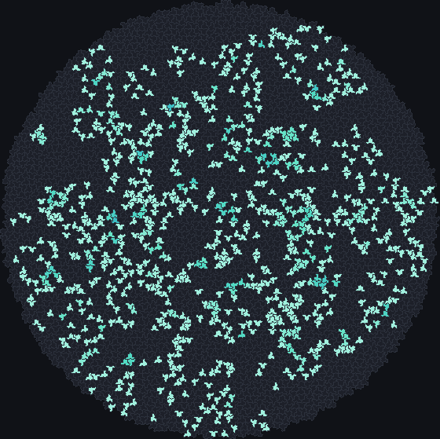
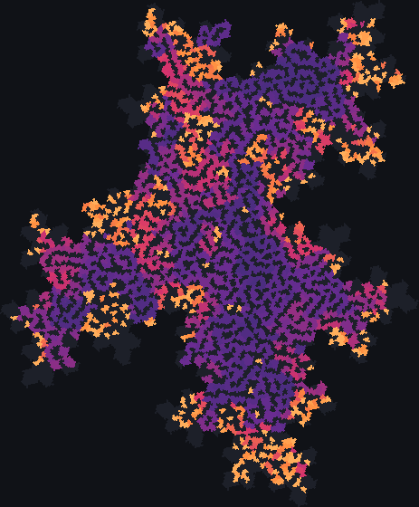

# The hat and the spectre

Ever since the first aperiodic sets of tiles were found in the 1960s, mathematicians had asked whether a
single tile could cover the plane only in patterns that never repeat: an *einstein*, from the German
for "one stone". In 2023 the answer came, twice in quick
succession: the hat, found by a hobbyist, and then the spectre, which does it without ever needing its
mirror image. JETCARP builds exact patches of both, up to about 18 million tiles, and runs every rule on
them.

<figure class="pair">

<figcaption>Left: B2/S34 on about 4,000 hats, 200 generations after a random start; every hat touches six
or seven others, much as a hexagon touches six, and the rule stays busy. Scene
<code>docs/scenes/tilings/hat-b2s34.json</code>. Right: B2/S23 with edge neighbours on about 4,000
spectres, where each tile shares edges with four to seven others. Scene
<code>docs/scenes/tilings/spectre-b2s23v.json</code>. Both 200 generations.</figcaption>
</figure>

## What it is

**The hat** is a *polykite*: eight of the kites of the Laves tiling [3.4.6.4], the tiling dual to
3.4.6.4, glued into a shape that looks a little like a hat or a shirt. Copies of it, together with some
mirror-image copies, tile the plane, and every such tiling is non-periodic. The mirror-image hats are
sparse; in JETCARP's patches about one hat in eight is reflected, and the ratio of the two kinds tends to
φ⁴ in large patches. The hat is one member of a continuous family of shapes, all aperiodic apart from
three special cases.

**The spectre** comes from one of those special cases, the equilateral member of the family. Tiled
without reflections it is aperiodic; changing its straight edges to curves gives the *spectres*, which
tile only non-periodically and never use a mirror image, even when reflections are allowed. Its tilings
follow a hierarchical substitution: groups of spectres form larger "supertiles" that fit together like
spectres again.

For an automaton, both are neighbour graphs with no repeating structure. Each hat has 4 to 6 edge
neighbours and 6 or 7 touch neighbours; each spectre 4 to 7 edge neighbours and 6 or 7 touch neighbours.
The irregularity is mild, which is why rules made for hexagons often feel at home on the hat, yet
movers face a different neighbourhood at every step.

## Where it came from

Earlier aperiodic sets needed more than one tile: Robert Berger's first used thousands of Wang tiles,
Roger Penrose's used two ([Berger 1966](../research/bibliography.md#berger1966undecidability); see
[Penrose tilings](penrose.md)). Joshua Socolar and Joan Taylor gave a single hexagonal tile that is
aperiodic when combined with matching rules ([Socolar and Taylor 2011](../research/bibliography.md#socolar2011aperiodic)).

David Smith, a hobbyist in Yorkshire, England, found the hat in the autumn of 2022, working largely by
hand with the help of Jaap Scherphuis's PolyForm Puzzle Solver, and emailed Craig S. Kaplan to ask him to study the shape with his software
([University of Waterloo 2023](../research/bibliography.md#uwaterloo2023trick)). Smith, Joseph Samuel
Myers, Kaplan and Chaim Goodman-Strauss posted "An aperiodic monotile" in March 2023, and it was
published in *Combinatorial Theory* in 2024. Their proof groups hats into four *metatiles* with a
substitution rule ([Smith et al. 2023](../research/bibliography.md#smith2023aperiodic)). Two months later
the same four authors showed in "A chiral aperiodic monotile" that the equilateral member of the
family is aperiodic without reflections, and introduced the spectres
([Smith et al. 2023b](../research/bibliography.md#smith2023chiral)). Kaplan published software for both:
*hatviz*, which builds hat patches from the metatile substitution, and an interactive spectre app
([hatviz](../research/bibliography.md#kaplannd_hatviz); [hat page](../research/bibliography.md#kaplannd_hatpage);
[spectre page](../research/bibliography.md#kaplannd_spectrepage)).

**Cellular automata on the monotiles.** Within weeks of the hat's announcement, Andrew Trevorrow's
HatLife ran Life-like, Larger than Life-style, WireWorld and "Worms" rules on it
([Trevorrow 2023](../research/bibliography.md#trevorrow2023hatlife)). James Edmond found gliders on both
tiles in 2026, by evolutionary search over priority tables
([Edmond 2026](../research/bibliography.md#edmond2026gliders); see
[Priority rules and the Spectre glider](../automata/priority-rules.md)).

## How JETCARP runs it

JETCARP's hat construction is ported from Kaplan's hatviz, and its spectre construction from Kaplan's
spectre app, both under the BSD 3-Clause licence (Kaplan granted that licence for the spectre code to
JETCARP in November 2026); the notices are in JETCARP's third-party notices file. Patches are chosen by
*level*: for the hat, levels 3, 4 and 5 are the 500, 4,000 and 35,000 tiles nearest a fixed centre,
which is a reflected hat; for the spectre, a level is a supertile level of the substitution (about
4,400 tiles at level 4 and 35,000 at level 5). Levels 7 and 8, with about 2 million and 17 to 18 million
tiles, are built in exact integer coordinates, and every neighbour is found by an exact lookup. The
tests check for gaps and overlaps and that the hat to reflected-hat ratio tends to φ⁴.

In a scene: `"tiling": {"family": "hat", "size": {"level": 4}}` (or `spectre`). Patch edges are dead,
and the tile shapes are fixed. For movers that need more room than any patch, `jetcarp movers` can
follow a pattern on a *sliding window* that builds supertiles around it as it goes; JETCARP has followed
the Spectre glider pair this way for 10 million rings of tiles.

## What is new here

The tiles are Smith, Myers, Kaplan and Goodman-Strauss's, and cellular automata on them began with
Trevorrow and Edmond. JETCARP adds two things that, to our knowledge, have not been done before: it runs
every rule family on the hat and spectre, including families (turmites, cyclic, Greenberg–Hastings,
rock-paper-scissors, Hodgepodge, forest fire) for which our search found no earlier monotile version,
though we count those only as direct applications; and it computes sandpile identities and large
single-source sandpiles on both monotiles, where our search found no earlier sandpile work at all (see
[The Abelian sandpile](../automata/sandpile.md#what-is-new-here) and
[What is new in JETCARP](../research/contributions.md)). Hat gliders found by JETCARP's search are not a
new kind of object; see [Priority rules](../automata/priority-rules.md#what-is-new-here).

## Try it

- Quick Start: *B2/S34 on the hat*, *Sandpile on the Spectre*, *Spectre glider*, *Layered parity on the
  Spectre*, *JACA war on the hat tiling*, and the *Tiling showcase* entries for both tiles.
- `jetcarp run docs/scenes/tilings/hat-b2s34.json --gens 200 --png hat.png`
- `jetcarp pile --tiling spectre --grains 1e6` builds a million-grain sandpile on an exact spectre patch.

## References

- [Berger 1966](../research/bibliography.md#berger1966undecidability);
  [Socolar and Taylor 2011](../research/bibliography.md#socolar2011aperiodic)
- [Smith et al. 2023](../research/bibliography.md#smith2023aperiodic);
  [Smith et al. 2023b](../research/bibliography.md#smith2023chiral);
  [University of Waterloo 2023](../research/bibliography.md#uwaterloo2023trick)
- [hatviz](../research/bibliography.md#kaplannd_hatviz);
  [Kaplan, hat page](../research/bibliography.md#kaplannd_hatpage);
  [Kaplan, spectre page](../research/bibliography.md#kaplannd_spectrepage)
- [Trevorrow 2023](../research/bibliography.md#trevorrow2023hatlife);
  [Edmond 2026](../research/bibliography.md#edmond2026gliders)
