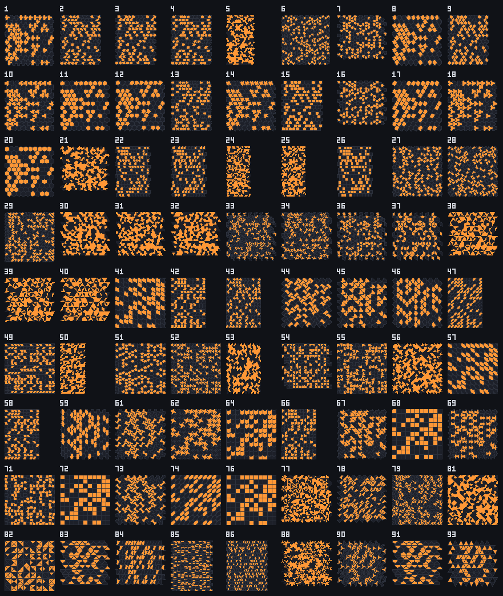
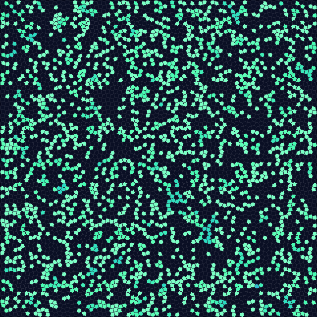

# Isohedral tilings

An isohedral tiling uses a single tile shape, placed so that every tile is surrounded in exactly the
same way: some symmetry of the tiling carries any tile onto any other. Escher's drawings of birds,
fish and lizards interlocking across the page are, almost all, isohedral tilings with decorated tiles.
There are 93 types, and JETCARP supports the 81 of them that can be told apart by the tile's shape
alone, each with sliders that reshape the tile within its type.

<figure>

<figcaption>All 81 isohedral types JETCARP supports, IH1 to IH93 less the twelve marked types, each drawn
with random edge shapes allowed by its type and a random pattern of live cells. Made by
<code>jetcarp isohedral --png sheet.png --cols 9 --thumb 88</code>.</figcaption>
</figure>

## What it is

Grünbaum and Shephard sorted isohedral tilings into 93 types, IH1 to IH93, by the way each tile's edges
and corners relate to its neighbours': which edges must match which, and by what symmetry (a slide, a
half turn about the edge's midpoint, a rotation about a corner, a reflection). Within a type, a tile
can change shape freely as long as those relations hold. Twelve of the types are *marked*: they need a
motif drawn inside the tile to cut its symmetry down, so as bare shapes they coincide with other
types. That leaves 81 types that can be told apart by shape alone.

For an automaton, the type fixes the neighbour graph, whatever the parameters: reshaping a tile
changes the picture but not which tiles touch. Many types give the hexagonal graph (six neighbours
each); others give the square grid's or something else. The same rule can behave very differently on
two tilings that look alike, and identically on two that look different; the
[tiling catalogue](catalogue.md#isohedral-types) lists each type's degrees, and the next sections show
that there are only eleven graphs in all.

<figure>

<figcaption>B2/S34 on type IH28, a pentagon tiling with the Cairo tiling's neighbour graph, with
Tactile's default shape, 200 generations after a random start. As far as the rule is concerned this is
the Cairo tiling. Scene
<code>docs/scenes/tilings/isohedral-ih28.json</code>.</figcaption>
</figure>

## Where it came from

Elli and Heinrich Heesch completed a classification of 28 types of asymmetric tiles that give
isohedral tilings in 1932; they submitted it in 1934 but chose not to publish, and tried for years to
patent it ([Reichenberger 2023](../research/bibliography.md#reichenberger2023elli)). Heesch and Otto
Kienzle published the 28 types in *Flächenschluß* (1963), with each tile's boundary described as a word
in letters for its edge symmetries; their scheme leaves out tilings with mirror lines
([Heesch and Kienzle 1963](../research/bibliography.md#heesch1963flachenschluss);
[Kaplan and Schattschneider 2025](../research/bibliography.md#kaplan2025isohedral)).

Branko Grünbaum and G. C. Shephard gave the complete classification, with "incidence symbols", in "The
eighty-one types of isohedral tilings in the plane" (1977) and a polygonal version in 1978: 93 types,
of which twelve are marked ([Grünbaum and Shephard 1977](../research/bibliography.md#grunbaum1977eightyone);
[1978](../research/bibliography.md#grunbaum1978isohedral);
[1987](../research/bibliography.md#grunbaum1987tilings)). Nearly all of M. C. Escher's regular divisions
of the plane can be read as isohedral tilings
([Kaplan and Schattschneider 2025](../research/bibliography.md#kaplan2025isohedral)); Doris
Schattschneider's *Visions of Symmetry* is the standard catalogue of his periodic drawings
([Schattschneider 1990](../research/bibliography.md#schattschneider1990visions)). Tom McLean's online
catalogue gives a template for each of the 93 types ([McLean](../research/bibliography.md#mcleannd_isohedral)).

Craig S. Kaplan brought the types into computer graphics. His thesis and his work with David Salesin
on "Escherization" derive Escher-like tilings from shapes a user supplies
([Kaplan 2002](../research/bibliography.md#kaplan2002computer);
[Kaplan and Salesin 2000](../research/bibliography.md#kaplan2000escherization)), and his book explains the
types for programmers ([Kaplan 2009](../research/bibliography.md#kaplan2009introductory)). His Tactile
library, in C++ and JavaScript, represents all 81 non-trivial types and lets their tiles be reshaped
([Tactile](../research/bibliography.md#kaplannd_tactile);
[TactileJS](../research/bibliography.md#kaplannd_tactilejs)).

## How JETCARP runs it

JETCARP's isohedral families `ih01` to `ih93` (81 of them) are converted from TactileJS's tables, used
under Kaplan's BSD 3-Clause licence. Each type has Tactile's parameters (from none to six) and its edge
shapes: free curves, curves mirrored about their midpoint, half-turn symmetric curves, and straight
lines. Tactile's description of each type gives the unit cell, so the usual periodic storage,
wrapped or dead edges, drawing and automata all apply. In a scene:
`"tiling": {"family": "ih28", "params": {"p": [0.45, 0.5]}}`; without `p`, Tactile's default shape
is used.

In the app, pick *Isohedral IH01–IH93* in the family list, then the type and its parameter sliders;
*Edit tile…* lets you drag corners and reshape edges, and the editor keeps the tile within its type.
`jetcarp isohedral` lists the types with their symmetry groups and neighbour counts, and
`jetcarp isohedral --png sheet.png` draws them all, as above.

## Eleven graphs: the Laves tilings

Every isohedral tiling is combinatorially one of the eleven **Laves tilings**, the duals of the eleven
uniform tilings: count the tiles meeting at each corner of a tile, and the sequence (written in
brackets, such as [32.4.3.4] for the Cairo tiling) is one of eleven
([Grünbaum and Shephard 1987](../research/bibliography.md#grunbaum1987tilings)). An isohedral tiling
and its Laves tiling are the same tiling topologically, with the same edge and touch neighbour graphs,
so a rule that only counts neighbours behaves on the one exactly as on the other. JETCARP's survey of neighbour graphs sorted the
81 types as follows ([Findings](../research/findings.md#isohedral-tilings-are-eleven-neighbour-graphs)):

| Laves tiling | Types | A rule sees |
| --- | --- | --- |
| [36] | IH01–IH18, IH20 | the hexagonal grid |
| [44] | 30 types from IH41 to IH76 | the square grid |
| [63] | IH83–IH86, IH88, IH90, IH91, IH93 | the triangular grid |
| [32.4.3.4] | IH27–IH29 | the Cairo tiling |
| [33.42] | IH22–IH26 | the prismatic pentagonal tiling |
| [34.6] | IH21 | the floret pentagonal tiling |
| [3.6.3.6] | IH33, IH34, IH36, IH37 | the rhombille tiling |
| [3.4.6.4] | IH30–IH32 | the deltoidal trihexagonal tiling |
| [3.122] | IH38–IH40 | the triakis triangular tiling |
| [4.82] | IH78, IH79, IH81, IH82 | the tetrakis square tiling |
| [4.6.12] | IH77 | the kisrhombille tiling |

So 57 of the 81 types are the three regular grids in another drawing and three more are the Cairo
tiling. The shapes still matter for pictures, and for [Lenia](../automata/lenia.md), which measures
distances between tile centres; for every other rule family the eleven rows above are all there is.

## What is new here

The classification is Grünbaum and Shephard's and the tables are Kaplan's. Cellular automata on a few
isohedral tilings are not new either: Matej Kerekrety ran Life-like rules on the rhombille and Cairo
tilings ([Kerekrety 2020](../research/bibliography.md#kerekrety2020game)). JETCARP runs every rule on all
81 types and lets their tiles be reshaped while a rule runs.

For the rules, though, 81 types are not 81 worlds. As the section above explains, they have only the
eleven neighbour graphs of the Laves tilings, so we present every result on an isohedral type as a
result on its Laves tiling. Sandpile identities on the Laves tilings other than the square, hexagonal
and triangular grids have not, to our knowledge, been shown before
([The Abelian sandpile](../automata/sandpile.md#what-is-new-here)). No spaceship is claimed on an
isohedral tiling: every "spaceship" JETCARP's searches found on one (on IH46, IH54, IH62, IH72 and IH84)
is a known ship of the square or triangular grid, Conway's glider and the lightweight and middleweight
spaceships among them.

## Try it

- Quick Start, family *Tiling showcase*: entries on IH01, IH07, IH21, IH28, IH41, IH55, IH74, IH81 and
  IH90, and JACA presets on IH28 and IH41. As far as the rules are concerned, IH01 and IH07 are
  hexagons, IH41, IH55 and IH74 squares, IH90 triangles, IH28 the Cairo tiling, IH21 the floret
  pentagonal tiling and IH81 the tetrakis square tiling.
- `jetcarp isohedral` lists all 81 types; open one in the app and drag its sliders while a rule runs.

## References

- [Reichenberger 2023](../research/bibliography.md#reichenberger2023elli);
  [Heesch and Kienzle 1963](../research/bibliography.md#heesch1963flachenschluss)
- [Grünbaum and Shephard 1977](../research/bibliography.md#grunbaum1977eightyone);
  [Grünbaum and Shephard 1978](../research/bibliography.md#grunbaum1978isohedral);
  [Grünbaum and Shephard 1987](../research/bibliography.md#grunbaum1987tilings)
- [Kaplan and Schattschneider 2025](../research/bibliography.md#kaplan2025isohedral);
  [Schattschneider 1990](../research/bibliography.md#schattschneider1990visions);
  [McLean](../research/bibliography.md#mcleannd_isohedral)
- [Kaplan 2002](../research/bibliography.md#kaplan2002computer);
  [Kaplan and Salesin 2000](../research/bibliography.md#kaplan2000escherization);
  [Kaplan 2009](../research/bibliography.md#kaplan2009introductory);
  [Tactile](../research/bibliography.md#kaplannd_tactile);
  [TactileJS](../research/bibliography.md#kaplannd_tactilejs)
- [Kerekrety 2020](../research/bibliography.md#kerekrety2020game)
