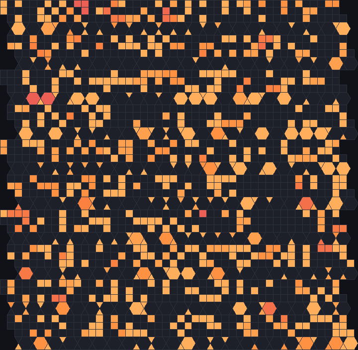
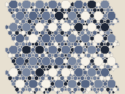
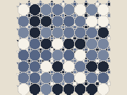
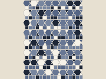
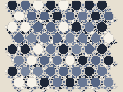
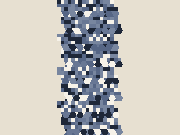
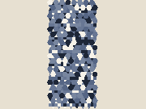
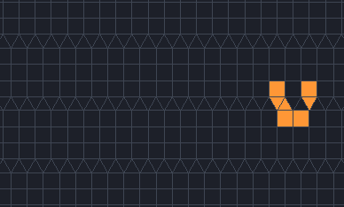

# k-uniform tilings

Allow more than one kind of corner and the eleven uniform tilings grow into an enormous family. A
tiling by regular polygons is *k-uniform* when its corners fall into k classes: within a class every
corner is the same, but the classes differ. JETCARP carries Brian Galebach's complete catalogue up to
k = 6, all 1,248 tilings, and every rule runs on each of them.

<figure>

<figcaption>B2/S34 on the 3-uniform tiling [3.42.6; 3.6.3.6; 44] #1 (catalogue id
<code>k3-011</code>), 100 generations after a random start. Scene
<code>docs/scenes/tilings/kuniform-k3-011.json</code>.</figcaption>
</figure>

## What it is

In an edge-to-edge tiling by regular polygons, two corners are *equivalent* if a symmetry of the whole
tiling (a translation, rotation or reflection that maps the tiling onto itself) carries one onto the
other. The tiling is k-uniform if there are exactly k classes of corner. The 1-uniform tilings are the
eleven [Archimedean tilings](regular-archimedean.md). With k = 2 there are 20, and the numbers grow
quickly:

| k | Tilings in JETCARP's catalogue | Catalogue ids |
| --- | --- | --- |
| 1 | 11 | `k1-001` to `k1-011` |
| 2 | 20 | `k2-001` to `k2-020` |
| 3 | 61 | `k3-001` to `k3-061` |
| 4 | 151 | `k4-001` to `k4-151` |
| 5 | 332 | `k5-001` to `k5-332` |
| 6 | 673 | `k6-001` to `k6-673` |

A tiling's name lists the vertex type of each class, in square brackets: `[3.4.6.4; 4.6.12]` has one
class of corners where a triangle, two squares and a hexagon meet and another where a square, a
hexagon and a dodecagon meet. When different tilings share a name, a number is added (`#1`, `#2`).
Mixing polygons this way gives tilings where neighbouring tiles have very different degrees, which
changes how rules behave from one region to the next.

<figure><figcaption><code>k2-001</code> [3.4.6.4; 4.6.12]</figcaption></figure>
<figure><figcaption><code>k2-002</code> [3.4.3.12; 3.12^2]</figcaption></figure>
<figure><figcaption><code>k2-007</code> [3.4^2.6; 3.6.3.6] #2</figcaption></figure>
<figure><figcaption><code>k2-013</code> [3^6; 3^2.4.12]</figcaption></figure>
<figure><figcaption><code>k3-011</code> [3.4^2.6; 3.6.3.6; 4^4] #1</figcaption></figure>
<figure><figcaption><code>k3-030</code> [3.4^2.6; 3.6.3.6; 3.6.3.6] #1</figcaption></figure>

Six of the 2- and 3-uniform tilings. The full list, with neighbour counts, is in
the <a href="catalogue.md#k-uniform-tilings-k--1-to-3">tiling catalogue</a>.

## Where it came from

Otto Krötenheerdt classified the k-uniform tilings in which every class has a *different* vertex type
in three papers in 1969 and 1970
([Krötenheerdt 1969](../research/bibliography.md#krotenheerdt1969homogenen);
[1970](../research/bibliography.md#krotenheerdt1970homogenenii);
[1970b](../research/bibliography.md#krotenheerdt1970homogeneniii)). Branko Grünbaum and G. C. Shephard
treated k-uniform tilings in their 1977 survey and in *Tilings and Patterns*
([Grünbaum and Shephard 1977](../research/bibliography.md#grunbaum1977tilings);
[1987](../research/bibliography.md#grunbaum1987tilings)). Darrah Chavey's 1984 thesis gave the number
of 3-uniform tilings, 61, and Chavey's 1989 paper is the standard printed catalogue
([Chavey 1984](../research/bibliography.md#chavey1984periodic);
[Chavey 1989](../research/bibliography.md#chavey1989tilings)).

Brian Galebach wrote a program that generates complete sets of k-uniform tilings. Galebach's entry in the
On-Line Encyclopedia of Integer Sequences records 151 4-uniform and 332 5-uniform tilings (2002) and
673 6-uniform tilings (2003); Galebach's page says the 6-uniform run took about a month of computation and
reproduced Krötenheerdt's list ([Galebach, OEIS A068599](../research/bibliography.md#galebach2002a068599);
[Galebach, n-uniform tilings](../research/bibliography.md#galebachnd_uniform)). Marek Čtrnáct later
extended the counts to k = 13 and, with Eryk Kopczyński, built an online tessellation catalogue
([Čtrnáct and Kopczyński](../research/bibliography.md#ctrnactnd_tescatalog)).

José Ezequiel Soto Sánchez, Tim Weyrich, Asla Medeiros e Sá and Luiz Henrique de Figueiredo gave an
integer representation for periodic tilings by regular polygons
([Soto Sánchez et al. 2021](../research/bibliography.md#sotosanchez2021integer); see also
[Medeiros e Sá et al. 2018](../research/bibliography.md#medeirosesa2018synthesizing)), and Soto Sánchez
publishes Galebach's collection in that form, with an online viewer, under the CC BY 4.0 licence
([Soto Sánchez, tiling viewer](../research/bibliography.md#sotosancheznd_tiling)). That file is
JETCARP's source.

## How JETCARP runs it

JETCARP includes Soto Sánchez's Galebach file unchanged, with attribution under its CC BY 4.0 licence. A
script rebuilds each tiling exactly, in coordinates that are whole-number combinations of twelfth roots
of unity, finds its translation lattice, symmetry group and vertex classes, and rejects anything
inconsistent. The tilings are numbered `kN-NNN` in Galebach's order. (The one exception to exact
coordinates is 4.8.8, whose octagons need different numbers; it is built separately.)

In a scene a catalogue tiling is a `periodic` tiling with a catalogue id:
`"tiling": {"family": "periodic", "params": {"catalog": "k3-011"}, "size": {"cells": 9000}}`. Scripts
accept the id directly as the tiling (`world(#{ tiling: "k3-011" })`). In the app, the tiling panel's
*Tiling catalog* lists every tiling and can be filtered by k or searched by vertex type or symmetry
group.

## What is new here

The catalogue is Galebach's, and the data and its representation are Soto Sánchez and colleagues'.
What JETCARP adds is running cellular automata on all of it. Our prior-art search found no published
cellular automaton work on k-uniform tilings with k of 2 or more. JETCARP has computed sandpile
identities and piles across the catalogue, and its searches have found Life-like spaceships on 2- and
3-uniform tilings. No 2- or 3-uniform tiling has the neighbour graph of a lattice, of Cairo or of an
Archimedean tiling (the k-uniform tilings with k from 4 to 6 have not been surveyed), so a ship found on
one is not a lattice ship in disguise.

A k-uniform tiling can still contain a corridor of a simpler tiling, and a ship that runs in such a
corridor belongs to the simpler tiling. JETCARP's skeptical pass checked every ship against all the
2- and 3-uniform tilings: eight ships found on 3-uniform tilings run unchanged on a 2-uniform tiling or
on 3.6.3.6, and are claimed there, and others run on several tilings of the same k. A looser
congruence test, which asks only that the live tiles evolve the same way whatever the neighbour counts
of the empty tiles around them, moved eight more: five ships of strips of squares and triangles run on
the Archimedean tiling 3.3.3.4.4, and three 3-uniform ships run on a 2-uniform tiling. It also showed
that two pairs of catalogue entries are one ship each. After those checks, 13 single ships with no flag
on 2-uniform tilings and 6 on 3-uniform tilings are, to our knowledge, new; a few more are flagged
because they were very common in their search or run in HighLife. All are listed
in [Findings](../research/findings.md#the-60-objects); see also
[What is new in JETCARP](../research/contributions.md).

Those ships run in rules other than Life. A census of Life itself (`B3/S23`), 50,000 random soups on
each of the 81 2- and 3-uniform tilings, found Life spaceships on 5 of the 20 2-uniform tilings and on
19 of the 61 3-uniform ones. To our knowledge, Life had not been reported on any 3-uniform tiling
before, nor on any 2-uniform tiling but k2-007, where Martin Büttner very likely found a period-20 ship
in 2014; other rules had been run on k2-001, `[3.4.6.4; 4.6.12]`, without ships (see
[What is new in JETCARP](../research/contributions.md#4-spaceships-on-non-square-tilings)). Most of what the census found is common ships flying in pairs, or ships of simpler tilings
running in corridors; the single ships that passed every check are in
[Life on the Archimedean and k-uniform tilings](../research/findings.md#life-on-the-archimedean-and-k-uniform-tilings).

<figure>
<picture>
  <source srcset="../images/tilings/ship-7860a67a-still.png" media="(prefers-reduced-motion: reduce)">
  
</picture>
<figcaption>A 7-cell period-4 spaceship on the 2-uniform tiling k2-003, moving one lattice step every
four generations in the 256 rules from <code>B45/S34</code> up. The same ship runs unchanged on k2-004
and in corridors of the 3-uniform tilings k3-010 and k3-016, where the search first found it. Its live
tiles also evolve the same way on k3-013, k3-019, k3-051, k3-052 and on the Archimedean tiling 3.3.3.4.4,
where the tiles beside its strip have more neighbours, so it is listed on 3.3.3.4.4, and flagged there as
small and common. Watch the triangles at its front and back take turns. Scene
<code>docs/scenes/tilings/ship-7860a67a.json</code>.</figcaption>
</figure>

Treating the tiling as a dimension of an exploratory search also depends on having this catalogue.

## Try it

- Quick Start, family *Tiling showcase*: entries on `k2-001`, `k2-002`, `k3-011`, `k4-100`,
  `k5-058` and `k6-673`.
- `jetcarp run docs/scenes/tilings/kuniform-k3-011.json --gens 200 --png k3-011.png`
- In a script, `for id in catalog_tilings(2) { ... }` loops over the 2-uniform tilings.

## References

- [Krötenheerdt 1969](../research/bibliography.md#krotenheerdt1969homogenen);
  [Krötenheerdt 1970](../research/bibliography.md#krotenheerdt1970homogenenii);
  [Krötenheerdt 1970b](../research/bibliography.md#krotenheerdt1970homogeneniii)
- [Grünbaum and Shephard 1977](../research/bibliography.md#grunbaum1977tilings);
  [Grünbaum and Shephard 1987](../research/bibliography.md#grunbaum1987tilings);
  [Chavey 1984](../research/bibliography.md#chavey1984periodic);
  [Chavey 1989](../research/bibliography.md#chavey1989tilings)
- [Galebach, OEIS A068599](../research/bibliography.md#galebach2002a068599);
  [Galebach, OEIS A068600](../research/bibliography.md#galebach2002a068600);
  [Galebach, n-uniform tilings](../research/bibliography.md#galebachnd_uniform);
  [Čtrnáct and Kopczyński](../research/bibliography.md#ctrnactnd_tescatalog)
- [Soto Sánchez et al. 2021](../research/bibliography.md#sotosanchez2021integer);
  [Medeiros e Sá et al. 2018](../research/bibliography.md#medeirosesa2018synthesizing);
  [Soto Sánchez, tiling viewer](../research/bibliography.md#sotosancheznd_tiling)
