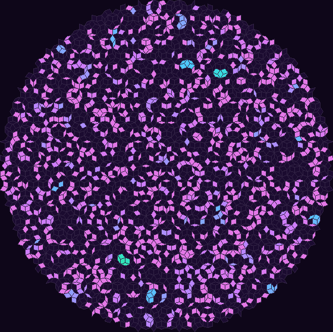
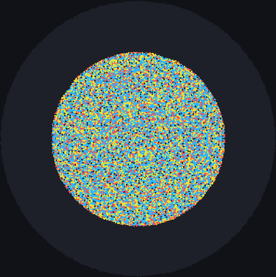

# Penrose tilings

Penrose tilings cover the plane with two tile shapes in a pattern that never repeats: no shift of the
tiling, however large, maps it onto itself. Yet they are highly ordered, with five-fold symmetry
everywhere at every scale. JETCARP builds both of Roger Penrose's two-tile versions, kites and darts
(P2) and thick and thin rhombs (P3), as exact finite patches of up to millions of tiles, and every rule
runs on them.

<figure class="pair">

<figcaption>Left: B2/S34 on about 4,000 Penrose rhombs (P3), 200 generations after a random start; each
rhomb touches 7 to 11 others. Scene <code>docs/scenes/tilings/penrose-rhomb-b2s34.json</code>. Right:
30,000 sand grains dropped on a patch of Penrose kites and darts (P2) and toppled until stable; every
kite and dart has four edge neighbours, so all topple at four grains. Scene
<code>docs/scenes/tilings/penrose-kd-sandpile.json</code>.</figcaption>
</figure>

## What it is

A tiling is *aperiodic* if no translation maps it onto itself and, more strongly, a set of tiles is
aperiodic if *every* tiling it makes is non-periodic. Penrose's tiles are such a set, with matching
rules (marks on the edges, or notches) that forbid the periodic arrangements the bare shapes would
allow:

- **P2, kites and darts.** Two quadrilaterals cut from a rhombus with angles of 72° and 108°. In a
  large patch, kites outnumber darts by the golden ratio φ ≈ 1.618.
- **P3, rhombs.** A thick rhomb (72° and 108°) and a thin one (36° and 144°), meeting edge to edge.
  Thick rhombs outnumber thin ones by φ.

Both can be built by *deflation*: cut every tile into smaller tiles of the same kinds, scale up, and
repeat. Each Penrose tile splits into two mirror-image golden triangles (*Robinson triangles*), which
deflate exactly, and this is how both tilings are usually generated.

For an automaton, a Penrose tiling is a neighbour graph in which every tile has four edge neighbours
but a varying number of touch neighbours: 8 to 10 for kites and darts, 7 to 11 for rhombs. Because the
graph never repeats, a pattern that moves meets a slightly different neighbourhood at every step, which
is why gliders are so hard to find there.

## Where it came from

Robert Berger showed in 1966 that the domino problem for Wang tiles is undecidable, which needed an
aperiodic set of tiles ([Berger 1966](../research/bibliography.md#berger1966undecidability)); Raphael M.
Robinson simplified the construction in 1971 ([Robinson 1971](../research/bibliography.md#robinson1971undecidability)).
Roger Penrose found much smaller aperiodic sets in the 1970s, reducing them to two tiles, the kite and
dart and the two rhombs. His US patent, "Set of tiles for covering a surface", was filed in 1976 (with a
UK priority date of June 1975) and granted in 1979 ([Penrose 1979, patent](../research/bibliography.md#penrose1979set));
his own account is "Pentaplexity" ([Penrose 1979](../research/bibliography.md#penrose1979pentaplexity)).
Martin Gardner made the tilings widely known in his *Scientific American* column of January 1977
([Gardner 1977](../research/bibliography.md#gardner1977extraordinary)).

The Robinson triangles are named after Raphael Robinson; Grünbaum and Shephard give the standard
account of them ([Grünbaum and Shephard 1987](../research/bibliography.md#grunbaum1987tilings), ch. 10).
N. G. de Bruijn gave an algebraic theory of Penrose tilings in 1981
([de Bruijn 1981](../research/bibliography.md#debruijn1981algebraic);
[part II](../research/bibliography.md#debruijn1981algebraicii)). Jeff Preshing's 2011 blog post explains
generating them by triangle subdivision in a few lines of Python
([Preshing 2011](../research/bibliography.md#preshing2011penrose)).

**Cellular automata on Penrose tilings.** Margaret Hill, Susan Stepney and Francis Wan studied the ash
that Life leaves on Penrose tilings ([Hill, Stepney and Wan 2005](../research/bibliography.md#hill2005penrose)),
and Nick Owens and Susan Stepney catalogued its still lifes and oscillators and found no gliders
([Owens and Stepney 2010](../research/bibliography.md#owens2010game)). Adam P. Goucher found the first
glider that travels across an aperiodic tiling, in a four-state rule on a Penrose tiling
([Goucher 2012](../research/bibliography.md#goucher2012gliders)). D. A. Bailey and K. A. Lindsey
studied a Game of Life on Penrose tilings ([Bailey and Lindsey 2017](../research/bibliography.md#bailey2017game)),
Fersula, Noûs and Perrot computed sandpile identities on them
([Fersula, Noûs and Perrot 2020](../research/bibliography.md#fersula2020sandpile)), and Langton's ant
has been run on them ([ptiles/ant](../research/bibliography.md#ptilesnd_ant)).

## How JETCARP runs it

JETCARP builds both tilings by exact Robinson-triangle deflation from a five-fold "sun" at the centre,
pairing mirror-image triangles into whole tiles at the end; the code was written from the geometry of
the triangles as Grünbaum and Shephard and de Bruijn describe it. Patches are chosen by *level*: level
3, 4 and 5 are the 500, 4,000 and 35,000 tiles nearest the centre, and levels 7 and 8 (about 2.2 and 18
million tiles) are built in exact integer coordinates, with every neighbour found by an exact lookup
rather than a floating-point tolerance. Smaller patches nest inside larger ones. The tests check that there are no gaps or
overlaps, that the vertex neighbourhoods are the legal Penrose ones (7 kinds for P2, 8 for P3), and that
the tile ratios tend to φ.

In a scene: `"tiling": {"family": "penrose-rhomb", "size": {"level": 4}}` (or `penrose-kd`). Patch
edges are dead. Tiles are rigid copies of the two prototiles; their shapes cannot be edited.

## What is new here

Cellular automata on Penrose tilings have a long history, summarised above, and we claim nothing new
for the tilings themselves. JETCARP runs every family on them, including some (cyclic,
Greenberg–Hastings, rock-paper-scissors, Hodgepodge and forest fire) for which our search found no
earlier Penrose version; these are direct applications of known rules, so we do not count them as
discoveries. JETCARP's 71 [JACA](../automata/jaca.md) presets include several on both Penrose tilings.

## Try it

- Quick Start: *Sandpile on Penrose kites and darts*, *Brian's Brain on Penrose rhombs*, the *Tiling
  showcase* entries for both tilings, and JACA presets such as *JACA rainbow fronts (Penrose rhombs)*.
- `jetcarp run docs/scenes/tilings/penrose-rhomb-b2s34.json --gens 200 --png rhombs.png`

## References

- [Berger 1966](../research/bibliography.md#berger1966undecidability);
  [Robinson 1971](../research/bibliography.md#robinson1971undecidability)
- [Penrose 1979, patent](../research/bibliography.md#penrose1979set);
  [Penrose 1979](../research/bibliography.md#penrose1979pentaplexity);
  [Gardner 1977](../research/bibliography.md#gardner1977extraordinary)
- [Grünbaum and Shephard 1987](../research/bibliography.md#grunbaum1987tilings);
  [de Bruijn 1981](../research/bibliography.md#debruijn1981algebraic);
  [de Bruijn 1981, part II](../research/bibliography.md#debruijn1981algebraicii);
  [Preshing 2011](../research/bibliography.md#preshing2011penrose)
- [Hill, Stepney and Wan 2005](../research/bibliography.md#hill2005penrose);
  [Owens and Stepney 2010](../research/bibliography.md#owens2010game);
  [Goucher 2012](../research/bibliography.md#goucher2012gliders);
  [Bailey and Lindsey 2017](../research/bibliography.md#bailey2017game);
  [Fersula, Noûs and Perrot 2020](../research/bibliography.md#fersula2020sandpile);
  [ptiles/ant](../research/bibliography.md#ptilesnd_ant)
