# Regular and Archimedean tilings

The regular tilings, by triangles, squares or hexagons alone, are the grids most cellular automata
were born on. Add the eight Archimedean tilings, which mix regular polygons so that every corner looks
the same, and you have the eleven *uniform* tilings of the plane. Each gives a rule a different
neighbour graph: some tiles see three neighbours, some eighteen, and in the mixed tilings
neighbouring tiles see different numbers. JETCARP runs every rule on all eleven.

<figure>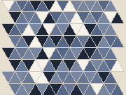6 triangular" width="140"><figcaption>36 triangular <code>triangle</code></figcaption></figure>
<figure>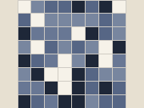4 square" width="140"><figcaption>44 square <code>square</code></figcaption></figure>
<figure>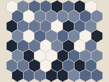3 hexagonal" width="140"><figcaption>63 hexagonal <code>hex</code></figcaption></figure>
<figure>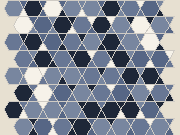<figcaption>3.6.3.6 trihexagonal <code>trihex</code></figcaption></figure>
<figure>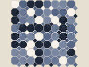<figcaption>4.8.8 truncated square <code>oct</code></figcaption></figure>
<figure>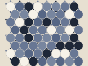<figcaption>3.12.12 truncated hexagonal <code>trunchex</code></figcaption></figure>
<figure>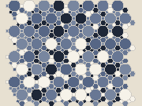<figcaption>4.6.12 truncated trihexagonal <code>trunctrihex</code></figcaption></figure>
<figure>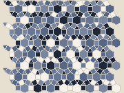<figcaption>3.4.6.4 rhombitrihexagonal <code>rhombitrihex</code></figcaption></figure>
<figure>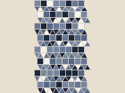<figcaption>3.3.3.4.4 elongated triangular <code>elongtri</code></figcaption></figure>
<figure>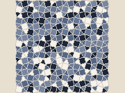<figcaption>3.3.4.3.4 snub square <code>snubsq</code></figcaption></figure>
<figure>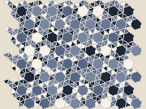<figcaption>3.3.3.3.6 snub hexagonal <code>snubhex</code></figcaption></figure>

The eleven uniform tilings, named by their vertex configurations, with JETCARP's
family ids. Thumbnails from the <a href="catalogue.md">tiling catalogue</a>, drawn by JETCARP with each tile
in a random colour.

## What it is

A tiling by regular polygons is *edge to edge* when tiles meet only along whole edges, corner to
corner. It is *uniform* (or *1-uniform*, *Archimedean*) when every vertex looks the same: the same
polygons, in the same order, meet at each corner. A vertex is described by listing the polygons around
it, so 4.8.8 means a square and two octagons, and 3.3.4.3.4 means triangle, triangle, square, triangle,
square. Repeated numbers can be written with exponents: 36 for six triangles,
32.4.3.4 for the snub square.

There are exactly eleven: the three regular tilings 36, 44 and 63, and
the eight mixed ones 3.6.3.6 (trihexagonal, also called kagome), 4.8.8 (truncated square), 3.12.12
(truncated hexagonal), 4.6.12 (truncated trihexagonal), 3.4.6.4 (rhombitrihexagonal), 3.3.3.4.4
(elongated triangular), 3.3.4.3.4 (snub square) and 3.3.3.3.6 (snub hexagonal), which comes in two
mirror-image forms.

For an automaton the differences are large. With touch neighbours a triangle in the triangular tiling
has 12 neighbours, a hexagon 6; in 3.3.3.3.6 each hexagon touches 18 tiles and each triangle 9. In
3.12.12, touch and edge neighbours are the same (3 for a triangle, 12 for a dodecagon), because no two
tiles meet at a corner only. Rules that count neighbours respond to all of this.

<figure>
<picture>
  <source srcset="../images/tilings/osc-trihex-p42-still.png" media="(prefers-reduced-motion: reduce)">
  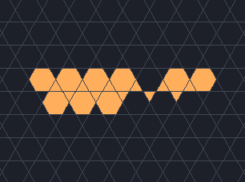
</picture>
<figcaption>A 20-cell oscillator with period 42 on the trihexagonal tiling 3.6.3.6, in the rule
<code>B4,5,7,8,10,11/S0,2,3,4,6,7,9,10</code>, one generation per frame. Hexagons here touch 12 tiles and
triangles 6, which is why the rule lists counts up to 11; watch the activity run back and forth along
the row of hexagons. Found by JETCARP's soup search. Scene
<code>docs/scenes/tilings/osc-trihex-p42.json</code>.</figcaption>
</figure>

<figure>
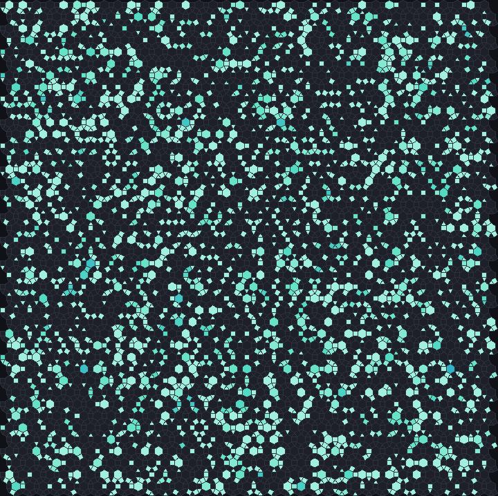
<figcaption>B2/S34 on the rhombitrihexagonal tiling 3.4.6.4, 200 generations after a random start.
Triangles touch 6 tiles, squares 8 and hexagons 12, so births and deaths happen at different rates on
each kind of tile. Scene <code>docs/scenes/tilings/archimedean-rhombitrihex.json</code>.</figcaption>
</figure>

## Where it came from

The regular tilings are ancient as patterns. The first systematic mathematical treatment of
edge-to-edge tilings by regular polygons, including the eight further Archimedean tilings, is Johannes
Kepler's in Book II of *Harmonices Mundi* (1619)
([Kepler 1619](../research/bibliography.md#kepler1619harmonices); English translation
[Kepler 1997](../research/bibliography.md#kepler1997harmony)). Darrah Chavey's 1984 thesis examined Kepler's
results in detail ([Chavey 1984](../research/bibliography.md#chavey1984periodic)). Branko
Grünbaum and G. C. Shephard surveyed the subject "from Kepler to the present" in 1977 and in their book
*Tilings and Patterns*, the standard modern reference
([Grünbaum and Shephard 1977](../research/bibliography.md#grunbaum1977tilings);
[1987](../research/bibliography.md#grunbaum1987tilings)).

The dotted vertex notation (4.8.8) is commonly named after H. M. Cundy and A. P. Rollett's
*Mathematical Models* ([Cundy and Rollett 1961](../research/bibliography.md#cundy1961mathematical));
Grünbaum and Shephard use exponents. Later notations designed for generating tilings automatically
include the GomJau-Hogg notation ([Gomez-Jauregui et al. 2021](../research/bibliography.md#gomezjauregui2021gomjau)).

Cellular automata on these tilings have their own history. Carter Bays studied Life-like rules on the
triangular tiling ([Bays 1994](../research/bibliography.md#bays1994cellular)) and on hexagons and Cairo
pentagons ([Bays 2005](../research/bibliography.md#bays2005note)), and wrote an overview
([Bays 2009](../research/bibliography.md#bays2009cellular)). In June 2013 EricG emulated all eight
mixed Archimedean tilings and their duals in Golly, with cells that share an edge or a vertex as
neighbours, and reported spaceships in Life-like rules on every one of the eight, in Life itself on
3.6.3.6, 3.3.4.3.4 and 3.3.3.4.4 ([EricG 2013](../research/bibliography.md#ericg2013tiling2)); EricG named
rules but did not list the ships, and the pattern files are no longer online. A 2014 Code Golf
challenge ran Life on several non-square tilings; Peter Taylor found only oscillators on 3.4.6.4
([Code Golf 2014](../research/bibliography.md#codegolf2014life)). H. S. Guttesen ran Life on six of the
mixed Archimedean tilings, described gliders on 3.6.3.6 and 3.3.4.3.4 and built a glider gun on 3.6.3.6
([Guttesen 2026](../research/bibliography.md#guttesen2026game)).

<figure class="pair">

<picture>
  <source srcset="../images/tilings/glider-guttesen-kagome-still.png" media="(prefers-reduced-motion: reduce)">
  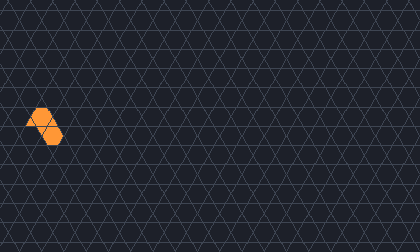
</picture>

<picture>
  <source srcset="../images/tilings/glider-guttesen-snubsq-still.png" media="(prefers-reduced-motion: reduce)">
  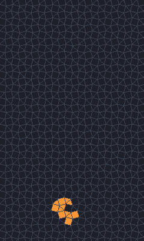
</picture>

<figcaption>Guttesen's gliders in Life (<code>B3/S23</code>). Left: glider g on the kagome tiling
3.6.3.6, two hexagons and a trailing triangle, period 4, one lattice step every four generations.
Right: the period-8 glider on the snub square tiling 3.3.4.3.4, a ring of triangles with one square,
moving two lattice steps every eight generations. JETCARP's soup searches found both independently;
watch how each tile kind takes its turn. Scenes
<code>docs/scenes/tilings/glider-guttesen-kagome.json</code> and
<code>glider-guttesen-snubsq.json</code>.</figcaption>
</figure>

## How JETCARP runs it

The triangle, square and hexagon tilings are *reshapeable* families (`triangle`, `square`, `hex`):
their tiles can be any triangle, any parallelogram or any of a family of hexagons, and the regular
shapes are the default (see [Editable tile families](editable-families.md)). The eight mixed tilings are
fixed families: `trihex`, `oct`, `trunchex`, `trunctrihex`, `rhombitrihex`, `elongtri`,
`snubsq` and `snubhex`. All eleven also appear in the [k-uniform catalogue](k-uniform.md) as its
k = 1 entries, `k1-001` to `k1-011`.

In a scene the tiling is given by its family id, a size and an edge rule, for example
`"tiling": {"family": "rhombitrihex", "size": {"cells": 9000}, "boundary": "wrap"}`. A flat-topped
version of the hexagon tiling, `hex_flat`, exists for the three-parent
[hexagonal row rules](../automata/hexagonal-rows.md).

## What is new here

The tilings are classical. On them, JETCARP's searches have found spaceships in Life-like rules on
4.8.8, 3.12.12, 4.6.12, 3.4.6.4, 3.3.3.4.4 and 3.3.3.3.6, and on 3.6.3.6 in rules other than Life. After
the checks described in [What is new in JETCARP](../research/contributions.md#how-we-checked), six
single ships with no flag remain on these tilings, four on 3.3.3.4.4 and one each on 3.4.6.4 and
3.3.3.3.6. They run in none of the rules in which EricG reported ships, and to our knowledge they have
not been reported before. Three of the four on 3.3.3.4.4 were found in strips of squares and triangles
inside 2- and 3-uniform tilings; their live tiles evolve the same way on the elongated triangular tiling
itself, so they are listed there. Two ships on 4.8.8 and two on 3.12.12 passed the same checks but run in
the `B2` and `B26` rules where EricG saw many ships, so they are flagged until EricG's patterns can be
compared. Four ships are below.

The others on these tilings are described rather than claimed. On 4.8.8, 3.12.12, 4.6.12, 3.6.3.6 and
3.3.3.4.4 the rest are small ships that turn up often in soups, ships in well-known rules such as HighLife or
`B2/S34`, or a smaller ship with a passenger, and others may well have seen them. Guttesen's Life
gliders on 3.6.3.6 and 3.3.4.3.4 (on tilings where EricG had seen Life spaceships in 2013), which
JETCARP also found, are Guttesen's, and so are the pairs of them that
JETCARP's catalogue first listed as separate ships. In Life on 3.3.4.3.4, JETCARP also found two larger
ships built around Guttesen's glider, of periods 16 and 24; we found no earlier report of them. Every ship is
listed in [Findings](../research/findings.md#the-60-objects).

A census of Life itself, 50,000 random soups on each of the eleven tilings, found spaceships only on
the square grid, 3.6.3.6, 3.3.4.3.4 and 3.3.3.4.4 (see
[Life on the Archimedean and k-uniform tilings](../research/findings.md#life-on-the-archimedean-and-k-uniform-tilings)).
On the first three they are Conway's and Guttesen's ships, the pairs and bound pairs those form, and
the larger snub-square ships above. On 3.3.3.4.4 it is one ship, now and then flying in a pair: eight
to twelve cells, period 2, moving along the rows at c/2, in about one soup in eleven. It is probably
the "common spaceship (although it only travels horizontally)" that EricG reported there in 2013,
although EricG's patterns are not online to compare. On the hexagonal and triangular grids, 4.8.8,
3.12.12, 4.6.12, 3.4.6.4 and 3.3.3.3.6 no soup produced a Life ship; on the last five, Guttesen and the
2014 Code Golf challenge had found none either.

<figure class="pair">

<picture>
  <source srcset="../images/tilings/ship-57a0326c-still.png" media="(prefers-reduced-motion: reduce)">
  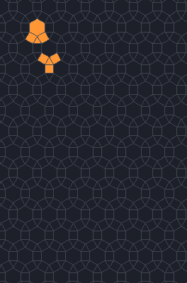
</picture>

<picture>
  <source srcset="../images/tilings/ship-d3cd3951-still.png" media="(prefers-reduced-motion: reduce)">
  
</picture>

<figcaption>Left: <code>aa7e7357</code> on 3.4.6.4, period 42, moving 3 lattice steps per period, in
the 1,024 rules from <code>B3/S235</code> up. Right: <code>acd0fa8b</code> on 3.3.3.3.6, period 27, one
lattice step along a row per period, in about a million rules from <code>B37/S2,5,6,10</code> up. Watch
each ship pass through shapes that look nothing alike before it repeats one place further on. Scenes
<code>docs/scenes/tilings/ship-57a0326c.json</code> and <code>ship-d3cd3951.json</code>.</figcaption>
</figure>

<figure class="pair">

<picture>
  <source srcset="../images/tilings/ship-3e30b9ff-still.png" media="(prefers-reduced-motion: reduce)">
  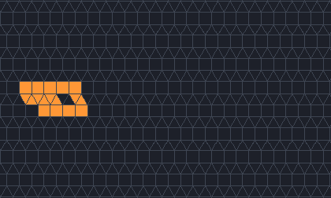
</picture>

<picture>
  <source srcset="../images/tilings/ship-504fdf46-still.png" media="(prefers-reduced-motion: reduce)">
  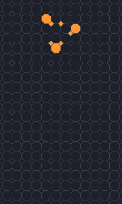
</picture>

<figcaption>Left: <code>a13d3fbf</code> on 3.3.3.4.4, period 8, two lattice steps along the rows per
period, in the 1,024 rules from <code>B46/S3458</code> up. Right: <code>9cee5c6a</code> on 4.8.8,
period 6, two lattice steps per period, in the 128 rules from <code>B2/S2</code> up; it is one of the
flagged 4.8.8 ships, since EricG found many ships in <code>B2</code> rules there. Scenes
<code>docs/scenes/tilings/ship-3e30b9ff.json</code> and <code>ship-504fdf46.json</code>.</figcaption>
</figure>

## Try it

- Quick Start, family *Tiling showcase*: a lively rule and a sandpile on each of the eleven.
- `jetcarp run docs/scenes/tilings/archimedean-rhombitrihex.json --gens 200 --png 3464.png`
- Run Life (`B3/S23`) on `trihex` from a random start and look for small gliders, as Guttesen did.
- `jetcarp run docs/scenes/tilings/ship-57a0326c.json --gens 126 --png ship.png` runs the period-42
  ship for three periods.

## References

- [Kepler 1619](../research/bibliography.md#kepler1619harmonices);
  [Kepler 1997](../research/bibliography.md#kepler1997harmony);
  [Chavey 1984](../research/bibliography.md#chavey1984periodic)
- [Grünbaum and Shephard 1977](../research/bibliography.md#grunbaum1977tilings);
  [Grünbaum and Shephard 1987](../research/bibliography.md#grunbaum1987tilings)
- [Cundy and Rollett 1961](../research/bibliography.md#cundy1961mathematical);
  [Gomez-Jauregui et al. 2021](../research/bibliography.md#gomezjauregui2021gomjau)
- [Bays 1994](../research/bibliography.md#bays1994cellular);
  [Bays 2005](../research/bibliography.md#bays2005note);
  [Bays 2009](../research/bibliography.md#bays2009cellular);
  [EricG 2013](../research/bibliography.md#ericg2013tiling2);
  [Code Golf 2014](../research/bibliography.md#codegolf2014life);
  [Guttesen 2026](../research/bibliography.md#guttesen2026game)
