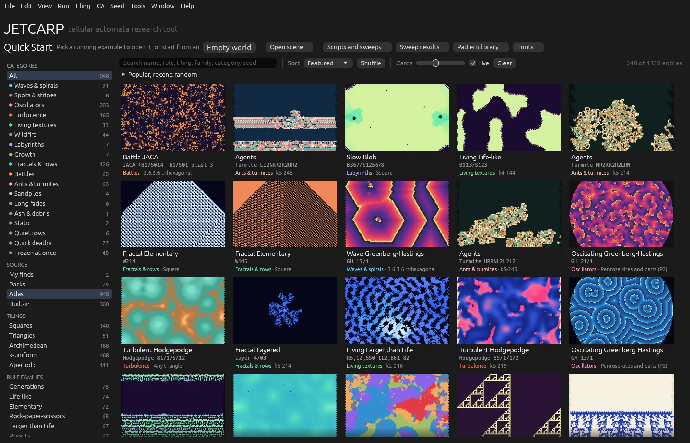

# 4. Building your own Quick Start

The Quick Start menu holds the examples that come with JETCARP, the entries of the packs you import,
and an *atlas*: the best runs of an exploratory search over every tiling and rule family. Each
computer's search starts from a point of its own, so your atlas holds things no one else's does. In
this tutorial you build an atlas, look through what it found, keep and hide entries, promote finds
of your own, and share them as a pack. It takes about twenty minutes, three of them searching.

You need JETCARP installed ([Installing](../getting-started/installing.md)). The search runs on your
graphics card when you have one, and on the processor otherwise, where it finds less in the time.
The [Searching for patterns](../guides/searching.md#the-exploratory-search) guide covers the
exploratory search in full.

## 1. Build an atlas

`jetcarp quickstart build` searches for as many minutes as you say, then puts its best runs into
the Quick Start:

```text
$ jetcarp quickstart build --minutes 3
explore search job 22 in /home/ada/.local/share/jetcarp/library.sqlite
GPU: AMD Radeon 8060S Graphics (RADV STRIX_HALO) (radv), Vulkan
Quick Start build (explore 22): 949 atlas entries published (949 new, 0 updated, 0 removed); 28,078 runs (145/s), 6,478 elites in 3,423 niches, 310 confirmed, 25 of 1,359 tilings; AMD Radeon 8060S Graphics (RADV STRIX_HALO) (radv), Vulkan
  status done, 3 min 17 s run over every session, 1,041 confirmation runs, 29,454 candidates tried, 1.22 GB
  …
  family                     runs   mean   best  elites
  life_like                 8,427   0.27   1.35   1,761
  generations               6,663   0.58   2.01   1,489
  ltl                       3,922   0.30   2.18     511
  …
```

In three minutes it ran 28,078 worlds, each a rule of one of its 22 rule families on one of the
tilings, from a start of its own, and scored each for how lively, varied and long-lasting it was. It
kept the best of each kind it saw (6,478 *elites* in 3,423 *niches*), ran the best of those again
from other starts to confirm them (310 confirmed), and published 949 of them as atlas entries, a few
per category, rule family and tiling. The table says how each rule family did; the last figure on
the *status* line is the memory it used.

**Timings.** The minutes are the search's, and it ends on time: runs still going on the processor
when they are spent are given up, and the graphics card's last batches are sized to end with them.
Publishing then takes a few seconds more, since each entry's run is replayed to where it is most
interesting. This three-minute build took 3 minutes 18 seconds from start to finish. Three minutes
see only a couple of dozen of JETCARP's 1,359 tilings; a longer build sees more and finds more.

Open the app (or go back to its Quick Start screen) and set *Source* to *Atlas* to see only your
build's entries:



Your atlas will differ: every build searches from a starting point of its own.

**Stopping and carrying on.** Ctrl-C stops a build. `jetcarp jobs resume 22` carries it on to the
end of its minutes and then publishes. `--detach` runs it in the background, and `--no-gpu` keeps it off
the graphics card.

## 2. What the categories mean

Each atlas entry gets one category from how its run behaved, tested in about this order:

| Category | The run |
| --- | --- |
| *Fractals & rows*, *Quiet rows* | A rule that writes one row at a time (elementary and hexagonal row rules): with complex rows, or simple ones |
| *Sandpiles*, *Ants & turmites* | By family: the Abelian sandpile, and ants and turmites |
| *Quick deaths*, *Long fades* | Died out: early in the run, or late |
| *Frozen at once* | Stopped changing early in the run |
| *Wildfire* | A forest fire, which never settles |
| *Gliders & ships* | At least three things moving across a quiet, sparse background |
| *Battles* | A JACA rule, where two kinds of cell annihilate each other |
| *Waves & spirals* | Smooth waves or spirals that travel or turn |
| *Spots & stripes* | A Lenia rule settled into quiet spots or stripes |
| *Labyrinths* | Large smooth regions that have nearly stopped changing |
| *Oscillators* | Ended in a cycle of more than one generation |
| *Ash & debris* | Nearly still, in many small pieces |
| *Growth* | Still growing at the end |
| *Static* | Fine-grained noise, like a badly tuned television |
| *Turbulence* | More than a fifth of the cells still changing at the end |
| *Living textures* | Still changing, and none of the above |

Four more categories hold entries from elsewhere: *Classics* and *Computing* (built-in examples),
*My finds* (your promotions, below) and *Packs* (a pack's entries that name no category of their
own). Built-in and pack entries can be in the categories above too.

## 3. Look through the results

The build is an explore job in your library. `jetcarp jobs list` lists it with the others, and
`jetcarp jobs runs` lists its stored runs, best first:

```text
$ jetcarp jobs runs --limit 5
    11856   2.60  cycle   greenberg_hastings penrose-rhomb    GH 9/2
    17127   2.59  cycle   greenberg_hastings snubsq           GH 6/2
    12419   2.55  cycle   greenberg_hastings catalog:k5-219   GH 11/2
    20145   2.50  cycle   greenberg_hastings penrose-rhomb    GH 12/2
    11455   2.45  cycle   greenberg_hastings penrose-rhomb    GH 5/2
5 run(s) of explore job 22
```

Each line is a run's id, its score, how it ended (`cycle`: it settled into a repeating cycle), its
rule family, its tiling and its rule. Its options choose a `--family`, a `--tiling`, a `--fate` or a
`--min-score`. With no job named, these commands use the newest explore job.

**A contact sheet** shows chosen runs at an eighth of the way, halfway and at the end:

```text
$ jetcarp jobs sheet --ids 11856,17127,12419,17001 --cols 3 --px 200 --png best.png
4 runs, 632x928: /home/ada/best.png
```


**Clips** animate a sample of runs from every category, to look through by eye. Each is a GIF, and
`manifest.json` says what each one is:

```text
$ jetcarp jobs clips --sample 24 --out clips
18 clips in /home/ada/clips
```

**Reviews** record your verdict on a run, `keep`, `maybe` or `drop`, and `--reviewed` lists runs by
it:

```text
$ jetcarp jobs review 22 11856 keep
recorded 1 review(s); job 22 has keep 1
$ jetcarp jobs runs --reviewed keep
    11856   2.60  cycle   greenberg_hastings penrose-rhomb    GH 9/2
1 run(s) of explore job 22
```

To watch any run in the app, save it as a scene, and open that with *File → Open scene…* or
`jetcarp --scene snub-gh.json`:

```text
$ jetcarp jobs scene 22 17127 --save snub-gh.json
run 17127 saved as a scene: /home/ada/snub-gh.json
```

## 4. Keep, hide and rate

**In the app**, right-click a card to rate it from one to five stars, or to hide it (see
[A tour of the app](../getting-started/tour.md#the-quick-start-screen)). A hidden entry leaves the
menu, your packs and your website exports.

**From the command line**, `jetcarp library quickstart` lists every entry that is not built in, and
hides, shows or removes one by its id:

```text
$ jetcarp library quickstart --source atlas
catalog: /home/ada/.local/share/jetcarp/library.sqlite (949 entries)
atlas:a0e3aa0c-1077           atlas     search_run Short-lived Continuous       Lenia R=9,T=5, k6-535
atlas:a0e3aa0c-1079           atlas     search_run Short-lived Continuous       Lenia R=10,T=1 k6-535
…
$ jetcarp library quickstart --hide atlas:a0e3aa0c-1077
atlas:a0e3aa0c-1077: hidden
```

`--hidden` lists the hidden entries, `--unhide ID` shows one again, and `--remove ID` deletes it.
An atlas entry's id is `atlas:`, the start of its search's id, and the run's id.

## 5. Promote your own finds

`jetcarp library promote` adds an entry under *My finds*. It takes a run of a search:

```text
$ jetcarp library promote --search-run 17127 --job 22 --title "Spirals on the snub square"
promoted: Spirals on the snub square
entry:    find:run-a0e3aa0c-17127 in /home/ada/.local/share/jetcarp/library.sqlite
It appears in the app's Quick Start under "My finds".
```

or any scene file, such as the one from [Life on a new tiling](life-on-a-new-tiling.md):

```text
$ jetcarp library promote --scene life-k2-007.json --title "Life on k2-007"
promoted: Life on k2-007
entry:    find:scene-3eb3915ac28926d6 in /home/ada/.local/share/jetcarp/library.sqlite
It appears in the app's Quick Start under "My finds".
$ jetcarp library quickstart --source promotion
catalog: /home/ada/.local/share/jetcarp/library.sqlite (2 entries)
find:run-a0e3aa0c-17127       promotion search_run Spirals on the snub square   GH 6/2         3.3.4.3.4 snub square
find:scene-3eb3915ac28926d6   promotion scene      Life on k2-007               B3/S23         [3.4^2.6; 3.6.3.6] #2 (k2-007)
```

`jetcarp library promote ID` promotes a pattern of your library, and `jetcarp library promote-run`
a run of a script's sweep ([Scripting a rule sweep](scripting-a-sweep.md#5-keep-the-best-one)). In
the app, the pattern library's *Promote to Quick Start* does the same for a pattern.

## 6. Share it as a pack

A pack carries Quick Start entries, with everything needed to open them, to other people (see
[Packs](../guides/packs.md)). Packs are signed with your *publisher key*. `jetcarp pack key` makes
it, and a name given to it goes on your packs:

```text
$ jetcarp pack key --name "Ada Example"
made publisher key SHA256:5JRuc87uNYZXX3f9LNs/9Yw8X7/umwbHJ102dBa+LD0
  ssh-ed25519 AAAAC3NzaC1lZDI1NTE5AAAAIC7I9X81inrgVLhrhn8hMV/B08wtjbCTviYzImkte4pF jetcarp publisher
  file /home/ada/.config/jetcarp/pack/publisher_ed25519
  named Ada Example
```

Then export the entries you choose, by their ids:

```text
$ jetcarp pack export --to my-finds-2026.11 --feed my-finds --title "My finds" --version-label 2026.11 \
    --id find:run-a0e3aa0c-17127 --id find:scene-3eb3915ac28926d6 --no-searches
publishing feed my-finds (version 1) into /home/ada/.my-finds-2026.11.store
…
exported sha256:e615ea6d2fdd6d1210a0bcca316c89f966ec1268586528fa8f5ef5339f6e86c1 into /home/ada/my-finds-2026.11: 15 files, 25647 bytes
…
$ jetcarp pack info my-finds-2026.11
export sha256:e615ea6d2fdd6d1210a0bcca316c89f966ec1268586528fa8f5ef5339f6e86c1 (feed my-finds, version 2026.11)
  My finds
  publisher SHA256:5JRuc87uNYZXX3f9LNs/9Yw8X7/umwbHJ102dBa+LD0 (Ada Example), signed by its publisher
  created 2026-11-12T11:53:23Z, licence CC0-1.0
  provenance             2 rows in 1 parts, 3860 bytes
  quickstart             2 rows in 2 parts, 8002 bytes
  tilings                2 rows in 1 parts, 7614 bytes
```

The folder `my-finds-2026.11` is the pack: zip it and send it, and the other person imports it with
`jetcarp pack import`, or adds it with *Add packs from a folder…* on the setup window's packs page
(*Researcher* and *Everything*). Your explore searches go in unless you leave them out with
`--no-searches` or choose some with `--search`. Without `--id`, the export holds your whole library
but its hidden entries: every pattern, ant run and Quick Start entry, the starter pack's included.
`--query` chooses patterns by a library query.

## 7. Longer searches

A build is an exploratory search and its publishing in one job. For a longer search that you look
through before publishing anything, run the two apart. Give the search an hour rather than the
minute here:

```text
$ jetcarp search explore --gpu --minutes 1 --label longer
explore search job 23 in /home/ada/.local/share/jetcarp/library.sqlite
…
explore search 23 paused (at its budget); `jetcarp jobs resume 23` continues it from its archive (not run for run: the search is not deterministic)
$ jetcarp quickstart publish
873 atlas entries from explore job 23 (search 79d59129-7681-4f75-9a12-709a698683b3) in the Quick Start of /home/ada/.local/share/jetcarp/library.sqlite: 873 new, 0 updated, 0 removed
```

`jetcarp quickstart publish JOB` publishes a job's atlas (the newest explore job's when no job is
named), replacing the entries it published before. `--per-niche` sets how many entries each
category, family and tiling may have (12 by default), and `--min-score` the lowest confirmed score
(1.25). Publishing again after `jetcarp jobs resume` updates the atlas with what the search found
since.

## The setup window's build

The setup window's *Quick Start build* is `jetcarp quickstart build` with the profile's minutes: 10
for *Explorer* (which you can switch off), 30 for *Researcher* and 60 for *Everything*, changeable
from 1 to 600 on its summary page. It runs in the background while you use the app, its entries
appear in the Quick Start as soon as it publishes, and *Tools → Hunts…* lists it as *Quick Start
build*. A build cut off by closing the app or restarting the computer is carried on by *Resume* there,
by running setup again, or by `jetcarp jobs resume JOB`. See [First run and
setup](../getting-started/first-run.md).

## Where to go from here

- [Searching for patterns](../guides/searching.md) covers the other searches, which hunt for
  spaceships, oscillators and ant highways.
- [Search runs](../reference/search-runs.md) describes the files an explore search keeps.
- [Website export](../guides/website-export.md) publishes your reviewed patterns as a website.
