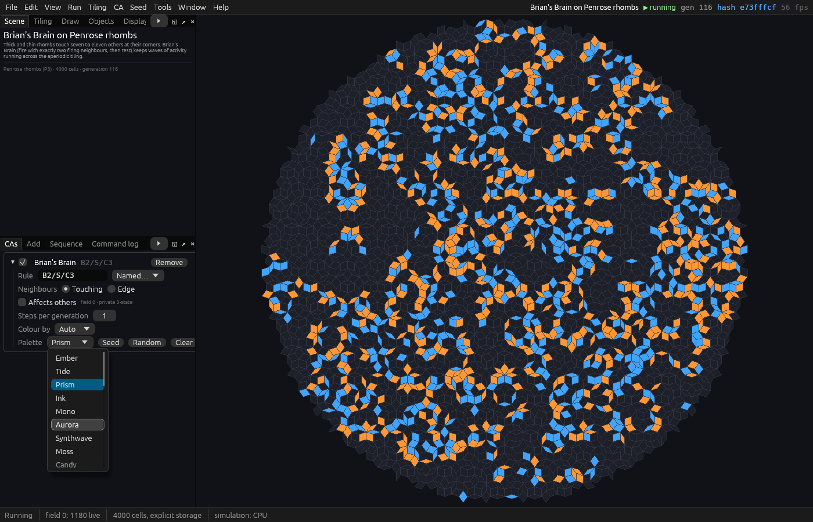
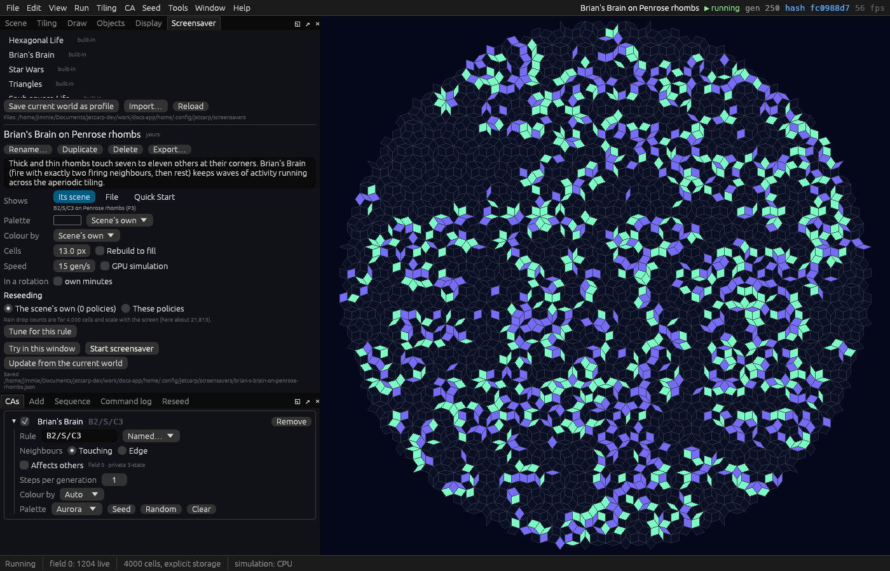

# 1. Your first live wallpaper

In this tutorial you pick an entry from the Quick Start menu, give it colours of your choosing, and
make it the moving background of your desktop: first in the app, then with the background host,
which keeps it running with no app open. You also make a still wallpaper, add JETCARP to the
system's screen savers, and turn it all off again. It takes about fifteen minutes.

You need JETCARP installed ([Installing](../getting-started/installing.md)). What works depends on
your system: Windows and macOS show a live wallpaper as they are; on Linux it needs GNOME and
JETCARP's GNOME extension. The table in
[Wallpapers, screensavers and the background host](../guides/wallpapers.md#what-works-on-which-system)
says what works where, and [what has been tested](../guides/wallpapers.md#what-has-been-tested) on
which machines.

## 1. Pick an entry

On the Quick Start screen, type `penrose` in the search box and click *Brian's Brain on Penrose
rhombs*. Brian's Brain is a rule with three states (firing, refractory and off) that never settles,
which suits a wallpaper, and here it runs on the aperiodic Penrose tiling of thin and thick rhombs.

## 2. Change its palette

In the *CAs* pane, open the list after *Palette* (it says *Prism*) and choose *Aurora*:



The world turns mint and violet at once. *CA → Palettes…* opens the palette window, which shows
every palette, applies one to every automaton at once, and makes palettes of your own (see
[Palettes and colouring](../guides/palettes.md)).

## 3. Fill the screen

The app's *screensaver mode* hides every control and runs a world full screen until you press Esc.
What it runs is set in the *Screensaver* pane: choose *View → Screensaver settings…* to open it.

Keep this world as it is now by saving it as a *screensaver profile*: press *Save current world as
profile* under *Profiles*. The profile is named after the scene and holds its tiling, rule, seed and
palette. Then set *Show* to *One profile* and *Profile* to *Brian's Brain on Penrose rhombs*:



Now *View → Screensaver mode* (F12), or *Start the screensaver* at the top of the pane, fills the
screen with your profile. (*Show → The current world* runs whatever world is open instead.)

## 4. Make it the desktop background

A live wallpaper is run by the *background host*, a separate JETCARP program that keeps going when
the app closes. The host shows a *rotation*: a list of items, each shown for a while. Make one with
your profile in it:

1. In the *Screensaver* pane, set *Show* to *A rotation* and press *New*.
2. Name it `My wallpaper`, and under its items choose *Add profile → Brian's Brain on Penrose rhombs*.
   For a second item, type `tiling:penrose-kd` (Brian's Brain on Penrose kites and darts) in the
   box for a Quick Start entry and press Enter.
3. Press *Save*.

Then open *Background host*, below *While it runs*:

1. Set its *Rotation* to *My wallpaper*.
2. Press *Start*. The host starts in a window of its own.
3. Tick *Show on the desktop*. The host's window moves behind your other windows and becomes the
   desktop background.

On Windows the host sits under the desktop icons, and on macOS behind them, on every Space. On
GNOME it needs JETCARP's GNOME Shell extension: press *Install* beside *The GNOME extension is not
installed*, then log out and back in once. Without the extension, and on Linux desktops other than
GNOME, the host shows its plain window instead. Its menu, in the notification area (Windows), the
menu bar (macOS) or GNOME's top bar, has *Next*, *Previous*, *Paused* and *Quit*.

*Show what is running* adds a caption naming the rule and the tiling. The host pauses by itself
while the computer runs on battery, while the processor is busy (during a long search, say), and
while its wallpaper is hidden behind windows. The guide's [background host](../guides/wallpapers.md#the-background-host)
section has every setting.

## 5. The same from the command line

The host's settings and rotations are files in JETCARP's settings folder (`jetcarp paths` says where),
so everything above can be done from a terminal too. A rotation that shows the two Quick Start
entries in Aurora, ten minutes each, as a file `my-wallpaper.json` in the `rotations` folder of the
settings folder:

```json
{
  "name": "My wallpaper",
  "description": "Brian's Brain on two Penrose tilings, in Aurora, ten minutes each.",
  "default_minutes": 10.0,
  "look": {"palette": "Aurora"},
  "items": [
    {"source": {"kind": "quick_start", "id": "penrose-rhomb-brain"}, "label": "Brian's Brain on rhombs"},
    {"source": {"kind": "quick_start", "id": "tiling:penrose-kd"}, "label": "Brian's Brain on kites and darts"}
  ]
}
```

`penrose-rhomb-brain` is the entry's id; `jetcarp --json quickstart` lists the built-in ones.
[Rotations](../guides/rotations.md#rotation-files) describes the file. Choose the rotation, start the
host, and put it on the desktop:

```text
$ jetcarp host rotation "My wallpaper"
saved; the host is not running
$ jetcarp host start
running, pid 3429677, up 0.0s, 94 MB, GPU AMD Radeon 8060S Graphics (RADV STRIX_HALO)
screen 0: My wallpaper · Brian's Brain on rhombs (1 of 2) · generation 3 · 4000 cells · window
caption: off
$ jetcarp host wallpaper on
running, pid 3429677, up 4.0s, 95 MB, GPU AMD Radeon 8060S Graphics (RADV STRIX_HALO)
screen 0: My wallpaper · Brian's Brain on rhombs (1 of 2) · generation 127 · 4000 cells · wallpaper
wallpaper: waiting for the GNOME extension · lock screen: live
caption: off
```

Each command answers with what the host shows now. The output here comes from a host started with
`--headless` (no window) on a Linux computer without the GNOME extension, so its wallpaper waits for
the extension (`jetcarp host gnome install` installs it). On Windows and macOS, and on GNOME with
the extension, the wallpaper shows at once.

Move on to the next item, and turn the caption on:

```text
$ jetcarp host next
running, pid 3429677, up 6.0s, 95 MB, GPU AMD Radeon 8060S Graphics (RADV STRIX_HALO)
screen 0: My wallpaper · Brian's Brain on kites and darts (2 of 2) · starting · wallpaper
…
$ jetcarp host caption on
running, pid 3429677, up 8.0s, 99 MB, GPU AMD Radeon 8060S Graphics (RADV STRIX_HALO)
screen 0: My wallpaper · Brian's Brain on kites and darts (2 of 2) · generation 33 · 4000 cells · wallpaper
wallpaper: waiting for the GNOME extension · lock screen: live
caption: on, bottom left, 20 pt
```

`jetcarp host status` says the same at any time, `previous` goes back, and `pause` and `resume`
freeze and restart it. A setting changed while the host is stopped is saved for the next time it
starts. With several monitors, `jetcarp host wallpaper on --screen 1 --monitor 1 --rotation NAME`
gives a monitor a rotation of its own.

## 6. A still wallpaper

A still picture at your monitor's size needs no host at all:

```text
$ jetcarp wallpaper penrose-rhomb-brain --palette Aurora --gens 200
/home/ada/Pictures/JETCARP/wallpapers/Brian-s-Brain-on-Penrose-rhombs-3840x2160-2026-11-12_07-13-31.png (3840 x 2160)
```

It runs the entry 200 generations and draws it at 3840 × 2160, filling the picture (`--fit contain`
shows the whole round patch instead). `--size QHD` or `--size 2560x1440` sets another size, and
`--monitors` makes one picture spanning several monitors (with `--split`, one for each). Set the file as your background in your
system's settings. In the app, *File → Export wallpaper…* does the same for the world you have open
(see [Pictures and animations](../guides/pictures.md#desktop-wallpapers)).

## 7. The screen saver

**On Windows and macOS** JETCARP can join the system's own list of screen savers:

```text
$ jetcarp host saver install --rotation "My wallpaper"
```

This installs it and opens the system's screen saver settings, where you choose *JETCARP*. On
Windows it needs `jetcarpw.exe` beside `jetcarp.exe`, which JETCARP's Windows downloads have. On
macOS the rotation is copied into the screen saver, so install it again after changing the rotation.
In the app, *Screen saver runs* in the *Background host* section does the same, with an *Install*
button. `jetcarp host saver status` says whether it is installed.

**On Linux** there is no such list, and the command says so:

```text
$ jetcarp host saver install
Error: this system has no screen saver list; on GNOME, use `jetcarp host lock screensaver`
```

On GNOME, with the extension installed, the lock screen shows the host's wallpaper instead: blurred
behind the clock by default, or sharp and lit until you reach for the password box with
`jetcarp host lock screensaver`. See [The system's screen saver](../guides/wallpapers.md#the-systems-screen-saver).

## 8. Turn it all off

```text
$ jetcarp host stop
stopped
$ jetcarp host wallpaper off
saved; the host is not running
$ jetcarp host caption off
saved; the host is not running
```

`jetcarp host wallpaper off` turns the screens back into windows for the next time the host runs.
To remove the rest: `jetcarp host saver remove` takes the screen saver out (close the screen saver
settings first on Windows), and `jetcarp host gnome remove` removes the GNOME extension. In the app,
*Stop* in the *Background host* section stops the host and unticking *Show on the desktop* turns the
wallpaper off.

`jetcarp uninstall` lists everything JETCARP has set up on your desktop, and `jetcarp uninstall
--yes` undoes it all, leaving your library and pictures alone (see
[Uninstalling](../guides/uninstalling.md)).

## Where to go from here

- **Rotations** can change by the hour or the day, and run whole series of rules: see
  [Rotations](../guides/rotations.md).
- **Reseeding** keeps a wallpaper from dying out: see [Reseeding](../guides/reseeding.md).
- **Start at login:** *Start at login* in the *Background host* section, or `jetcarp host login on`,
  writes the entry that starts the host when you log in. Logging in with it has not been tested on
  a real machine yet (see [Start at login](../guides/wallpapers.md#start-at-login)).
