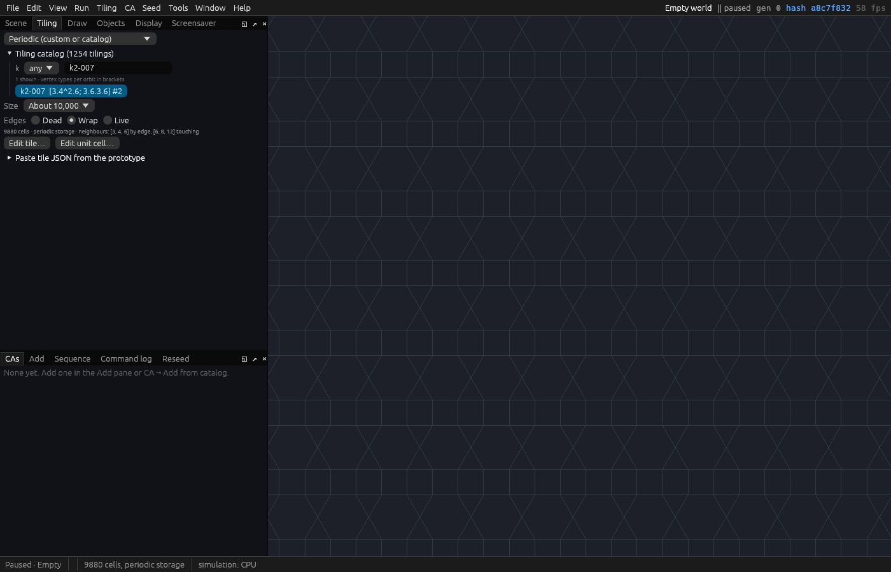
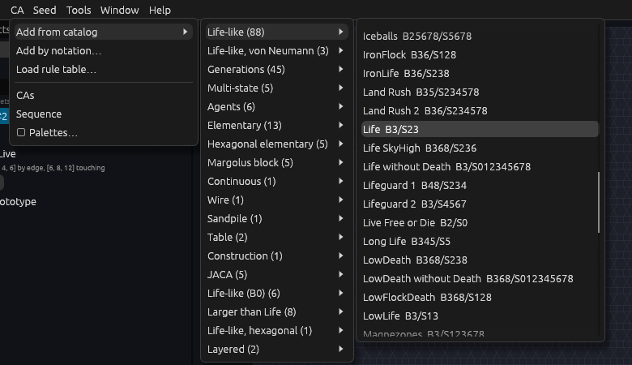
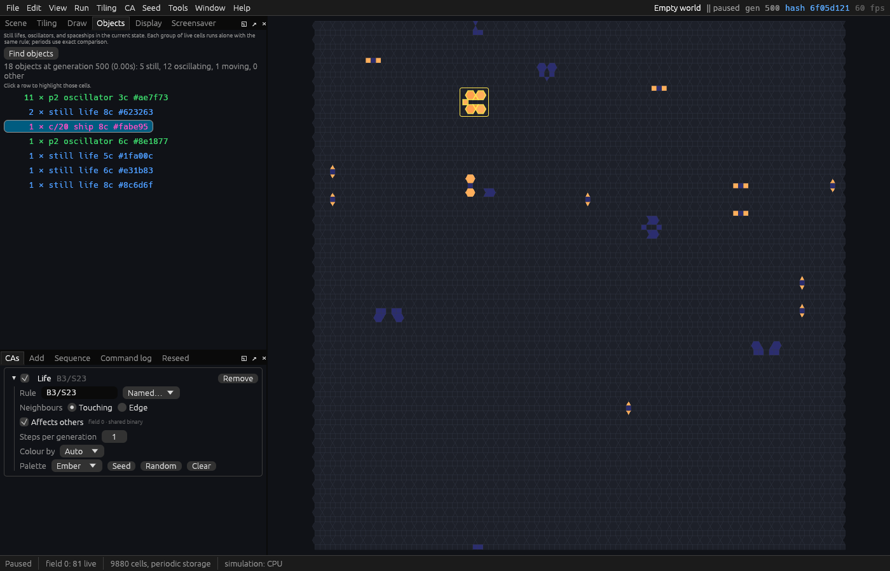
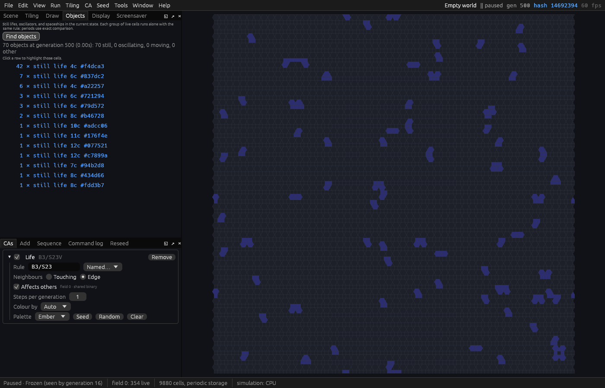

# 2. Life on a new tiling

In this tutorial you start from an empty world, choose a tiling of triangles, squares and hexagons,
put Conway's Life on it, and run it until it settles. The *Objects* pane then finds what is left:
still lifes, oscillators and a spaceship that has been seen on this tiling before. You try a
different neighbourhood, save the world and a picture of it, and do it all again from the command
line. It takes about fifteen minutes.

You need JETCARP installed ([Installing](../getting-started/installing.md)). [A tour of the
app](../getting-started/tour.md) shows where everything is.

## 1. An empty world

Choose *File → New empty world* (Ctrl+N), or press *Empty world* on the Quick Start screen. You get a
square grid with wrapped edges and no automata on it; the *Scene* pane calls it *Empty world*.

## 2. Choose a tiling

*Tiling → Family* (or the list at the top of the *Tiling* pane) has JETCARP's tilings in three
groups: tiles you can reshape (squares, hexagons, triangles, Cairo pentagons and more), fixed shapes
(the Archimedean tilings and a few others), and the aperiodic Penrose, hat and spectre tilings. The
pane's list also has the 81 isohedral types. The 1,254 Archimedean and k-uniform tilings are in the
*tiling catalog*, by their ids:

1. In the *Tiling* pane, open *Tiling catalog (1254 tilings)*. (*Tiling → Tiling catalog* has the
   same list.)
2. Type `k2-007` in its search box, and click `k2-007  [3.4^2.6; 3.6.3.6] #2`.
3. Set *Size* to *About 10,000*. The usual size, *Fill the view*, fits the world to your window, so
   your world would not be the one here.



`k2-007` is one of the twenty 2-uniform tilings: every corner is either `3.4².6` (a triangle, two
squares and a hexagon) or `3.6.3.6` (triangles and hexagons in turn). The line under *Edges* says
what that does to the neighbours: a tile has 3, 4 or 6 neighbours across its edges, and 6, 8 or 12
if those touching it at a corner count too. The [k-uniform tilings](../tilings/k-uniform.md)
chapter explains the names.

## 3. Add Life

Choose *CA → Add from catalog → Life-like → Life*:



Or choose *CA → Add by notation…*, which opens the *Add* pane, type `B3/S23` after *or notation*,
and press its *Add*. Either way Life appears in the *CAs* pane. `B3/S23` means a dead cell is born
with exactly three live neighbours and a live one survives with two or three (see
[Rule notation](../reference/rule-notation.md)).

Life starts on a random soup: each tile alive with a chance of 30%, the usual seed for a rule like
Life. To start again from a different soup, *Seed → Random cells in every CA* (or *Random* in the
*CAs* pane) adds more random cells, and *Edit → Reset* (R) clears the world and seeds it again.
Leave it as it is here, to see what this page shows.

## 4. Run it

Press Space. Within a hundred generations the soup has fallen apart into small separate objects,
most of them sitting still or blinking in place, and a few moving. *Run → Speed* makes it faster or
slower. Press Space again to pause somewhere between generations 400 and 600 (the generation is in
the menu bar).

## 5. Find the objects

Open the *Objects* pane and press *Find objects*. Every group of live tiles is run alone with the same
rule until it repeats, and is counted by what it is:



Here 18 objects are left: 11 copies of a three-tile oscillator of period 2 (`p2 oscillator 3c`),
another oscillator, five still lifes, and a spaceship, `c/20 ship 8c #fabe95`. Click a row to box its
objects in the grid. Each name gives the object's class, its period or speed, its size in tiles and
the start of its id; `c/20` means the ship moves one step of the tiling's lattice every 20
generations.

This ship is not new. It is in the book's [Findings](../research/findings.md#life-fabe952b), and is
very likely the period-20 ship Martin Büttner found on this tiling in 2014. JETCARP's census of Life
on the 2- and 3-uniform tilings saw it 5,772 times.

There were two of these ships at generation 100; one crashed at about generation 330. Let the world
run on and watch the other: at about generation 615 it flies into a still life, and both are gone,
leaving a new still life and an oscillator behind. On a small wrapped world a ship eventually hits
something. [Hunting for spaceships](hunting-spaceships.md) searches for ships on
an unbounded plane instead.

## 6. Try another neighbourhood

So far every tile touching a tile, even at one corner, has counted as its neighbour. In the *CAs*
pane, set *Neighbours* to *Edge*, so that only tiles across an edge count. The rule becomes
`B3/S23V` (the `V` is for edge neighbours, as von Neumann's are on squares). Press *Edit → Reset*
(R) to start again from the same soup, run it to the same generation, and find the objects again:



With so few neighbours, nothing moves: the soup freezes into 70 still lifes within 16 generations.
Rules behave differently on each tiling, and differently again with each neighbourhood. Set
*Neighbours* back to *Touching* and reset to have the ship back.

## 7. Save the scene and a picture

- *File → Save scene…* (Ctrl+S) writes the world as a scene file: the tiling, Life, the random
  state and everything done since, with the generation and state hash it reached. *File → Open
  scene…* opens it again at that generation, on any computer (see [Scenes](../guides/scenes.md)).
- *File → Export the world as PNG…* (Ctrl+E) draws the whole tiling to a picture, 2,400 pixels on its
  long side unless *Export size* below it says otherwise, with the scene inside the file. *File →
  Export the view as PNG…* saves what the grid shows instead (see
  [Pictures and animations](../guides/pictures.md)).

## 8. The same from the command line

The steps above, as a scene file. Save this as `life-k2-007.json`:

```json
{
  "name": "Life on k2-007",
  "tiling": {"family": "periodic", "params": {"catalog": "k2-007"}, "size": {"cells": 10000}, "boundary": "wrap"},
  "rng_state": 1,
  "cas": [{"rule": "B3/S23"}]
}
```

`"cells": 10000` is *About 10,000*, `"wrap"` the empty world's wrapped edges, and Life with no seed
starts on the same 30% soup. An empty world's random state starts at 1, so this is the world you
made in the app. `jetcarp run` runs it, draws it and saves it:

```text
$ jetcarp run life-k2-007.json --gens 500 --png life-k2-007.png --save life-k2-007-500.json
scene:      life-k2-007.json
tiling:     Periodic (custom or catalog) (periodic): 9880 cells, 52x38 unit cells, 5 tile type(s), storage periodic, edges wrap
backend:    cpu (32 threads)
generation: 500
hash:       6f05d1213042e5e6
status:     Running
done:       no
field 0:    shared binary, 81 live: Life [B3/S23]
png:        life-k2-007.png (1600x1590)
saved:      life-k2-007-500.json
time:       0.11s on 32 threads
```

The hash is the one the app showed at generation 500 (`hash 6f05d121` in the menu bar): the same
world, tile for tile. `jetcarp verify life-k2-007-500.json` replays the saved scene and checks that it
reaches the hash again. `jetcarp objects` is the *Objects* pane:

```text
$ jetcarp objects life-k2-007.json --gens 500
…
generation: 500  hash 6f05d1213042e5e6
rule:       B3/S23 (CA 1, field 0), 81 live cells
objects:    18 (still lifes 5, oscillators 12, spaceships 1, other 0), 4 symmetries, periods up to 64
…
 count  class       period  cells  key       name
    11  oscillator       2      3  ae7f7376  p2 oscillator 3c #ae7f73
     2  still life       1      8  623263df  still life 8c #623263
     1  spaceship       20      7  fabe952b  c/20 ship 8c #fabe95, c/20 orthogonal
     1  oscillator       2      6  8e1877ac  p2 oscillator 6c #8e1877
     1  still life       1      5  1fa00ce2  still life 5c #1fa00c
     1  still life       1      6  e31b8323  still life 6c #e31b83
     1  still life       1      8  8c6d6fe1  still life 8c #8c6d6f
```

`--list` lists every object with where it is, and `--png` draws them coloured by class. For edge
neighbours, add `"neighborhood": "edge"` to Life in the scene:

```text
$ jetcarp objects life-k2-007-edge.json --gens 500
…
rule:       B3/S23V (CA 1, field 0), 354 live cells
objects:    70 (still lifes 70, oscillators 0, spaceships 0, other 0), 4 symmetries, periods up to 64
…
```

## Where to go from here

- **Other tilings.** Try the same with `k3-030`, a 3-uniform tiling, where this soup leaves 20 still
  lifes, three oscillators and a faster ship (c/4), or with the Cairo pentagons and the truncated
  square tiling under *Tiling → Family*.
- **Hunt for ships.** [Hunting for spaceships](hunting-spaceships.md) drops thousands of soups on an
  unbounded plane and keeps every new object.
- **Draw your own tiles.** [Drawing and editing tiles](../guides/drawing-tiles.md) reshapes a tiling
  or builds a new one.
- **Several rules at once.** [Several automata at once](../guides/several-automata.md) puts more than
  one automaton on a world.
